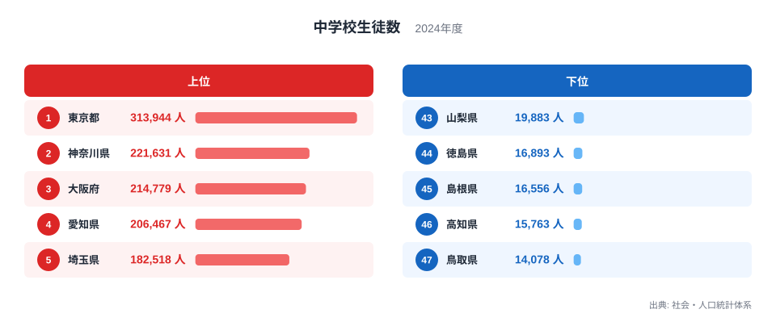
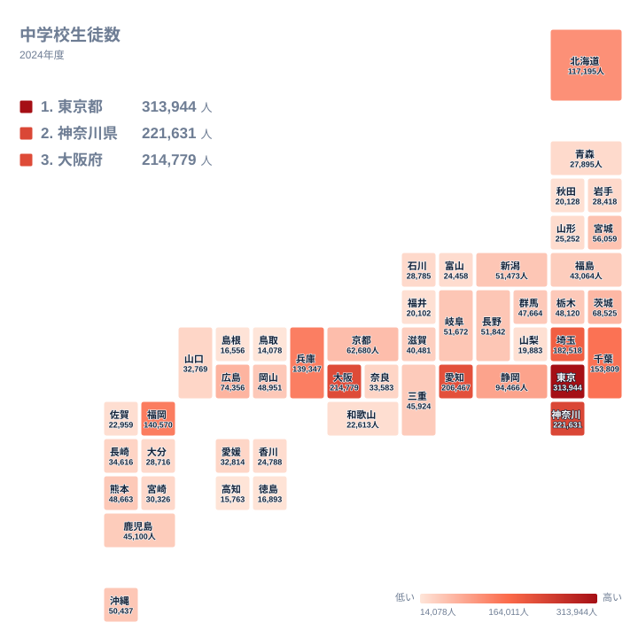

## 中学校生徒数は東京都が1位、鳥取県が47位

2024年の中学校生徒数で1位になったのは東京都で、313,944人です。2位は神奈川県の221,631人、3位は大阪府の214,779人、4位は愛知県の206,467人、5位は埼玉県の182,518人と続きます。

一方、最も少ないのは47位の鳥取県で14,078人です。1位と47位の比はおよそ22倍にあたります。同じ中学校という区分でも、都道府県によって在籍する生徒の規模はこれほど違います。

この記事では、順位と規模の差を実データから整理します。産業や歴史、人口移動のデータは手元にないため、そうした背景については確認できる範囲を超えないよう、仮説として触れるにとどめます。

<source-link href="/ranking/junior-high-school-students-count">中学校生徒数ランキングをもっと見る</source-link>

図の上位5都府県は、東京都、神奈川県、大阪府、愛知県、埼玉県です。所属する地方は、関東が東京都、神奈川県、埼玉県の3つ、近畿が大阪府、中部が愛知県です。5位までの顔ぶれは、1つの地方に偏ってはいません。

下位5県は、鳥取県の14,078人、高知県の15,763人、島根県の16,556人、徳島県の16,893人、山梨県の19,883人です。地方では中国が鳥取県と島根県、四国が高知県と徳島県、中部が山梨県にあたります。

上位の内部にも段差があります。東京都の313,944人と、2位の神奈川県の221,631人とのあいだには、あいだに他県が入らないまま大きな開きがあります。2位の神奈川県から4位の愛知県までは221,631人、214,779人、206,467人と近い水準で並び、東京都だけが抜けています。

> [!NOTE]
> 中学校生徒数は、中学校に在籍する生徒の実数です。出典は「社会・人口統計体系」の2024年の値で、単位は人です。中学生は3学年分の合計なので、1学年あたりの人数ではありません。また、人口に対する割合ではないため、県の人口が大きいほど数字も大きくなります。

## 関東が上位に多く並ぶ理由を探る

上位6位のうち、関東の都県は4つです。東京都が1位、神奈川県が2位、埼玉県が5位、千葉県が6位の153,809人です。間の3位は大阪府、4位は愛知県で、関東以外の大都市圏の県も上位に入っています。

関東の4都県が上位に集まる背景として、人口の集積が大きいことが考えられます。ただし、この記事の指標は生徒数の実数だけで、人口そのものは含みません。ですので、順位の背景は人口規模の差によると推測しつつも、数値で裏づけたものではないことをお断りしておきます。

タイルマップで見ると、色の濃い県は関東から近畿にかけて連なっています。愛知県の206,467人は中部では最大で、中部で次に多いのは10位の静岡県の94,466人です。愛知県の数字は静岡県の2倍を超える水準です。

近畿では、大阪府の214,779人、兵庫県の139,347人、京都府の62,680人と、府県ごとの差がはっきり出ています。兵庫県は8位、京都府は13位です。同じ近畿でも、3つの府県で規模はそろっていません。

> [!TIP]
> 中学生は3学年分の人数なので、この数字は過去3年ほどの出生数の積み重なりを反映しています。順位が近い県どうしでも、学年ごとの人数の偏りで数百人ほど動くことがあります。1位や47位といった端の順位より、中位の細かな順位の差は読みすぎないのがコツです。

## 地方の中核県は中位に並ぶ

福岡県は7位の140,570人で、九州・沖縄では最大です。九州・沖縄では次に、沖縄県が18位の50,437人、熊本県が20位の48,663人、鹿児島県が24位の45,100人と続きます。福岡県と沖縄県のあいだには、順位で11位分、人数で大きな開きがあります。

北海道は9位の117,195人で、北海道・東北では最大です。東北では宮城県が14位の56,059人、福島県が25位の43,064人、岩手県が34位の28,418人、青森県が35位の27,895人、山形県が36位の25,252人、秋田県が41位の20,128人と並びます。

中国では広島県が11位の74,356人、岡山県が19位の48,951人です。同じ中国でも、山口県は30位の32,769人、島根県は45位の16,556人、鳥取県は47位の14,078人と大きく離れています。

関東では、茨城県が12位の68,525人、栃木県が21位の48,120人、群馬県が22位の47,664人です。上位の東京都や神奈川県と比べると、同じ関東でも規模の差が大きいことがわかります。

> [!WARNING]
> この数字は在籍している学校の所在地ごとに集計された値だと考えられますが、国立・私立中学校の生徒が県境をまたいで通学する場合の扱いは、この指標だけでは確認できません。東京都など大都市圏の数字は、通学圏の広さに左右されている可能性があります。

## 下位の県を見ると何がわかるか

下位10県は、中国、四国、中部、近畿、九州・沖縄、北海道・東北にまたがります。具体的には、鳥取県、島根県が中国、高知県、徳島県が四国、山梨県と福井県と富山県が中部、和歌山県が近畿、佐賀県が九州・沖縄、秋田県が北海道・東北です。下位は特定の1地方に集中しているわけではありません。

41位の秋田県は20,128人、42位の福井県は20,102人、43位の山梨県は19,883人で、3県の差は250人ほどにとどまります。この水準では順位が入れ替わりやすく、1つの年の順位だけで県の優劣を語ることはできません。

四国では、愛媛県が29位の32,814人、香川県が37位の24,788人、徳島県が44位の16,893人、高知県が46位の15,763人です。愛媛県と高知県のあいだには、32,814人と15,763人という大きな差があります。

北海道・東北で挙げた県のうち、岩手県、青森県、山形県、秋田県の4県は、いずれも30,000人未満です。一方、福島県は43,064人で、宮城県の56,059人に次ぐ規模にあたります。東北の中でもこれだけ差があります。

## 中位の細かな順位をどう読むか

中位は差が小さく、順位が入れ替わりやすい層です。長野県は15位の51,842人、岐阜県は16位の51,672人、新潟県は17位の51,473人で、3県の差は400人にも届きません。続く沖縄県の50,437人、岡山県の48,951人も近い水準です。

栃木県は21位の48,120人、群馬県は22位の47,664人です。差は数百人で、年が変われば順位が入れ替わっても不思議ではありません。中位の順位は、固定的なものとして捉えないことが大切です。

他の指標と組み合わせて地域の姿を知りたいときは、[東京都のデータ](/areas/13000)や[神奈川県のデータ](/areas/14000)が役立ちます。教育や暮らしに関する別の指標は、[同じカテゴリの統計一覧](/category/educationsports)から探せます。

## データについて

使用した指標は「中学校生徒数」で、出典は社会・人口統計体系、年は2024年、単位は人です。全47都道府県の実数をそのまま並べており、本文の順位は多い順に並べたものです。1位と47位の比は、東京都の313,944人と鳥取県の14,078人から求めています。

人口が多い県ほど数字が大きくなる実数の指標なので、県同士の教育の充実度や子育てのしやすさを直接比べるものではありません。地域の姿を知る入口として使い、他の統計と合わせて読むことをおすすめします。
