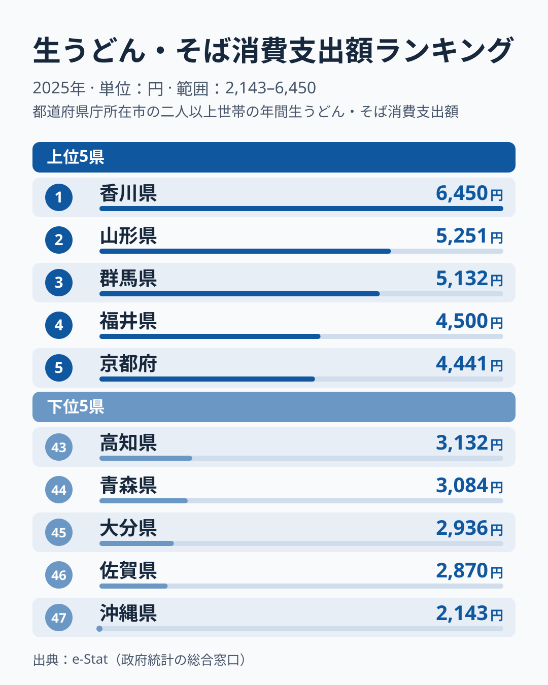
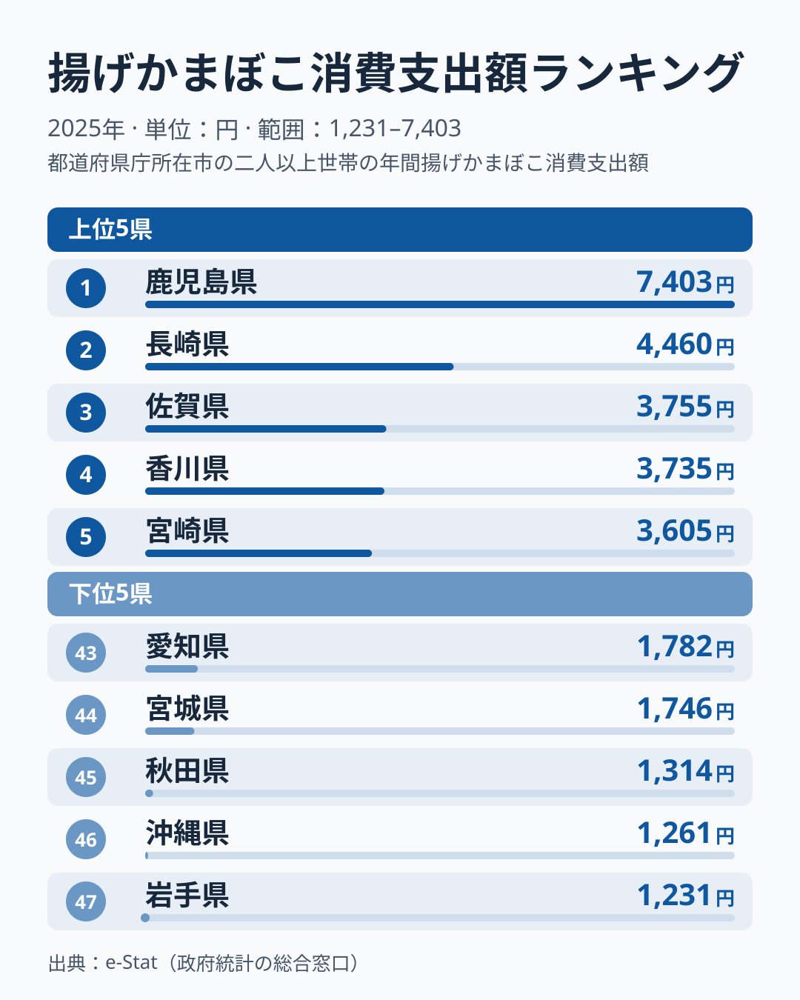
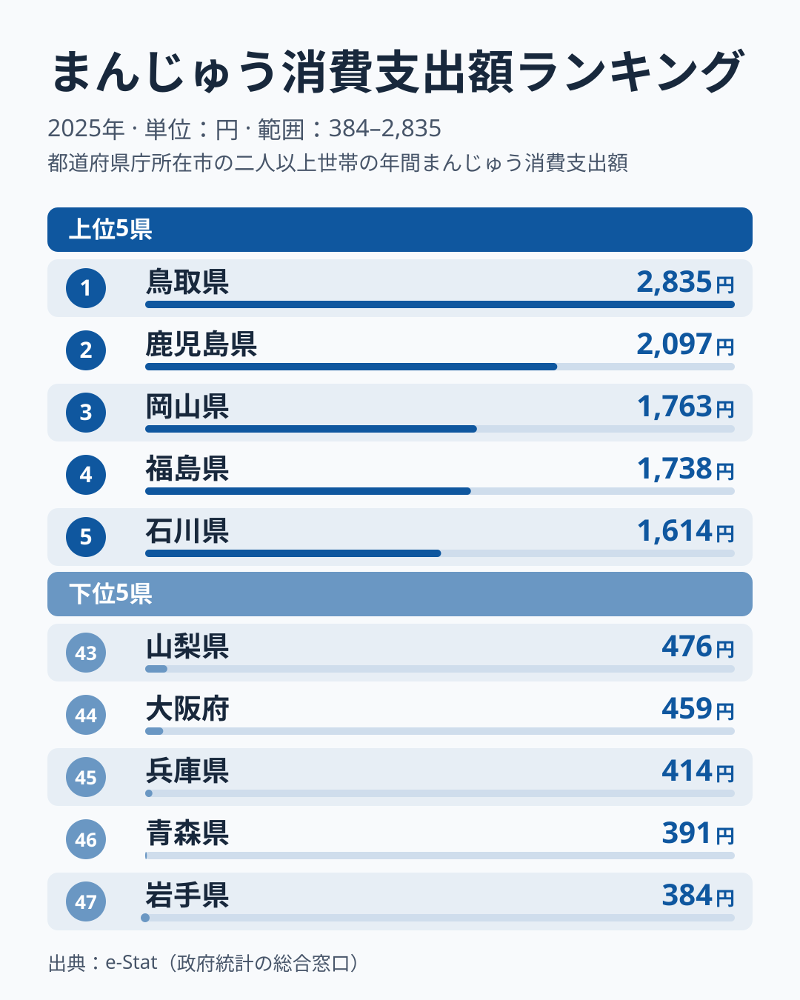
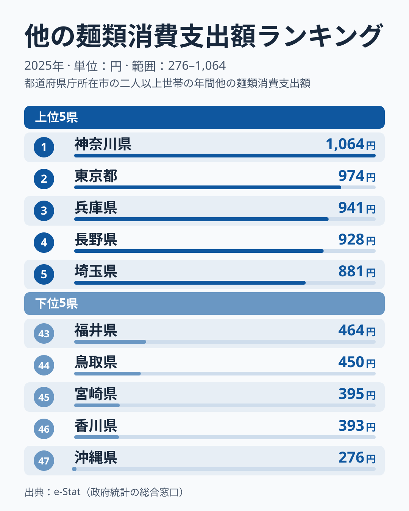
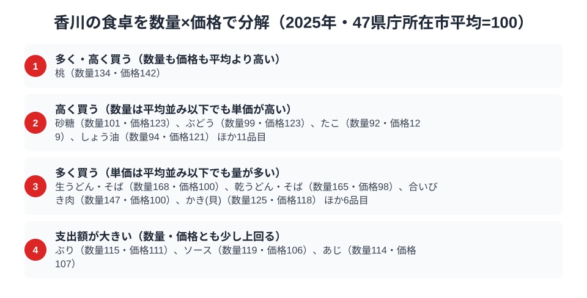

香川県は「うどん県」を公式に名乗る唯一の都道府県です。総務省の家計調査で生うどん・そばへの支出額を見ると、香川県は年間6,450円と全国1位。2位の山形県は5,251円で、香川県が大きく先行しています。

ところが同じ家計調査には、もう一つ気になる数字があります。「他の麺類」への支出は年間393円で、全国46位です。この区分は、そうめん・冷や麦などが中心の残余区分で、中華麺・カップ麺・即席麺・パスタは別品目として集計されます。つまり麺類全般の数字ではありません。生うどん・そばに6,450円を使う県が、この区分には393円しか使っていない、という対照が見えます。この記事では、香川県の家計調査データから見える食卓の特徴を、揚げかまぼこ・まんじゅうという2つの上位品目とあわせて読み解きます。

> [!NOTE]
> 本記事の数値は総務省統計局「家計調査（品目別）」の**都道府県庁所在市・二人以上世帯**における年間支出額（2025年）です。香川県は高松市のデータが対象になります。消費量ではなく金額ベースの統計である点にご注意ください。

## 生うどん・そば消費支出額 — 全国1位6,450円、2位の山形県を上回る

<source-link href="/ranking/fresh-udon-soba-consumption-expenditure">生うどん・そば消費支出額ランキングをもっと見る</source-link>

香川県の生うどん・そば消費支出額は6,450円で全国1位です。2位は山形県で5,251円、3位は群馬県で5,132円と、香川県が上位を大きく引き離しています。最下位は沖縄県で2,143円、香川県との差は3.0倍にのぼります。

香川県は讃岐うどんの本場として知られ、生麺タイプのうどんを買いやすい環境が支出額を押し上げている可能性があります（[仮説]）。山形県・群馬県・福井県・京都府と続く上位の県にも、麺類消費に地域の食文化が反映されているかもしれません（[仮説]）。ただし、家計調査の市別の値は単年のぶれが大きいため、複数年の推移で確かめる必要があります。

## 揚げかまぼこ消費支出額 — 全国4位3,735円、九州勢に続く位置

<source-link href="/ranking/deep-fried-fish-cake-consumption-expenditure">揚げかまぼこ消費支出額ランキングをもっと見る</source-link>

揚げかまぼこの消費支出額では、香川県は3,735円で全国4位です。1位は鹿児島県で7,403円、2位は長崎県で4,460円、3位は佐賀県で3,755円と続き、5位は宮崎県で3,605円です。上位5県のうち香川県以外の4県は九州の県で、香川県が四国から食い込んでいます。3位の佐賀県とは20円差で、香川県は上位の九州勢のすぐ後ろにつけています。一方、1位の鹿児島県の7,403円は、2位以下と比べても突出した値です。

香川県は瀬戸内海に面しており、魚を使った練り物が食卓に並びやすい土地柄である可能性があります。うどんと一緒に揚げかまぼこなどの練り物を食べる習慣が支出額に反映されているのかもしれません（[仮説]）。九州の県が上位に並ぶ点については、海に面した西日本の魚食文化の広がりが背景にあるとも考えられますが（[仮説]）、この記事のデータだけでは確かめられません。

## まんじゅう消費支出額 — 全国6位1,585円、3位から6位は僅差

<source-link href="/ranking/manju-consumption-expenditure">まんじゅう消費支出額ランキングをもっと見る</source-link>

まんじゅうの消費支出額は1,585円で全国6位です。1位は鳥取県で2,835円、2位は鹿児島県で2,097円と、上位2県が抜けています。一方、3位の岡山県は1,763円、4位の福島県は1,738円、5位の石川県は1,614円で、香川県との差は小さく、3位から6位までは1,585円から1,763円の範囲に集まる混戦です。

香川県は和三盆をはじめとする和菓子で知られる県です。和菓子を買う機会の多さがまんじゅうの支出額に表れている可能性はありますが、このデータだけで理由を確かめることはできません（[仮説]）。順位は単年のぶれの影響も受けるため、6位という位置は「上位グループにいる」程度に受け止めるのが適切です。

## 他の麺類消費支出額 — 全国46位393円、残余区分の読み方

<source-link href="/ranking/other-noodles-consumption-expenditure">他の麺類消費支出額ランキングをもっと見る</source-link>

「他の麺類」はそうめん・冷や麦などが中心の残余区分で、中華麺・カップ麺・即席麺・パスタは別品目として集計されます。この区分で香川県は393円、全国46位です。1位の神奈川県は1,064円、47位の沖縄県は276円で、香川県は沖縄県に次いで低い水準です。

生うどん・そばが全国1位である一方、この区分が下位にあることから、香川県の家庭では生うどん・そばに比べてそうめん・冷や麦などの支出が少ない、という対照が読み取れます。ただし、この順位から麺類全体の傾向を言うことはできません。理由としては、麺類への支出がうどんに向いているためという見方もありますが、あくまで [仮説] で、このデータだけでは検証できません。上位に神奈川県・東京都・兵庫県・長野県・埼玉県が並ぶ背景についても、データからは説明できません。

> [!WARNING]
> 讃岐うどんの外食（うどん店での飲食）は別品目「そば・うどん外食」に分類され、本記事の数値には含まれていません。店で食べるうどんの量は、ここでの支出額に反映されない点にご注意ください。

## 香川の食卓から読めること

4つのデータを並べると、香川県は複数の品目で上位に入っています。生うどん・そばは全国1位です。揚げかまぼこは4位、まんじゅうは6位です。一方、残余区分の「他の麺類」は46位です。生うどん・そばの突出と、この区分の低さとの対照が、香川県の家計調査の特徴といえます。

ただし、金額データから言えるのは支出額の高低までです。うどんが食生活の中心にあると断定する材料は、この記事のデータにはありません。隣県の[徳島の食卓](/blog/tokushima-food-culture)と読み比べると、県ごとの強みの違いが見えてきます。

> [!TIP]
> 「他の麺類」は、中華麺・カップ麺・即席麺・パスタを含まない残余区分です。この順位だけで「麺類全般の消費が少ない」とは言えません。ランキングを読むときは、品目の定義がどこまでを含むかをまず確認してください。

## 数量×価格で分解する高松市の食卓

<source-link href="/ranking/fresh-udon-soba-consumption-quantity">生うどん・そば消費量ランキングをもっと見る</source-link>

支出額は「数量×単価」に分解できます。47都道府県庁所在市の平均を100とした数量指数・価格指数を高松市について見ると、生うどん・そばは数量指数168と平均を大きく上回って買われている一方、価格指数は100とちょうど平均並みです。支出額が全国1位になっている主因は、単価の高さではなく買う量の多さだとわかります。

乾うどん・そばも同じ構造です。数量指数は165と平均を大きく上回る一方、価格指数は98と平均並みからやや下にとどまります。生麺でも乾麺でも、高松市の家庭は量で支出額を押し上げています。

なお、桃のように数量・価格とも平均を上回る品目や、砂糖・ぶどう・たこ・しょう油のように単価が高い品目もありますが、うどんの話とは別の論点のため、ここでは触れません。また、「他の麺類」の数量指数・価格指数は今回の図に含まれていないため、順位が低い理由が量の少なさなのか単価なのかは、このデータでは確かめられません。

> [!NOTE]
> ここでの指数は家計調査の全国値ではなく、47都道府県庁所在市（高松市を含む）の単純平均を100とした相対値です。価格指数には産地・ブランド・パッケージサイズの違いによる差も含まれており、品質の高さを直接示すものではありません。対象は二人以上世帯の年間データ（2025年）です。

## まとめ

- 生うどん・そば消費支出額は6,450円で全国1位、2位の山形県は5,251円
- 揚げかまぼこは3,735円で全国4位、1位は鹿児島県の7,403円
- まんじゅうは1,585円で全国6位、1位は鳥取県の2,835円
- 「他の麺類」（そうめん・冷や麦などの残余区分）は393円で全国46位。麺類全般の傾向ではなく、この区分に限った結果

香川県の家計データをさらに詳しく見たい方は、[香川県の地域プロフィール](/areas/37000)や[経済カテゴリ一覧](/category/economy)もあわせてご覧ください。
