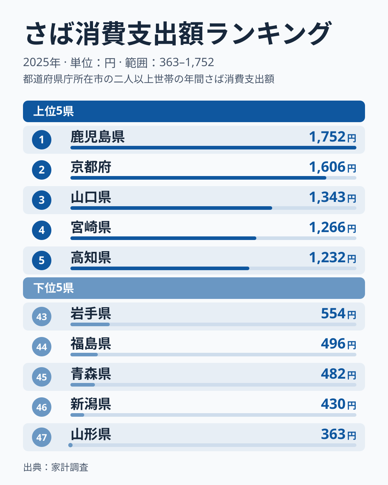
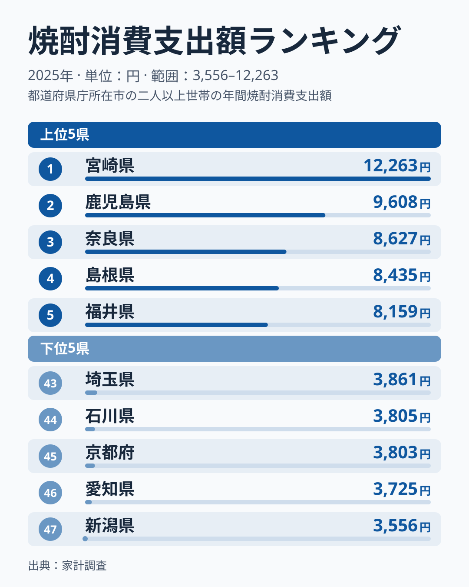
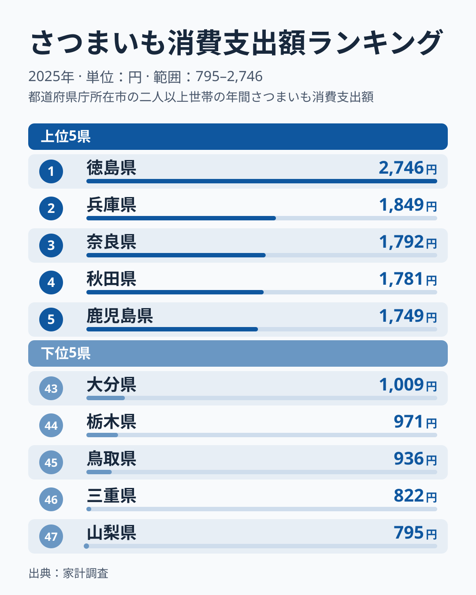
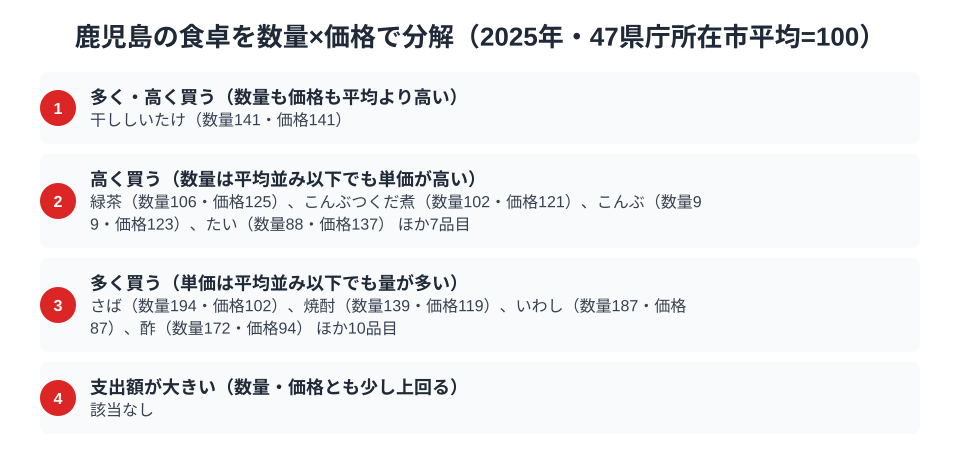

鹿児島県の食卓を家計調査で見ると、意外な形が浮かび上がります。さば消費支出額は1,752円で全国1位です。ところが「鹿児島といえば」の代表格である焼酎は9,608円で、全国1位は宮崎県の12,263円で、鹿児島はそれに次ぐ2位です。さつまいもは1,749円で、全国1位は徳島県の2,746円で、鹿児島は5位にとどまります。

つまり鹿児島の食卓は「首位のさば」と「首位に届かない焼酎・さつまいも」が同居しています。全国的な名産イメージが強い焼酎とさつまいもで、なぜ隣接県や徳島県に首位を譲るのか。逆に、さばのようにイメージの薄い魚が、なぜ全国トップの支出額を記録するのか。総務省の家計調査（品目別）から、さば・焼酎・さつまいもという3つの品目を横断しながら、鹿児島の食卓の輪郭を読み解きます。

> [!NOTE]
> この記事のデータは総務省統計局「家計調査（品目別）」に基づく、都道府県庁所在市（鹿児島市）における二人以上世帯の2025年（暦年）の年間消費支出額です。世帯単位の金額であり、消費量そのものではありません。県全体の値ではなく、単年の順位はぶれも大きい点に注意してください。

## さば — 全国1位1,752円、なぜ鹿児島が「さば県」なのか

<source-link href="/ranking/mackerel-consumption-expenditure">さば消費支出額ランキングをもっと見る</source-link>

鹿児島市の二人以上世帯は、さばに年間1,752円を支出しており、これは全国1位です。2位は京都府で1,606円、3位は山口県で1,343円と続きますが、鹿児島は首位を保っています。最下位は山形県の363円で、鹿児島との差は4.8倍にのぼります。

上位の並びを見ると、2位の京都府、3位の山口県に続いて、4位には隣県の宮崎県が1,266円で、5位には高知県が1,232円で入っています。九州南部と、日本海側・太平洋側の別の地域が混在しており、産地の近さだけでは並びを説明できません。鹿児島が首位に立つ背景として、東シナ海に面した漁場の近さが日常の購入につながっている可能性があります［仮説］。この調査から分かるのは購入額までで、漁獲量や流通経路は確かめられないため、検証には水産統計など別の資料が必要です。

## 焼酎 — 全国2位9,608円、なぜ全国1位・宮崎県の12,263円に届かないのか

<source-link href="/ranking/shochu-consumption-expenditure">焼酎消費支出額ランキングをもっと見る</source-link>

鹿児島は焼酎に年間9,608円を支出し、全国2位です。全国1位は宮崎県の12,263円で、その差は2,655円。3位は奈良県の8,627円で、鹿児島はこれを上回っています。最下位は新潟県の3,556円で、鹿児島との差は3倍に迫ります。

鹿児島は芋焼酎の本場として知られ、9,608円で全国2位と知名度に見合う結果です。それでも全国1位の宮崎県には2,655円届きません。この差が「量の差」か「単価の差」かは、同じ家計調査の焼酎消費量で確かめられます。2025年の焼酎消費量は宮崎県が16,378mlで全国1位、鹿児島県は10,443mlで7位です。支出額を消費量で割った1ml当たりの支出は、宮崎県が約0.75円、鹿児島県が約0.92円で、単価はむしろ鹿児島のほうが高くなっています。

<source-link href="/ranking/shochu-consumption-quantity">焼酎消費量ランキングをもっと見る</source-link>

つまり鹿児島が宮崎に届かないのは、単価の差ではなく、購入する量の差です。鹿児島の消費量は宮崎の約64％にとどまります。なぜ宮崎の家庭で焼酎の量が多いのかは、この調査だけでは確かめられません。3位以下には奈良県・島根県・福井県が並び、南九州以外にも広がっているため、焼酎の支出は産地の近さだけでは説明できないと読めます。

## さつまいも — 全国5位1,749円、全国1位・徳島県の2,746円とは大きな開き

<source-link href="/ranking/sweet-potato-consumption-expenditure">さつまいも消費支出額ランキングをもっと見る</source-link>

さつまいもの消費支出額は1,749円で全国5位です。全国1位の徳島県は2,746円で、その差は997円あります。2位は兵庫県の1,849円、3位は奈良県の1,792円、4位は秋田県の1,781円で、鹿児島はこれらに僅差で続いています。最下位は山梨県の795円で、鹿児島との差は2.2倍です。

鹿児島県はさつまいもの大産地として知られ、名前の由来も鹿児島（薩摩）にあるとされるほど、地域と結びつきの強い作物です。それでも支出額で上位に届かないのは、鹿児島では収穫したさつまいもの多くが焼酎の原料や自家消費・贈答用に回り、店頭での購入という「家計支出」として計上されにくい構造があるためと考えられます［仮説］。産地であることと、家計調査上の購入額の順位は必ずしも一致しません。

> [!WARNING]
> 家計調査の支出額は「購入した金額」であり、消費量そのものではありません。自家栽培・贈答・県外出荷分は集計に含まれないため、鹿児島のように焼酎・さつまいもの産地として知られていても、家計の購入額としては他県に届かないケースがあります。

## 鹿児島の食卓を貫くもの

さば・焼酎・さつまいもという3品目を通して見えるのは、「生産地であること」と「家計での購入額が全国1位になること」は別軸だという点です。さばは産地と食卓が近く直接消費に結びつきやすい一方、焼酎とさつまいもは加工・出荷・贈答という別の流通経路を持つため、産地としての実力がそのまま家計支出の首位には表れないのかもしれません［仮説］。鹿児島の食卓は「産地の強さ」と「日常の購入行動」がずれる、南九州らしい二重構造を持っています。

同じ南九州でも[宮崎の食卓](/blog/miyazaki-food-culture)は焼酎で全国1位を守りながら、ほたて貝では501円で36位と下位寄りという別の対比を見せています。焼酎という同じ品目でも、隣県同士でトップと2位が分かれる点は比較する価値があります。

> [!TIP]
> 焼酎・さつまいものように「産地としてのイメージが強いのに支出額では首位に届かない」品目は、生産量の統計と家計調査の購入額を見比べると、地域内消費と県外出荷のバランスを読み解くヒントになります。ただし本稿は家計調査だけを使っており、生産量との照合は行っていません。

## 数量×価格で分解する鹿児島市の食卓

<source-link href="/ranking/mackerel-consumption-quantity">さば消費量ランキングをもっと見る</source-link>

家計調査の支出額は「数量×単価」に分解できます。47都道府県庁所在市の平均を100とした指数で見ると、2025年はさばの数量が194・価格が102、焼酎の数量が139・価格が119です。さばは数量が平均を大きく上回る一方、価格はほぼ平均並みです。つまりさばの支出額の高さは「高いものを買っている」からではなく「たくさん買っている」ことに由来しています。

一方、干ししいたけは数量141・価格141で、数量・価格とも指数120を超える唯一の品目です。緑茶（数量106・価格125）は量が平均並みでも単価が高く、支出額を押し上げるタイプです。

「多く買う」型のさばやいわし（数量187・価格87）は、地元で魚が手に入りやすいことと整合する可能性があります［仮説］。ただし産地であることと単価の低さは結びつきません。大産地として知られる緑茶は価格125、干ししいたけは141と、単価が高い側に入っています。焼酎は数量139・価格119で、量が多いうえに単価もやや高い形です。宮崎県は数量217・価格97なので、鹿児島との差は単価ではなく量にあり、前節の消費量の比較と同じ結論になります。

> [!NOTE]
> 数量指数・価格指数は「47都道府県庁所在市（鹿児島市を含む）の単純平均を100」とした値で、家計調査が公表する全国平均そのものではありません。二人以上世帯・鹿児島市における年間の購入量と支出額から算出しており、価格指数には品種やブランドによる単価差も含まれます。

さばやいわしのように「数量指数は高いが価格指数は平均並み以下」な品目は、少なくとも高価格帯に偏らず量で支出額を押し上げています。逆に緑茶やたいのように価格指数だけが平均を上回る品目は、量より単価の高さで支出額を押し上げていると読み解けます。

## まとめ

- 産地としての知名度と家計の購入額の順位は別物で、鹿児島ではさばが全国1位、焼酎が2位、さつまいもが5位と、品目ごとに結果が分かれます
- 焼酎が宮崎に届かない差は、単価ではなく購入量の差です（消費量は宮崎16,378ml、鹿児島10,443ml）
- さつまいもは全国1位の徳島県と997円の差があり、産地と店頭での購入額は一致しません
- 産地の強さと日常の購入行動がずれる二重構造がうかがえます［仮説］

鹿児島県の地域プロフィールは[鹿児島県のページ](/areas/46000)で確認できます。家計に関する他の指標は[経済カテゴリ一覧](/category/economy)からまとめて見られます。
