「消費量日本一」の都市は、毎年入れ替わるのでしょうか。総務省「家計調査」の食料の個別品目（外食と酒類の品目を含みます）について、47の県庁所在市（東京都は区部）の中で2007年から2025年までを調べると、前の年と別の都市が1位になった品目は各年の平均で支出額の56.4%、購入数量の63.8%でした。19年の間に1位になった都市が3都市以上に分かれた品目は、支出額で203品目中162品目の79.8%、購入数量で122品目中109品目の89.3%です。19年間ずっと同じ都市が1位だったのは、支出額で18品目、購入数量で6品目にとどまります。つまり「日本一」は大半の品目で動き、ごく一部の品目でだけ固定しています。以下、品目と数えるのは支出額と購入数量それぞれの指標です。

では、1年の値ではなく3年平均で順位をつけると安定するのでしょうか。食料の支出額では、単年の1位が3年後にも同じ都市である割合は39.7%、3年平均の1位が3年後にも同じ都市である割合は56.5%でした。3年平均にすると続きやすくなりますが、半分強にとどまります。この記事では、品目全体を横断して入れ替わりを数え、何が入れ替わりを決めるのか、単年と3年平均で何が食い違うのかを順に確かめます。そのうえで、ぎょうざ、納豆、食パン、米、うどん、中華そば、チョコレートで、1位と2位の差が揺れの範囲に収まっているかを具体的に見ます。

## この記事の数え方

数え方を先に決めておきます。値は家計調査の二人以上の世帯で、47都道府県の県庁所在市の1世帯あたり年間の値です。東京都は東京都区部の値で、都道府県全体の値ではありません。以下の都市名はすべて市の値を指します。総務省統計局の「家計調査 調査の概要」（2026年11月9日確認）によると、県庁所在市と政令指定都市の52市で二人以上の調査世帯数は合計5,472世帯でした。1市あたりにならすと約105世帯です。1つの品目を1年のうちに買った世帯の数は、これより少ないと考えられ、単年の順位は標本の入れ替わりの影響を受けやすいと考えられます。標本の揺れの大きさはこのデータからは測れません。

購入数量については、同じページに注意すべき記述があります。2002年1月から、二人以上の世帯では食料品の重量の調査を調査開始から1か月間だけ行う方法に変わったとされています。購入数量の年間の値が、この1か月分の記録から作られているのかどうかは、確かめていません。ただ、入れ替わりの割合は購入数量のほうが高く出ており、これが関係している可能性があります。[仮説] 重量を測る期間が短いと、標本の揺れが大きくなって1位が入れ替わりやすくなります。検証するには、期間別の標本の値が必要で、この記事では確かめられません。

品目は家計調査の分類コードの末尾が000でなく、合算でもない個別品目です。食料の支出額203品目、購入数量122品目を主な対象とし、比較のために食料以外の支出額247品目、購入数量54品目も数えています。1位は各年で値が最大の都市で、同額で並んだ年は並んだ都市すべてを数え、購入した世帯がなく値が0の年は欠測として順位の対象から外しました。詳しくは最後の「データについて」にまとめています。

## 19年で1位になった都市の数

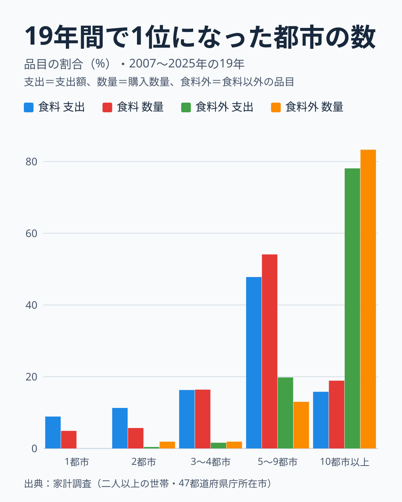

食料の支出額203品目で、19年間に1位になった都市の数の中央値は6都市でした。分布を見ると、1都市だけの品目が18品目で8.9%、2都市が23品目で11.3%、3〜4都市が33品目で16.3%、5〜9都市が97品目で47.8%、10都市以上が32品目で15.8%です。購入数量は122品目で、1都市が6品目の4.9%、2都市が7品目の5.7%、3〜4都市が20品目の16.4%、5〜9都市が66品目の54.1%、10都市以上が23品目の18.9%でした。支出額と購入数量は別の指標なので、同じ品目でも別々に数えています。

比べると、食料以外の品目はさらに入れ替わります。食料以外の支出額247品目では、10都市以上に分かれた品目が193品目の78.1%、購入数量54品目では45品目の83.3%で、1都市だけの品目は1つもありません。[仮説] 住宅設備や家具のように数年に一度しか買わない品目は、調査に当たった世帯の買い方次第で1位が偶然に決まりやすく、入れ替わりが大きくなる可能性があります。このデータには購入頻度や調査世帯数が含まれないため、確かめられません。確かなのは、食べ物のほうが「毎年同じ都市が日本一」になりやすいという点です。

> [!NOTE]
> 同額で並んだ年は、並んだ都市をすべて1位として数えています。そうした年がある品目は、食料の支出額で6品目、購入数量で5品目ありました。また、標本に購入した世帯がなく値が0になる年は欠測として扱い、順位の対象から外しています。

## 19年ずっと同じ都市が1位の食品

では、動かない品目には何があるのでしょうか。19年間1位が1都市に固定していたのは、支出額では、かつおの高知市、にんじんの那覇市、カステラの長崎市、揚げかまぼこの鹿児島市、魚介の缶詰の那覇市、かまぼこの仙台市、生うどん・そばの高松市、しじみの松江市、油揚げ・がんもどきの福井市、さやまめの新潟市、かつお節・削り節の那覇市、こんにゃくの山形市、他の加工肉の那覇市、梨の鳥取市、ほたて貝の青森市、日本そば・うどんの高松市、さつまいもの徳島市、まぐろの静岡市の18品目です。購入数量では、かつおの高知市、生うどん・そばの高松市、しじみの松江市、かつお節・削り節の那覇市、ほたて貝の青森市、まぐろの静岡市の6品目で、すべて支出額でも固定していた品目です。

この18品目を分野で見ると、魚介類が8品目、野菜・海藻が5品目で、穀類、肉類、果物、菓子類、外食がそれぞれ1品目です。固定する品目の中心は魚介と、産地や食文化と結びつきやすい品目でした。[仮説] 高松市のうどんや高知市のかつおのように、地域の食文化や産地と結びついている品目では、他の都市が追い付きにくいのかもしれません。ただし、このデータには産地や店舗の情報が含まれず、食文化の影響は測れていません。この記事で確かめられるのは、どの品目が固定しているか、そして次に見るように、固定している品目では1位と2位の差が大きいということです。

## 固定する食品は1位と2位の差が大きい

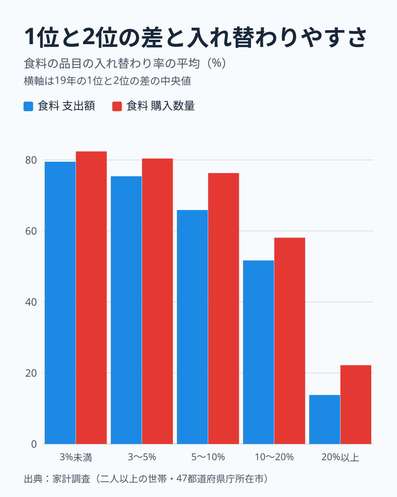

固定する品目と動く品目の違いを、1位と2位の差で見ます。各年の1位の値を2位の値で割って1を引いた差を求め、品目ごとに19年の中央値を取りました。そのうえで、差の大きさで品目を5つに分け、2008年から2025年までの18回の前年との比較で別の都市が1位になった割合（入れ替わり率）の平均を出したのが上の図です。食料の支出額では、差が3%未満の19品目の入れ替わり率は79.5%、3〜5%の53品目は75.4%、5〜10%の51品目は65.9%、10〜20%の39品目は51.7%、20%以上の41品目は13.8%でした。購入数量では、差が3%未満の12品目が82.4%、3〜5%の23品目が80.4%、5〜10%の37品目が76.3%、10〜20%の28品目が58.1%、20%以上の22品目が22.2%です。

差が大きいほど入れ替わらない関係は、品目単位の順位相関でも確かめられ、支出額で−0.71、購入数量で−0.70でした。固定した18品目の差の中央値は49.1%、10都市以上に分かれた32品目は4.7%で、購入数量では固定した6品目が109.5%、10都市以上の23品目が5.6%です。固定かどうかで品目を分けた比較なので、差が大きい品目ほど逆転しにくいのは、ある意味で当然の裏返しです。それでも、差が10〜20%の品目で入れ替わり率が半分前後、5〜10%の品目で3分の2前後という段階的な変化は、1位の入れ替わりが差の大きさでおおむね説明できることを示しています。購入数量の固定は6品目しかなく、その中央値は品目の少なさにも左右されます。

差を揺れの目安と比べることもできます。揺れの目安として、品目ごとに47市すべての前年比の絶対値の中央値を使います。これは実際の増減も含むため、標本の揺れだけを測った値ではありません。食料の支出額では、1位と2位の差の中央値がこの前年比の変動の中央値を下回る品目が144品目あり、入れ替わり率の平均は71.5%でした。差が変動を上回る59品目では19.5%です。購入数量では、下回る90品目が75.7%、上回る32品目が30.2%でした。1位と2位の差が、市の値が1年で動く幅より小さい品目では、年ごとに1位が入れ替わるのが普通だと読めます。

## 分野で入れ替わりやすさは違う

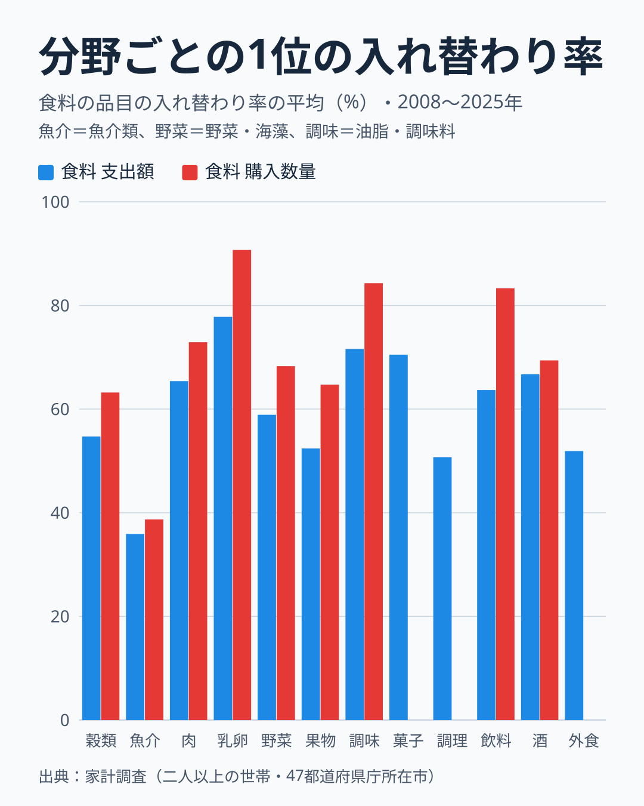

食料を品目分類コードの上4桁で12分野に分けて、入れ替わり率の平均を比べます。際立つのは魚介類で、支出額35品目の平均が35.9%、購入数量27品目が38.7%と、他の分野より20ポイント近く低くなっています。調理食品の支出額50.7%、外食の支出額51.9%、果物の支出額52.4%、穀類の支出額54.7%がそれに続きます。逆に高いのは、乳卵類の支出額77.8%（5品目）と購入数量90.7%（3品目）、油脂・調味料の支出額71.6%と購入数量84.3%、菓子類の支出額70.5%です。飲料の購入数量も83.3%ですが、4品目しかないため参考値です。

分野ごとの1位と2位の差の中央値を見ると、おおむね同じ傾向が出ます。魚介類は支出額で18.3%、購入数量で17.1%と大きく、果物の支出額も18.9%です。肉類は4.5%と3.2%、油脂・調味料は4.4%と5.6%、乳卵類は5.3%と3.3%と小さくなります。魚介や果物は産地が地域に偏りやすく、肉や調味料、乳卵は全国で似た買い方をする品目が多いため、差がつきにくいのだと考えられます。[仮説] この解釈は産地や流通のデータでは確かめていません。ここで言えるのは、1位が入れ替わりやすいかどうかが分野によって大きく違い、魚介類のように固定しやすい分野と、肉や調味料、乳卵のように動きやすい分野があるという点です。

## 単年の1位と3年平均の1位

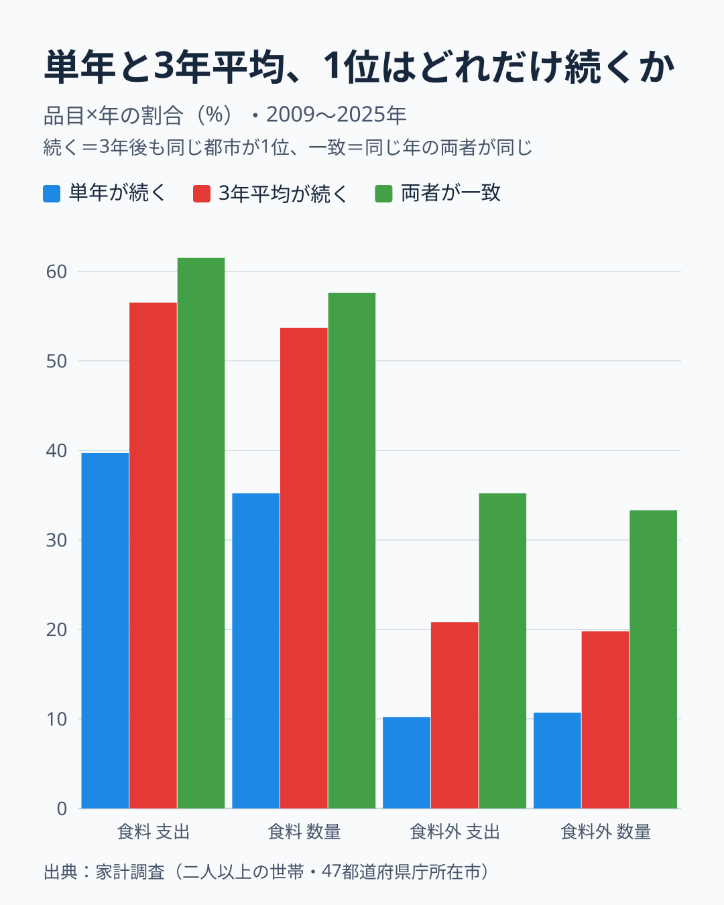

次に、1年の値で決めた1位と、3年平均で決めた1位を比べます。ここでの3年平均は、各年とその前2年の値を単純に平均したもので、3年とも購入世帯のある都市だけを順位の対象にしました。3年後との比較は2009年から2022年の各年について、単年の1位が3年後も同じか、3年平均の1位が3年後も同じかを数えています。3年平均の窓は3年後のものとは重ならないので、同じ標本が両方に入ることはありません。

食料の支出額203品目では、単年の1位が3年後も同じ都市だった割合は2842組のうち39.7%、3年平均の1位が3年後も同じだった割合は56.5%でした。購入数量122品目では35.2%と53.7%です。3年平均にすると、続く割合が支出額で16.8ポイント、購入数量で18.5ポイント高くなります。一方で、同じ年を終点とする単年の1位と3年平均の1位が一致した割合は、支出額で61.5%、購入数量で57.6%でした。食料以外は、単年の1位が続く割合が支出額で10.2%、購入数量で10.7%、3年平均でも20.8%と19.8%にとどまります。3年平均は入れ替わりを和らげますが、品目と年の組で見て、3年後も同じ都市が1位なのは半分強にとどまります。

> [!WARNING]
> 総務省統計局が公表している品目別ランキングは、県庁所在市に川崎市、相模原市、浜松市、堺市、北九州市の5市を加えた52市の2023年〜2025年平均です。この記事は47の県庁所在市だけで順位をつけているため、ここでの順位は公式の順位と一致するとは限りません。ここでの3位は、52市の中では3位から8位のどこかになります。

総務省統計局の同ページは、品目ごとの地域差を明らかにするために、2023年〜2025年平均のランキングを集計したと説明しています。単年のランキングではなく3年平均で公表している理由までは、公式ページでは確認できません。そのため、3年平均の公表が標本の揺れを和らげる意図を持つのかどうかは、ここでは断定しません。確認できたのは、公式が公表する順位が3年平均であり、この記事のデータで見ても3年平均のほうが1位が続きやすいということです。

## 3年平均の1位は、単年でも1位だったのか

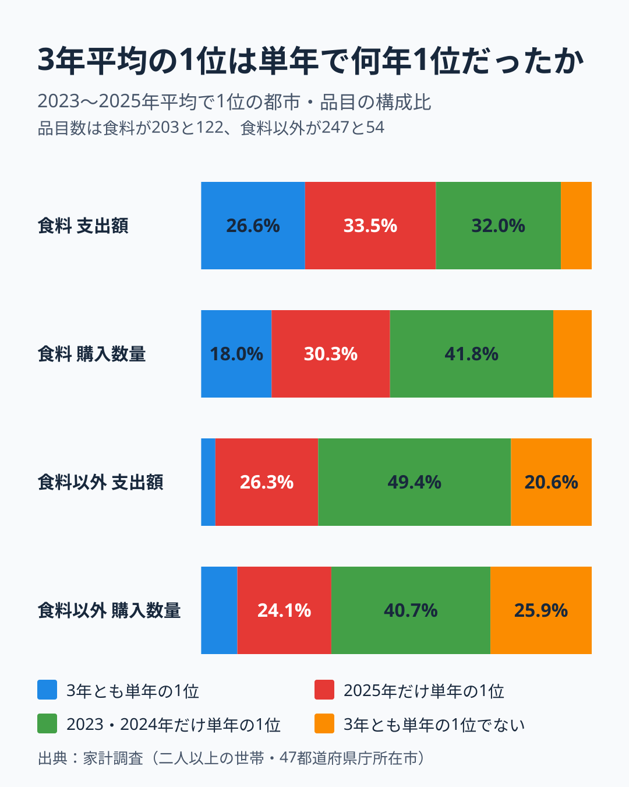

2023〜2025年の3年平均で1位になった都市が、実際に単年でも1位だったかを数えます。食料の支出額では、3年とも単年の1位だった品目が54品目の26.6%、2025年だけ単年の1位だった品目が68品目の33.5%、2023年か2024年にだけ単年の1位だった品目が65品目の32.0%、3年とも単年の1位でなかった品目が16品目の7.9%でした。購入数量では、順に22品目の18.0%、37品目の30.3%、51品目の41.8%、12品目の9.8%です。食料以外は、支出額で3年とも単年の1位だった品目が9品目の3.6%しかなく、2023年か2024年にだけが122品目の49.4%、3年とも単年の1位でなかった品目が51品目の20.6%でした。購入数量も5品目の9.3%、22品目の40.7%、14品目の25.9%です。

3年とも単年の1位だった品目だけが、3年平均でも単年でも同じ都市が1位と言える品目です。食料の支出額で26.6%、購入数量で18.0%ですから、「日本一」と言い切れる品目は思ったより少ないと言えます。さらに、3年平均で1位でも、3年とも単年の1位でなかった品目が食料の支出額に16品目、購入数量に12品目あります。この場合、3年平均の1位は、どの年にも単年の1位にならないまま、安定して2位や3位に入ることで平均を押し上げた都市です。

単年の1位と3年平均の1位が食い違う品目は、2025年で見ると食料の支出額で81品目の39.9%、購入数量で63品目の51.6%でした。食い違った品目で、2025年の単年の1位が3年平均では何位だったかを見ると、支出額では2位が28品目、3位が24品目、4位以下が29品目、購入数量では2位が19品目、3位が16品目、4位以下が28品目です。つまり、食い違った品目のおよそ3分の1は、単年の1位が3年平均でも2位に入っていますが、およそ3分の1は4位以下まで下がっています。具体例では、ぎょうざの2025年の単年の1位は宇都宮市ですが、3年平均では宮崎市が1位です。じゃがいもの購入数量は、2025年の単年の1位が長崎市で、3年平均の1位は新潟市でした。

## 2位以下の順位はもっと動く

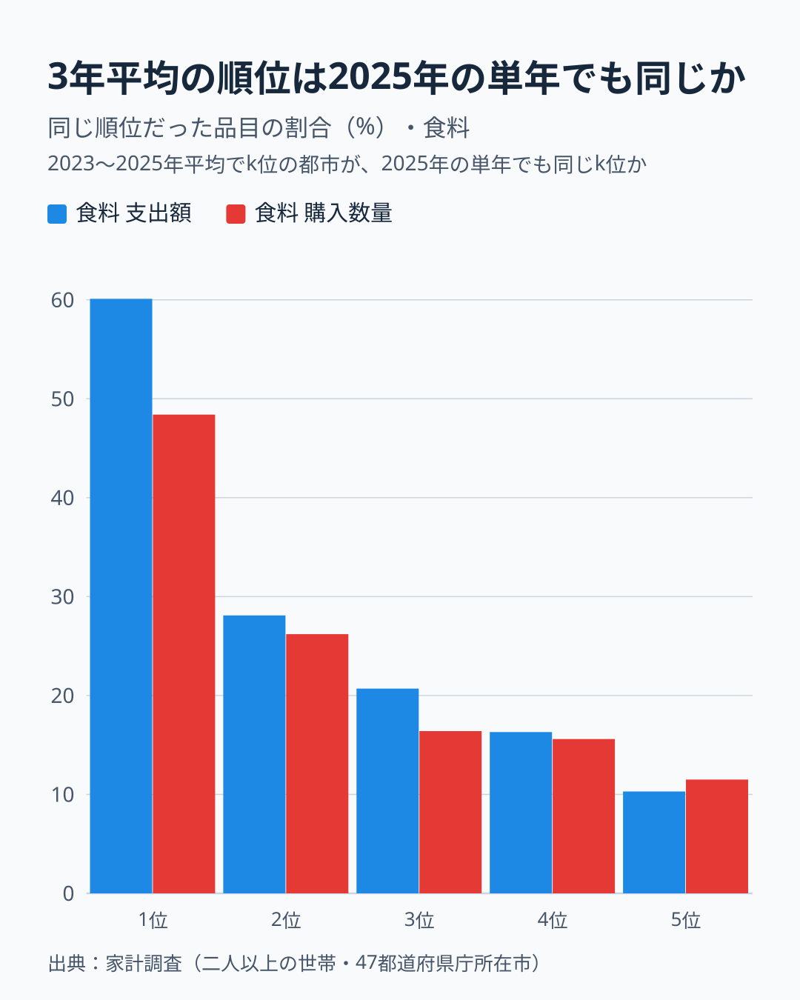

1位だけでなく、2位以下の順位がどれだけ安定しているかも調べました。2023〜2025年の3年平均でk位だった都市が、2025年の単年の値で並べても同じk位だった品目の割合は、食料の支出額で1位が60.1%、2位が28.1%、3位が20.7%、4位が16.3%、5位が10.3%でした。購入数量では1位が48.4%、2位が26.2%、3位が16.4%、4位が15.6%、5位が11.5%です。1位から2位に下がるだけで一致する割合が半分以下になり、順位が下がるほど単年と3年平均が一致しなくなります。

同じ順位にならなくても、近い順位には入っているかもしれません。3年平均でk位だった都市が、2025年の単年の5位以内に入っていた割合は、支出額で1位の都市が93.6%、2位の都市が73.4%、3位の都市が68.5%、4位の都市が62.1%、5位の都市が39.9%でした。購入数量では順に85.2%、69.7%、62.3%、54.1%、39.3%です。1位の都市は、単年で別の都市に抜かれても、たいてい5位以内には残ります。一方で、3位や4位の都市は、単年の5位以内に残るのが3分の2前後で、単年の順位だけで3位や4位と決めるのは難しいことが分かります。

「2023〜2025年の平均で京都市が3位の食品」のような問いにも、同じ注意が要ります。47の県庁所在市の中で京都市が3位になる食料は、支出額で8品目、購入数量で5品目ありました。ただし、3位の意味は品目で違います。たまねぎの支出額では、1位の奈良市と3位の京都市の差は約22円で、1%に満たない僅差です。柿の購入数量は、1位の岐阜市が約5,122グラム、3位の京都市が約2,930グラムと大差です。順位の数字だけでは、近いのか離れているのかが分かりません。京都市のパンの順位は[京都のパンは全国何位?](/blog/bread-city-ranking-kyoto-quiz)で詳しく扱っています。

## 入れ替わりは年を追って減っていない

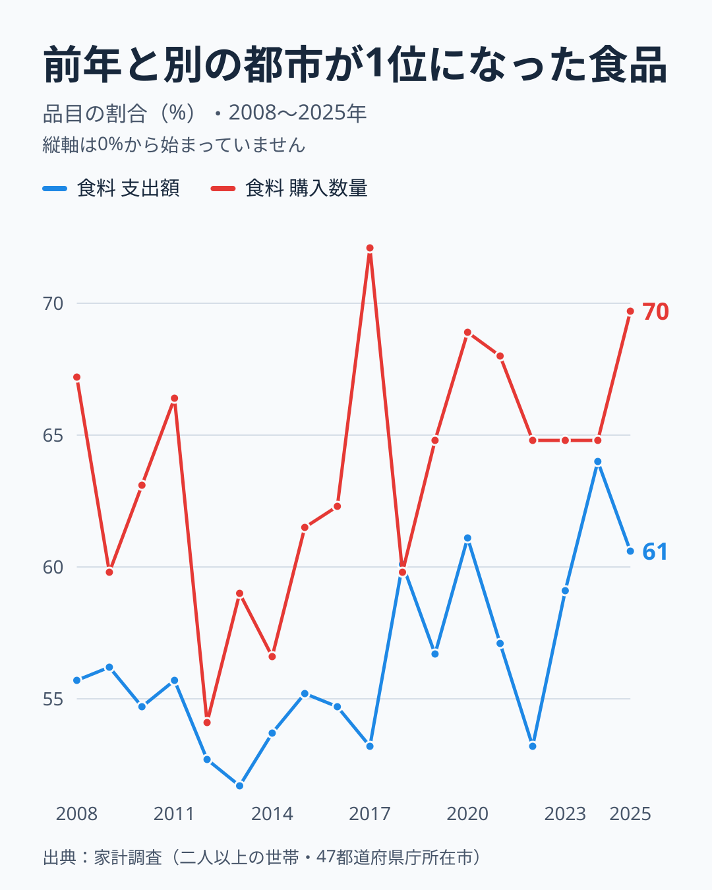

年ごとに見ても、1位は毎年かなりの割合で入れ替わっています。各年について、1位の都市が前年の1位の都市のいずれとも重ならない品目の割合を2008年から2025年まで求めると、食料の支出額は平均56.4%で、最も低いのが2013年の51.7%、最も高いのが2024年の64.0%でした。購入数量は平均63.8%で、2012年の54.1%から2017年の72.1%の間で動いています。2025年はそれぞれ60.6%と69.7%です。つまり、食料のおよそ6割の品目では、前の年と別の都市が1位になっています。食料以外は平均が支出額で87.8%、購入数量で88.3%と、さらに高い水準です。

この割合は、年によって上下しながらも、減ってはいません。2008〜2017年の平均は支出額が54.4%、購入数量が62.2%で、2018〜2025年の平均は59.0%と65.7%と、後半のほうがやや高めです。この差が年ごとのぶれの範囲に収まるかどうかは検定していません。2008年は支出額が55.7%、購入数量が67.2%でした。したがって、ある年に「日本一が入れ替わった」と感じても、それは例外的な年の出来事ではなく、毎年おおむね起きている入れ替わりの一部です。ただし、この割合は1位の都市が変わったかどうかだけを数えており、変わった先の都市が2位だったのか、20位以下から急に上がったのかは区別していません。順位の動きの大きさは別に確かめる必要があります。

## 入れ替わるとき、新しい1位は前年のどこにいたか

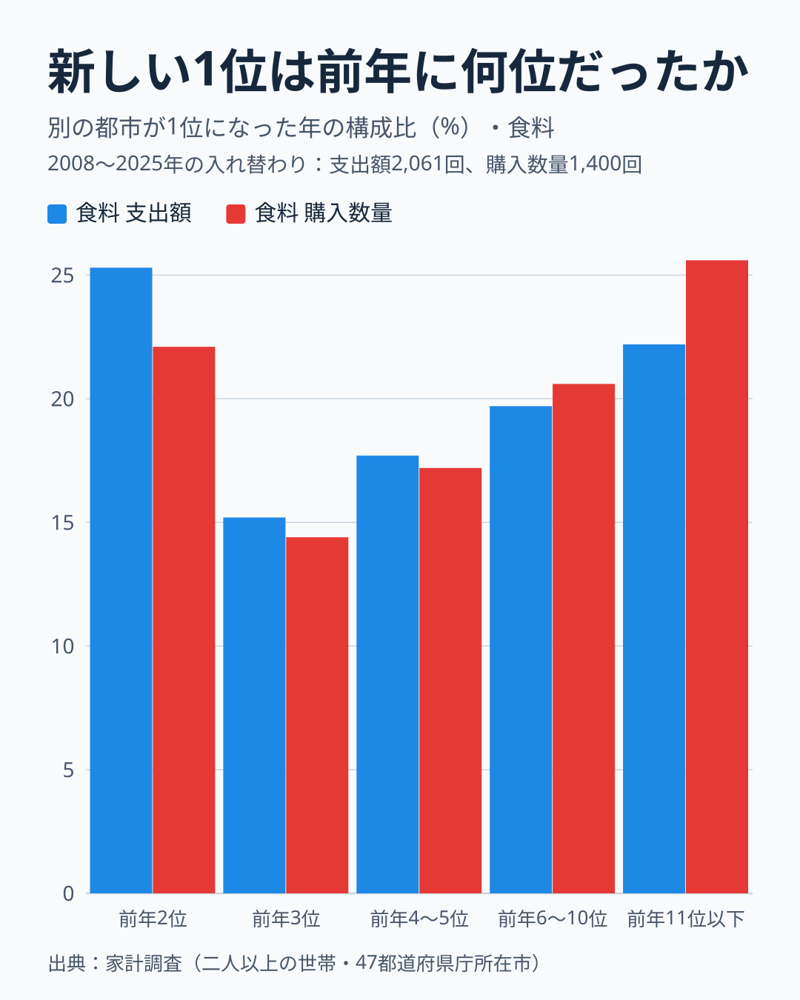

前の節では、1位の都市が変わったかどうかだけを数えました。変わった先の都市が前年の2位だったのか、下位から一気に跳ね上がったのかを調べます。2008年から2025年までの各年で、1位の都市が前年の1位のいずれとも重ならなかった入れ替わりは、食料の支出額で2,061回、購入数量で1,400回ありました。この入れ替わりで新しく1位になった都市が、前年の値で並べると何位だったかを、全品目で数えます。

支出額では、前年2位の都市が1位になったのが521回の25.3%、前年3位が313回の15.2%、前年4〜5位が364回の17.7%、前年6〜10位が406回の19.7%、前年11位以下が457回の22.2%でした。購入数量も、前年2位が22.1%、3位が14.4%、4〜5位が17.2%、6〜10位が20.6%、11位以下が25.6%で、ほぼ同じ形です。前年の5位以内だった都市が新しい1位になった割合は、支出額で58.1%、購入数量で53.8%です。

この割合は、無作為に選んだ場合とは大きく違います。前年の1位を除く46市から新しい1位を無作為に選ぶとすると、前年2位は約2.2%、前年2位から5位の4市を合わせても約8.7%、前年11位以下は約80.4%になるはずです。実際は、前年2位が25.3%、2〜5位の合計が58.1%、11位以下が22.2%ですから、新しい1位は前年の上位の都市から出やすいと言えます。同時に、およそ4分の1は前年に11位以下だった都市で、前年の順位が低い都市でも1位に立つ余地は残っています。単年の1位を「日本一」と呼ぶことは、この動きの一点を切り取ったものだと読めます。[仮説] 都市ごとの標本が小さいため、中位の都市でも年によって買い方が偏れば、1位に立つ可能性があります。調査世帯のデータがなければ、これを標本の揺れから切り分けることはできません。

## 1位を多く持つ都市

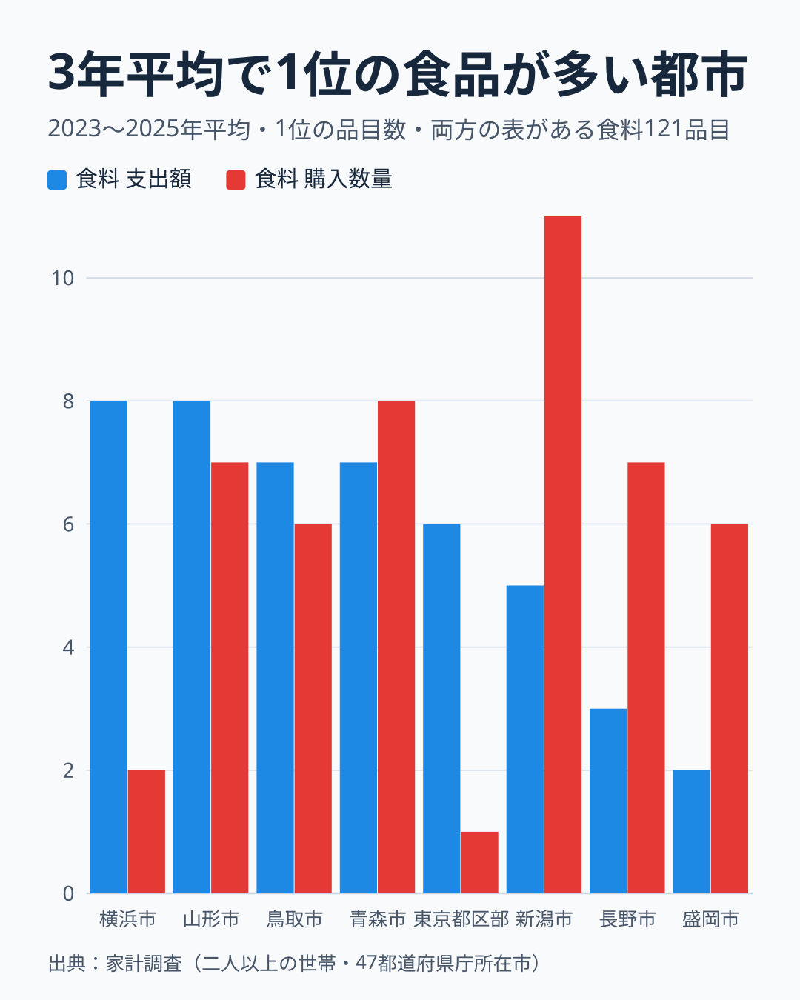

3年平均で見たとき、どの都市が1位を持っているのでしょうか。食料には購入数量の表がなく支出額だけの品目が82品目あるため、支出額と購入数量を同じ品目で比べられるよう、両方の表がある121品目に絞って、2023〜2025年の3年平均で1位の品目を数えました。支出額で1位の品目が最も多いのは横浜市と山形市の8品目で、鳥取市と青森市が7品目、東京都区部が6品目と続き、1位を持つ都市は47市のうち40市に分かれます。購入数量では、新潟市が11品目、青森市が8品目、山形市と長野市が7品目、鳥取市と盛岡市が6品目の順で、こちらも1位を持つ都市は40市でした。図には、支出額と購入数量のどちらかで上位に入った8市を示しています。

最も多い市でも、1位を持つのは121品目の1割に届きません。支出額の横浜市と山形市は8品目で6.6%、購入数量の新潟市は11品目で9.1%です。つまり、「この市は食べ物の日本一が多い」という見方はほとんど成り立たず、1位は品目ごとに別の都市へ散らばっています。同じ市でも、横浜市は支出額で8品目の1位ですが購入数量では2品目、東京都区部は支出額で6品目に対して購入数量は1品目と、支出額と購入数量で数が変わります。支出額と購入数量は別の指標なので、「日本一」を語るときはどちらの指標かを区別する必要があります。

## 品目で見る1位と2位の差

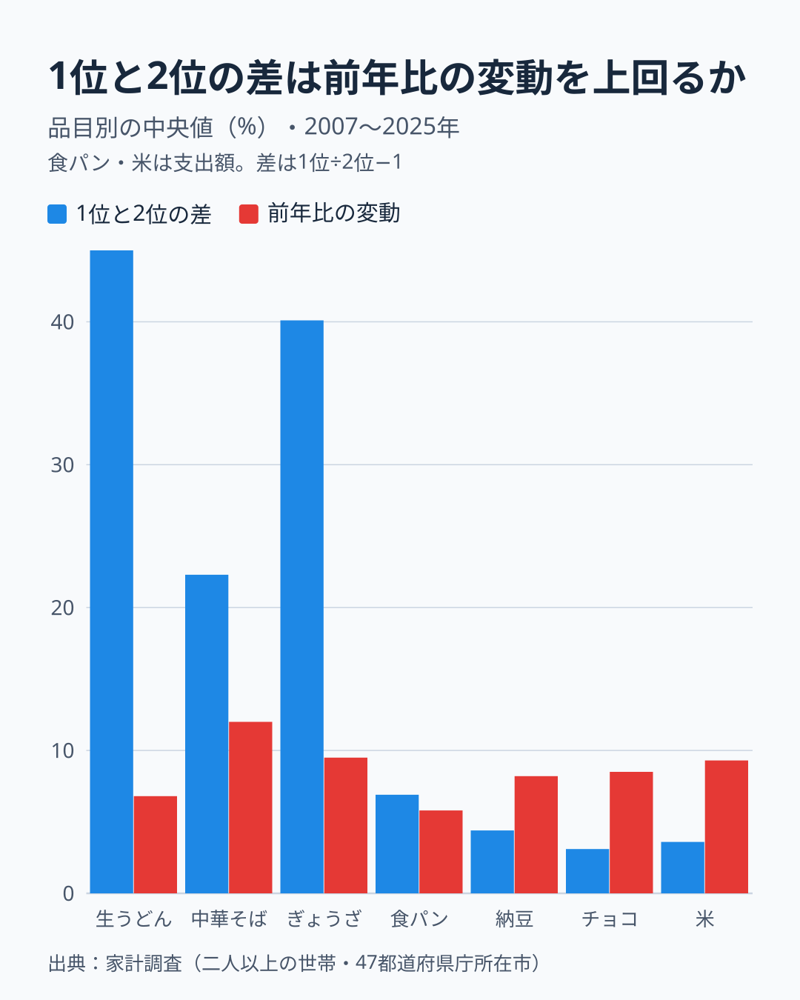

ここからは、検索の多い品目で、1位と2位の差が前年比の変動の範囲に収まっているかを見ます。図の青は19年の各年の1位と2位の差の中央値、赤は47市すべての前年比の絶対値の中央値です。差が変動を上回るのは、生うどん・そば、中華そば（外食、ラーメンに当たる品目です）、ぎょうざ、食パンの支出額の4品目で、下回るのは納豆、チョコレート、米の支出額でした。別の都市が1位になった年の割合は、前者では生うどん・そばが0%、ぎょうざが11.1%、中華そばが22.2%、食パンの支出額が44.4%で、後者では納豆が50.0%、米の支出額が83.3%、チョコレートが88.9%です。差が前年比の変動を上回るかどうかで、入れ替わりの多さが分かれています。

以下、品目ごとに推移を見ていきます。チョコレートは3年平均の1位がさいたま市で、2位の千葉市との差は1.1%の僅差です。1位の入れ替わりそのものは[チョコ消費の王者、なぜ毎年入れ替わる?](/blog/chocolate-expenditure-ranking)にあります。

## ぎょうざ: 長く続いた首位が3年平均で入れ替わる

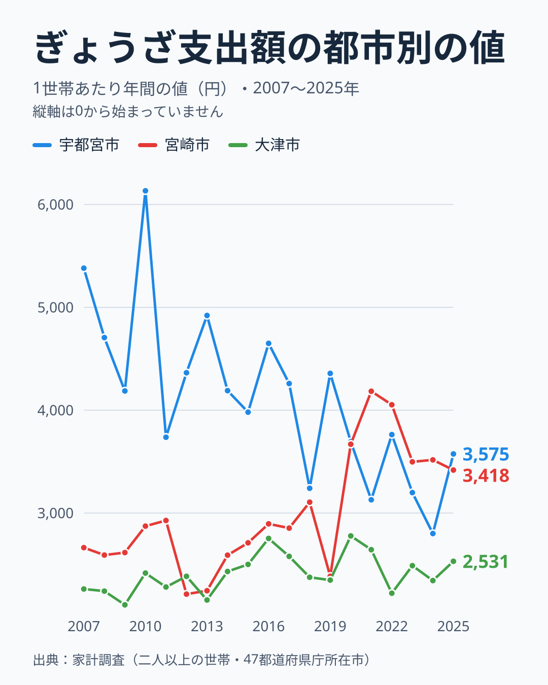

<source-link href="/ranking/gyoza-frozen-consumption-expenditure">ぎょうざ消費支出額ランキングをもっと見る</source-link>

ぎょうざ消費支出額は、宇都宮市が2007年から2020年までの14年と2025年で1位、宮崎市が2021年から2024年までの4年で1位でした。1位と2位の差の中央値は40.1%と大きいのですが、これは前半の年に差が開いていたためです。差が40%以上だった年は2007年から2010年、2013年から2017年、2019年の10年で、2007年の宇都宮市は5,381円、宮崎市は2,664円でした。2010年の宇都宮市は6,133円、宮崎市は2,873円です。その後、宇都宮市は2011年に3,737円、2020年に3,694円、2024年に2,801円まで下がり、宮崎市は2020年に3,669円、2021年に4,184円と上がって、2021年から2024年は逆転しました。差は2018年に4.3%、2020年に0.7%、2022年に7.7%、2025年に4.6%と、近年は一桁の年が増えています。

2025年の単年では、宇都宮市が3,575円、宮崎市が3,418円で、差は4.6%です。3年平均にすると、宮崎市が3,477.7円で1位、宇都宮市が3,191.7円で2位で、差は9.0%です。2025年の単年の1位と3年平均の1位が食い違う理由は、宮崎市が2023年に3,498円、2024年に3,517円だったのに対し、宇都宮市が2023年に3,199円、2024年に2,801円と下回ったことにあります。つまり、ぎょうざの「日本一」は、2010年代までは動かなかったのに、近年は差が縮まり、どちらを1位と呼ぶかが単年か3年平均かで変わります。3位は、2025年の単年ではさいたま市の2,555円、3年平均では大津市の2,454.7円で、上位2市とは差があります。

なお、総務省の公式ランキングは52市で、浜松市がこのデータに入っていません。この記事の47市だけの順位では、浜松市との比較はできません。宇都宮市と浜松市の比較は[宇都宮と浜松、餃子日本一はどっち?](/blog/frozen-gyoza-spending-prefecture-gap)にまとめています。

## 納豆: 差が揺れの内側に収まる

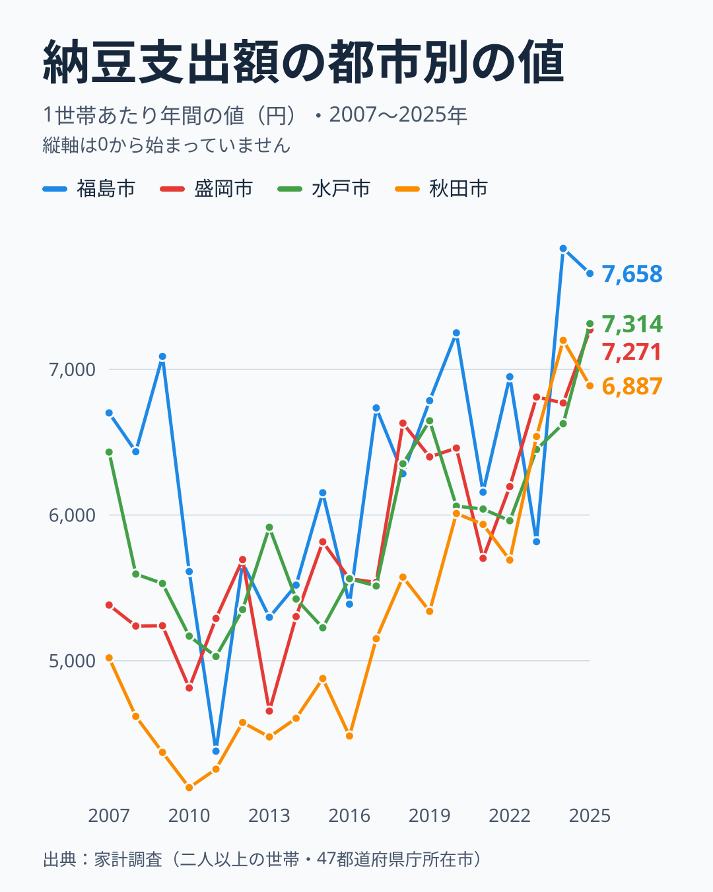

<source-link href="/ranking/natto-consumption-expenditure">納豆消費支出額ランキングをもっと見る</source-link>

納豆消費支出額は、福島市が19年中13年、盛岡市が4年、水戸市が2年で1位になり、19年間で3都市が1位を分け合っています。1位と2位の差の中央値は4.4%で、前年比の変動の中央値は8.2%でした。差が変動より小さいため、毎年1位が入れ替わっても不思議はありません。実際、別の都市が1位になった年の割合は50.0%で、19年のうち18回の前年比較の半分で入れ替わっています。

図を見ると、4市の線が絡み合いながら全体として上がっています。福島市は2007年の6,701円から2011年に4,379円まで落ち、2025年に7,658円でした。盛岡市は2007年に5,382円、2025年に7,271円で、水戸市は6,432円から5,029円、7,314円へ動いています。2025年の単年の順位は、福島市が7,658円、水戸市が7,314円、盛岡市が7,271円で、1位と2位の差は4.7%でした。3年平均では、福島市が7,101.7円、盛岡市が6,950.0円、秋田市が6,875.0円で、1位と2位の差は2.2%と小さくなります。

2位の水戸市は単年では2位でも、3年平均では上位3市に入りません。水戸市は2023年が6,450円、2024年が6,627円と低めで、2025年だけ7,314円まで上がったため、3年平均は6,797.0円にとどまります。単年の2位が3年平均では圏外になりうることが、ここでも分かります。福島市が1位と言えるのは、単年でも3年平均でも1位だからですが、2位との差が小さく、「福島市が日本一」と書くなら「わずかな差で」と添えるのが正確です。水戸市と納豆の関係は[納豆をいちばん買うのは茨城ではない｜家計調査2024](/blog/natto-consumption-expenditure)で詳しく見ています。

## 食パン: 支出額は固定し、購入数量は割れる

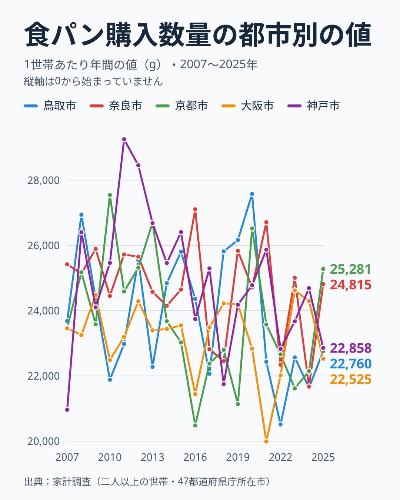

<source-link href="/ranking/white-bread-consumption-quantity">食パン消費量ランキングをもっと見る</source-link>

食パンは、同じ品目でも支出額と購入数量で姿が大きく変わります。支出額では、神戸市が19年中13年で1位、奈良市が2年、広島市と京都市、鳥取市、金沢市が各1年で、6都市に分かれますが、神戸市がほぼ固定しています。1位と2位の差の中央値は6.9%と、前年比の変動の5.8%を上回り、入れ替わり率は44.4%です。2023〜2025年の3年平均でも、神戸市が14,549.7円で、2位の奈良市の12,998.3円と11.9%の差がありました。

購入数量は割れています。19年の1位は、鳥取市、奈良市、神戸市が各4年、京都市が3年、大津市が2年、広島市と松江市が各1年の7都市です。1位と2位の差の中央値は2.5%で、前年比の変動の6.5%を大きく下回り、別の都市が1位になった年の割合は77.8%でした。2025年の単年の1位は京都市の25,281グラムで、2位の奈良市の24,815グラムとの差は1.9%です。3年平均になると、奈良市が23,833.0グラム、大阪市が23,813.7グラム、神戸市が23,739.3グラムで、上位3市の差は0.4%に収まり、順位を決める意味がほとんどありません。

図の線も、5市が交差を繰り返しています。購入数量の「日本一」を1つの都市に決めるのは、このデータでは難しいと言えます。一方、支出額は神戸市が19年のうち13年で1位を取り、2025年の単年でも3年平均でも1位です。[仮説] 神戸市では1枚あたりの価格が高い食パンが選ばれ、購入数量では他都市と並んでいても支出額で上に出ているのかもしれません。この仮説は価格を計算して確かめる必要があり、ここでは確かめていません。食パンの購入数量の地域差は[食パン消費量、なぜ関西が上位独占?](/blog/white-bread-consumption-quantity-prefecture-gap)で扱っています。

## 米: 2025年に全都市が一斉に上がった

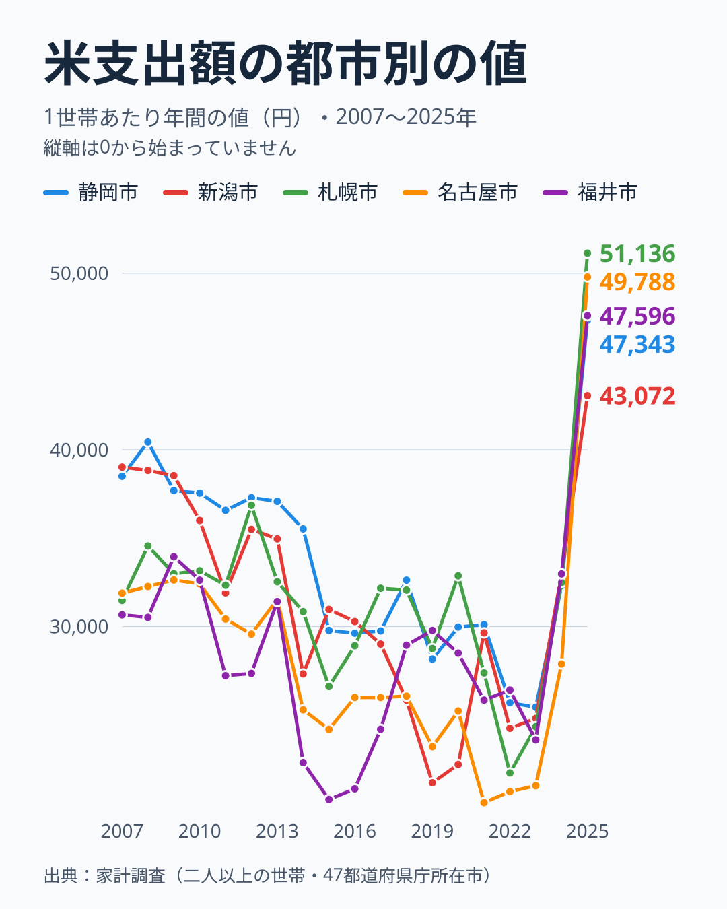

<source-link href="/ranking/rice-consumption-expenditure">米消費支出額ランキングをもっと見る</source-link>

米消費支出額は、19年で8都市が1位になっています。静岡市が7年、新潟市が4年、札幌市が3年で、佐賀市、福井市、富山市、福島市、宮崎市が各1年です。1位と2位の差の中央値は3.6%と小さく、別の都市が1位になった年の割合は83.3%でした。2025年の単年の1位は札幌市の51,136円で、2位の名古屋市の49,788円、3位の宮崎市の49,661円と僅差です。上位3市の差は3%未満で、単年だけで日本一を決めるのは難しい状況です。

図を見ると、2025年に全都市が一斉に上がっていることが分かります。47市の前年比の中央値は、2024年が+32.0%、2025年が+55.2%でした。2025年の前年比の最小値は+17.2%、最大値は+107.0%と、47市のどこでも大きく上がっています。この結果、前年比の変動の中央値9.3%は、2025年の上昇が大きく入った値になり、他の品目の揺れの目安と単純には比べられません。[仮説] 米の価格が上がったことで、全都市の支出額が同時に押し上げられた可能性があります。このデータは支出額だけで価格を含まないため、確かめられません。米の支出と購入量の関係は[米を買う量はほぼ横ばいなのに、支出が大きく増えた](/blog/rice-spending-quantity-gap-2025)にまとめています。

3年平均にすると、札幌市が35,984.0円、静岡市が35,031.0円、福井市が34,717.7円で、1位と2位の差は2.7%です。2025年の単年の1位と3年平均の1位は同じ札幌市ですが、3年平均の2位は静岡市で、単年の2位の名古屋市とは異なります。米の購入数量は19年で10都市が1位になっており、支出額よりさらに入れ替わっています。米どころの新潟市が1位になりにくいことは[米どころ新潟、消費トップに届かず](/blog/rice-consumption-quantity-ranking)で扱っています。

## 中華そば: 19年中17年の首位にも、逆転寸前の年があった

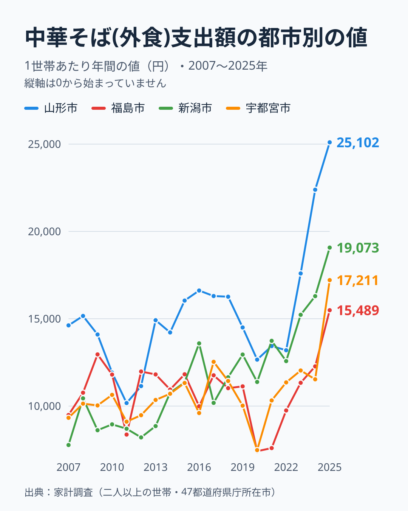

<source-link href="/ranking/ramen-dining-consumption-expenditure">中華そば消費支出額ランキングをもっと見る</source-link>

ラーメンに当たる家計調査の品目は、外食の中華そばです。中華そば消費支出額は、山形市が19年中17年で1位で、福島市が2012年、新潟市が2021年に1位を取りました。1位と2位の差の中央値は22.3%と大きく、別の都市が1位になった年の割合も22.2%と低い部類です。ただし、19年を通して安定していたわけではありません。2010年は山形市が11,916円、福島市が11,801円で差は1.0%、2021年も新潟市との差が2.2%まで縮まり、逆転寸前の年が何度かありました。

2023年以降の動きは目立ちます。山形市は2022年の13,196円から、2023年に17,593円、2024年に22,389円、2025年に25,102円へと急に上がりました。同じ期間に新潟市も12,573円から15,224円、16,292円、19,073円へ、宇都宮市は11,352円から17,211円へと上がり、福島市も15,489円です。全体が押し上がるなかで山形市の伸びが最も大きく、2025年の1位と2位の差は31.6%、3年平均では山形市が21,694.7円、新潟市が16,863.0円で差は28.7%になっています。[仮説] 2020年に福島市が7,414円、宇都宮市が7,477円まで落ちたのは外出自粛の影響で、2023年以降の上昇は外食の回復によるものかもしれません。このデータは外食の頻度や価格を含まないため、確かめられません。

この品目は、単年でも3年平均でも1位が山形市で一致し、3年平均の差28.7%が前年比の変動の中央値12.0%を上回っています。そのため、47市の中では「外食の中華そばの支出額は山形市が日本一」と言える品目です。ただし、19年のうち2010年と2021年は逆転寸前だったことから、この判断も標本の揺れを完全に排除したものではありません。麺類全体の地域差は[うどん県・そば県・ラーメン県に日本は三分割される](/blog/noodle-consumption-prefecture-character)で扱っています。

## 生うどん・そば: 固定していても差は縮んでいる

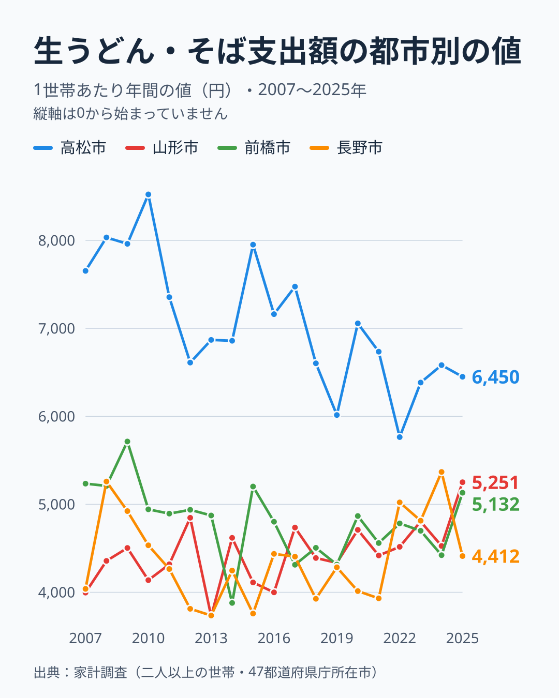

<source-link href="/ranking/fresh-udon-soba-consumption-expenditure">生うどん・そば消費支出額ランキングをもっと見る</source-link>

生うどん・そば消費支出額は、高松市が19年すべてで1位でした。固定している品目の代表ですが、中身を見ると差は一定ではありません。高松市の値は2007年の7,654円、2010年の8,523円から、2019年に6,015円、2022年に5,764円まで下がり、2025年は6,450円です。2位は年によって入れ替わり、2025年は山形市の5,251円、3位は前橋市の5,132円で、2023〜2025年の3年平均では高松市が6,472.0円、2位が長野市の4,864.7円、3位が山形市の4,861.0円でした。2位と3位の差は3年平均で約4円で、3位以下の順位は意味のある差ではありません。

1位と2位の差の推移を見ると、2007年の46.2%、2010年の72.4%に対し、2022年は14.8%、2025年は22.8%でした。差の中央値は45.0%で前年比の変動の中央値6.8%を大きく上回り、19年を通じて1位が動かなかったのはこのためです。しかし、2022年の差14.8%は、納豆やチョコレートの差の中央値の数倍ですが、固定する品目としては狭まった年です。高松市の値が下がり、山形市が2007年の3,996円から2025年の5,251円へ上がったことで、差は以前より縮んでいます。固定していることと、今後も固定し続けることは別なので、「今は日本一」として読むのが安全です。うどんの地域差は[香川は沖縄の3.8倍うどんを買う｜なぜ西高東低?](/blog/fresh-udon-soba-consumption-prefecture-gap)で見られます。

## 「日本一」を言うときの読み方

ここまでの結果から、品目の「日本一」をどう言えばよいかを整理します。確認するのは2つです。1つ目は、2025年の単年の1位と、2023〜2025年の3年平均の1位が同じ都市かどうかです。2つ目は、3年平均での1位と2位の差が、その品目の前年比の変動（47市の前年比の絶対値の中央値）を上回るかどうかです。この2つで、この記事で取り上げた品目は次の3つに分かれます。

- 2つとも満たす品目は、「日本一」と言えます。生うどん・そばの高松市、中華そばの山形市、食パンの支出額の神戸市がこれに当たり、19年ずっと同じ都市が1位だった品目も含みます。
- 1つ目だけ満たす品目は、「3年平均でも1位。ただし僅差」と添えます。納豆の福島市、米の支出額の札幌市、チョコレートのさいたま市が当たります。3年平均の1位と2位の差が、納豆で2.2%、米の支出額で2.7%、チョコレートで1.1%と、前年比の変動に届きません。
- 1つ目を満たさない品目は、「上位グループ」と書きます。単年の1位と3年平均の1位が食い違うぎょうざ（宇都宮市と宮崎市）と、食パンの購入数量（京都市と奈良市）が当たります。

公式の発表を読む場合も同じです。総務省統計局が公表するのは、52市の2023年〜2025年平均の順位です。単年の順位が欲しいときは、同じ家計調査の年報で各年の値を確かめる必要があります。単年の値で「日本一」と書かれている記事を見たときは、2つの確認を当てはめると、言い過ぎを避けられます。個別の品目の入れ替わりは、[牛肉消費の首位、なぜ毎年入れ替わる?](/blog/beef-consumption-quantity)や[じゃがいも消費、首位はなぜ毎年入れ替わる?](/blog/potato-consumption-quantity)でも見られます。

## まとめ

- 2007〜2025年の19年に1位が3都市以上に分かれた食料の品目は、支出額で79.8%、購入数量で89.3%
- 19年ずっと同じ都市が1位だった品目は、支出額で18品目、購入数量で6品目で、高松市の生うどん・そばや高知市のかつおなど。分野では魚介類が8品目と最も多い
- 1位と2位の差が大きい品目ほど入れ替わらない。差が20%以上の品目の入れ替わり率は支出額で13.8%、3%未満では79.5%
- 単年の1位が3年後も続く割合は支出額で39.7%、3年平均では56.5%。3年平均にすると続きやすいが、半分強にとどまる
- 3年平均の1位が3年とも単年の1位だった品目は、食料の支出額で26.6%、購入数量で18.0%
- 3年平均でk位の都市が2025年の単年でも同じ順位なのは、支出額の1位で60.1%、3位で20.7%と、順位が下がるほど一致しにくい
- 新しい1位の約6割は前年に5位以内の都市で、約4分の1は前年に11位以下の都市
- 「日本一」と言えるのは、単年と3年平均の1位が一致し、3年平均の差が前年比の変動を上回る品目

気になる品目は、支出額と購入数量の両方の[ランキング](/ranking/white-bread-consumption-expenditure)で見比べてください。家計消費の全体像は[経済・所得カテゴリ](/category/economy)から確かめられます。

## データについて

出典は総務省統計局「家計調査」（二人以上の世帯）の品目別年間支出金額（統計表0004023605）と購入数量（統計表0004023606）で、47都道府県の県庁所在市の値です。調査世帯数と調査の方法は、総務省統計局「家計調査 調査の概要」（2026年11月9日確認）の記述に基づきます。調査世帯数はこの記事のデータに含まれておらず、標本の大きさは公式ページの値から1市あたりの平均を求めたものです。

集計の対象は、家計調査として登録している832指標のうち、食料全体や穀類のように複数の品目を足し合わせた分類・合算の154指標を除いた678の個別品目です。そこから、2007〜2025年の19年が揃わない24指標と、購入世帯のある都市が40都市に満たない年がある28指標を除き、626指標（支出額450、購入数量176）を残しました。このうち食料は325指標（支出額203、購入数量122）、食料以外は301指標です。食料は家計調査の分類で、外食と酒類の品目を含みます。食料には購入数量の表がなく支出額だけの品目が82あり、外食や酒類などがこれに当たります。除外した品目には、2010年、2015年、2025年から始まる系列や、購入が少なく標本に買った世帯のない都市が多い品目が含まれ、これらの1位の入れ替わりはここでは扱っていません。

1位は各年で値が最大の都市で、同額は並んだ都市すべてを数えました。入れ替わり率は、2008〜2025年の18回の前年比較で、1位の都市が前年の1位の都市のいずれとも重ならなかった割合です。1位と2位の差は、各年の1位の値を2位の値で割って1を引いた値の19年の中央値で、前年比の変動は47市すべての前年比の絶対値の中央値です。分野は品目分類コードの上4桁で分けました。3年平均は各年とその前2年の単純平均で、総務省の公式な3年平均の算出方法は確かめていません。総務省統計局は、品目別の地域差を明らかにするために、都道府県庁所在市と5つの政令指定都市の2023年〜2025年平均のランキングを公表しています。品目分類の改定が年をまたぐ比較に与える影響は、ここでは確認していません。
