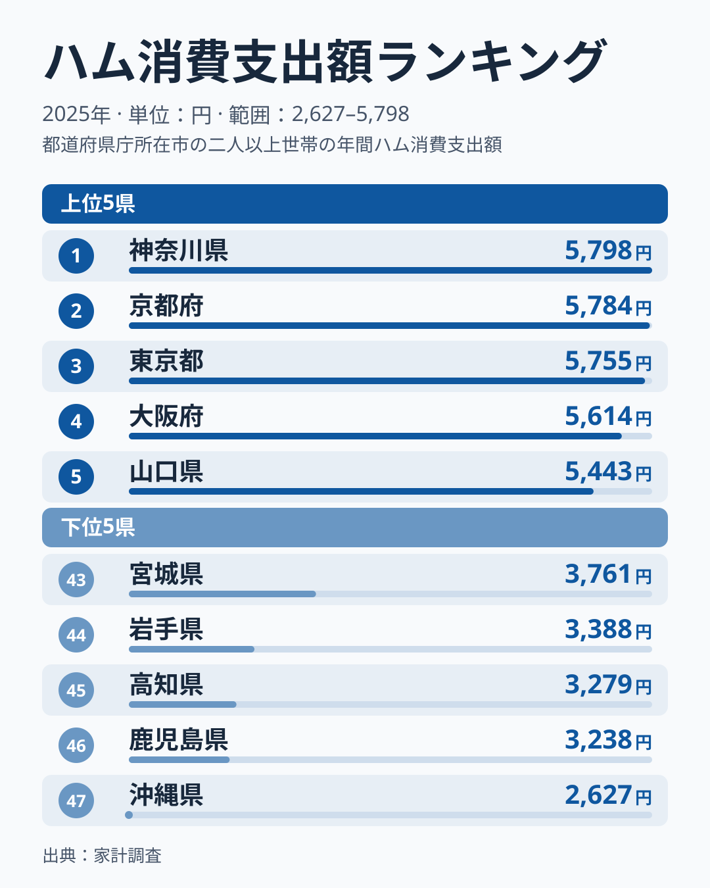
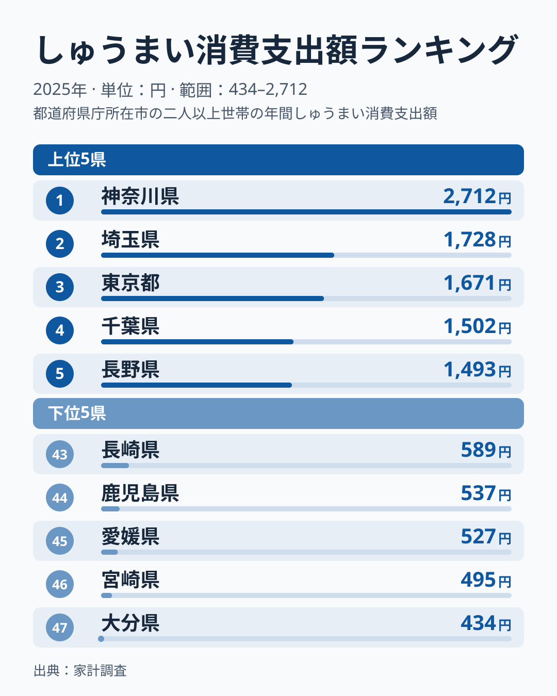
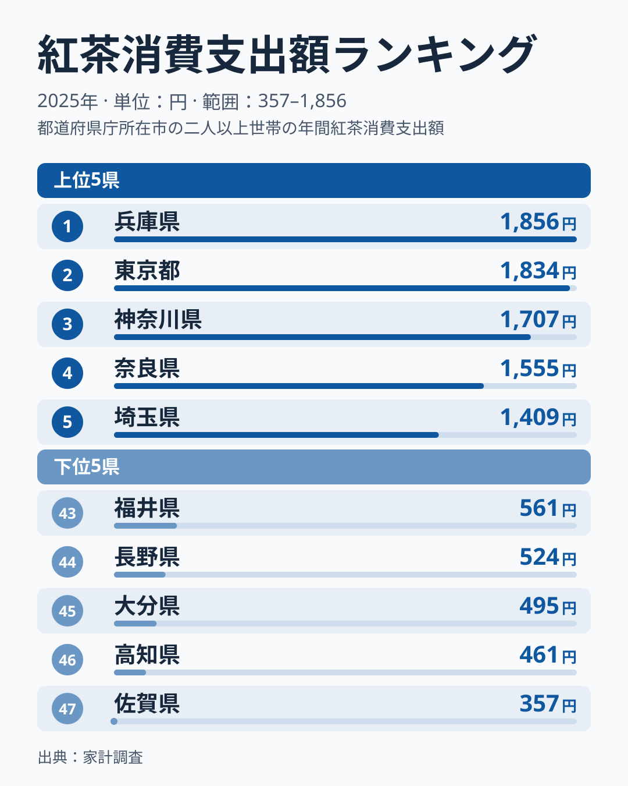
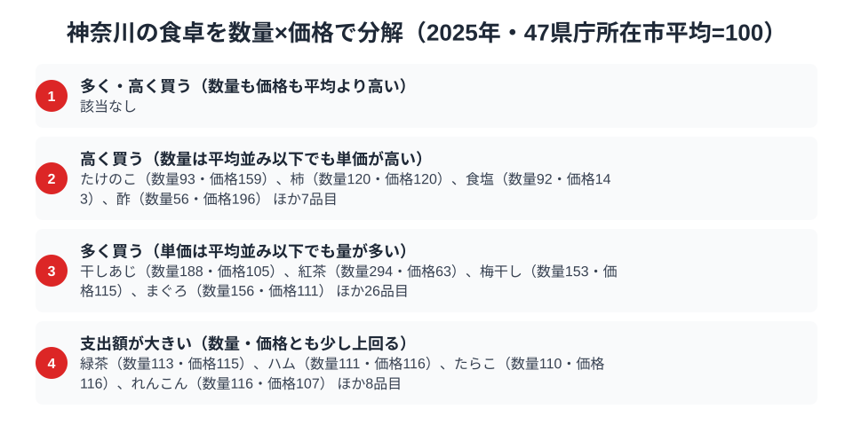

「シウマイ弁当」と聞いて崎陽軒を思い浮かべる人は多いはずです。実は神奈川県は、しゅうまいの消費支出額で全国1位というだけでなく、ハムでも全国トップに立ち、紅茶でも3位に入っています。洋食・中華・喫茶という出自の異なる系統の食品が、1つの県で上位に並ぶのは珍しい光景です。

総務省「家計調査」の2025年データ（都道府県庁所在市、二人以上世帯）を確認すると、神奈川県（横浜市）はハム消費支出額5,798円、しゅうまい消費支出額2,712円で47都道府県中1位、紅茶消費支出額1,707円は3位でした。紅茶の首位は兵庫県の1,856円で、神奈川県より149円多い水準です。ハムは洋食文化、しゅうまいは中華料理、紅茶は喫茶文化と、出自の異なる3つの食が同じ街で上位に入っているのがこの記事の出発点です。この記事では、それぞれの数字を見た上で、なぜ横浜という港町にこの組み合わせが根付いたのかを読み解きます。

> [!NOTE]
> 本記事の数値は総務省「家計調査（品目別）」2025年、都道府県庁所在市（神奈川県は横浜市）の二人以上世帯における年間消費支出額です。世帯当たりの支出額であり、購入量そのものではありません。県内の他都市を含む集計ではなく、県庁所在市の家計を代表値として扱っています。

## ハム — 全国1位5,798円、洋食文化の土台

<source-link href="/ranking/ham-consumption-expenditure">ハム消費支出額ランキングをもっと見る</source-link>

神奈川県のハム消費支出額は5,798円で全国1位でした。ただし2位の京都府は5,784円で両者はほぼ並んでおり、3位の東京都は5,755円、4位の大阪府は5,614円、5位の山口県は5,443円と、上位は僅差でひしめいています。最下位は沖縄県で2,627円にとどまり、神奈川県の半分以下でした。

横浜は明治期に開港した港町として、外国人居留地を通じて西洋の食肉加工技術が最も早く持ち込まれた土地の一つです。ハム・ソーセージの製造は横浜近郊で盛んになり、洋食店やパン食文化とともに家庭にハムを取り入れる習慣が根付きました。上位に京都・東京・大阪といった大都市圏が並ぶ一方、沖縄県のように豚肉料理そのものは豊富でも加工ハムの消費が少ない地域とは対照的な結果です。2位との差はごくわずかで、家計調査の市別の値は単年のぶれが大きいため、1位という順位そのものを神奈川の構造と断定することはできません。[仮説] 開港以来のハム文化が上位グループ入りの背景にあるが、他の都市との首位争いは年ごとに入れ替わりうる。検証には複数年の順位を並べる必要があります。

## しゅうまい — 全国1位2,712円、2位の1.6倍

<source-link href="/ranking/shumai-consumption-expenditure">しゅうまい消費支出額ランキングをもっと見る</source-link>

しゅうまい消費支出額は神奈川県が2,712円で圧倒的な全国1位です。2位の埼玉県は1,728円で約1.6倍、3位の東京都は1,671円、4位の千葉県は1,502円で、ハムや紅茶よりも突出した独走ぶりが見て取れます。最下位は大分県で434円にとどまり、神奈川県の約6分の1という開きでした。

この結果を作っている最大の要因は、[仮説] 横浜中華街の存在と、崎陽軒の「シウマイ弁当」に象徴される地元ブランドの浸透だと考えられます。中華街での食事だけでなく、駅弁・惣菜・家庭の食卓にまでしゅうまいが定着している点が、他の大都市圏（埼玉・東京・千葉）を大きく引き離す差になっている、というのが仮説です。上位5県のうち4県を関東地方が占める一方、下位には大分・宮崎・愛媛・鹿児島・長崎と九州・四国の県が並びます。

## 紅茶 — 全国3位1,707円、港町の喫茶文化

<source-link href="/ranking/black-tea-consumption-expenditure">紅茶消費支出額ランキングをもっと見る</source-link>

紅茶消費支出額は兵庫県が1,856円で1位、東京都が1,834円で2位、神奈川県が1,707円で3位でした。4位は奈良県の1,555円です。ハムやしゅうまいと違って首位ではありませんが、上位3つを兵庫・東京・神奈川という港町・大都市圏が占める構図は変わりません。最下位は佐賀県で357円、46位の高知県も461円にとどまり、神奈川県の約5分の1でした。

紅茶が兵庫・東京・神奈川という3つの大都市圏で上位を占める背景として、[仮説] 横浜・神戸がいずれも明治の開港場であり、西洋の喫茶文化やホテル文化が早期に定着した土地であることが挙げられます。この見方は [紅茶支出、なぜ港町の県が強いのか](/blog/black-tea-expenditure-ranking) で扱った港町仮説とも重なりますが、市別の値は単年のぶれが大きく、首位が兵庫に移ったことからも、順位の細かな違いより「上位グループにいる」ことを読むのが安全です。

> [!WARNING]
> ここでの支出額は世帯単位の年間購入金額であり、外食・中食（弁当・惣菜）での消費や、崎陽軒のような駅弁として購入されるしゅうまいの一部は、家計調査の「しゅうまい」ではなく「調理食品」や「他の飲食」に計上されている可能性があります。統計上の「しゅうまい」は主に家庭内調理・小売購入分を捉えている点に注意してください。

## 神奈川の食卓を貫くもの

ハム・しゅうまい・紅茶という3つの品目に共通するのは、いずれも神奈川県が生み出した食文化ではなく「海外から持ち込まれ、横浜という開港都市で最初に根付いた食」だという点です。洋食のハム、中華のしゅうまい、喫茶の紅茶は出自も系統もばらばらですが、いずれも「港から入ってきた食を家庭の日常に取り込んだ土地」という一本の軸で説明できます。

これは他の食文化まとめ記事とは性格が異なります。[青森の食卓](/blog/aomori-food-culture) や [高知の食卓](/blog/kochi-food-culture) が地元産の農産物・水産物（りんご、かつお）の1位を軸にしているのに対し、神奈川県は「産地」ではなく「玄関口」としての強さが数字に表れているのが特徴です。[静岡の食卓](/blog/shizuoka-food-culture) がお茶とまぐろという地場産業の1位で構成されているのとも対照的で、神奈川県は地場産品ではなく舶来食の受け皿として上位に立っています。

> [!TIP]
> 3品目とも「2位以下との差」の大きさが異なる点にも注目してください。しゅうまいは2位の約1.6倍という圧倒的な差がある一方、ハムは2位の京都府とほぼ並んでおり、紅茶は首位に届かず3位にとどまります。同じ上位でも、しゅうまいのようにご当地ブランドが突出しているケースと、ハムや紅茶のように大都市圏で横並びに高いケースがあり、背景にある事情は品目ごとに異なります。

## 数量×価格で分解する横浜市の食卓

<source-link href="/ranking/tuna-consumption-quantity">まぐろ消費量ランキングをもっと見る</source-link>

家計調査には、多くの品目で「消費数量」と「消費支出額」の両方が公表されています。支出額を数量で割ると単価の目安が求まり、同じ「支出額で全国1位」でも、たくさん買っているのか、単価の高いものを買っているのかで背景がまったく違って見えてきます。ここでは家計調査の食料品目のうち数量と支出額の両方がそろう138品目について、47都道府県庁所在市の単純平均を100とした数量指数と価格指数を作り、横浜市がどちらの方向で全国平均から離れているかを見ていきます。

横浜市で数量指数がとりわけ高いのは干しあじとまぐろです。干しあじは数量指数188と平均の2倍近くを買う一方、価格指数は105と平均並みにとどまり、量で支出額を押し上げているタイプだと分かります。背景には小田原に代表される神奈川の干物文化があると考えられます[仮説]。まぐろも数量指数156と平均を大きく上回りますが、価格指数は111とほぼ平均並みで、高級なまぐろを選んでいるというより日常的によく食べている結果と読めます。三浦半島の三崎港が遠洋まぐろ漁業の一大基地であることと重ねると、横浜市のまぐろ消費量が全国平均を上回るのも、水揚げ地に近い土地ならではの結果と言えそうですが、これも単年の値からの推測にとどまります[仮説]。

一方、たけのこ・食塩・酢は数量指数が平均並みかそれ以下なのに価格指数だけが高く、量ではなく単価の高いものを選ぶ傾向がうかがえます。たけのこは数量指数93・価格指数159、食塩は数量指数92・価格指数143、酢は数量指数56・価格指数196で、いずれも「量は少なめ、単価は高い」という同じ形です。紅茶は逆のタイプで、数量指数294・価格指数63と、数量は47市中1位で平均の約3倍を買う一方、見なし単価は平均を大きく下回ります。紅茶の支出額が全国3位なのは、高い紅茶を選んでいるからではなく、とにかく大量に買っているからだと数字は示しています。ハムは数量指数111・価格指数116とどちらも平均を少し上回る程度で、突出はしていませんが、その組み合わせで支出額1位を支えています。

支出額の順位だけでは「たくさん食べている」のか「高いものを買っている」のか分かりません。まぐろ・干しあじ・紅茶は主に量、たけのこ・食塩・酢は主に単価、ハムは量と単価の両方が少しずつ平均を上回るというように、品目によって支出額を押し上げている理由が違います。

> [!NOTE]
> ここでの指数は47都道府県庁所在市の単純平均を100とした相対値で、家計調査の全国平均そのものではありません。価格指数は支出額を数量で割った見なし単価の相対値なので、買っている品種やブランドの違いも含んでおり、純粋な価格水準を示すものではない点に注意してください。対象は二人以上世帯・都道府県庁所在市（神奈川県は横浜市）の年間値です。

## まとめ

- ハム消費支出額は神奈川県が5,798円で全国1位。2位の京都府は5,784円でほぼ並ぶ
- しゅうまい消費支出額は神奈川県が2,712円で全国1位。2位の埼玉県は1,728円で約1.6倍という突出した差
- 紅茶消費支出額は神奈川県が1,707円で3位。1位の兵庫県1,856円、2位の東京都1,834円と、港町・大都市圏が上位を占める構図
- 家計調査の数量×価格分解でみると、まぐろ・干しあじ・紅茶は「量」で、たけのこ・食塩・酢は「単価」で全国平均を上回る品目
- 3品目に共通するのは「地場産品」ではなく「開港都市として舶来食を受け入れた土地」という軸（[仮説]。市別の値は単年のぶれが大きい）

神奈川県のように[経済カテゴリ](/category/economy)の消費支出データで上位に並ぶ品目を複数持つ県は、その土地の産業構造や歴史的背景を映し出しています。[神奈川県の地域プロフィール](/areas/14000) では、家計調査以外の指標も含めた地域の全体像を確認できます。

## データについて

総務省統計局「家計調査（品目別）」2025年、都道府県庁所在市（横浜市）二人以上世帯のデータをe-Stat（政府統計の総合窓口）経由で取得・集計しています。
