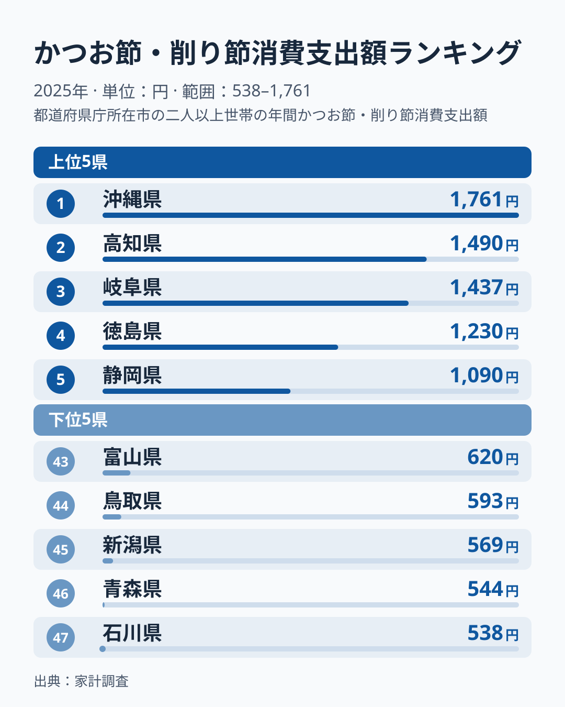

「だしの効いた味」と聞いて、どんな料理を思い浮かべるでしょうか。沖縄そばやチャンプルーの奥に効いている出汁は、実はかつお節が支えています。総務省家計調査（品目別）の2025年データによると、二人以上世帯のかつお節・削り節への年間消費支出額は、沖縄県が1761円で全国1位でした。

2位は高知県の1490円、最下位は石川県の538円で、沖縄と石川の差は3.3倍です。沖縄の支出額は2位の高知との差が271円にとどまり、前年は沖縄が首位で、2位との差はもっと開いていました。この記事では、都道府県別のかつお節消費支出データから、出汁文化の地域差を読み解きます。

> [!NOTE]
> データは総務省「家計調査（品目別）」の都道府県庁所在市・二人以上世帯を対象にした年間支出額です。県全体の値ではなく、世帯単位の支出額であり、外食や加工食品に含まれるかつお節の消費量は含まれません。

## 上位の顔ぶれ｜沖縄は1位でも2位との差は小さめ

2025年のトップ5は、沖縄県1761円、高知県1490円、岐阜県1437円、徳島県1230円、静岡県1090円と続きます。沖縄は1位ですが、2位の高知との差は271円、3位の岐阜とは324円で、上位3県が比較的近い水準に並びました。

沖縄そば・チャンプルー・味噌汁と、沖縄の家庭料理は出汁を効かせた料理が多く、かつお節（沖縄には、かつお節と味噌にお湯を注ぐだけで作る「カチューユー」という即席汁物もあります）は日常的に使われる調味料です。

沖縄に続くのは高知・岐阜・徳島・静岡で、四国と中部の県が並びます。高知県は生鮮かつおの水揚げでも知られ、かつお漁とかつお節の両方に馴染みが深い土地柄です。詳しくは[高知県の地域データ](/areas/39000)も参照してください。

6位以降も三重県1087円、宮崎県1074円、奈良県1057円、鹿児島県1011円、島根県985円と、近畿・九州・中国の県が10位まで続きます。上位10県を地方で見ると、九州・沖縄、四国、中部、近畿、中国の県で占められ、北海道・東北・関東の県は1つも入りません。

同じ家計調査で買った量を見ると、並びは少し変わります。購入数量では高知県が319グラム、岐阜県が293グラムと、どちらも上位に入り、支出額の順位に近い位置です。一方、徳島県は支出額が4位でも購入数量は379グラムで2位、三重県は支出額6位に対し購入数量は190グラムで15位、島根県は支出額10位に対し購入数量は146グラムで26位です。[仮説] 三重・島根のように支出額の順位が購入数量の順位より高い県は、1グラムあたりに払う金額が高い品を選んでいる可能性があります。かつお漁や出汁を重視する食文化との結びつきは、この記事のデータだけでは確かめられません。

<source-link href="/ranking/katsuobushi-consumption-expenditure">かつお節・削り節消費支出額ランキングをもっと見る</source-link>

> [!TIP]
> 高知県は生鮮かつお（カツオのたたき等）の消費でも話題になる県です。「生のかつお」と「かつお節」という同じ魚の違う食べ方が、どちらも高知の食文化に根付いている可能性があります。関連する[かつお節と牡蠣の魚介マップ](/blog/bonito-vs-oyster-fish-map)もあわせてどうぞ。

## 最下位グループ｜北陸や北の県で低め

下位5県は、石川県538円、青森県544円、新潟県569円、鳥取県593円、富山県620円という顔ぶれです。石川県は沖縄の約3割（538÷1761）にあたり、残る4県も沖縄の3割台の水準にとどまります。[石川県の地域データ](/areas/17000)も見てみてください。

下位5県のうち石川・新潟・富山の3県は中部、青森県は北海道・東北、鳥取県は中国の県です。その上の順位でも北海道718円は39位、秋田県702円は40位と北海道・東北の県が続きます。ただし42位の千葉県670円や41位の山口県688円のように、これらに当てはまらない県も下位に入っており、地理だけでは説明しきれません。

[仮説] これらの地域では、かつお節よりも昆布や煮干しなどのだしが食卓の中心になっているのかもしれません。昆布の支出額ランキング（2025年）では、富山・福井・青森・三重・長崎が上位5県に並びます。三重県は昆布でも上位ですが、かつお節でも6位に入っており、「西のかつお節、東・北の昆布」というすみ分けはおおまかな傾向にとどまります。下位5県の昆布の順位は富山1位・青森3位・石川11位・新潟24位・鳥取44位とばらつき、昆布で説明できる県（富山・青森・石川）とできない県（新潟・鳥取）が混ざっています。

あわせて見る: [昆布消費支出額ランキング](/ranking/konbu-consumption-expenditure)

> [!WARNING]
> 家計調査は「支出額」であり「消費量」ではありません。かつお節は品質や産地によって単価差が大きいため、支出額の順位が必ずしも消費量の順位と一致するとは限らない点に注意が必要です。

## 発見｜沖縄の首位は続くが、2位との差は小さい

近年は家庭での調理が「だしパック」や「顆粒だし」に置き換わる傾向が強まっており、かつお節そのものを削って使う家庭は全国的に減少傾向にあるとみられます。それでも沖縄が1位を維持している背景には、そばや汁物といった日常食に出汁を効かせる調理習慣が根強く残っていることがありそうです。

[仮説] 沖縄の1位は、家庭料理での出汁使用頻度の高さに加え、削り節を使った「カチューユー」のような即席料理の存在も影響している可能性があります。2025年に2位との差が小さくなった理由は、この記事のデータだけでは分かりません。県庁所在市の標本世帯は数が限られ、市別の値は単年のぶれが大きいため、1年分の変化から構造の変化を断定せず、翌年以降の値で続くかを確かめる必要があります。

もう一つの見方として、かつお節（乾物・加工品）と生鮮かつおの消費傾向を比べると、高知県のようにどちらも高い県がある一方、沖縄は生鮮かつおの消費では突出していないかもしれません。同じ「かつお」でも、食べ方の違いが地域の食文化を映し出している可能性があります。

支出額ではなく買った量で見ると、どうなるでしょうか。ここでいう購入数量は、支出額と同じ2025年の家計調査（県庁所在市・二人以上世帯）で、同じ品目の年間購入数量をグラムで示したものです。消費した量そのものではなく、買った量である点は変わりません。かつお節・削り節の年間購入数量は、沖縄県が492グラムで1位、富山県が81グラムで最下位でした。1位は支出額と同じ沖縄県ですが、最下位は支出額の石川県とは異なり、両端の差は約6.1倍です。沖縄の492グラムは、購入数量で次に多い徳島県の379グラムを上回っています。

一方、支出額で2位の高知県は、購入数量では3位の319グラムです。2つのランキングの値から、1グラムあたりの支出額を計算できます。沖縄県は1761円÷492グラムで約3.6円、高知県は1490円÷319グラムで約4.7円、富山県は620円÷81グラムで約7.7円です。沖縄との支出額の差は、量の違いに加えて単価の違いも含んでいます。富山県は量が最も少ない一方で単価は高く、買う量は少なくても、1グラムあたりに払う金額は高いという組み合わせです。逆に支出額が最下位の石川県は、購入数量が211グラムで8位、1グラムあたりは538円÷211グラムで約2.5円と単価が低い県です。[仮説] 石川県の支出額の低さは、買う量の少なさよりも、1グラムあたりの安い品を選んでいることが効いている可能性があります。なお、この単価は年間の支出額を年間の購入数量で割った見かけの値であり、かつお節と削り節パックなど品の種類や内容量の違いも含んでいます。

あわせて見る: [かつお節・削り節消費量ランキング](/ranking/katsuobushi-consumption-quantity)

家計調査の品目分類では、かつお節と競合する調味・出汁関連の品目として「だし・つゆ」や「昆布」も別枠で集計されています。今後もし顆粒だし・液体だしへの置き換えがさらに進めば、かつお節そのものの支出額は全国的に緩やかな減少を続ける可能性があります。それでも沖縄のように調理習慣の中に深く組み込まれている地域では、下げ止まりや高止まりが続くことも考えられます。地域ごとの食文化の根深さが、統計の数字にも表れているのです。

## まとめ

- **首位**: 沖縄県 1761円
- **最下位**: 石川県 538円
- **倍率**: 1位と最下位で3.3倍の差
- **地域パターン**: 上位10県は中部より西の県と沖縄だけで占められ、下位は中部や北海道・東北の県が目立つ傾向
- **特筆点**: 沖縄の首位は前年から続くが、2位高知との差は271円で、単年のぶれも考慮が必要
