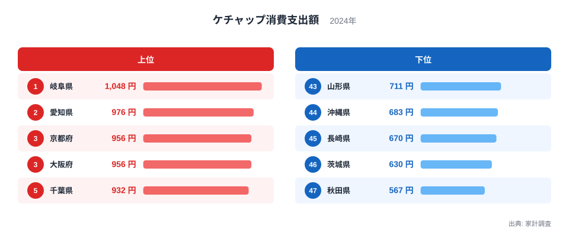
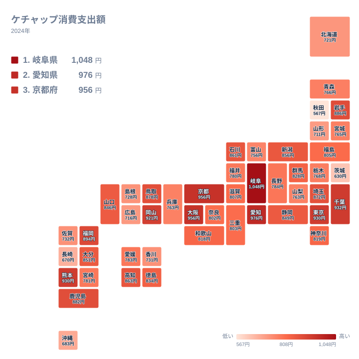

## ケチャップへの支出が最も多い県は？

ケチャップは、オムライスやナポリタン、ハンバーグのソースなど、家庭の食卓に広く浸透した調味料です。全国どこでも買えるありふれた品ですが、1年間に使うお金を県別に並べると、意外なほどはっきりした差が見えてきます。

2024年の家計調査で、ケチャップへの支出が最も多かったのは岐阜県でした。1世帯あたりの年間支出額は1,048円です。2位は愛知県で976円、3位は京都府と大阪府がともに956円で並びました。一方、最も少なかったのは秋田県の567円です。岐阜県と秋田県の差は481円あり、岐阜県は秋田県の2倍近い水準になっています。

この記事では、上位と下位に並ぶ県の顔ぶれを手がかりに、食文化、都市の外食・洋食文化、気候や暮らし方との関係を考えます。また、トマトの産地と支出額の関係についても、データから言える範囲で確かめます。

## 上位と下位の顔ぶれを見る

まず、上位5県と下位5県をまとめた図を見てみましょう。

<source-link href="/ranking/ketchup-consumption-expenditure">ケチャップへの支出ランキングをもっと見る</source-link>

上位は東海と近畿の大都市圏を含む県が中心で、5位の千葉県まで含めても、中部から近畿にかけての地域が目立ちます。下位には東北と九州・沖縄の県が多く、地域的な偏りがうかがえます。

注目したいのは、1位の岐阜県だけが1,000円台に乗っている点です。2位の愛知県から3位の京都府・大阪府までは976円から956円の間にあって差が小さく、トップだけが一段抜けています。岐阜県には、単なる誤差では片づけにくい独自の傾向がありそうです。

一方、下位は46位の茨城県が630円、47位の秋田県が567円と、最下位に近づくほど間隔が開いています。上位が僅差でひしめくのに対し、下位は底が深い形をしています。

> [!NOTE]
> ここでの金額は、家計調査における1世帯あたりの年間支出額です。購入した量ではなく支出額なので、価格が高い商品を選ぶ世帯が多い県や、少量パックを頻繁に買う県でも金額は変わります。「消費量」の順位とは必ずしも一致しません。

## 東海・近畿に強い洋食の土壌

岐阜県と愛知県が1位と2位に並んだことは、東海地方の食文化と重ねると理解しやすくなります。愛知県を中心とする名古屋圏には、あんかけスパゲッティや鉄板ナポリタンなど、ケチャップを使う洋食系の外食文化が根づいています。家庭でも、ケチャップを使う料理が日常的に作られているのかもしれません。

岐阜県は愛知県と生活圏が重なる部分が大きく、名古屋圏の食の影響を受けやすい県です。もっとも、岐阜県が愛知県を上回った理由を、今回のデータだけで断定することはできません。ここでは、隣接する県同士で上位を占めたという事実を押さえておきます。詳しい数値は[岐阜県のデータ](/areas/21000)や[愛知県のデータ](/areas/23000)で確認できます。

近畿では、京都府と大阪府がともに3位です。どちらも956円で同額でした。大阪府には喫茶店文化や洋食店の歴史があり、京都府も古くから洋食やパン食が根づいた都市として知られます。ケチャップは、こうした都市型の食生活と相性のよい調味料だと考えられます。

> [!TIP]
> 順位を見るときは、金額の差にも注目してください。ともに3位の京都府と大阪府は956円で、5位の千葉県の932円とも24円しか離れていません。中位以降は数十円の差で順位が入れ替わるため、順位の上下だけで「多い」「少ない」と判断するのは禁物です。

## 地理分布で見る東西と南北の傾向

次に、47都道府県の位置関係を、タイルマップで確認します。

地図で眺めると、中部から近畿、さらに首都圏にかけて、支出の多い県が連なっているのがわかります。東京都は930円で6位、熊本県も930円で同額の6位、岡山県は921円で8位です。大都市圏だけでなく、九州の熊本県や中国地方の岡山県のような県も上位に入っており、単純な「都会ほど高い」という説明では収まりません。

東北に目を向けると、岩手県は886円で10位と健闘していますが、青森県は766円で33位、宮城県は765円で34位、山形県は711円で43位、秋田県は567円で47位です。同じ東北でも、県によって位置づけに大きな開きがあります。

北海道は721円で41位、沖縄県は683円で44位でした。寒冷地や離島を含む地域で低めに出ており、気候や流通、地元の食材を中心にした食卓との関係がある可能性があります。ただし、これは傾向の整理であり、原因を特定したものではありません。

> [!WARNING]
> 家計調査は標本調査で、調査対象の世帯数が限られます。県全体の平均というより、調査に含まれた世帯の姿を映したものなので、年によって順位が入れ替わりやすい点に注意が必要です。1年分の結果だけで、県の食文化を決めつけないでください。

## 産地と食習慣から考える

ケチャップの原料はトマトです。トマトの産地として知られる熊本県は、930円で6位に入りました。産地の県で支出が多くなる傾向があるのかを、このデータだけで確かめることはできませんが、トマトを身近に感じる地域であることが、トマト加工品への親しみにつながっている可能性はあります。

一方で、茨城県は630円で46位、長崎県は670円で45位でした。トマトを含む野菜の産地は全国に広く分布するため、産地であることと家庭の支出額が直結するとは言えません。外食が多いか、家庭で洋食をどれほど作るか、ほかの調味料で代替しているかといった食習慣の違いが影響している可能性もありますが、このデータだけでは確かめられません。

ケチャップの支出が少ない県については、トマト系の味付けよりも、しょうゆやみそを軸にした和食中心の食卓が多い可能性があります。これも推測にとどまるため、他の統計と合わせて読む必要があります。同じ分野の統計は[同じカテゴリの統計一覧](/category/economy)から探せます。

## 中位の県が示すもの

中位の県を見ると、9位の福岡県から13位の埼玉県までに、九州、中国、首都圏の県が混在しています。地域のまとまりだけでは説明しきれない多様さがあります。

もう一つの特徴は、順位が下がるにつれて金額が緩やかに下がっていくことです。上位から下位まで極端な断絶はなく、分布は連続的です。つまり、ケチャップへの支出は特定の県だけが突出しているのではなく、全体としてなだらかに広がる指標だといえます。

ただし、最上位の岐阜県と最下位の秋田県の間には、はっきりとした距離があります。この差がどのような暮らしの違いに由来するのかは、他の食品支出と組み合わせて探っていく価値があります。

## データについて

この記事で使ったのは、家計調査の「ケチャップ消費支出額」(2024年、単位は円)です。1世帯あたりの年間支出額を都道府県別に比べたもので、全47件を対象にしています。

金額は購入した量そのものではなく、支払った額を表します。そのため、価格の高低、購入頻度、パックの大きさ、店頭での特売の有無などが数値に影響します。また、世帯の人数や年齢構成の違いも含まれるため、県同士を比べるときは、あくまで目安として読むのが適切です。

## まとめ

2024年のケチャップへの支出は、岐阜県が1,048円で1位、愛知県が976円で2位、京都府と大阪府が956円でともに3位でした。最下位は秋田県の567円で、トップとの差は481円です。

東海・近畿の洋食文化や都市の外食文化が上位に反映されている可能性がある一方、トマトの産地であるかどうかは、単純には結びつきませんでした。食文化の違いを読み取る入り口として、このデータを活用してみてください。
