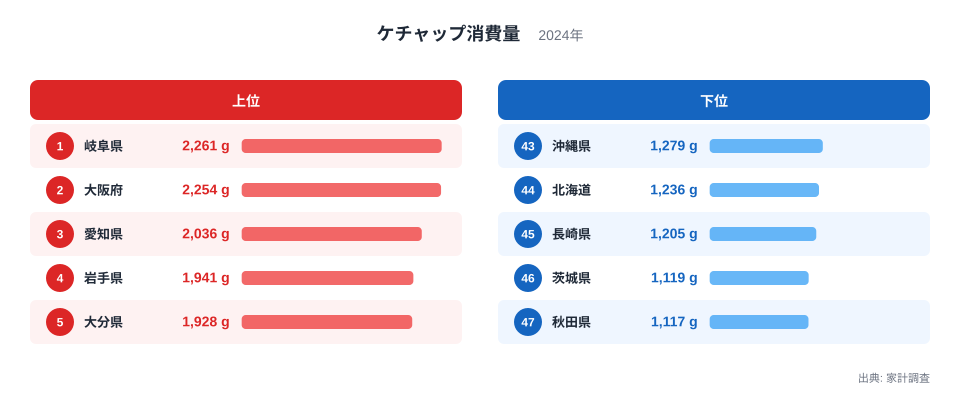
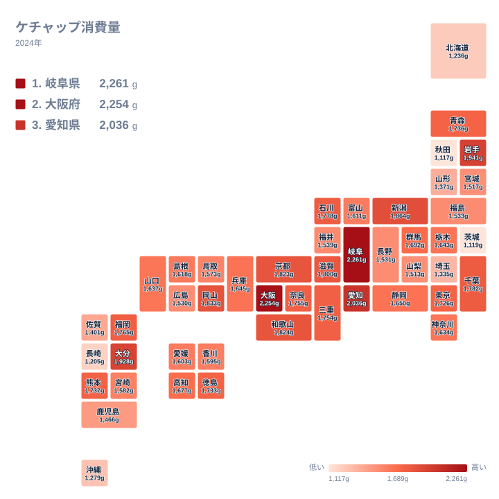

## ケチャップ消費量が多い県は？首位は岐阜県

ケチャップ消費量が最も多い県はどこでしょうか。2024年の家計調査によると、1位は岐阜県の2,261gでした。2位は大阪府の2,254gで、差はわずか7gです。3位は愛知県の2,036gで、上位3府県が全国の中でも抜けた水準にあります。

一方、最も少ないのは秋田県の1,117gです。北海道は1,236gで44位、茨城県は1,119gで46位でした。首位と最下位を比べると、岐阜県は秋田県の2倍前後を消費している計算になります。ただし、この記事では実データに載っている値だけを扱い、細かな倍率は計算しません。

ケチャップは洋食の調味料というイメージが強いものの、家庭での使い方は地域ごとに違いがあります。オムライスやナポリタン、炒め物の味付けなど、使われる場面が多いほど消費量は増えます。この記事では、上位と下位の顔ぶれを確認しながら、食文化や暮らしとの結びつきを考えます。

> [!NOTE]
> 本記事の数値は、家計調査における1世帯あたりの年間購入量で、単位はgです。人口全体の消費量ではなく、調査対象世帯の購入数量から見た指標です。

## 上位5府県と下位5道県を比べる

まず、上位と下位の顔ぶれを図で確認します。

<source-link href="/ranking/ketchup-consumption-quantity">ケチャップ消費量ランキングをもっと見る</source-link>

上位5位は、岐阜県の2,261g、大阪府の2,254g、愛知県の2,036g、岩手県の1,941g、大分県の1,928gです。東海、近畿、東北、九州と、地域がばらけている点が特徴です。1つの地方だけが突出しているわけではありません。

下位5位は、43位の沖縄県が1,279g、44位の北海道が1,236g、45位の長崎県が1,205g、46位の茨城県が1,119g、47位の秋田県が1,117gです。こちらも北海道・東北・関東・九州・沖縄と地域が分散しています。

上位でも下位でも、地方の単純な区分では説明しにくいことがわかります。そのため、気候だけでなく、外食や家庭料理の傾向、ほかの調味料との使い分けなど、複数の要因を重ねて見る必要があります。

> [!WARNING]
> 家計調査は標本調査で、都道府県によっては調査世帯数が限られます。順位の近い県どうしの差は、年ごとの偶然のぶれを含む可能性があります。1位と2位の7gの差も、実力差とは言い切れません。

## 東海・近畿に強い消費傾向

上位に並ぶ岐阜県、大阪府、愛知県は、いずれも東海から近畿にかけての地域です。愛知県や大阪府は、喫茶店文化や粉もの文化、洋食店の多さなどで語られることが多い地域です。ナポリタンやオムライス、お好み焼きの味付けなど、ケチャップが身近な場面は想像しやすいところです。

岐阜県は、愛知県の隣にあって食の影響を受けやすい県です。2,261gで首位に立った背景を、データだけで断定することはできません。ただ、名古屋圏の食文化と近い生活圏であることは、一つの手がかりになります。詳しい数値は[岐阜県のデータ](/areas/21000)で確認できます。

大阪府についても、[大阪府のデータ](/areas/27000)から他の統計と並べて見られます。近畿ではほかにも、京都府が1,823gで9位、和歌山県が1,824gで8位、滋賀県が1,800gで10位と、1,800g台がずらりと並びます。奈良県は1,755gで14位、三重県は1,754gで15位でした。近畿から東海にかけて、全体として高めの水準だとわかります。

## 地理分布で見ると何がわかるか

次に、全国の分布をタイルマップで見てみましょう。

マップを見ると、東海から近畿にかけてのまとまりが目立ちます。一方で、岩手県が1,941gで4位、大分県が1,928gで5位、新潟県が1,864gで6位と、離れた地域にも高い県があります。単一の産地や気候だけでは説明しきれない分布です。

東日本では、千葉県が1,782gで11位、石川県が1,778gで12位です。東京都は1,726gで19位、神奈川県は1,634gで26位でした。大都市圏が必ずしも上位にあるわけではない点は、意外に感じられるかもしれません。

下位には、秋田県、茨城県、長崎県、北海道、沖縄県が並びます。地域の食材や郷土料理が、洋風調味料の使い方に影響している可能性はあります。たとえば海産物や農産物の豊富な地域では、素材の味を生かす料理が中心になることも考えられます。ただし、これは仮説であり、データだけから結論づけることはできません。

> [!TIP]
> 順位だけでなく、実際の値の差を見ましょう。たとえば10位の滋賀県は1,800g、20位の群馬県は1,692gで、中位は値が密集しています。中位の順位の違いは小さく、上位3府県の突出のほうが意味のある差です。

## 関連品目との対比で考える

ケチャップの消費は、ソースやマヨネーズなどほかの調味料との使い分けとも関係していると考えられます。たとえば、お好み焼きや揚げ物にはソース、サラダにはマヨネーズ、パスタや卵料理にはケチャップというように、料理ごとに調味料が選ばれます。ある県でケチャップが少ない場合、ほかの調味料が多く使われている可能性もあります。

この記事で扱っているのは、ケチャップの購入量だけです。そのため、ほかの調味料との比較は実データに基づいて断言できません。ほかの品目も含めた傾向は、[同じカテゴリの統計一覧](/category/economy)から探すのが近道です。複数の指標を並べると、地域の食の個性がより立体的に見えてきます。

また、家庭で使うケチャップと、外食や中食で使われるケチャップは別物です。家計調査は家庭内の購入が中心ですので、喫茶店やレストランで食べる量は含まれません。名古屋圏や大阪府のように外食文化が盛んな地域では、実際の接触量はさらに大きい可能性もあります。

中位の県を見ても、1,700g台から1,500g台までさまざまです。福岡県は1,765gで13位、熊本県は1,737gで16位、青森県は1,736gで17位、徳島県は1,733gで18位でした。西日本から東北まで、地域をまたいで似た値が並ぶ点も興味深いところです。

## データについて

この記事の元になった統計は、家計調査の「ケチャップ消費量」で、2024年の値を使っています。単位はgで、各都道府県の県庁所在地および政令指定都市の世帯を中心とした調査にもとづく数値です。そのため、県全体の傾向をそのまま表すとは限りません。

また、1年間の購入量であるため、特売や物価、家族構成、世帯人数の違いにも左右されます。ほかの年と比べるときは、同じ条件でそろえて見る必要があります。この記事では2024年の値だけを扱っており、過去との比較はしていません。

## まとめ

2024年のケチャップ消費量は、岐阜県が2,261gで1位、大阪府が2,254gで2位、愛知県が2,036gで3位でした。最下位は秋田県の1,117gで、次いで茨城県が1,119g、長崎県が1,205gです。

上位には東海・近畿が多く並ぶ一方、岩手県や大分県、新潟県のように離れた地域も入っています。食文化や外食習慣、家庭の調理スタイルなど、複数の要素が重なって差が生まれていると考えられます。

数値の裏にある背景は、1つの指標だけでは決めつけられません。関心のある県のデータを見比べながら、自分の地域の食卓を振り返ってみてください。
