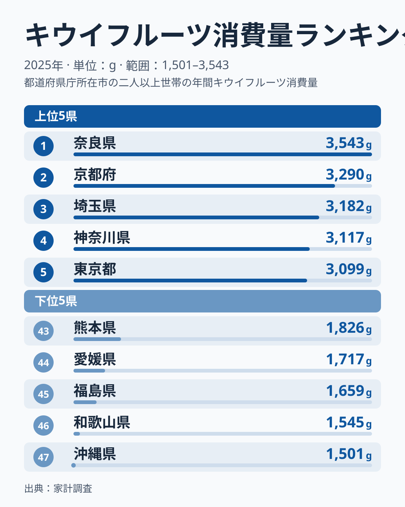
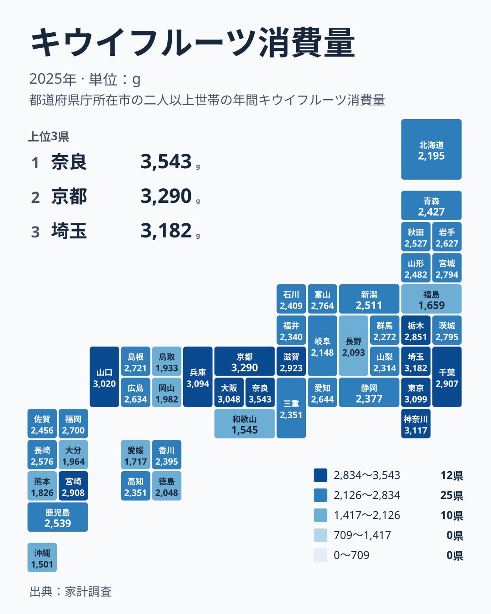

キウイフルーツを一年間にどれだけ買って食べているかを、都道府県ごとに並べてみると、意外な県が先頭に立ちます。家計調査の2025年の結果で1位になったのは奈良県で、3,543gでした。果物の産地として名前が挙がることの多い県ではなく、買い手としての県民が主役になる指標です。

ここでは、キウイフルーツ消費量の上位と下位を見比べながら、なぜその差が生まれるのかを、食文化や暮らし方、産地との距離という観点から考えます。あわせて、関連する品目の読み方にも触れます。

## 日本一は奈良県、続くのは京都府

まず、上位5県と下位5県を一枚にまとめた図を見てください。

<source-link href="/ranking/kiwi-consumption-quantity">キウイフルーツ消費量ランキングをもっと見る</source-link>

1位は奈良県で3,543g、2位は京都府で3,290gです。3位は埼玉県で3,182g、4位は神奈川県で3,117g、5位は東京都で3,099gと続きます。上位5つの顔ぶれは、近畿の2府県と、首都圏の3都県にきれいに分かれています。

一方、下位に目を向けると、47位は沖縄県で1,501gです。46位は和歌山県で1,545g、45位は福島県で1,659g、44位は愛媛県で1,717g、43位は熊本県で1,826gでした。上位と下位を並べると、同じ果物でも家庭に入る量にははっきりした開きがあります。

注目したいのは、奈良県と和歌山県が同じ近畿でありながら、1位と46位に分かれている点です。奈良県は海に面しない内陸の県で、和歌山県は海沿いに果樹園が広がる県です。近畿というくくりだけでは、キウイの消費は説明できないことが分かります。

[奈良県のデータ](/areas/29000)と[京都府のデータ](/areas/26000)をあわせて見ると、人口の集まり方や暮らしの構成が、果物の買い方とどう結びつくかを考える手がかりになります。

> [!NOTE]
> この指標は家計調査によるキウイフルーツの購入数量で、単位はグラムです。金額ではなく重さなので、高級品を少し買う家庭より、安価なものをたくさん買う家庭のほうが大きな値になります。また、調査の対象は世帯が実際に買った量であり、贈答品や外食で口にした分は含まれません。

## 地図で見ると、大都市圏に高い県が集まる

次に、47都道府県の分布を地図で確認します。

地図に色を載せると、上位の県が日本列島の中ほどに固まっているのが見えます。奈良県と京都府に加え、兵庫県が3,094g、大阪府が3,048g、滋賀県が2,923gと、近畿の主要な府県が軒並み上位に入っています。首都圏でも、千葉県が2,907g、栃木県が2,851g、茨城県が2,795gと高い水準です。

西日本では、山口県が3,020gで8位に入りました。宮崎県も2,908gで10位です。中国地方の山口県と、九州の宮崎県が、大都市圏の県々と肩を並べているのは興味深い結果です。

反対に、色が薄くなるのは東北の南部や四国、九州の一部、そして沖縄県です。福島県は1,659gで45位、愛媛県は1,717gで44位、熊本県は1,826gで43位と、いずれも全国の下位に並びます。

つまり、キウイの消費量は、単純に北が多い、南が多いといった傾斜では並びません。大都市とその周辺で高く、都市から離れた県や、別の果物が暮らしに根づいている県で低くなる、という二重の構図が見えてきます。

> [!TIP]
> 地図を読むときは、色の濃い県だけでなく、色の薄い県の隣に何があるかも見てください。和歌山県は1,545gで46位ですが、すぐ隣の奈良県が1位です。隣り合う県の差が大きいほど、地理的な近さより、その県の食習慣や買い物環境の違いが効いていると考えられます。

## 奈良県が1位になる理由は、このデータからは断定できない

題の問いに正面から答えると、奈良県だけが特別に多い理由を、この指標から証明することはできません。確かめられるのは次の三点です。

- 2位の京都府との差は253gで、奈良県の3,543gの1割に満たない、小さな開きです。
- 3位の埼玉県から5位の東京都までは3,099gから3,182gの間に収まっており、奈良県は大都市圏の上位グループの先頭に立った形です。
- 家計調査は県庁所在市を中心とした標本調査なので、1位は「奈良市周辺の世帯がよく買った」結果であり、県全体の食習慣をそのまま示すものではありません。

奈良県固有の事情として、内陸の県で産地ではないことは事実ですが、それが消費量を押し上げたと示す証拠はありません。したがって、奈良県が日本一という結果は「近畿と首都圏の上位グループの中で、標本の偏りの範囲を含めて先頭に出た」と読むのが限界です。本当に奈良県の特徴かどうかは、過去の年次や他の果物の順位で、毎年上位に入るかを確かめる必要があります。

## なぜ大都市圏で多いのか

上位に並ぶ県の共通点として、まず考えられるのは、スーパーや青果店の品ぞろえの厚さです。キウイフルーツは年間を通して店頭に並びやすく、輸入ものと国産がともに流通します。流通の拠点に近い県ほど、手に取りやすい価格と鮮度で買える機会が多くなります。

次に、朝食の習慣があります。キウイはヨーグルトやパンと合わせて、手軽にビタミンを補える果物として定着しました。共働きの世帯が多い大都市圏では、皮をむいて切るだけで食べられる果物が重宝されると考えられます。ただし、これはデータから直接確かめた結論ではなく、背景として考えられる説明の一つです。

京都府と奈良県が並んで上位に入る点にも触れておきます。どちらも、健康や食材の質への関心が高いとされる地域です。隣り合う二つの県が1位と2位を占めたことは、購買の傾向が生活圏のなかで共有されている可能性を示します。もっとも、この指標だけでは原因までは断定できません。

首都圏では、埼玉県が3,182g、神奈川県が3,117g、東京都が3,099gと、三つの都県がほぼ横並びです。三つとも3,000gを超えており、大都市圏の消費が全国の上位を支えている構図がはっきりします。

## 産地の近くで、消費は増えるとは限らない

意外に思えるのは、キウイの産地として知られる地域が、必ずしも上位に入らない点です。愛媛県はキウイの栽培が盛んな県として知られていますが、消費量は1,717gで44位でした。産地であることと、家庭でよく買われることは別の話です。

産地の県では、出荷が中心で地元の店頭に回る量が少ないことや、ほかの果物が暮らしに深く根づいていることが考えられます。愛媛県であれば、柑橘類が果物の中心にあるため、キウイが選ばれる機会が相対的に減るのかもしれません。ただし、これも仮説であり、このデータだけで証明できるものではありません。

和歌山県も同じ構図です。みかんなど、ほかの果物の産地として知られる県で、キウイの消費は1,545gと下位にあります。地元で豊富に手に入る果物があれば、それを優先して食べるのは自然な行動です。

沖縄県の1,501gも、同じ文脈で理解できます。南国の果物が身近にあり、輸入果物を日常的に買う習慣が本土と違うことが、47位という結果に関わっている可能性があります。

一方で、九州の中でも宮崎県は2,908gで10位、福岡県は2,700gで17位と高めです。九州は一枚岩ではなく、県ごとに消費の姿が大きく異なります。

## 関連する果物と読み比べるために

キウイの消費差を読み解くには、ほかの果物の数字と並べてみるのが近道です。柑橘類が強い県でキウイが弱い、という関係が見えれば、先ほどの仮説に一歩近づきます。逆に、果物全般を多く買う県でキウイも多いなら、単に果物好きの県だという説明になります。

どちらの読み方が正しいかは、この記事の実データだけでは決められません。ほかの品目のランキングを開いて、同じ県が上位に入るか、下位に入るかを確かめてください。[同じカテゴリの統計一覧](/category/economy)から、関連する家計の項目を探せます。

> [!WARNING]
> 家計調査は標本調査で、県庁所在市を中心とした世帯のデータをもとにしています。県全体の暮らしをそのまま表すわけではありません。また、1位と2位の差のように近い順位は、調査の誤差の範囲に収まる可能性があります。順位の差を過大に読まないでください。

## 順位より、層で見る

最後に、順位の読み方を整理します。1位の奈良県が3,543gで、47位の沖縄県が1,501gです。この開きは大きいものの、47県を順に追うと、中位には2,500g前後の県が数多く並んでいます。たとえば、秋田県は2,527gで23位、鹿児島県は2,539gで22位、長崎県は2,576gで21位です。

多くの県は、極端に多くも少なくもない中位の層に集まっています。順位の上下に一喜一憂するより、自分の県がどの層にいるかを把握するほうが、数字の意味をつかみやすくなります。

近畿と首都圏が上位を占め、産地や南の離島が下位に沈むという構図は、キウイが贅沢な果物ではなく、生活に溶け込んだ日常の果物であることを示しています。奈良県が日本一であるという事実は、その象徴のように見えます。

## データについて

この記事の数値は、家計調査のキウイフルーツ消費量にもとづいており、年は2025年、単位はグラムです。全47件の値を使い、順位は値の大きい順に付けています。値が同じ県は、同じ水準として並びます。

詳しい順位や、ほかの県の値は、[キウイフルーツ消費量ランキング](/ranking/kiwi-consumption-quantity)で確認できます。
