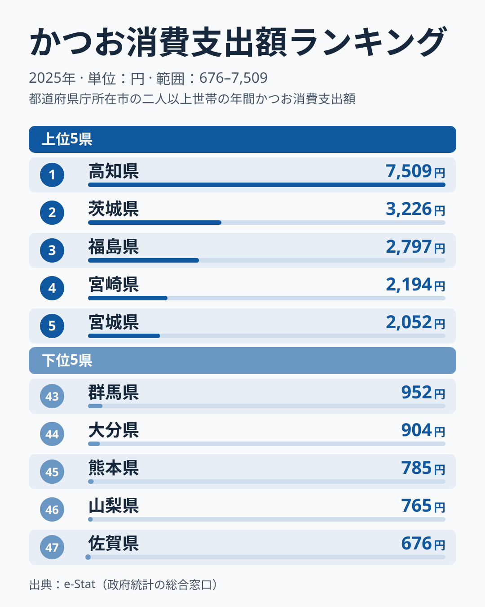
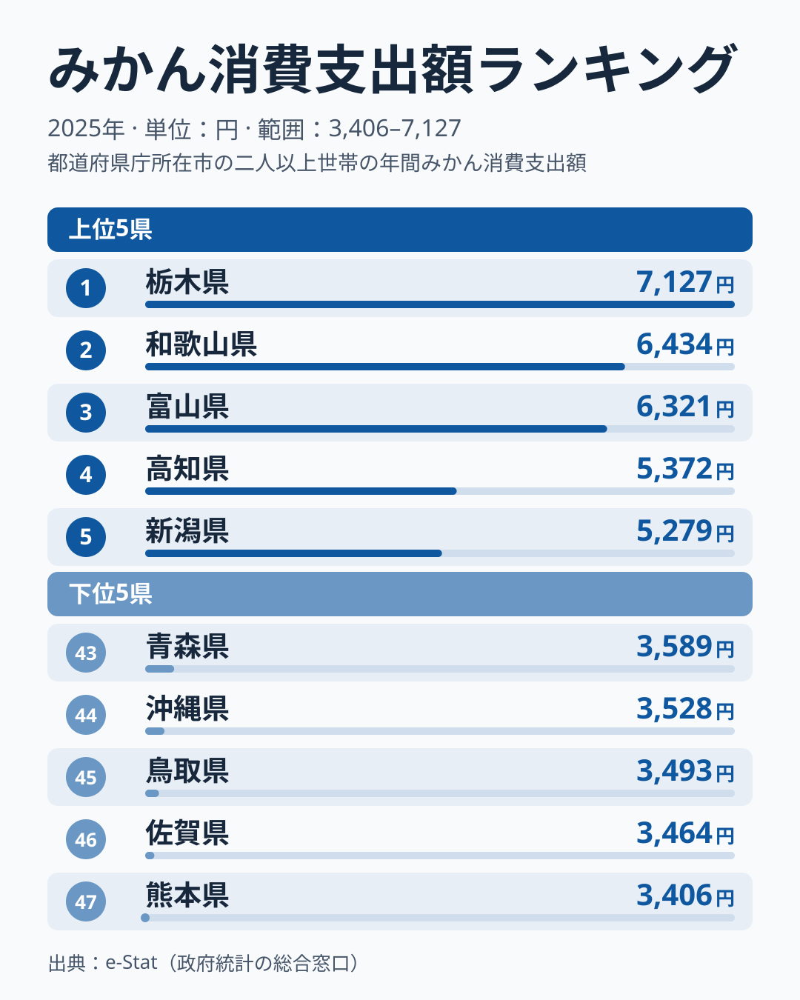
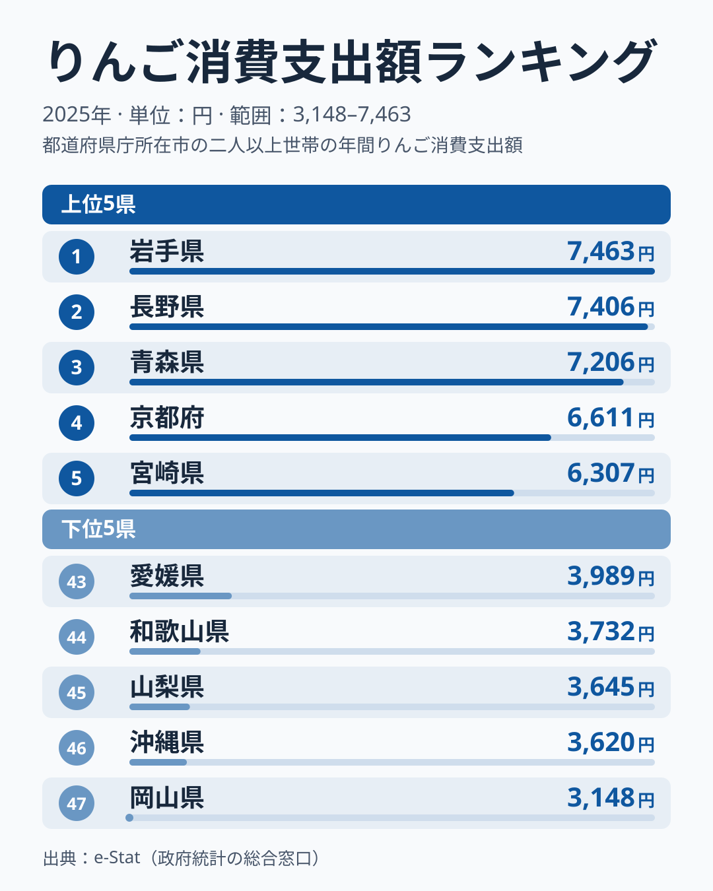
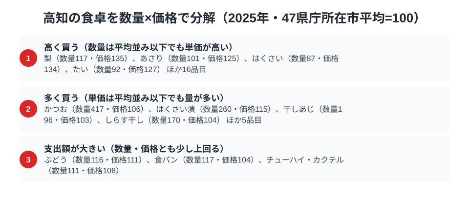

「高知県といえばかつおのたたき」というイメージは、家計調査の数字にはっきりと表れています。総務省の家計調査（品目別）で高知市の二人以上世帯を見ると、2025年のかつお消費支出額は7,509円で全国1位。2位の茨城県3,226円の約2.3倍という、他の追随を許さない独走です。

ところが同じ高知県のみかんは、2024年に全国47位の最下位だったのが、2025年には4位へ急浮上しました。ゆずをはじめとする柑橘の名産地である高知で、みかんの順位はなぜこれほど動くのでしょうか。この記事では、高知県民の食卓を「何にお金を使い、何に使わないか」の両面から見ることで、黒潮に面した南国・高知ならではの食文化の輪郭を浮かび上がらせます。

> [!NOTE]
> 家計調査の都道府県データは、県庁所在市（高知県は高知市）の二人以上世帯を対象にした年間支出額です。県全体ではなく高知市在住世帯の家計簿から見た傾向であり、支出「金額」であって消費「量」そのものではない点にご注意ください。

## かつお — 2位の2.3倍、全国で唯一の「7,000円台」

<source-link href="/ranking/bonito-consumption-expenditure">かつお消費支出額ランキングをもっと見る</source-link>

高知県のかつお消費支出額は7,509円で全国1位です。注目すべきはその突出ぶりで、2位の茨城県は3,226円と、高知の半分にも届きません。最下位の佐賀県676円と比べると11.1倍。1位が2位を2倍以上引き離す独走で、前年の2024年も高知が7,369円で首位でした。

この数字の背景には、黒潮に乗って回遊するかつおを一本釣りする漁法の伝統と、「かつおのたたき」という郷土料理の存在があります。藁焼きのたたきを家庭でも作り、にんにくや薬味をたっぷり添えて食べるスタイルが日常に根づき、春の「初がつお」と秋の「戻りがつお」を季節の行事のように楽しむ習慣もあります。外食だけでなく家庭の食卓でもかつおが主役を張り続けていることが、この圧倒的な支出額に凝縮されています。

かつおの消費地図が太平洋側に偏る構図は、[かつおと牡蠣の東西対比を扱った記事](/blog/bonito-vs-oyster-fish-map)でも詳しく取り上げています。黒潮の魚であるかつおは、高知を頂点に太平洋沿岸で強く、日本海側で弱いという明快な分布を示します。

## みかん — 前年最下位47位から4位へ、柑橘王国の順位は大きく揺れる

<source-link href="/ranking/mandarin-consumption-expenditure">みかん消費支出額ランキングをもっと見る</source-link>

一方で、みかんの消費支出額は高知県が5,372円で全国4位です。1位の栃木県7,127円の約75%にあたります。ところが前年の2024年は3,099円で47位の最下位でした。ゆず生産量日本一を誇り、文旦など多彩な柑橘を育てる「柑橘王国」高知で、みかんの順位が1年で43位も動いたことになります。

高知市のみかん消費支出額の順位は、2007年から2025年の19年間で3位から47位まで動いています。10位以内に入ったのは6回、30位以下に沈んだのは7回で、2023年は6位（5,358円）、2024年は47位（3,099円）、2025年は4位（5,372円）と直近3年だけでも大きく振れます。

[仮説] この振れ幅は、県庁所在市の標本世帯が少ない家計調査では、1年ごとの購入量や果物の価格・作柄の違いがそのまま順位に出やすいためです。「高知はみかんを食べない県」でも「よく食べる県」でもない可能性があります。検証コマンド: `/usr/bin/curl -s https://storage.stats47.jp/app/ranking/mandarin-consumption-expenditure/values.json` の各年の高知を並べ、数年平均でも順位が定まらないかを確認します。検証期日: 2027-03-31（2026年分が R2 に入った時点で同じ表に追加し、仮説が崩れないか確かめます）。

もう一つ、家計調査の品目区分も効いています。この統計でいう「みかん」は温州みかんを指し、ゆず・文旦（ザボン）といった高知の主力柑橘は「他の柑きつ類」として別枠で集計されます。そのため、ゆずなど高知らしい柑橘の消費は、ここで見ているみかんの順位には含まれません。産地の県のみかんの順位は、[みかん消費の産地の逆説を扱った記事](/blog/mandarin-expenditure-ranking)でも取り上げています。

## りんご・いか — 「黒潮の外」は控えめ

<source-link href="/ranking/apple-consumption-expenditure">りんご消費支出額ランキングをもっと見る</source-link>

かつお・みかん以外の品目を見ると、高知の食卓の輪郭がさらにはっきりします。寒冷地の果物であるりんごは5,104円で22位と中位です。1位の岩手県7,463円の約7割で、産地の県ほどは使わないものの、極端に低い水準でもありません。かつおのような突出がないぶん、りんごの順位は食卓の特徴というより平均的な水準を映していると読めます。

海産物でも、寒流域が主産地のいかは1,804円で18位と、かつおの突出とは対照的に全国中位にとどまります。黒潮の魚には日本一お金を使い、寒流の魚介や寒地の果物は中位。高知の食卓は、かつおだけが突き抜けて、ほかは全国の真ん中に並ぶ形です。

> [!WARNING]
> 家計調査は支出金額の調査であり、消費量そのものではありません。物価や単価の違いも金額に影響するため、「最下位＝まったく食べない」という意味ではない点にご注意ください。特に高知のみかんのように、品目区分（温州みかんと他の柑きつ類の別集計）や単年のぶれが順位を大きく左右するケースがあります。

## 高知の食卓を貫くもの

高知県民の食卓を貫くのは、「地元の自然が生むものを深く味わう」という明快な軸です。黒潮がもたらすかつおには全国平均を大きく超える支出を注ぎ、柑橘はゆず・文旦など地元品種も楽しむ。その結果、かつおは2024年・2025年と連続で1位を保つ一方、みかんは47位から4位へ1年で入れ替わるという、安定と揺れの対照が同居します。

この「特化型」の食卓は、幅広い食材をまんべんなく消費する大都市圏の食卓とは対照的です。かつおのように年が変わっても動かない1位と、みかんのように年ごとに順位が入れ替わる品目をセットで見ることで、高知の食文化の核が「黒潮の恵みへの特化」にあり、柑橘の順位は単年では判断できないことが見えてきます。

> [!TIP]
> 県の食文化をデータで読むときは、1位の品目だけでなく、前年の順位との比較もセットで見ると輪郭がはっきりします。高知のかつおのように連年で1位を保つ品目は、特定の海流・気候・地元産品に食卓が強く結びついている証拠です。みかんのように1年で最下位から4位へ動く品目は、単年の順位から構造を決めつけない方が安全です。品目区分のからくり（温州みかんと他の柑きつ類など）も忘れずに確認してください。

## 数量×価格で分解する高知市の食卓

<source-link href="/ranking/bonito-consumption-quantity">かつお消費量ランキングをもっと見る</source-link>

家計調査の品目データは、支出額を「数量（どれだけ買うか）」と「価格（1単位あたりいくら払うか）」に分解できます。47県庁所在市の平均をそれぞれ100とした指数で見ると、高知市のかつお消費量指数は417と平均の4倍を超える一方、価格指数は106で平均を6%上回る程度です。つまり支出額1位という結果は、かつおを高く買っているからではなく、圧倒的な量を買っているからだと分かります。

この傾向はかつお節・削り節にも波及しており、高知は沖縄に次いで全国で2番目に多く支出しています（1,490円、沖縄は1,761円）。数量指数は183、価格指数は92で、こちらも単価を抑えながら量を買うタイプです。生のかつおだけでなく加工品にも量で厚みを出す「かつお文化」がうかがえます。

一方でみかんは、数量指数が106と平均並みで、価格指数は111と1割ほど高くなっています。4位という順位は、量を特に多く買っているというより、平均並みの量に平均を上回る単価がかかった結果です（量だけの順位は13位）。りんごも数量指数90・価格指数111で、22位は平均を少し下回る量に高めの単価が乗った中位の水準です。数量と価格を切り分けることで、高知の食卓は「圧倒的に多く買う品目」と「量も価格も平均前後に収まる品目」がはっきり分かれていることが見えてきます。

> [!TIP]
> 支出額だけでは「高く買っている」のか「たくさん買っている」のか区別できません。かつおのように価格指数が平均に近いのに支出額が全国で突出して多い品目は、量で稼いでいるサインです。逆にみかんやりんごのように数量指数が平均前後で価格指数が1割ほど高い品目は、量ではなく単価が支出額を押し上げていると読み解けます。

なお、ここでの数量指数・価格指数は、総務省家計調査の47都道府県庁所在市（二人以上世帯）の単純平均を100とした相対値で、家計調査の「全国」値ではありません。また価格指数は同じ品目内の品種・ブランド・購入場所の違いも含むため、単価そのものの高低を厳密に表すわけではない点にご注意ください。対象は2025年の年間支出額・数量です。

## まとめ

- かつお消費支出額は高知県が全国1位（7,509円）、2位茨城県3,226円の約2.3倍で独走
- みかんは2025年に全国4位（5,372円）。2024年は47位（3,099円）で、19年間の順位は3位から47位まで動く
- りんごは22位（5,104円）、いかは18位（1,804円）と、黒潮の外の食材は中位
- 動かない1位（かつお）と揺れる順位（みかん）をセットで見ると、柑橘の順位は単年で判断できず、食卓の核は「黒潮の恵みへの特化」だと見える

高知県の他の統計は[高知県の地域プロフィール](/areas/39000)、食品・家計消費の地域差は[経済カテゴリ一覧](/category/economy)からご覧いただけます。
