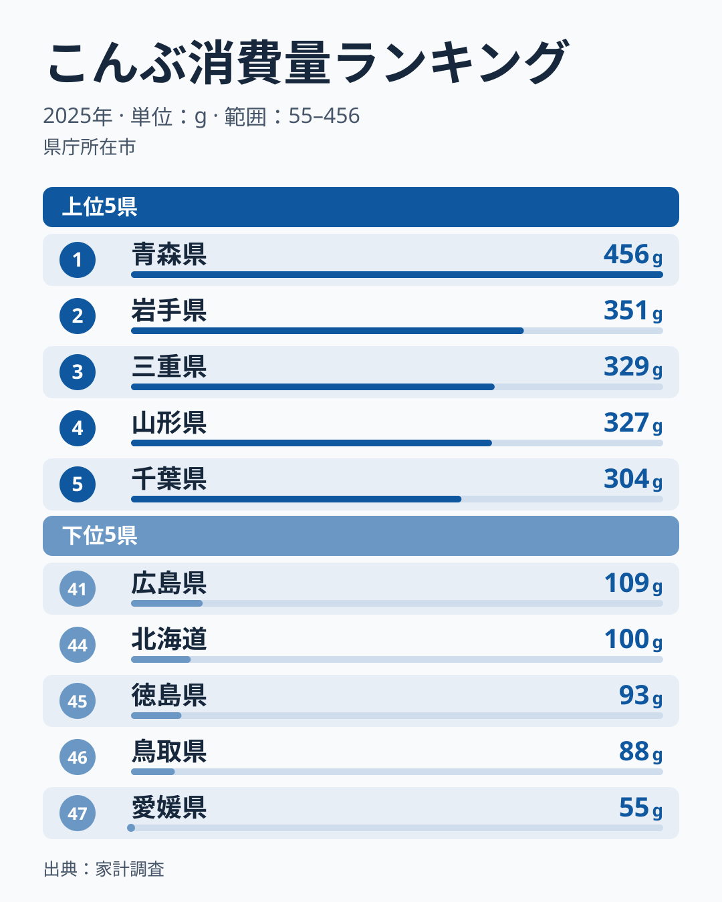
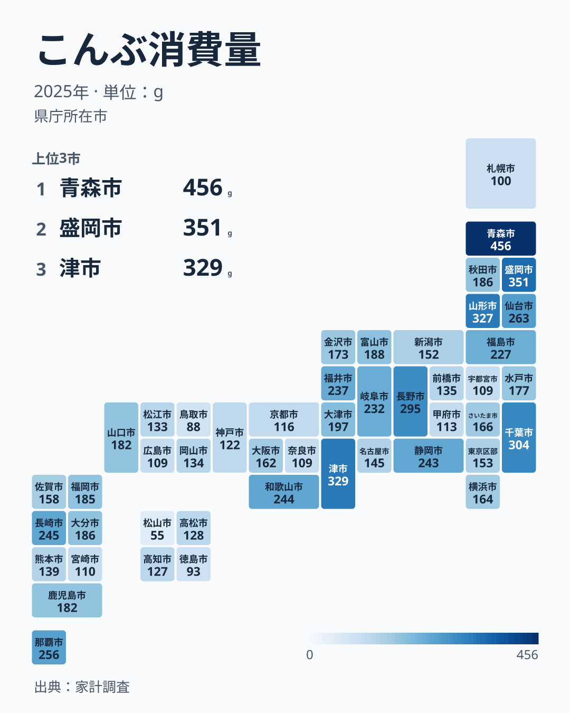

国内の昆布生産の大半を担う北海道が、家庭で買うこんぶの量では47都道府県中44位にとどまります。総務省「家計調査」の2025年の結果では、[北海道](/areas/01000)は100gでした。1位の[青森県](/areas/02000)は456gで、北海道の約4.6倍にあたります。

「産地の人ほど食べない」と片づけたくなる結果ですが、話はそれほど単純ではありません。青森県と岩手県も昆布がとれる県なのに、こちらは上位に並ぶからです。この記事では、上位と下位の顔ぶれを図で確かめたうえで、産地と消費地がずれる県とずれない県があることを見ていきます。

> [!NOTE]
> 家計調査の「こんぶ」は、都道府県庁所在市に住む二人以上の世帯が1年間に購入した量を、1世帯当たりのグラム数で示したもの。県全体の平均ではなく、北海道の値は札幌市、青森県の値は青森市の世帯の値にあたる。こんぶつくだ煮は別の品目として集計され、だしの素やめんつゆに含まれる昆布もこの数量には入らない。

## 1位は青森の456g、最下位の愛媛とは約8.3倍

<source-link href="/ranking/konbu-consumption-quantity">こんぶ消費量ランキングを47都道府県で見る</source-link>

2025年の1位は青森県の456gです。2位は岩手県で351g、3位は三重県で329g、4位は山形県で327g、5位は千葉県で304gと続きます。2位から5位までは50g足らずの幅に収まっているのに対し、青森県だけが頭ひとつ抜けています。

下位に目を移すと、最下位の47位は愛媛県で55gです。46位は鳥取県で88g、45位は徳島県で93g、44位が北海道で100gでした。その上の41位には栃木県、奈良県、広島県が109gで並びます。青森県の456gは愛媛県の55gの約8.3倍にあたり、同じ品目でも県庁所在市によって買う量に大きな開きがあることがわかります。

上位10県を見ると、7位にも宮城県が263gで入ります。ここまでに挙げた青森県、岩手県、山形県と合わせて、東北が4県を占めます。一方で、3位の三重県、5位の千葉県、6位の長野県のように東北以外の県も上位に入っており、「北の県ほど多い」と一言でまとめられる分布ではありません。47都道府県の真ん中にあたる24位は埼玉県の166gで、青森県はその約2.7倍です。

青森県や岩手県、山形県では、昆布巻きや煮しめのように昆布そのものを具材として食べる料理が家庭に残っているといわれます。だしを取るだけでなく昆布を食べる習慣があれば、1世帯が買うグラム数は増えやすくなります。ただし、家計調査は料理の内訳までは記録していません。これは購入量の多さと矛盾しない説明のひとつとして受け取ってください。

## 産地の北海道は44位、同じ産地の青森と岩手は上位

北海道の100gは、全国の真ん中である埼玉県の166gの6割ほどです。昆布の大産地でありながら家庭の購入量が少ないことから、「産地は出荷が中心で、地元ではあまり買わない」という見方がよく語られます。

しかし、この見方だけでは説明がつきません。青森県と岩手県も昆布の水揚げがある県ですが、消費量は青森県が1位、岩手県が2位です。産地であることが購入量を下げるのなら、この2県も下位に並ぶことになりますが、実際は逆になっています。

違いを生みうる要素のひとつは、数字が指している範囲です。北海道の値は札幌市の世帯のもので、昆布漁が盛んな道内の沿岸部の家庭は含まれません。産地の漁村で昆布をどれだけ食べているかは、この統計からは読み取れません。

もうひとつは、買わずに手に入る昆布の存在です。家計調査の数量は購入した分だけを数えるため、もらい物や自分で採った昆布は入りません。産地に近い世帯ほどこうした入手が多いのであれば、購入量は実際に食べている量より少なく出ます。もっとも、同じ事情は青森県や岩手県にも当てはまりうるため、北海道だけが低い決め手にはなりません。ここで押さえておきたいのは、「産地かどうか」だけでは順位が決まらないという点です。

## 地図で見ると三重・和歌山・長崎・沖縄にも多い県

地図のタイルには、値の対象である県庁所在市の名前が入っています。色の濃い県が東北に集まる一方で、離れた場所にも濃い県が点在していることがわかります。三重県は329gで3位、沖縄県は256gで8位、長崎県は245gで9位、和歌山県は244gで10位です。沖縄県では昆布を豚肉などと炒め煮にする料理が知られており、昆布がとれない地域でも食べ方が根づけば購入量が多くなりうることを示す例といえます。

逆に色が薄いのは四国と山陰です。四国は愛媛県が47位、徳島県が45位、高知県が127gで36位、香川県が128gで35位と、4県すべてが35位以下に入ります。山陰も鳥取県が46位、島根県が133gで34位です。

江戸時代には、蝦夷地の昆布が北前船で各地の港を経て大坂へ運ばれ、寄港地に昆布の食文化が広がったと説明されることがあります。2025年の数字でこの説明を照らすと、当てはまる県とそうでない県に分かれます。北前船の寄港地があった福井県は237gで12位、富山県は188gで16位と中位より上です。一方で、同じく寄港地があった新潟県は152gで29位、終点にあたる大阪府は162gで26位でした。歴史的な流通路の影響があったとしても、それだけで現在の購入量が決まっているとまではいえません。

昆布だしの文化で知られる京都府も116gで38位にとどまります。だしの素や外食で昆布を口にする機会は家庭での購入量に表れないため、「昆布だしをよく使う地域」と「昆布を多く買う地域」は別のものとして見る必要があります。

> [!WARNING]
> 家計調査は標本調査で、こんぶのように購入頻度の低い品目は年ごとの振れが大きい。首位の県も年によって入れ替わるため、1年分の順位の細かな差に意味を持たせすぎないこと。複数年のランキングで位置が安定しているかを確かめると読み誤りを防げる。

## こんぶ消費量の順位を引用するときの確かめ方

この順位を資料や授業で引用するときは、次の3点を添えると誤解を防げます。

- 対象は都道府県庁所在市の二人以上の世帯で、県全体の平均ではありません。
- 数量は家庭が購入した「こんぶ」という品目のもので、こんぶつくだ煮や、だしの素に含まれる昆布は入りません。
- 単年の値は振れやすいため、前後の年と見比べて使います。

量ではなく金額で見たい場合や、加工品の傾向と比べたい場合は、別の指標が使えます。あわせて見る: [こんぶ消費支出額ランキング](/ranking/konbu-consumption-expenditure) / [こんぶつくだ煮消費量ランキング](/ranking/konbu-tsukudani-consumption-quantity)

## まとめ

- 2025年のこんぶ消費量は、1位が青森県の456g、最下位が愛媛県の55gで、約8.3倍の開きがあります。
- 昆布の大産地である北海道は100gで44位です。同じく昆布がとれる青森県は1位、岩手県は2位で、産地かどうかだけでは順位を説明できません。
- 上位10県のうち4県が東北で、三重県、沖縄県、長崎県、和歌山県のように離れた地域にも多い県があります。
- 京都府は116gで38位です。昆布だしの文化と、家庭が昆布を買う量は別の指標として読む必要があります。
- 値は県庁所在市の世帯のもので、年ごとの振れが大きい点に注意が必要です。
