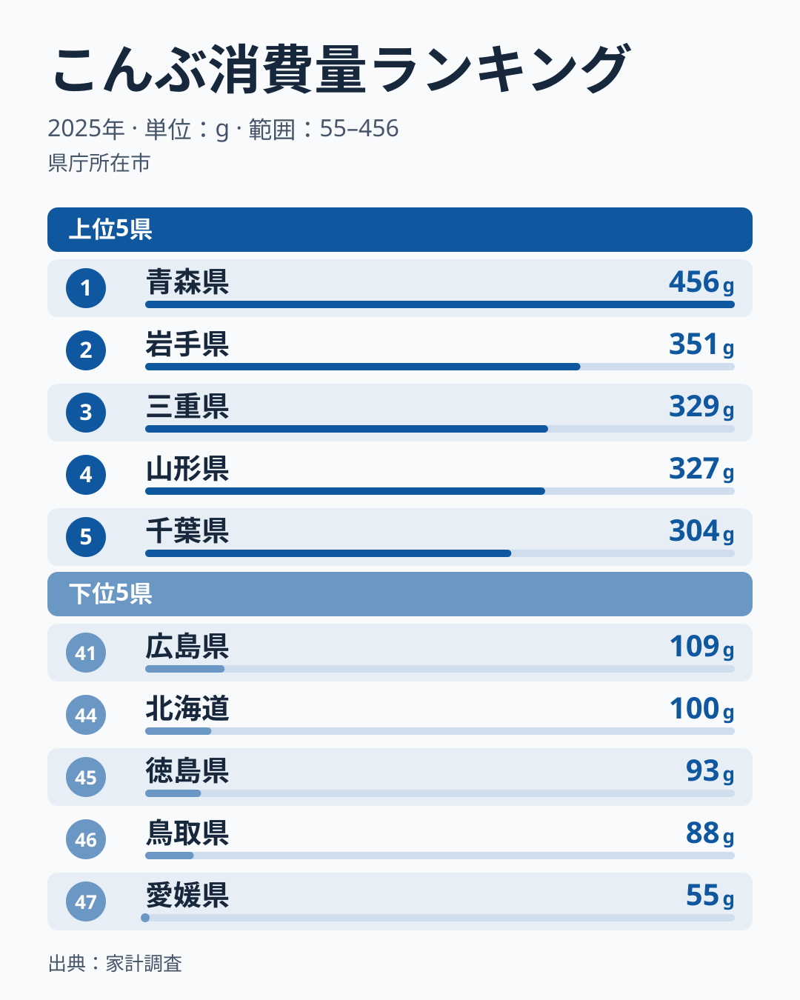
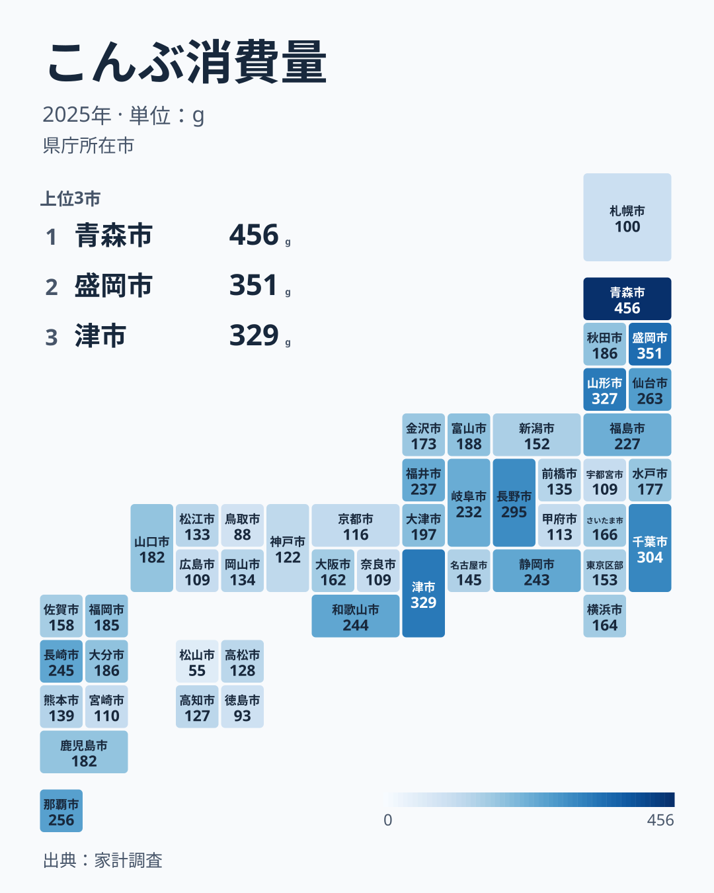

昆布の産地として知られる北海道が、家庭で買うこんぶの量では47都道府県中44位にとどまります。総務省「家計調査」の2025年の結果では、[北海道](/areas/01000)は100gでした。1位の[青森県](/areas/02000)は456gで、北海道の約4.6倍にあたります。

「産地の人ほど食べない」と片づけたくなる結果ですが、話はそれほど単純ではありません。青森県と岩手県も昆布がとれる県なのに、こちらは上位に並ぶからです。この記事では、上位と下位の顔ぶれを図で確かめたうえで、産地と消費地がずれる県とずれない県があることを見ていきます。

> [!NOTE]
> 家計調査の「こんぶ」は、都道府県庁所在市に住む二人以上の世帯が1年間に購入した量を、1世帯当たりのグラム数で示したもの。県全体の平均ではなく、北海道の値は札幌市、青森県の値は青森市の世帯の値にあたる。こんぶつくだ煮は別の品目として集計され、だしの素やめんつゆに含まれる昆布もこの数量には入らない。

## 1位は青森の456g、最下位の愛媛とは約8.3倍

<source-link href="/ranking/konbu-consumption-quantity">こんぶ消費量ランキングを47都道府県で見る</source-link>

2025年の1位は青森県の456gです。2位は岩手県で351g、3位は三重県で329g、4位は山形県で327g、5位は千葉県で304gと続きます。2位から5位までは50g足らずの幅に収まっているのに対し、青森県だけが頭ひとつ抜けています。

下位に目を移すと、最下位の47位は愛媛県で55gです。46位は鳥取県で88g、45位は徳島県で93g、44位が北海道で100gでした。その上の41位には栃木県、奈良県、広島県が109gで並びます。青森県の456gは愛媛県の55gの約8.3倍にあたり、同じ品目でも県庁所在市によって買う量に大きな開きがあることがわかります。

上位10県を見ると、7位にも宮城県が263gで入ります。ここまでに挙げた青森県、岩手県、山形県と合わせて、東北が4県を占めます。一方で、3位の三重県、5位の千葉県、6位の長野県のように東北以外の県も上位に入っており、「北の県ほど多い」と一言でまとめられる分布ではありません。47都道府県の真ん中にあたる24位は埼玉県の166gで、青森県はその約2.7倍です。

青森県や岩手県、山形県では、昆布巻きや煮しめのように昆布そのものを具材として食べる料理が家庭に残っていて、それが購入量を押し上げている可能性があります。この記事ではこの食文化の出典を確かめておらず、家計調査も料理の内訳までは記録していないため、確かめるには各県の食生活を扱った別の資料が要ります。

3位の三重県、5位の千葉県、6位の長野県については、この統計だけでは理由を特定できません。関連する品目を見ると、三重県はこんぶへの支出額も1,176円で4番目と、量と金額の両方で上位です。長野県はこんぶつくだ煮の購入量が744gで2番目と、加工品でも上位に入ります。一方で千葉県は、購入量が5位なのに支出額は583円で40番目と、グラム数の割に金額が低く、同じ上位でも中身が違います。理由までは書けないというのが、この統計から言える範囲です。

## 産地の北海道は44位、同じ産地の青森と岩手は上位

北海道の100gは、全国の真ん中である埼玉県の166gの6割ほどです。昆布の産地として知られながら家庭の購入量が少ないことから、「産地は出荷が中心で、地元ではあまり買わない」という見方がよく語られます。

しかし、この見方だけでは説明がつきません。青森県と岩手県も昆布の水揚げがある県ですが、消費量は青森県が1位、岩手県が2位です。ただし、両県の昆布の生産規模が北海道と同じとは限らず、この記事では生産量の数字を使っていません。生産規模の小さい県だから地元で多く買うのか、産地であることと購入量はもともと関係が薄いのかは、この統計だけでは切り分けられません。確かめられるのは、昆布の産地とされる県の中でも購入量の順位は大きく分かれる、という点までです。

違いを生みうる要素のひとつは、数字が指している範囲です。北海道の値は札幌市の世帯のもので、昆布漁が盛んな道内の沿岸部の家庭は含まれません。産地の漁村で昆布をどれだけ食べているかは、この統計からは読み取れません。

もうひとつは、買わずに手に入る昆布の存在です。家計調査の数量は購入した分だけを数えるため、もらい物や自分で採った昆布は入りません。産地に近い世帯ほどこうした入手が多いのであれば、購入量は実際に食べている量より少なく出ます。もっとも、同じ事情は青森県や岩手県にも当てはまりうるため、北海道だけが低い決め手にはなりません。ここで押さえておきたいのは、「産地かどうか」だけで順位が決まるとは言い切れない、という点です。さらに、北海道の順位は年によっても動きます。2024年は57gで46位、2023年は190gで22位でした。

## 地図で見ると三重・和歌山・長崎・沖縄にも多い県

地図のタイルには、値の対象である県庁所在市の名前が入っています。東北では青森県、岩手県、山形県、宮城県の4県が濃い色で、秋田県は186gで17位、福島県は227gで14位と中位にとどまります。東北以外にも濃い県が点在していることがわかります。三重県は329gで3位、沖縄県は256gで8位、長崎県は245gで9位、和歌山県は244gで10位です。沖縄県では昆布を豚肉などと炒め煮にする料理が知られており、昆布がとれない地域でも食べ方が根づけば購入量が多くなりうることを示す例といえます。

逆に色が薄いのは四国と山陰です。四国は愛媛県が47位、徳島県が45位、高知県が127gで36位、香川県が128gで35位と、4県すべてが35位以下に入ります。山陰も鳥取県が46位、島根県が133gで34位です。

江戸時代には、蝦夷地の昆布が北前船で各地の港を経て大坂へ運ばれ、寄港地に昆布の食文化が広がったと説明されることがあります。2025年の数字でこの説明を照らすと、当てはまる県とそうでない県に分かれます。北前船の寄港地があった福井県は237gで12位、富山県は188gで16位と中位より上です。一方で、同じく寄港地があった新潟県は152gで29位、終点にあたる大阪府は162gで26位でした。歴史的な流通路の影響があったとしても、それだけで現在の購入量が決まっているとまではいえません。

昆布だしの文化で知られる京都府も116gで38位にとどまります。だしの素や外食で昆布を口にする機会は家庭での購入量に表れないため、「昆布だしをよく使う地域」と「昆布を多く買う地域」は別のものとして見る必要があります。ただし、金額で見ると京都府の位置は変わります。次の章で確かめます。

> [!WARNING]
> 家計調査は標本調査で、こんぶのように購入頻度の低い品目は年ごとの振れが大きい。首位は2023年が青森県の549g、2024年が岩手県の535g、2025年が青森県の456gと入れ替わっており、青森県は2024年に345gで4位だった。1年分の順位の細かな差に意味を持たせすぎず、前後の年と見比べて使うこと。

## 関連品目と並べると、量と金額でずれる県が見える

同じ2025年の家計調査で、関連する2品目の順位も並べてみます。

- こんぶつくだ煮の購入量は、1位が福井県の841g、2位が長野県の744g、3位が富山県の701gです。青森県は577gで5番目、岩手県は384gで34番目でした。
- こんぶへの支出額は、1位が富山県の1,461円、2位が福井県の1,397円、3位が青森県の1,270円です。京都府は1,017円で7番目、岩手県は802円で19番目でした。

青森県は、こんぶの購入量、つくだ煮の購入量、こんぶへの支出額の3つとも上位にいます。購入量が多いだけでなく、昆布を買う習慣が量・加工品・金額のどれにも表れていると読めます。これに対して岩手県は、こんぶの購入量は2位でも、つくだ煮は34番目、支出額は19番目と、指標によって位置が下がります。

目立つのは京都府です。購入量は116gで38位ですが、支出額は7番目、つくだ煮の購入量も502gで9番目に入ります。1世帯の支出額を購入量で割ると、京都府は1,017円÷116gで1gあたり約8.8円、青森県は1,270円÷456gで約2.8円となり、京都府のほうが約3倍です。京都府は、単価の高い昆布を少量買う世帯が多いのかもしれません。ただし種類や単価は家計調査の数量と金額から逆算した平均にすぎず、検証には品目内の種類別の資料が要ります。いずれにしても、購入量の順位だけで「昆布を食べる習慣」を測ることはできません。

量ではなく金額で見たい場合や、加工品の傾向と比べたい場合は、別の指標が使えます。あわせて見る: [こんぶ消費支出額ランキング](/ranking/konbu-consumption-expenditure) / [こんぶつくだ煮消費量ランキング](/ranking/konbu-tsukudani-consumption-quantity)

この順位を引用するときは、対象が都道府県庁所在市の二人以上の世帯の単年の値で、県全体の平均ではないことを添えてください。

## まとめ

- 2025年のこんぶ消費量は、1位が青森県の456g、最下位が愛媛県の55gで、約8.3倍の開きがあります。
- 昆布の産地として知られる北海道は100gで44位です。2024年も57gで46位と、直近2年は下位にいます (2023年は190gで22位)。同じく昆布の水揚げがある青森県は1位、岩手県は2位で、産地かどうかだけでは順位を説明しきれない可能性があります。
- 上位10県のうち4県が東北で、三重県、沖縄県、長崎県、和歌山県のように離れた地域にも多い県があります。
- 京都府は116gで38位ですが、こんぶへの支出額は7番目に多くなっています。購入量の順位だけでは、昆布を食べる習慣は測れません。
- 値は県庁所在市の世帯のもので、首位が年ごとに入れ替わるほど振れが大きい点に注意が必要です。
