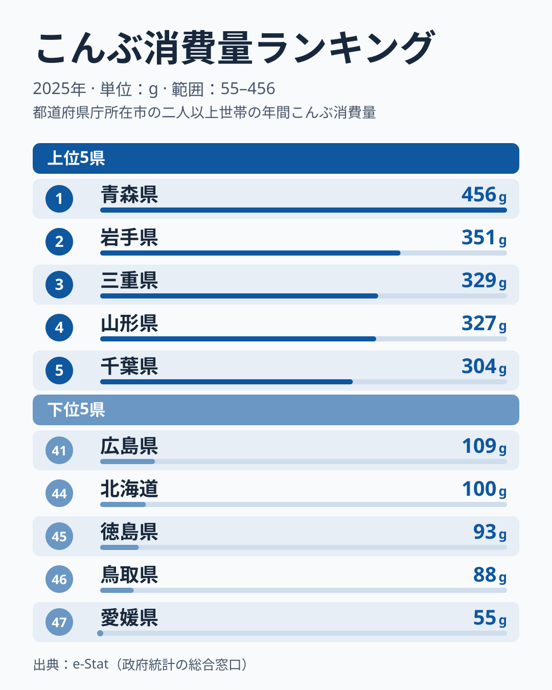

昆布を最も多く購入しているのは、昆布の産地ではありません。

2025年の家計調査（総務省）によると、二人以上世帯のこんぶ消費量で首位に立ったのは456gの青森県、続く2番手は351gの岩手県でした。一方、昆布の産地として知られる北海道は100gにとどまり、47都道府県のなかで44位、下から4番目という結果になっています。最下位の愛媛県は55gで、首位の青森県との差は約8.3倍にのぼります。産地と購入量が重ならないこの「ねじれ」の理由は、このデータだけでは確かめられません。この記事では、データで言えることと、仮説として考えられることを分けて読みます。

> [!NOTE]
> 本データは総務省「家計調査」2025年のもので、都道府県庁所在市（および政令指定都市）の二人以上世帯における年間こんぶ消費量（g）です。県全域ではなく県庁所在市の標本で、北海道の値は札幌市の世帯、東北の値は各県庁所在市の世帯の購入量です。単身世帯は対象外で、1人あたりの量ではありません。標本が小さく単年の順位は入れ替わりやすい指標です。ランキングページの2024年の値では、岩手県が535gで首位、山梨県が56gで最下位でしたが、2025年は岩手県が351g、山梨県が113gと大きく動いています。細かな順位の差より、複数年で続く傾向を見るのが安全です。

## こんぶ消費量の上位5市と下位5市｜東北が上位に並び、産地は下位級

<source-link href="/ranking/konbu-consumption-quantity">こんぶ消費量ランキングの全件データを見る</source-link>

上位5は青森が456g、岩手が351g、三重が329g、山形が327g、千葉が304gと並び、東北勢が3枠を占めたうえに、東海の三重と関東の千葉が食い込む構図です。対して下位5は愛媛が55g、鳥取が88g、徳島が93g、北海道が100g、広島が109gで、四国・中国地方の県と産地の北海道が並びます。広島は栃木・奈良と同じ109gで並んでおり、図には下位5の1つとして広島を載せています。

上位5の平均は約353gで、下位5平均の約89gのおよそ4.0倍にあたります。とりわけ目を引くのは、昆布の一大産地として知られる北海道が100gで下位5に沈み、首位の青森とは4倍以上の開きがある点です。少なくとも2025年の家計調査では、「産地＝大量購入地」という直感は昆布で成立していません。

東北の上位3市（青森・岩手・山形）の平均は約378gで、これは全国のなかでも突出した水準です。宮城は263gで7位と上位10に入り、東北の6県中4県が上位10に入っています。一方、福島は227gで14位、秋田は186gで17位にとどまり、東北でも差があることがデータから読み取れます。

## 青森・岩手・山形が上位に並ぶ背景――データで言えることと仮説

データが示すのは、青森・岩手・山形の県庁所在市の世帯で、こんぶの年間購入量が多いという事実までです。その理由は、この記事のデータでは確かめられません。

[仮説] 東北では昆布を汁物や煮物のだしに使い、おでんや昆布巻きの具材としても日常的に使う習慣があり、それが購入量を押し上げている可能性があります。ただし同じ東北でも福島や秋田は中位で、東北全体に共通する食文化とは言い切れません。上位には三重・千葉・長野も入っており、東北だけの現象ではありません。検証するには、昆布の用途別の購入や、地域別の郷土料理の実態を別の統計や文献で確認する必要があります。

> [!WARNING]
> 家計調査の「こんぶ」は1品目の合計で、だし用か具材用かといった用途の内訳は分かりません。「どの用途で使われたか」は、このデータからは読み取れません。県庁所在市の標本であることもあわせて、岩手など個別の県の食文化は[岩手県のデータブック](/areas/03000)や、[経済・家計カテゴリのランキング](/category/economy)にある他の食品とあわせて読むと理解が深まります。

## 産地・北海道が下位級にとどまる理由――産地のパラドックス

昆布の産地として知られるのは北海道（日高・利尻・羅臼などの名が知られています）ですが、こんぶ消費量は100gで44位にとどまり、愛媛・鳥取・徳島に次ぐ下から4番目の低さでした。この値は札幌市の二人以上世帯の購入量で、産地の世帯の購入量ではありません。

[仮説] 生産された昆布の多くは道外や加工用に出荷されるため、産地であることと札幌の家庭が乾燥昆布を買う量は結びつかない可能性があります。ただし、この出荷構造の仮説も、データでは確かめられません。検証するには、昆布の生産量と出荷先を示す農林水産省などの統計を確認する必要があります。

> [!WARNING]
> 本データは家庭が買った量で、外食や給食経由の消費は含まれません。北海道の家庭が昆布を食べていないと読むのは誤りで、「家庭で乾燥昆布を買う量」が東北より少ない、と読むのが妥当です。

産地でありながら家庭の購入量が下位級という事実は、産地の生産量と家庭の購入量が必ずしも同じ地図を描かないことを示しています。

## 西日本・九州の線引きは単純ではない――だし文化の違いとデータ

下位5の愛媛・鳥取・徳島・広島は中国・四国地方に集まっています。最下位の愛媛は55gで、下から2番目の鳥取の88gと比べても4割近く低い水準で、突出して低い値です。

一方、九州・沖縄は一様ではありません。沖縄は256gで8位、長崎は245gで9位と上位10に入っています。大分は186gで18位、福岡は185gで19位、鹿児島は182gで21位と中位に並び、佐賀は158gで27位、熊本は139gで31位、宮崎は110gで40位と中位から下位寄りです。九州はかつおぶし・煮干しをだしの主軸とすると一般には言われますが、2025年のデータでは「九州は昆布の購入量が少ない」という単純な図式は当てはまりません。[仮説] 沖縄は昆布を炒め物（クーブイリチーなど）の具材として日常的に使う食習慣が、購入量を押し上げている可能性があります。ただし、この食習慣が購入量に結びついているかは、この記事のデータだけでは確かめられません。

京都府は116gで38位となり、下位5からは外れたものの、全国の下位圏にとどまっています。京都は「昆布だし文化の本場」というイメージが強いものの、家計調査が対象とする京都市の世帯では、こんぶの購入量は全国でも低い水準でした。[仮説] 料亭・仕出しなどの業務用の消費が大きく、家庭での乾燥昆布の購入量には反映されにくい可能性があります。検証するには、外食・業務用の昆布の使用量を示す別の統計が必要です。

山梨は113gで39位と、内陸県で下位圏にとどまりました。前年の2024年は56gで最下位でしたが、2025年は最下位ではなくなっています。[山梨のエリアページ](/areas/19000)で県全体の食文化もあわせて確認できます。

昆布の購入量が多い県は、東北に目立ちます。青森・岩手・山形・宮城の4県が上位10に入り、東北以外では三重が3位、千葉が5位、長野が6位です。関東の7都県では、千葉以外は茨城が22位、埼玉が24位、神奈川が25位、東京が28位、群馬が32位、栃木が41位と中位以下です。西日本にも、和歌山が10位、長崎が9位、沖縄が8位と上位10に入る県があります。東日本と西日本をきれいに分ける「だし文化の断層線」は、2025年のデータでははっきりとは見えません。

## まとめ

- こんぶ消費量の1位は青森456g、最下位は愛媛55gで約8.3倍差です
- 上位は青森・岩手・三重・山形・千葉で、東北勢が3枠を占めています
- 産地として知られる北海道は100gで44位、下位5入りです。理由は確かめられず、出荷構造などの仮説は別の統計での検証が必要です
- 東北の上位には用途や食習慣の仮説がありますが、福島や秋田は中位で、東北全体に共通するとは言い切れません
- 標本が小さく単年の順位は入れ替わりやすいため、複数年で続く傾向を見ることが大切です

こんぶ消費量の地図を眺めると、産地と家庭の購入量が必ずしも一致しないことが見えてきます。食料品の購入量統計は、地域の食文化を映す手がかりの一つとして、仮説とあわせて読むのが適切です。
