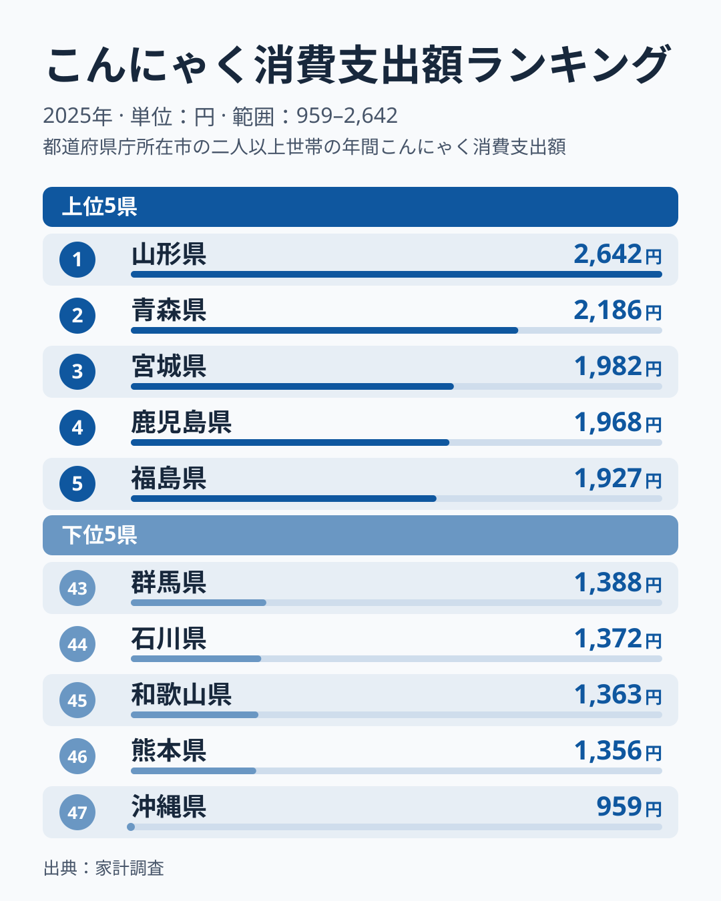
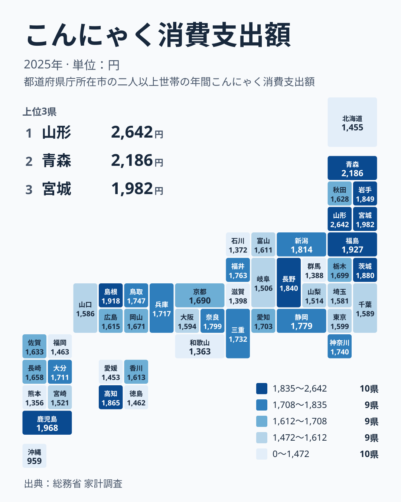

こんにゃくは低カロリーで食物繊維が豊富な、日本の食卓に古くから根付く食材です。おでんや煮物、田楽など調理法も幅広く、全国どこでも売られています。ですが1世帯あたりの年間消費支出額を都道府県庁所在市別に見ると、実は2.7倍を超える地域差があります。

総務省家計調査（2025年）によると、こんにゃく消費支出額の1位は山形市の世帯の2642円、最下位は沖縄県の那覇市の世帯の959円で、その差は約2.75倍に達します。さらに意外なのは、こんにゃく芋の生産量で全国一の産地として知られる群馬県の前橋市の世帯が、1388円で43位と下位5に入っている点です。この記事では、「作る県」と「食べる県」が一致しない事実を確かめたうえで、考えられる読み方を仮説として整理します。

> [!NOTE]
> 本データは総務省「家計調査」の品目別支出金額（二人以上の世帯、年間、暦年）を、都道府県庁所在市の世帯について集計したものです。県民全体の消費量ではなく、各市の世帯が実際に購入した加工済みこんにゃく（板こんにゃく・玉こんにゃく・しらたき等を含む）の支出額で、こんにゃく芋の栽培量ではありません。標本が小さく単年の順位は動きやすい指標です。ランキングページの2024年の値では、群馬県は1570円、高知県は2078円でしたが、2025年は1388円と1865円に動いており、1年で順位が大きく入れ替わります。

## 上位と下位

<source-link href="/ranking/konnyaku-consumption-expenditure">こんにゃく消費支出額ランキングをもっと見る</source-link>

上位5県は山形・青森・宮城・鹿児島・福島の順で、鹿児島を除く4県が東北です。上位10県で見ても、山形・青森・宮城・福島・岩手の5県が東北に入ります。ただし東北でも差があり、秋田は1628円で26位と全国平均を下回る水準です。「東北は冬に保存の利く煮物を食べる」といった一般論は、東北の6県全体には当てはまりません。

特に[山形県](/areas/06000)は「玉こんにゃく」という醤油ベースの煮物を郷土の味とする土地として知られます。[仮説] 山形の世帯が家庭でも玉こんにゃくやパック品を買う機会が多く、それが支出額を押し上げている可能性があります。ただし、この記事のデータは家庭での購入額で、外で食べる分は含まれないため、玉こんにゃくの食文化が支出額にどれだけ効いているかは確かめられません。

上位5県で東北以外の鹿児島県は1968円で4位です。理由はこのデータでは分かりません。高知県も1865円で8位と上位10に入り、前年の2024年の2078円から減っています。[仮説] 高知では宴席料理の皿鉢料理でこんにゃくの煮しめや酢の物が出る習慣が、支出額に関係する可能性があります。検証するには、郷土料理の調査や複数年の推移を確認する必要があります。

## 発見: なぜ生産地の群馬が上位に入らないのか

このマップを見ると、消費支出額が高い県が東北に偏っている一方（上位10県のうち5県が東北）、こんにゃく芋の生産量で全国一の産地として知られる群馬県は1388円で43位と、下位5に入っていることが分かります。山形の2642円は、群馬の約1.9倍です。「作る県＝食べる県」という単純な図式は成り立っていません。

[仮説] [群馬県](/areas/10000)のこんにゃく産業は、山間部で栽培されたこんにゃく芋を、原料や粉として全国の加工業者・食品メーカーに出荷する構造が中心だと言われます。その場合、群馬は日本全体のこんにゃく供給を支える「生産拠点」であり、前橋市の家庭の購入額が高いわけではない、という読み方ができます。ただし、この仮説は流通の統計で確かめる必要があり、群馬が43位になった理由として確定できるものではありません。また、群馬は前年の2024年は1570円で中位でした。1年で順位が大きく動いた事実は、単年の順位を産地の構造と結びつけて語ることの危うさも示しています。検証するには、農林水産省の統計などで、こんにゃく芋の出荷先と加工品の流通を複数年で確認する必要があります。

> [!WARNING]
> 家計調査の品目別支出額は、家庭が購入した額で、外食や給食、惣菜として外で食べる分は含みません。山形の玉こんにゃくのように屋台や祭りの縁日で食べる分は、このデータには反映されません。また、県庁所在市の二人以上世帯の値なので、群馬県全体や山形県全体のこんにゃく消費を表すものではありません。

## 下位5の顔ぶれと沖縄の位置づけ

下位5は、群馬が1388円、石川が1372円、和歌山が1363円、熊本が1356円、沖縄が959円です。最下位の沖縄は、46位の熊本の1356円より約3割低く、下位の中でも離れた最下位です。倍率の分母は最下位の沖縄の959円で、題の約2.75倍は沖縄の低さに左右されています。山形の2642円を46位の熊本で割ると約1.95倍になり、最下位を除いた差でも2倍近くあります。

[沖縄県](/areas/47000)は前年の2024年も1027円で最下位でした。沖縄の低さは2年続いており、1年だけの標本の揺れでは説明しにくい面があります。ただし、理由はこのデータだけでは分かりません。検証するには、沖縄の食材の購入内訳や郷土料理の実態を別の調査で確認する必要があります。群馬から熊本までの4県はほぼ同じ水準に並んでおり、下位5の中の細かな順位は、標本の揺れの範囲に入る可能性があります。

家計消費の地域差全体は[経済カテゴリ一覧](/category/economy)からも確認できます。

## まとめ

- 1位は山形県の2642円、最下位は沖縄県の959円で約2.75倍の格差です
- 上位5県は山形・青森・宮城・鹿児島・福島で、鹿児島を除く4県が東北ですが、秋田は26位で東北全体に共通するとは言えません
- こんにゃく芋の生産量が全国一の群馬県は消費支出額が1388円で43位と、下位5に入ります
- 産地と家庭の支出額が一致しない理由は、出荷構造などの仮説があるものの、このデータでは確かめられません
- 標本が小さく単年の順位は動きやすいため、複数年で続く傾向を見ることが大切です
