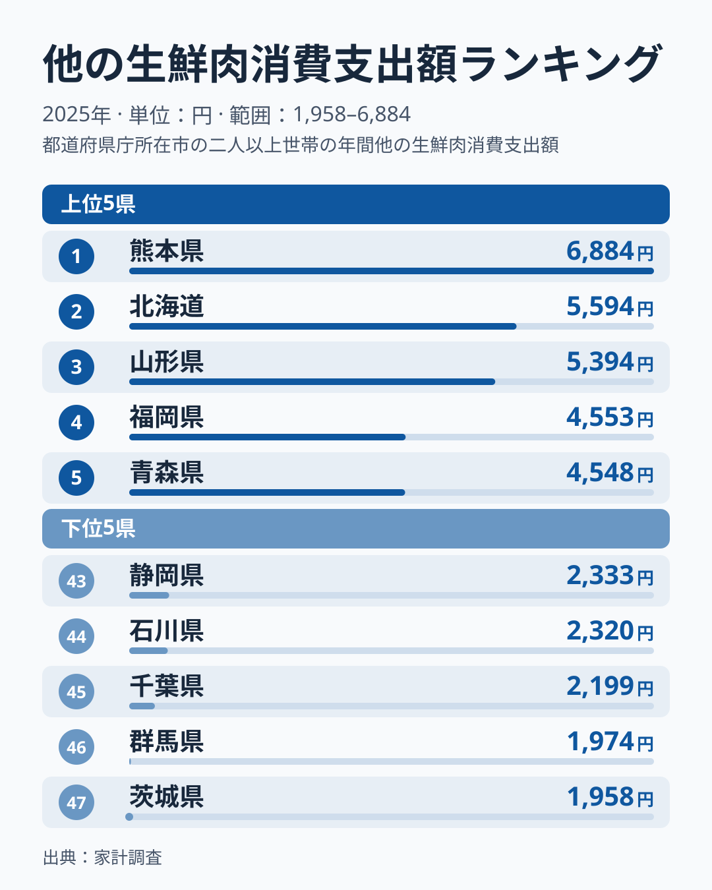
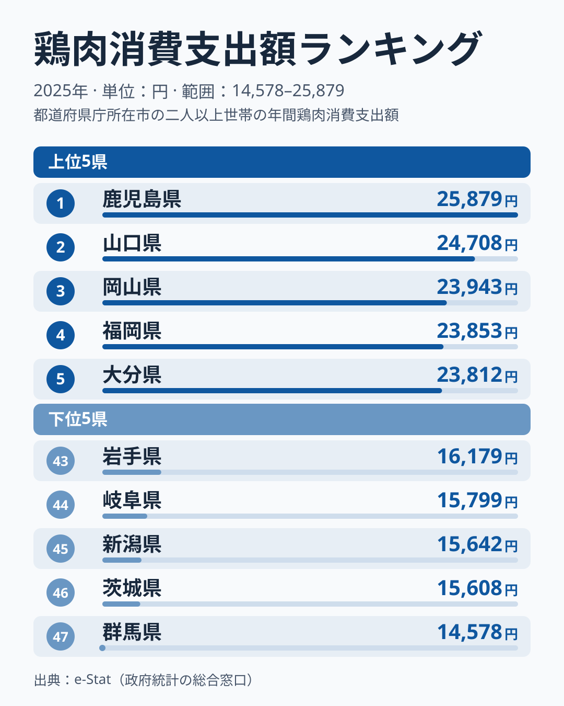
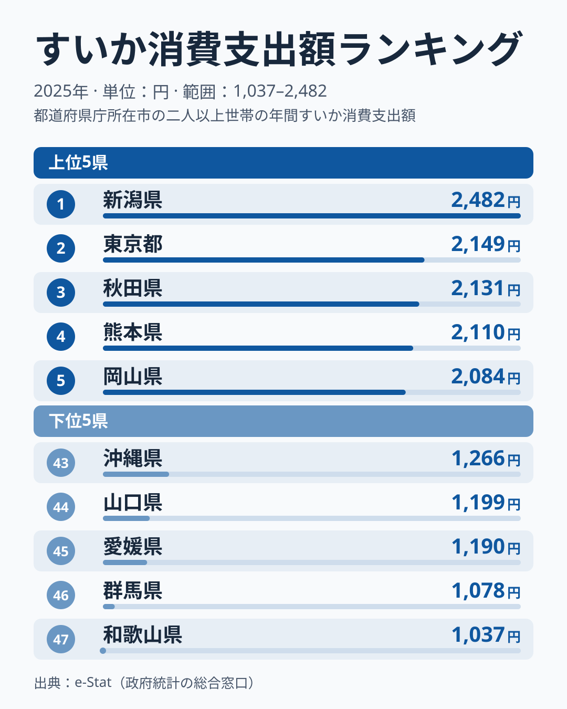
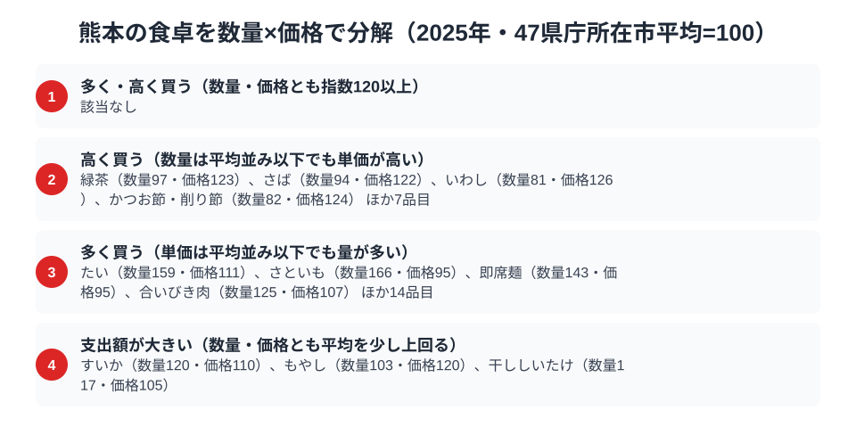

熊本県の食卓と聞くと、多くの人が馬刺しを思い浮かべるでしょう。家計調査の数字でも、そのイメージは外れていません。総務省の家計調査（品目別）で熊本市の二人以上世帯を見ると、馬肉などを含む「他の生鮮肉」の消費支出額は6,884円で全国1位です。2位の北海道は5,594円で、熊本はそれを大きく上回っています。最下位の茨城県1,958円と比べると3.5倍にあたります。

一方で、熊本の食卓で肉の主役を一つに絞るのは簡単ではありません。鶏肉の消費支出額は23,564円で全国6位、上位6県には鹿児島県・福岡県・大分県・熊本県の4県の九州勢が入っています。さらにすいかも2,110円で全国4位と、農産物の産地としての顔も家計に表れています。この記事では、他の生鮮肉・鶏肉・すいかという3つの品目を軸に、数量と価格の分解も交えながら、熊本県民の食卓を2025年のデータで読み解きます。

> [!NOTE]
> 家計調査の都道府県データは、県庁所在市（熊本県は熊本市）の二人以上世帯を対象にした年間支出額です。県全体ではなく熊本市在住世帯の家計簿から見た傾向である点にご注意ください。

## 他の生鮮肉 — 全国1位6,884円、馬肉を含む分類

<source-link href="/ranking/other-meat-consumption-expenditure">他の生鮮肉消費支出額ランキングをもっと見る</source-link>

熊本県の他の生鮮肉消費支出額は6,884円で全国1位です。2位は北海道5,594円、3位は山形県5,394円、4位は福岡県4,553円、5位は青森県4,548円で、最下位の茨城県1,958円と比べると約3.5倍の差があります。上位には九州・東北・北海道の都市が並び、肉の消費が牛肉・豚肉・鶏肉の3つだけに収まらない地域が見えてきます。

ここで注意したいのは、「他の生鮮肉」が馬肉だけの項目ではないことです。家計調査の品目分類では、牛肉・豚肉・鶏肉などの項目に分類されない鳥獣肉や臓もつを集める項目で、馬肉（さくら肉）のほか羊肉、かも、もつなどが含まれます。馬刺しは個別の品目としては集計されず、この項目の中に入っています。

2位以下の北海道・山形県・青森県は、羊肉やもつ類など別の品目が支出を押し上げている可能性があり、同じ「他の生鮮肉」でも中身は地域で異なるかもしれません。

[仮説] 熊本市では馬肉の購入が、この高い支出額の一因になっている可能性があります。検証するには馬肉を個別に集計した統計や、熊本市の世帯を対象にした品目別の購入データが必要で、家計調査の公表値だけでは羊肉やもつ類と切り分けられません。家計調査の市別の値は単年のぶれが大きいため、複数年で1位が続くかどうかも別途確認が必要です。

## 鶏肉 — 全国6位23,564円、九州の鶏食文化は健在

<source-link href="/ranking/chicken-consumption-expenditure">鶏肉消費支出額ランキングをもっと見る</source-link>

熊本県の鶏肉消費支出額は23,564円で全国6位です。1位は鹿児島県25,879円、2位は山口県24,708円、3位は岡山県23,943円、4位は福岡県23,853円、5位は大分県23,812円で、熊本はその次に続きます。最下位の群馬県14,578円とは約1.8倍の開きがあります。

上位6県の内訳は、鹿児島県・山口県・岡山県・福岡県・大分県・熊本県です。このうち九州は鹿児島県・福岡県・大分県・熊本県の4県で、残る2県は中国地方の山口県と岡山県です。6県は23,564円から25,879円の範囲に集中していて、九州が全国有数の「鶏食文化圏」であるという構図は、熊本が1位でなくてもほぼ保たれています。ただし家計調査の市別の値は単年のぶれも大きいため、6位か1位かといった順位の違いから構造を断定することはできません。

[仮説] 九州の上位4県に共通する鶏肉の食習慣（刺身や地鶏の利用など）が、鶏肉の支出を全国上位に保っている可能性があります。家計調査には調理法や地鶏かどうかの区別がないため、検証するには品種や用途別の購入データが必要です。

## すいか — 全国4位2,110円、産地の実力

<source-link href="/ranking/watermelon-consumption-expenditure">すいか消費支出額ランキングをもっと見る</source-link>

すいかの消費支出額でも熊本県は2,110円で全国4位につけています。1位は新潟県2,482円、2位は東京都2,149円、3位は秋田県2,131円、5位は岡山県2,084円で、最下位の和歌山県は1,037円、1位との差は約2.4倍です。熊本県はすいかの産地として知られており、[仮説] こうした産地の存在が、熊本市世帯の支出の高さにつながっているのかもしれません。ただし今回のデータだけでは、産地であることと家計の支出の関係は裏づけられません。

一方で、支出額の2位には産地とは限らない東京都が入っています。

[仮説] 産地であっても支出額の順位が県ごとにばらつくのは、購入する品種・大きさ・時期の違いが単価に出るためかもしれません。検証するには、品種別・月別の購入データが必要です。詳しい都道府県別の順位は[すいか消費支出の記事](/blog/watermelon-expenditure-ranking)も参考になります。

## 数量×価格で分解する熊本市の食卓

家計調査の支出額は「数量×価格」に分解できます。品目ごとに47県庁所在市の平均を100とした指数を作り、数量・価格が平均の2割増（指数120）以上かどうかで熊本市の品目を分けたのが図です。数量も価格も指数120以上の「多く・高く買う」型は、熊本市には該当がありませんでした。

「支出額が大きい」型は、数量も価格も平均を上回るものの、どちらも指数120には届かない品目です。それでも掛け合わせると支出額が平均の2割を超えます。すいか（数量120・価格110）、もやし（数量103・価格120）、干ししいたけ（数量117・価格105）の3品目が入り、表示の120は四捨五入のため、指数120の境界にわずかに届いていません。支出額が上位だったすいかは、量と単価の両方が少しずつ平均を上回る形で支えられています。

熊本市に固有の特徴は、魚の加工品や茶が「少なめの量を高めの単価で買う」型に集まっていることです。いわし（数量81・価格126）、かつお節・削り節（数量82・価格124）に加え、緑茶も数量97・価格123で同じ型に入ります。[仮説] 加工度の高い銘柄や贈答向けの品が単価を押し上げているか、購入頻度が低い分、1回に高めの品を選んでいる可能性があります。検証するには、銘柄別の購入単価と購入頻度の品目別データが必要です。

一方、量で目立つのは、たい・さといも・即席麺など、単価は平均並み以下でも多く買う品目です。同じ魚介でもいわしやさばは単価で、たいは量で支出が決まるように、買い方が二分されています。ただし市別の1年分の指数なので、構造を断定するのは避けたほうがよいでしょう。

あわせて見る: [すいか消費量ランキング](/ranking/watermelon-consumption-quantity)

> [!NOTE]
> ここでの指数は、家計調査で数量と支出額の両方が公表されている品目について、47都道府県庁所在市（熊本市を含む）の平均を100とした相対値であり、家計調査の全国値そのものではありません。価格指数は同じ品目内でも銘柄・品種による単価差を含むため、そのまま「割高」「割安」の判断材料にはできません。対象は熊本市の二人以上世帯の年間支出額・消費量（2025年）です。

## まとめ — 熊本の肉の主役は一つに決められない

では、熊本の肉の主役は馬刺しなのか、鶏肉なのか。結論は「どちらとも言い切れない」です。他の生鮮肉は全国1位ですが馬肉単独の値ではなく、鶏肉は6位とはいえ支出額は23,564円と他の生鮮肉の6,884円とは金額の桁が異なります。性格の違う二つの項目を直接比べることはできません。ここから言えるのは、馬肉などを含む他の生鮮肉で突出し、鶏肉でも九州の上位グループに入り、すいかでも4位という、肉と農産物の両面に厚みのある食卓だということです。数量と価格に分けると、熊本市は量と単価の両方で突出する品目はなく、少しずつ平均を上回ることや、買い方が品目ごとに分かれることが特徴でした。

- 他の生鮮肉（馬肉などを含む）の消費支出額は熊本県が全国1位（6,884円）、最下位の茨城県の約3.5倍
- 鶏肉は全国6位（23,564円）、上位6県のうち九州は鹿児島県・福岡県・大分県・熊本県の4県
- すいかは全国4位（2,110円）、数量・価格とも平均を少し上回る形で支出額が大きい
- 馬刺しは「他の生鮮肉」に含まれ単独では集計されず、馬刺しの消費が全国一とまでは言えない

熊本県の他の統計は[熊本県の地域プロフィール](/areas/43000)、食品・家計消費の地域差は[経済カテゴリ一覧](/category/economy)からご覧いただけます。
