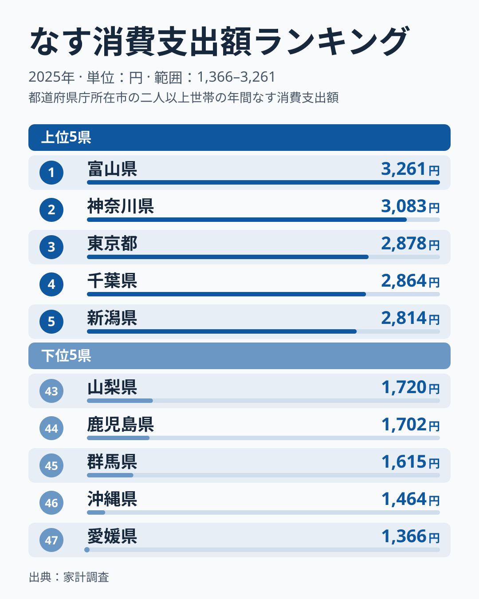
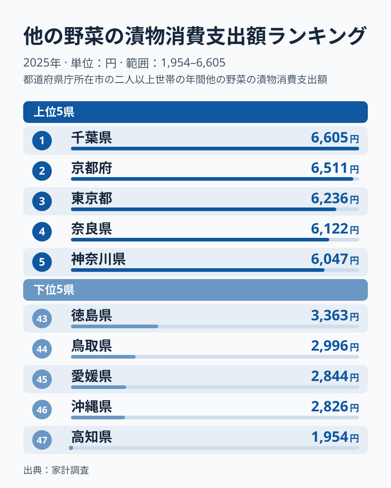
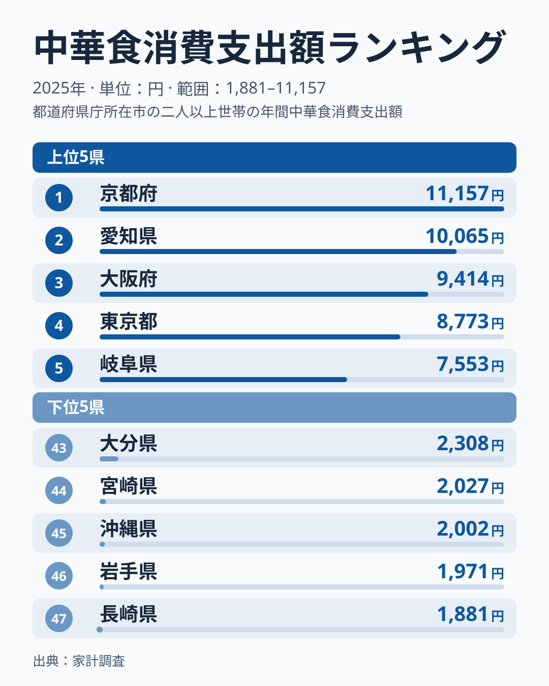
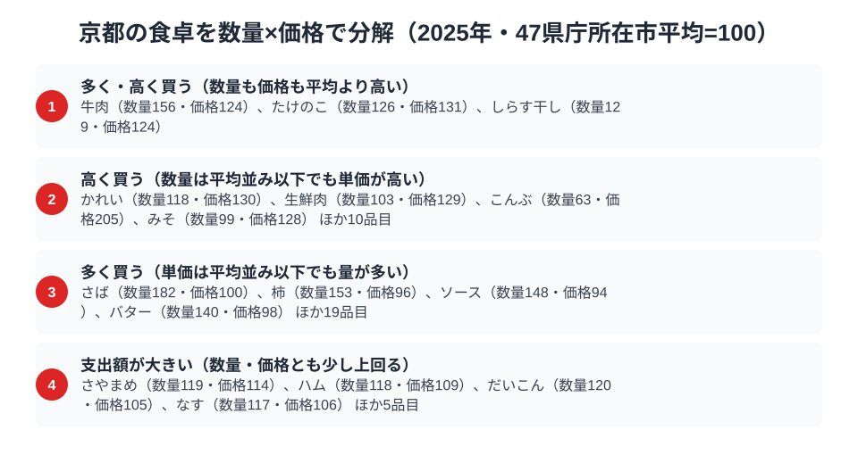

「京都の食」と聞いて多くの人が思い浮かべるのは、湯葉や生麩、繊細な出汁を使った京料理でしょう。ところが総務省の家計調査で品目別の支出額を都道府県別に見ていくと、京都の食卓の実像は少し違う顔を見せます。なす、漬物、そして中華料理の外食——この3つで京都は揃って上位に入り、中華料理の外食は全国1位なのです。

「京の伝統野菜」だけでなく、庶民的な漬物や中華食まで京都が上位に並ぶのは本物の強さなのでしょうか。この記事では、家計調査の品目別データから、京都の食卓の強さがどこまで言えるのかを読み解きます。結論を先に言えば、3品目の中で京都の強さが最も明確に出ているのは中華食の外食で、なすは購入量の多さが主な要因と読めます。ただし、漬物や中華食が「日常の習慣」かどうかは、年間の支出額だけでは分かりません。

> [!NOTE]
> 本記事のデータは総務省統計局「家計調査（品目別）」の**都道府県庁所在市（京都府は京都市）・二人以上世帯**の年間支出額（2025年）です。京都府全域ではなく京都市の消費傾向を表す点に注意してください。標本は小さく、単年の順位は動きやすい指標です。旧版の2024年データでは3品目とも1位でしたが、2025年は中華食が1位、他の野菜の漬物が2位、なすが6位に動いています。首位との差が小さい品目の順位は、標本の揺れの範囲に入りえます。

## なす消費支出額 — 全国6位2,791円、京の伝統野菜は上位圏

<source-link href="/ranking/eggplant-consumption-expenditure">なす消費支出額ランキングをもっと見る</source-link>

なすの消費支出額で京都市は年間2,791円と全国6位です。1位は富山県の3,261円、2位は神奈川県の3,083円、3位は東京都の2,878円で、京都は首位に近い上位圏にいますが、3位の東京都との差はわずかです。最下位は愛媛県の1,366円で、京都との差は2.0倍です。

京都には「賀茂なす」「京山科なす」といった京野菜としてブランド化されたなすが複数あります。[仮説] 地元の八百屋やスーパーで品揃えが厚く、揚げびたしや田楽など和食の副菜として日常的に登場することが、購入額を押し上げている可能性があります。ただし、この品揃えの厚さは、家計調査のデータでは確かめられません。後の節で数量と価格に分けて見ると、なすは購入量が平均を上回ることが分かります。

## 他の野菜の漬物消費支出額 — 全国2位6,511円、京漬物文化の厚み

<source-link href="/ranking/other-vegetable-pickles-consumption-expenditure">他の野菜の漬物消費支出額ランキングをもっと見る</source-link>

「他の野菜の漬物」（しば漬けや千枚漬けなどを含む区分）の支出額でも京都市は年間6,511円で全国2位です。1位は千葉県の6,605円で、京都は僅差の2位です。3位は東京都の6,236円、4位は奈良県の6,122円で、上位は僅差で並びます。最下位の高知県は1,954円で、京都との差は3.3倍に達します。なお、これは「他の野菜の漬物」だけの順位で、梅干しやだいこん漬、はくさい漬は別の区分です。後の節の指数では、だいこん漬とはくさい漬の京都市の支出額は、47市の平均を下回ります。漬物全体で京都が強いとは言えません。

京都には千枚漬け・しば漬け・すぐき漬けという「京の三大漬物」があり、老舗の漬物専門店が市内に多数あります。[仮説] 観光土産としての側面もありますが、地元の世帯が日常的に漬物を購入していることも、支出額の高さに関係している可能性があります。ただし、家計調査では贈答用の購入と自家用の購入を区別できないため、日常の食卓に取り入れていると言い切ることはできません。

## 中華食（外食）消費支出額 — 全国1位11,157円、京料理の街に中華の伝統

<source-link href="/ranking/chinese-food-dining-consumption-expenditure">中華食消費支出額ランキングをもっと見る</source-link>

もっとも意外なのが中華料理の外食支出です。京都市は年間11,157円で全国1位となっており、2位の愛知県は10,065円、3位の大阪府は9,414円で、これらを上回ります。最下位の長崎県は1,881円で、京都との差は5.9倍に達し、今回取り上げた3品目の中で最も大きい開きです。

京都は横浜や神戸のような大規模な中華街を持たない街です。[仮説] 町中華など日常的に使われる中華料理店が多いことが、外食支出を押し上げている可能性があります。ただし、この調査は二人以上世帯が対象なので、単身の学生の外食は含まれません。検証するには、京都市内の中華料理店の数や客層に関する別の統計を確認する必要があります。

> [!WARNING]
> 家計調査は「支出額」であり「消費量」ではありません。同じ品目でも京都は単価の高い高級食材（賀茂なす等のブランド野菜、老舗の京漬物）を購入している可能性があり、量が多いとは限らない点に注意してください。また賀茂なすや千枚漬けなど、個別のブランド食材は家計調査の品目区分では独立集計されておらず、「なす」「他の野菜の漬物」という広い区分の中に含まれています。

## 品目全体で見ると：京都は食料全般で支出が多い傾向

なす・漬物・中華食の3品目だけを見て「京都は野菜と中華に強い」と言い切ることはできません。次の節で使う食料138品目の集計では、京都市の支出額が47市の平均を上回る品目が約3分の2（93品目）を占め、平均の1.2倍以上の品目は37品目あります。そこには、たけのこ・さやまめ・ほうれんそう・レタス・だいこん・なす・ねぎ・れんこん・ピーマン・はくさいの野菜10品目が含まれる一方、牛肉・さば・食パン・ハム・みそなど、肉・魚・加工品も並びます。野菜以外の品目でも支出が多い傾向が、京都市の世帯には見られます。ただし、これは品目ごとの指数を並べた集計で、世帯の所得や世帯構成の影響を除いたものではありません。

## 京都の食卓を貫くもの：言える範囲

この記事のデータで言えるのは、次の3点です。

1. 中華食（外食）は、京都市が11,157円で全国1位です。なすと漬物の上位には、神奈川・東京・千葉などの首都圏の県が並び、東京は3品目すべての上位4県に入っています。京都の強さが最も明確に出ているのは中華食です。
2. なすと漬物は、京都が6位と2位の上位圏にいますが、首位との差は小さく、標本の揺れで順位が入れ替わりえます。
3. 購入量と単価に分けられたのはなすだけで、数量指数が平均を上回る一方、価格指数は平均並みでした。漬物と中華食には、数量の統計がないため、この方法を当てられません。

「特別な日のごちそう」ではなく「日常に定着した習慣」だという読み方は、仮説の域を出ません。年間の世帯支出額だけでは、日常の購入かハレの日の購入かを区別できないからです。京料理という華やかなブランドイメージの裏側に庶民的な食習慣が存在するかは、より細かな調査で確かめる必要があります。

同じように地域の食文化を1つの軸で読み解いた記事に、[富山県民の食卓](/blog/toyama-food-culture)（なす消費支出額で全国1位の県）があります。あわせて読むと、北陸と近畿における野菜消費の共通点と違いが見えてきます。地域比較をする際は[京都府の地域プロフィール](/areas/26000)で他の経済指標もあわせて確認すると、京都の家計全体の傾向がより立体的に見えてきます。

## 数量×価格で分解する京都市の食卓

<source-link href="/ranking/eggplant-consumption-quantity">なす消費量ランキングをもっと見る</source-link>

なす・漬物・中華食の支出額だけを見ていると、「京都はこの3つをたくさん食べている」と読みたくなります。ですが支出額は「数量×単価」で決まるため、実際には量が多いのか単価が高いのかを分けて見なければ実像はつかめません。家計調査には数量（グラムやミリリットル単位の購入量）と支出額の両方を持つ品目が多数あり、47都道府県庁所在市の単純平均を100とした数量指数・価格指数に分解すると、京都市の食卓がより具体的に見えてきます。

指数120以上（平均を2割以上上回る）を「多い・高い」として4区分すると、京都市で数量も価格もともに2割以上上回る品目は、牛肉（数量156・価格124）、たけのこ（数量126・価格131）、しらす干し（数量129・価格124）の3品目です。京都府南西部（向日市・京都市西京区一帯）は「京たけのこ」の産地として知られており、[仮説] たけのこ消費量の数量指数が126と平均を上回る背景には、地元での流通量の多さがある可能性があります。

単価は平均並みでも購入量が多い品目も並びます。さばは数量指数182と平均の1.8倍に達する一方、価格指数は100と平均並みで、柿（数量153・価格96）、ソース（数量148・価格94）、バター（数量140・価格98）も同じ向きです。本記事で扱ったなすは、なす消費量の数量指数が117、価格指数が106で、どちらも2割には届きませんが、数量が平均を上回り価格はほぼ平均並みという向きはさばや柿と同じです（図では、なすは「数量・価格とも少し上回る」区分に入ります）。つまり京都のなす消費支出額が全国6位に入るのは、高級なブランド野菜を少しだけ買っているからではなく、購入量がやや多いためだと読み取れます。

一方で、購入量は平均を下回るのに単価の高さで支出額が押し上げられている品目もあります。こんぶは数量指数が63にとどまるのに対し価格指数は205に達しており、購入量は控えめでも単価の高い商品を選んでいることがうかがえます。みそも数量指数は99と平均並みですが価格指数は128で、購入する品種やブランドが違う可能性を示しています。同じ「支出額が大きい」という結果でも、量による場合と単価による場合とでは、その品目が食卓にどう根付いているかの意味合いが変わってきます。

支出額の順位だけでは「たくさん買っているのか、高いものを買っているのか」を区別できません。さばやなすのように数量指数が高く価格指数が平均並みの品目は購入量の多い品目、こんぶやみそのように価格指数だけが突出する品目は高級品志向や購入品種の違いの可能性がある品目と読み分けると、同じ「支出額が上位」の品目でも中身の違いが見えてきます。

> [!NOTE]
> 数量指数・価格指数は家計調査の品目別データ（数量consumption-quantity・支出額consumption-expenditure）から、47都道府県庁所在市の単純平均を100とした相対値として算出しています。対象は食料138品目（数量と支出額の両方が揃う市が40未満の品目を除く）で、指数120以上を「多い・高い」、80以下を「少ない・安い」としています。総務省が公表する全国平均を基準にした数値ではありません。また価格指数は「支出額÷数量」で求めた相対値であり、購入するブランドや品種、購入頻度の違いも含むため、店頭価格そのものの差を表すものではない点に注意してください。対象は二人以上世帯・京都市の年間値（2025年）です。

## まとめ

- なす消費支出額は全国6位で2,791円です。1位富山は3,261円で、首位に近い上位圏にあります
- 他の野菜の漬物消費支出額は全国2位で6,511円です。1位千葉は6,605円で、僅差です
- 中華食（外食）消費支出額は全国1位で11,157円です。最下位長崎は1,881円で、5.9倍の格差があります
- 食料138品目では、京都市の支出額が平均を上回る品目が約3分の2を占め、野菜以外にも広がる傾向です
- 中華食1位・漬物2位・なす6位という結果は、京料理の華やかなイメージとは異なる庶民的な食習慣を示す可能性がありますが、年間の支出額だけでは日常かハレの日かを区別できません

京都府の経済指標を幅広く見るなら、[経済カテゴリ一覧](/category/economy)から他の家計調査ランキングもあわせてご覧ください。
