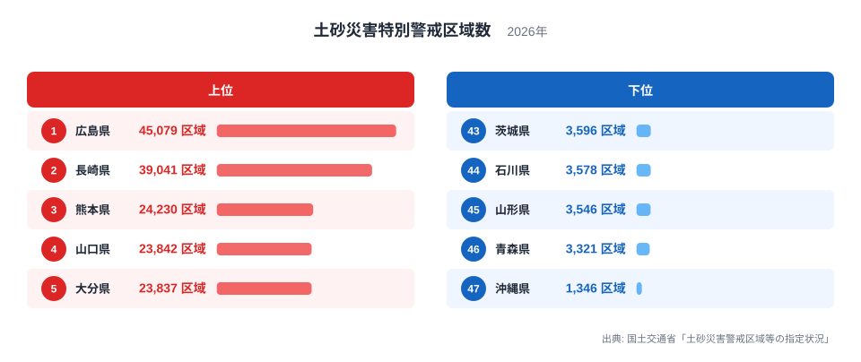
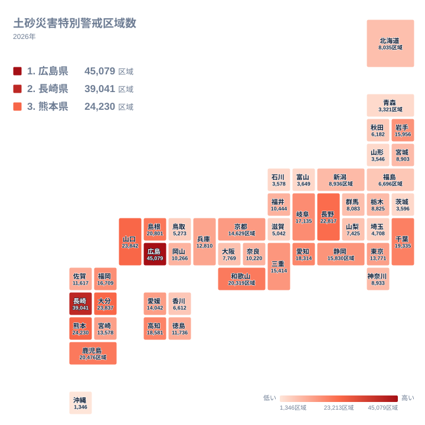

大雨が降るたびに、山あいの集落や住宅地で土砂災害の危険が報じられます。土砂災害特別警戒区域は、がけ崩れや土石流、地すべりが起きたときに、建物が壊れて住民の命に危害が及ぶおそれが特に大きい場所として指定されます。この区域数を都道府県別に並べると、危険な斜面と暮らしが近接している場所がどこに多いのかが見えてきます。

この記事では、2026年の指定状況をもとに、上位と下位がなぜその順になるのかを、地形と土地利用の面から考えます。データだけでは確かめられない部分は、あくまで仮説として示します。

## 広島県と長崎県が抜ける都道府県ランキング

まず、上位5県と下位5県を一枚の図にまとめました。

<source-link href="/ranking/landslide-special-warning-zone-count">土砂災害特別警戒区域数ランキングをもっと見る</source-link>

図で目を引くのは、上位の並び方の形です。1位の広島県は45,079区域で、2位の長崎県は39,041区域です。この2県の次に来る3位の熊本県は24,230区域で、1位の広島県の半分をやや上回る程度にとどまります。つまり、広島県と長崎県は、3位以下の県が作る集団から一段上に離れています。

その3位以下は、熊本県、山口県、大分県と並びますが、4位の山口県と5位の大分県は23,842区域と23,837区域で、ほとんど同じ水準です。順位は違っても、実質的には横並びの集団と見たほうが実態に近いでしょう。

下位は逆に、ほぼ一団になっています。43位の茨城県から46位の青森県までは3,000区域台の前半から半ばに収まり、47位の沖縄県の1,346区域だけが、さらに一段低い位置にあります。1位と47位のあいだは桁が違う開きですが、この差をそのまま「県の安全度の差」と読むのは早計です。数字が示すのは、指定の対象になりうる斜面と住宅の接し方の違いであり、その背景には地形や土地利用があると考えられます。

広島県の詳しい数字は[広島県のデータ](/areas/34000)、長崎県は[長崎県のデータ](/areas/42000)から確認できます。

> [!NOTE]
> 土砂災害特別警戒区域は、土砂災害警戒区域のなかでも、建築物が壊れて住民に著しい危害が生じるおそれのある範囲を、さらに限って指定したものです。つまり警戒区域の内側に位置づけられる、より絞り込まれた区域です。この記事で扱うのは特別警戒区域の数だけで、警戒区域全体の数とは別物です。両者を混ぜて比べないようにしてください。

## 上位の顔ぶれと、その背景として挙げられる条件

上位8県の内訳を地方別に数えます。中国が3県で、広島県、山口県、島根県です。九州が4県で、長崎県、熊本県、大分県、鹿児島県です。残る1県は中部の長野県で、合計8県になります。上位は西日本の2地方が大半を占める構図です。

広島県が1位であることについて、よく挙げられる背景は、花崗岩が風化してできた「まさ土」の分布です。雨水を含むと崩れやすい性質があり、瀬戸内沿岸の丘陵地では住宅が山すそまで迫っています。ただし、こうした地質が区域数を決めているとまでは、今回のデータからは言えません。あくまで順位と対応しうる要因の一つです。

長崎県は、平地が少なく、坂の街に住宅が段々に立ち並ぶ土地柄です。熊本県や鹿児島県、大分県には火山性の地層が広がり、阿蘇の周辺やシラス台地のように、雨で崩れやすいとされる地層が各地にあります。これらも背景として挙げられる条件ですが、どこまで区域数に効いているかは、別の分析が必要です。

> [!TIP]
> 区域数の大小は、「危険な斜面の多さ」と「そこに人が住んでいるか」と「指定をどこまで進めたか」の三つが重なった結果と読むと整理しやすくなります。斜面が多くても無人の山林なら指定の対象になりにくく、住宅が斜面の際まで迫る県ほど数は増えやすいと考えられます。

## 地理分布で見る西日本への偏り

続いて、都道府県の位置関係を地図で確認します。

地図では、色の濃い県が西日本に集まっています。上位10県に範囲を広げると、さきほどの8県に、9位の和歌山県と10位の千葉県が加わります。和歌山県は近畿、千葉県は関東です。内訳は中国が3県、九州が4県、中部が1県、近畿が1県、関東が1県で、合計10県です。10県のうち7県が中国と九州に入ります。

西日本に偏る理由として、梅雨前線や台風の影響を受けやすい気象条件が挙げられることがあります。山がちな土地に住宅が張りつく地域が多いことも、同じく仮説として考えられます。ただし、気象や地質の指標は今回のデータに含まれていないため、これらを裏づける検証まではできません。

東日本に目を向けると、10位の千葉県は19,335区域で、関東のなかでは際立っています。同じ関東でも、茨城県は43位で3,596区域、埼玉県は41位で4,708区域です。千葉県の房総丘陵のように、起伏の細かい丘陵地に住宅地が入り込んでいる土地では、斜面と住宅が近接しやすいと考えられます。一方で、関東平野の広がる県では、対象となる斜面そのものが限られる可能性があります。

> [!WARNING]
> 区域数は、県が基礎調査を終えて指定した結果の数です。指定の進み具合や、区域をどの単位で区切るかは県ごとに事情が異なる可能性があり、数字は調査の到達度や運用の違いも映します。また、区域の面積や、そこに暮らす人の数は含まれていません。区域数だけで県同士の危険度を比べることはできません。

## 下位の県に見られる共通点と、読み取れる限界

下位5県は、47位の沖縄県、46位の青森県、45位の山形県、44位の石川県、43位の茨城県です。地方で分けると、沖縄県は九州・沖縄、青森県と山形県は北海道・東北、石川県は中部、茨城県は関東にあたり、地方も気候もばらばらです。一つの地域に偏っていないため、「寒冷地だから少ない」「日本海側だから少ない」といった単純な説明は当てはまりません。

それぞれの県が少ない理由は、データからは特定できません。考えられる仮説として、平野に集落が集まり、斜面の下に住宅が張りつく場所が相対的に少ないことがあります。雪崩や融雪に伴う災害が別の枠組みで扱われる事情が、数に影響している可能性もあります。沖縄県は、標高が比較的低い地形が関係しているかもしれません。いずれも推測の域を出ないので、断定は避けておきます。

> [!NOTE]
> 順位の低さは、斜面災害の可能性が低いことをそのまま保証するものではありません。この指標は、法にもとづいて調査し、指定された区域だけを数えています。指定されていない場所は、数字の上では存在しないことになります。

## 順位の中ほどを読む

上位と下位だけでなく、中位の県にも目を向けると見え方が変わります。20位の東京都は13,771区域で、大都市圏のイメージに反して、斜面を抱える地域があることを示しています。28位の新潟県は8,936区域、33位の北海道は8,035区域です。面積の大きな道県でも、必ずしも上位には来ていません。

また、15位の岩手県は15,956区域で、東北では最も多い水準です。16位の静岡県は15,830区域、17位の三重県は15,414区域と続き、中位の県のあいだでは差がなだらかに縮まります。上位2県の突出ぶりと比べると、中位は小さな差のなかで順位が入れ替わる世界です。順位が1つ違うだけで意味のある差があるとは限らないため、読むときは位置よりも水準の近さを見るのが無難です。

自分の暮らす県の順位を確認したら、次は市区町村単位でハザードマップと照らし合わせてみてください。県全体の数字は大づかみな傾向を示すにすぎず、避難の判断に必要なのは、自宅や職場の近くの斜面がどう指定されているかという足もとの情報です。安全・環境に関するほかの統計は、[同じカテゴリの統計一覧](/category/safetyenvironment)から探せます。

## データについて

ここで扱う土砂災害特別警戒区域数は、国土交通省「土砂災害警戒区域等の指定状況」にもとづく2026年の値で、単位は区域です。土砂災害防止法にもとづき、都道府県が基礎調査を行ったうえで指定します。この記事の順位は、全47都道府県の値をそのまま並べたものです。区域の数え方や指定の進み具合は県によって異なりうるため、数値は地形そのものだけでなく、調査と指定の状況も反映していると考えてください。
