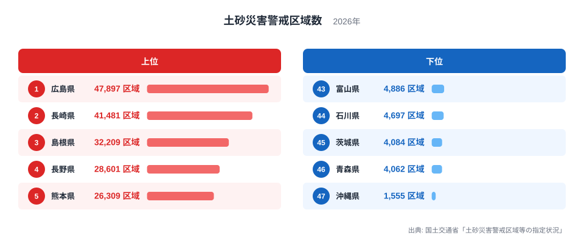
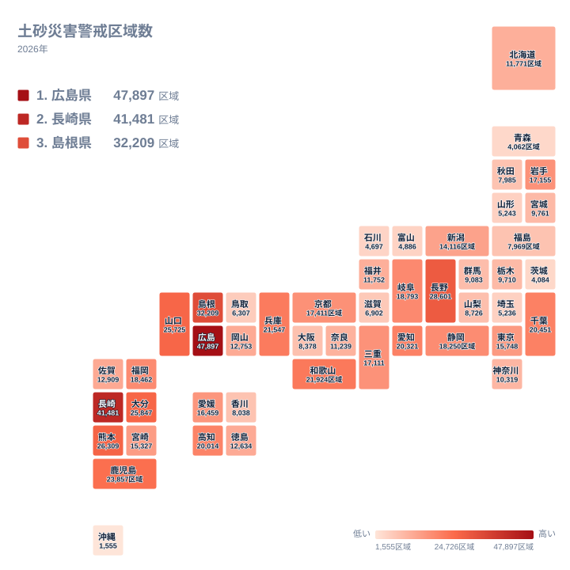

大雨のたびに「土砂災害警戒情報」が発表されますが、危険な斜面がどこにどれだけあるのかは、地図を見ないと実感しにくいものです。その手がかりになるのが、土砂災害警戒区域の指定数です。国土交通省の「土砂災害警戒区域等の指定状況」をもとに、2026年の都道府県別の区域数を並べると、はっきりした差が現れました。

最も多いのは広島県で47,897区域です。2位は長崎県の41,481区域、3位は島根県の32,209区域が続きます。一方、最も少ないのは沖縄県の1,555区域でした。この記事では、上位と下位がなぜこの順になるのかを、地理・産業構造・歴史の視点から整理します。

## 上位と下位の顔ぶれ

まず、上位と下位の県を図で確かめます。

<source-link href="/ranking/landslide-warning-zone-count">土砂災害警戒区域数ランキングをもっと見る</source-link>

上位は広島県、長崎県、島根県、長野県、熊本県の順です。長野県は28,601区域で4位、熊本県は26,309区域で5位でした。下位は沖縄県が47位、青森県が46位で4,062区域、茨城県が45位で4,084区域、石川県が44位で4,697区域、富山県が43位で4,886区域となっています。

上位の五県は、中国地方が二県、九州・沖縄が二県、中部が一県という構成です。西日本に偏ってはいますが、長野県のように内陸の山国も入っています。つまり、海に近いかどうかよりも、山と谷が入り組んだ地形で人が暮らしているかどうかが効いていると読めます。

下位は、九州・沖縄の沖縄県、北海道・東北の青森県、関東の茨城県、中部の石川県と富山県です。地方はばらばらで、共通点は「広い平野や平坦な土地に暮らしの中心がある」ことだと考えられます。上位が「山あいに人が住む県」だとすれば、下位は「平地に人が集まる県」あるいは「そもそも急な斜面が少ない県」という対比になります。

> [!NOTE]
> 土砂災害警戒区域は、土砂災害防止法にもとづいて都道府県が指定する区域です。急傾斜地の崩壊、土石流、地すべりのおそれがある場所のうち、住民の生命や身体に危害が生じるおそれがある区域が対象になります。数えているのは「区域」という指定の単位で、住宅の戸数や住民の人数ではありません。

## 地理分布で見ると西日本の山地が目立つ

次に、47都道府県の分布を地図で見ます。

地図にすると、色の濃い県が中国地方と九州に固まっているのが分かります。広島県、島根県、山口県はいずれも中国地方で、山口県も25,725区域と7位に入りました。九州では長崎県が2位、熊本県が5位、大分県が6位で25,847区域、鹿児島県が8位で23,857区域です。福岡県も18,462区域で15位に入り、九州の多くの県が上位から中位に並びます。

近畿や四国にも多い県があります。和歌山県は21,924区域で9位、兵庫県は21,547区域で10位、高知県は20,014区域で13位です。これらは、海岸近くまで山地が迫り、平地が限られている県です。限られた平地の周縁や谷あいに集落が延びるため、斜面と住まいが近くなり、指定が必要な区域が増えやすくなります。

逆に、東北から関東にかけての広い平野をもつ県は下位に寄っています。青森県が4,062区域、茨城県が4,084区域、埼玉県が5,236区域で42位、山形県が5,243区域で41位です。ただし東北でも岩手県は17,155区域で18位と、中位より上にあります。県の中に山地が広く含まれるかどうかで、同じ地方でも順位は大きく変わります。

> [!TIP]
> 地図を読むときは、色の濃さを「危険度の高さ」と短絡させないことが大切です。区域数が多い県は、危険な斜面が多いと同時に、調査と指定が進んでいる県でもあります。自分の住む県の順位だけでなく、市町村単位のハザードマップで、自宅がどの区域に入っているかを確かめるのが確実です。

## 上位の県を押し上げる地形と暮らし

広島県が1位になる背景には、地質と地形があります。広島県を含む中国地方の山地には、花崗岩が風化してできた砂状の土が広く分布します。この土は雨を含むと崩れやすい性質があります。さらに、瀬戸内海に面した狭い平地に市街地が集中し、住宅が山すそや丘陵地へ広がってきました。県のデータは[広島県のデータ](/areas/34000)でも確認できます。

こうした住宅地の広がり方は、戦後の人口増加と都市の成長の歴史と重なります。平地が足りないために斜面を切り開いて宅地にした地域では、斜面のすぐ下に住まいが並びます。広島県では過去に豪雨で大きな土砂災害が起きており、その後、危険箇所の調査と区域指定が進められてきた経緯があります。

2位の長崎県は、坂の多い市街地と離島の多い県です。平地が少なく、港の背後にある山の斜面に住宅が連なる景観は、観光地としても知られています。半島や島しょ部にも集落が分散しているため、小さな谷や斜面ごとに区域が指定されます。結果として、県全体の指定数が積み上がりやすい構造です。詳しくは[長崎県のデータ](/areas/42000)をご覧ください。

3位の島根県は、人口が少ないのに区域数が多い点が特徴です。中山間地域が広く、小さな集落が谷ごとに点在しています。集落一つひとつの規模は小さくても、谷や斜面の数が多ければ区域も増えます。区域数は人口に比例するわけではなく、「人が住む斜面の数」に近い指標だと言えます。

4位の長野県は、海のない山岳県です。急峻な山地と深い谷が県土の大半を占め、谷沿いや扇状地に集落が発達してきました。土石流が起こりやすい地形条件がそろい、28,601区域に達しています。

> [!WARNING]
> 区域数は県の面積や地形の複雑さの影響を強く受けます。県土が広く山がちな県ほど数が増える傾向があるため、この数字だけで「どの県が安全か」「どの県が危ないか」を決めることはできません。人口あたりや面積あたりに直した比較は、この記事では扱っていません。

## 下位の県に共通する条件と、読み違えやすい点

最下位の沖縄県は1,555区域で、上位との差が際立ちます。沖縄県の本島中南部は、なだらかな台地や低地が中心で、急峻な山地が少ない地形です。島しょ県で河川も短く、本州の山間部のように長い谷が続く場所は限られます。こうした条件が、区域数の少なさにつながっていると考えられます。

青森県と茨城県は、いずれも広い平野や台地をもつ県です。ただし、県を地方でまとめるなら、青森県は北海道・東北、茨城県は関東に属し、地方としての共通点はありません。両県を並べているのは、あくまで区域数が少ないという結果が近いからです。石川県は4,697区域、富山県は4,886区域で、どちらも中部に属します。両県は平野部に人口が集まる一方、山地側では別の災害対策が中心になっている可能性もあり、区域数だけで防災の取り組みを測ることはできません。

ここで注意したいのは、少ない県が「土砂災害と無縁」ではないことです。区域数が少ないのは、指定の対象となる条件を満たす場所が少ない、あるいは指定がまだ進んでいない、という二つの可能性を含みます。数字の少なさを安心材料にせず、自治体が公開するハザードマップで確認する姿勢が必要です。

> [!NOTE]
> 土砂災害警戒区域のほかに、建築物に損壊が生じ、住民に著しい危害が生じるおそれがある区域を指定する「土砂災害特別警戒区域」という制度があります。ここで扱っているのは警戒区域の数で、より厳しい規制がかかる特別警戒区域の数とは別の指標です。

## 大都市圏や中位の県から見えること

中位以下に目を向けると、別の傾向が見えます。千葉県は20,451区域で11位、愛知県は20,321区域で12位と、大都市圏を含む県でも上位に近い数字です。東京都は15,748区域で21位に入ります。東京都の場合、区部は平坦ですが、西部の多摩地域や島しょ部に山地や急斜面があり、区域が指定されています。

意外なのは千葉県です。標高の高い山岳地帯のイメージは薄い県ですが、房総丘陵には小さな谷が入り組み、崖地に沿って住宅が建つ場所が多くあります。標高の高さではなく、「斜面と人の暮らしの近さ」が区域数を決める点がよく表れています。

大阪府は8,378区域で35位、神奈川県は10,319区域で30位でした。どちらも人口の多い都市圏ですが、順位は中位から下位にとどまります。人口が多いことと、区域が多いことは別の話です。むしろ人口の集中する平野部では、斜面を伴う区域が相対的に少なくなります。北海道は11,771区域で27位で、広い県土に対して区域数は中位でした。

このように、区域数を決める要因は、地質、起伏の複雑さ、集落の分散、宅地開発の歴史、そして指定作業の進み具合です。産業構造の面では、農林業が盛んな中山間地域ほど山すそに集落があり、区域が多くなりやすい傾向があります。同じカテゴリの数字は[同じカテゴリの統計一覧](/category/safetyenvironment)でまとめて比べられます。

## データについて

この記事で使った「土砂災害警戒区域数」は、国土交通省「土砂災害警戒区域等の指定状況」の2026年の値で、単位は区域です。全47都道府県の値を比べています。

区域は、都道府県が基礎調査を行ったうえで指定する制度です。そのため、指定の進み方が県ごとに異なれば、数字にも影響が出ます。また、一つの区域の広さや、そこに含まれる住宅の数は同じではありません。広い一区域もあれば、小さな谷に限られた一区域もあります。区域数は、リスクの大きさそのものではなく、制度上で指定された場所の数だと理解してください。

最後に、順位の見方をまとめます。広島県が1位、長崎県が2位、島根県が3位という並びは、山がちな地形に人が暮らしてきた歴史を映しています。沖縄県が最下位なのは、平坦な地形が中心だからだと考えられます。自分の住む地域の区域指定は、都道府県や市町村が公開する地図で確認できます。数字をきっかけに、避難場所や避難経路を家族で話し合ってみてください。
