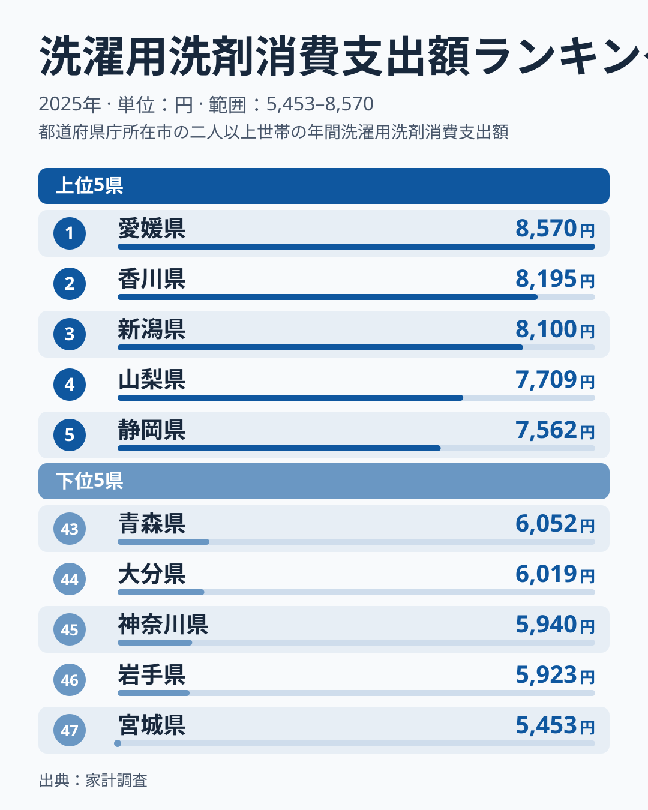
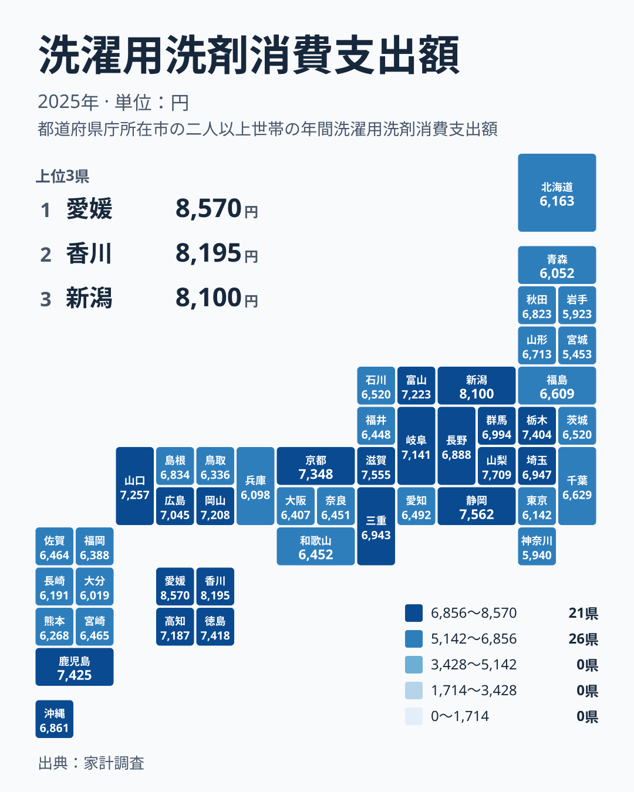

洗濯用洗剤は、ほぼすべての家庭で欠かさず使う日用品です。どこに住んでいても必要なものなので、支出額はどの県でも似た水準に収まりそうに思えます。ところが2025年の家計調査を見ると、県ごとにはっきりした差が出ています。

首位は愛媛県の8,570円で、最下位は宮城県の5,453円でした。この記事では、数字の並びを地方という別の切り口で分解し、差の背景を生活者の目線で考えます。ただし原因までは断定できないため、データから言えることと仮説を分けて書きます。

> [!NOTE]
> ここでの金額は、家計調査で把握された洗濯用洗剤への年間支出額です。購入した量ではなく、支払った金額を表します。大容量の詰め替えを安く買う家庭と、小容量の本体ボトルを買う家庭では、同じ量を使っていても金額が変わります。洗剤の「使用量」を比べた数字ではない点に注意してください。

## 首位と最下位は何倍の開きか

まずは上位5県と下位5県を図で確認します。

<source-link href="/ranking/laundry-detergent-consumption-expenditure">洗濯用洗剤への支出ランキングをもっと見る</source-link>

首位の愛媛県は最下位の宮城県の約1.6倍にあたります。毎日使う日用品で、ここまでの開きが生じていることが最初の発見です。ただし、この図で注目したいのは両端の数字そのものより、並び方の形です。

上位側には段差があります。1位から3位までは近い水準で並び、そこから4位以下へ一段下がります。つまり上位は、少数の県が高い水準で先に抜けている形です。一方、下位側は事情が違います。44位から46位までは値が詰まっていて、最下位の宮城県だけがその下に孤立しています。下位グループの中でも、宮城県は一段低い位置にあります。

この形は、順位の読み方にも影響します。真ん中あたりの県は金額が密集しているため、順位が数位違っても差はわずかです。順位だけで「多い県」「少ない県」と決めつけず、上位の抜け方と最下位の孤立という二つの特徴を押さえておくのが現実的です。

## 地図で見る四国の集中と地方ごとのばらつき

次に、都道府県の位置関係を地図で確認します。

地図でまず目を引くのは四国です。愛媛県が1位、香川県が2位、徳島県が8位、高知県が14位で、四国の4県はすべて14位以内に入っています。一つの地方がこれだけ上位にまとまる例は、ほかにありません。

では、ほかの地方はどうでしょうか。各地方について、域内で最も高い順位と最も低い順位を並べると、ばらつきの幅が見えてきます。

- 最高位3位の新潟県から最低位34位の福井県まで (中部)
- 最高位6位の滋賀県から最低位42位の兵庫県まで (近畿)
- 最高位9位の栃木県から最低位45位の神奈川県まで (関東)
- 最高位11位の山口県から最低位37位の鳥取県まで (中国)
- 最高位7位の鹿児島県から最低位44位の大分県まで (九州・沖縄)
- 最高位23位の秋田県から最低位47位の宮城県まで (北海道・東北)
- 最高位1位の愛媛県から最低位14位の高知県まで (四国)

四国は幅が14位以内に収まり、地方としてのまとまりが際立ちます。それに対して、四国を除く地方では、上位の県と下位寄りの県が同じ地方に混在しています。近畿は6位から42位、関東は9位から45位と、特に幅が広く出ています。中部でも、新潟県が3位、山梨県が4位、静岡県が5位と上位が続く一方で、福井県は34位でした。

北海道・東北は少し傾向が異なります。この地方では最高位でも23位にとどまり、上位に入る県がありません。宮城県が47位、岩手県が46位、青森県が43位と下位に集まっています。ただし、北海道・東北の中でも秋田県、山形県、福島県は中位です。低い県が目立つとは言えても、地方全体が低いとまでは言い切れません。

地方で一括りにはできない例が多いのは確かです。大都市を含む東京都は41位、神奈川県は45位、大阪府は35位、兵庫県は42位と、下位寄りに並びます。その一方で京都府は10位に入っているため、大都市だから低いと言い切るのも無理があります。「大都市圏で低めに出やすいかもしれない」という程度にとどめるのが適切です。

> [!WARNING]
> 洗剤は、詰め替え用の大容量パックを数か月分まとめて買う家庭が少なくありません。その場合、年間の支出額は「使った量」ではなく「買った時期」に左右されます。特売で買いだめした年は金額が膨らみ、在庫でしのいだ年は縮みます。また、茨城県と石川県は同額の6,520円で、それぞれ27位と28位に並んでいます。順位が近い県は金額差がごくわずかなので、優劣として読まないほうが安全です。

## 愛媛県と四国の上位集中をどう読むか

読者がいちばん気になるのは、愛媛県がなぜ首位なのかでしょう。結論から言うと、今回の実データだけでは愛媛県固有の理由を特定できません。言えるのは、愛媛県が首位、香川県が2位で、四国の4県がそろって上位にあるという事実です。

一つの県だけが飛び抜けたのであれば、その県の事情を疑うところです。しかし隣り合う香川県も上位に入り、4県すべてが14位以内に収まっています。そのため、愛媛県だけの特殊事情というより、四国の暮らしに共通する何かが働いている可能性があります。

あくまで仮説ですが、次のような見方が考えられます。ただし、いずれも今回のデータでは裏付けられません。

- 洗濯の回数や洗濯物の量が多い世帯が多い
- 液体洗剤や機能性の高い商品を選ぶ傾向がある
- 購入する店や、まとめ買いの習慣が地域で似ている

仮説を確かめるには、世帯構成や購入商品の内訳といった別のデータが必要です。まずは[愛媛県のデータ](/areas/38000)と[香川県のデータ](/areas/37000)を見比べ、ほかの項目でも両県が似た動きをしているかを確認するのが出発点になります。

> [!TIP]
> 金額の高さを「たくさん洗っている」と読むのは早計です。単価の高い商品を選んでいても、安い詰め替えを大量に買っていても、金額は同じになり得ます。自分の県の順位を見るときは、洗剤だけでなく柔軟剤や漂白剤など、隣接する支出と合わせて読むと、金額の高さが「量」か「単価」かを推し量る手がかりになります。

## 暮らしに引き寄せて読むと

数字を暮らしの側に引き寄せると、洗剤代の差は「何にお金をかけるか」の違いとして読めます。香りや除菌、部屋干し対応といった機能を重視する家庭が多ければ、支出は膨らむかもしれません。逆に、安価な詰め替えを選ぶ家庭が多い地域では、金額は抑えられる可能性があります。これらも仮説にとどまります。

中位の県は金額が密集しています。たとえば20位の長野県は6,888円、21位の沖縄県は6,861円、22位の島根県は6,834円で、順位が違っても差はわずかです。自分の県が中位にいる場合、順位を気にするより、家計の中で洗剤にいくらかけているかを把握するほうが実用的です。

金額の背景を考えるときは、ほかの日用品の支出も手がかりになります。関心のある方は、[同じカテゴリの統計一覧](/category/economy)から、ほかの指標も合わせて確認してみてください。日用品の支出を並べると、その県の暮らし方の特徴が浮かび上がります。

## データについて

この記事で使った統計は、家計調査における洗濯用洗剤消費支出額で、対象は2025年、単位は円です。全47都道府県の値を用いています。同額の県は同順位として扱い、実データに載っている値と順位だけを引用しています。独自の推計は行っていません。ただし、首位と最下位の比だけは、実データの2つの値から求めた倍率として示しました。

洗剤代という身近な数字でも、県ごとに並べると暮らし方の違いが見えてきます。次に洗剤を買うとき、ご自身の県がどのあたりに位置するかを思い出してみてください。
