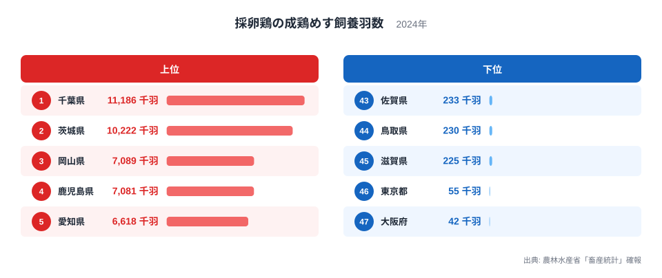
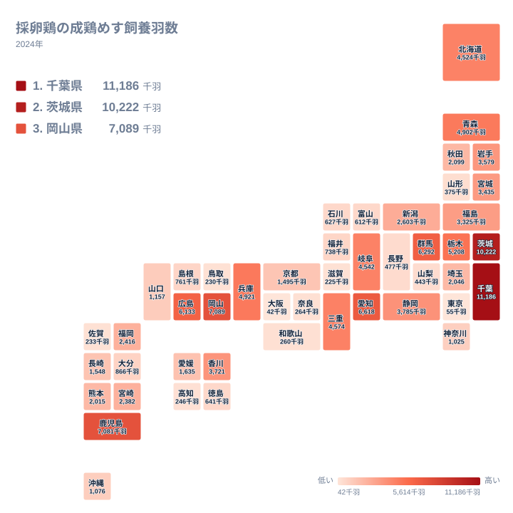

## 採卵鶏が多い県はどこか

毎日の食卓に欠かせない卵を産む鶏は、全国のどこで多く飼われているのでしょうか。2024年の採卵鶏の成鶏めす飼養羽数で最も多いのは、千葉県の11,186千羽です。2位は茨城県の10,222千羽で、関東の2県が全国の先頭に並びます。

3位は岡山県の7,089千羽、4位は鹿児島県の7,081千羽で、この2県はほぼ並んでいます。5位は愛知県の6,618千羽、6位は群馬県の6,292千羽、7位は広島県の6,133千羽と続きます。

一方で最も少ないのは大阪府の42千羽で、46位の東京都は55千羽です。1位の千葉県と47位の大阪府を比べると、約266倍の差があります。この記事では、この差の背景を考えます。ただし、データから確かめられることと、仮説にとどまることは分けて書きます。

> [!NOTE]
> ここでの「成鶏めす」は、卵を産む段階に達した雌鶏のことです。ひな鶏や肉用のブロイラーは含まれません。単位は千羽で、ある時点の飼養羽数を表します。年間の卵の生産量や出荷量そのものではありません。

## 上位と下位のランキング

<source-link href="/ranking/layer-hen-count">採卵鶏の成鶏めす飼養羽数ランキングをもっと見る</source-link>

上位5県は、千葉県、茨城県、岡山県、鹿児島県、愛知県です。関東が2県、中国が1県、九州・沖縄が1県、中部が1県という顔ぶれで、一つの地方に固まってはいません。ただし1位と2位は、3位以下と少し離れています。千葉県の11,186千羽と茨城県の10,222千羽は、3位の岡山県の7,089千羽を上回っています。

下位に目を向けると、大阪府が47位で42千羽、東京都が46位で55千羽です。どちらも人口が集中する大都市です。市街地が広がり、鶏舎の用地を確保しにくいことが影響している可能性はあります。ただし、この図の数字だけでは、その理由までは確かめられません。

上位2県が首都圏に近いことから、卵は割れやすく鮮度が重視されるため、消費地に近い立地が有利だという見方もあります。もっとも、この見方だけでは全体を説明できません。3位の岡山県、4位の鹿児島県、7位の広島県は首都圏から離れています。首都圏に近い埼玉県は23位の2,046千羽、神奈川県は30位の1,025千羽にとどまります。消費地への近さは要因の一つにすぎず、このデータだけでは説明しきれません。

> [!TIP]
> 東京都と大阪府は、人口の多い都府県でありながら、飼養羽数は下位にあります。「人口が多い地域ほど羽数も多い」とは限らないという観察として読んでください。なお、この記事のデータには消費量そのものは含まれていません。

## 地理分布から見える傾向

タイルマップを眺めて目につくのは、関東の北部から東部にかけての集中です。千葉県が1位、茨城県が2位で、群馬県が6位、栃木県が8位と、上位10県のうち4県が関東の県です。同じ関東でも、埼玉県が23位、神奈川県が30位、東京都が46位と、南西側では順位が下がります。関東の中でも、産地の集まる場所には偏りがあることが読み取れます。

もう一つの特徴は、上位が一つの地方に偏らず分散していることです。上位10県には、関東のほか、中国の岡山県と広島県、九州・沖縄の鹿児島県、中部の愛知県、近畿の兵庫県、北海道・東北の青森県が入っています。北海道は4,524千羽で13位です。大規模な産地は、消費地の近くだけでなく、各地方に点在していることがわかります。

> [!WARNING]
> 飼養羽数は、1つの農場の規模が大きい県で数字が跳ね上がることがあります。3位の岡山県と4位の鹿児島県のように、順位が近い県どうしの違いを実力差と読むのは危険です。単年の数字だけで、産地の優劣を断定しないでください。

## 理由はどこまで説明できるのか

ここまでの数字から、はっきり言えることは限られます。関東北部から東部に羽数が集まっていること、上位が複数の地方に分かれていること、人口の多い東京都と大阪府が下位にあること。この3点は、図からそのまま確認できます。

その先の理由については、仮説の域を出ません。たとえば、飼料の多くを輸入穀物に頼る養鶏では、港に近い立地が有利になるという見方があります。千葉県、茨城県、愛知県の順位が高いことと、この見方が合うように見える面もあります。ただし、この記事のデータには飼料の調達先や輸送の情報はなく、因果関係は確かめられません。

歴史についても同じです。戦後の都市化のなかで、都市部の近郊では飼養が難しくなり、少し離れた県に産地が移ったのではないか、という見立てがあります。東京都と大阪府の低さは、この見立てと矛盾しないかもしれません。けれども、2024年の1時点の数字からは、産地が移ってきた過程を確かめることはできません。

兵庫県の4,921千羽は9位、三重県の4,574千羽は11位で、近畿では2県に羽数が集まっています。一方、滋賀県の225千羽は45位です。同じ地方でも県によって大きく異なり、地方という単位だけでは産地の違いを説明できないことも、データは示しています。

## 地域のデータを見てみる

上位2県について、詳しいデータは県ごとのページで確かめられます。[千葉県のデータ](/areas/12000)では、1位となった千葉県の他の統計もあわせて見られます。[茨城県のデータ](/areas/08000)も、2位の産地の姿を知る手がかりになります。農業分野の他の指標と比べたいときは、[同じカテゴリの統計一覧](/category/agriculture)が役に立ちます。

## データについて

この記事で使ったのは、農林水産省「畜産統計」確報の2024年の値で、正式な統計名は「採卵鶏の成鶏めす飼養羽数」です。単位は千羽で、都道府県別に全47件が公表されています。記事中の順位はすべてこの確報に基づきます。

飼養羽数は、県の面積や人口で割った値ではないため、県の規模の違いは反映されていません。また、ここで示せるのは2024年の姿だけです。産地の変化の過程や、立地の理由は、この数字だけでは確かめられません。本文中の地理・産業・歴史に関する説明は、数字の背景を考えるための仮説として読んでください。

## まとめ

採卵鶏の成鶏めす飼養羽数は、千葉県が11,186千羽で1位、茨城県が10,222千羽で2位でした。関東の北部から東部に羽数が集まり、上位10県は関東、中国、九州・沖縄、中部、近畿、北海道・東北の各地方に分かれています。

下位には大阪府の42千羽と東京都の55千羽が並び、1位と47位の差は約266倍です。消費地への近さは、上位の理由の一つかもしれませんが、岡山県や鹿児島県、そして首都圏に近くても順位の低い埼玉県や神奈川県を見ると、それだけでは説明できません。数字の裏にある理由は、別の統計とあわせて考える必要があります。
