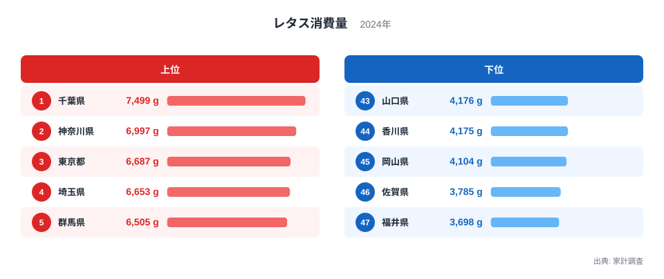
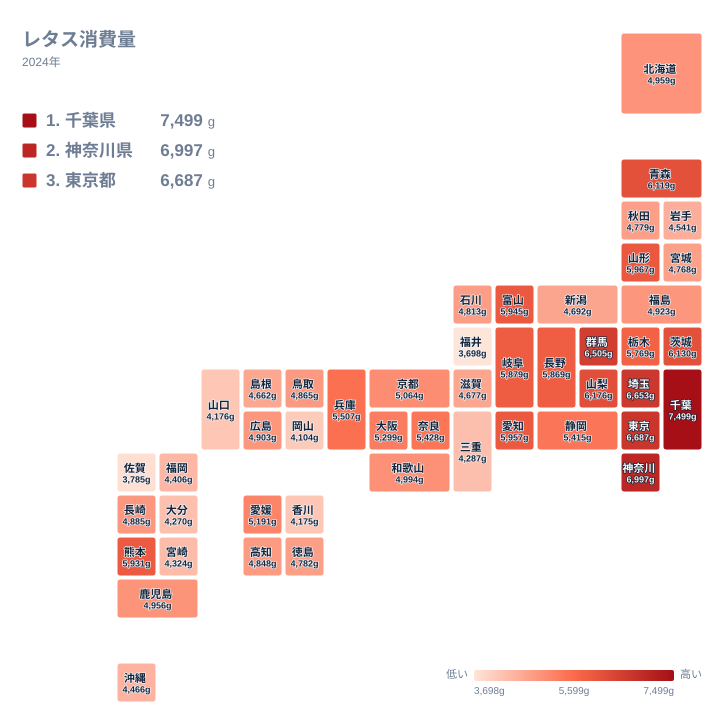

## レタス消費量が最も多い県は千葉県

サラダやハンバーガー、サンドイッチの具材として、レタスは一年を通して食卓に並ぶ野菜です。それでも、どれだけ買われているかを県ごとに比べると、はっきりした差があります。

2024年の家計調査で1位になったのは千葉県で、7,499gでした。2位は神奈川県の6,997g、3位は東京都の6,687gです。4位は埼玉県の6,653g、5位は群馬県の6,505gで、上位5位までを関東の県が占めています。

一方、最も少なかったのは福井県の3,698gです。46位の佐賀県が3,785g、45位の岡山県が4,104gと続きます。

<source-link href="/ranking/lettuce-consumption-quantity">レタス消費量ランキングをもっと見る</source-link>

最大の千葉県は7,499g、最小の福井県は3,698gです。7,499gを3,698gで割ると2倍強になり、最大は最小の約2倍に当たります。同じ野菜でも、県によって買われる量が倍近く開いていることが分かります。

上位5県と下位5県では、値の幅の違いも目立ちます。上位5県は1位の7,499gから5位の6,505gまでで、1位と5位の差は994gです。下位5県は43位の山口県4,176gから47位の福井県3,698gまでで、差は478gです。上位のほうが県ごとの値が散らばり、とくに千葉県が2位の神奈川県の6,997gを502g上回って抜けています。下位は、4,000g前後から3,000g台後半に小さく固まっています。

上位の顔ぶれは地理的にもまとまっています。千葉県、神奈川県、東京都、埼玉県、群馬県はいずれも関東の県です。一方、下位の5県は福井県が中部、佐賀県が九州・沖縄、岡山県と山口県が中国、香川県が四国と、複数の地方に散らばっています。

> [!NOTE]
> この統計の値は、家計調査で集計された世帯あたりの年間購入数量で、単位はグラムです。店で買った生のレタスの量が中心で、外食やコンビニのサンドイッチ、加工品に含まれるレタスは基本的に反映されません。「その県の人が食べたレタスの総量」ではない点に注意してください。

## 首都圏に消費が集まる背景

上位に関東の県が並ぶ背景として、まず考えられるのは産地との距離です。レタスは鮮度が品質に直結する葉物野菜で、収穫後の傷みも早い野菜です。大消費地の近くに産地があれば、新鮮なものが店頭に届きやすいという見方があります。

千葉県は1位、神奈川県は2位、東京都は3位です。茨城県も7位の6,130gで、関東の中でも上位に入っています。ただし、この記事のデータには産地の規模や流通の距離は含まれていません。産地との近さが消費量を押し上げているかどうかは、ここでは確かめられません。

千葉県や神奈川県については、地域別のデータページでほかの指標も確認できます。食料全体の傾向と合わせて見ると、レタスの位置づけが分かりやすくなります。

- [千葉県のデータ](/areas/12000)
- [神奈川県のデータ](/areas/14000)

もう一つの仮説は食習慣です。サラダを食卓の定番にする家庭や、パンと洋風の朝食を取る家庭が多い地域では、生で食べる葉物の需要が高まるという見方があります。ただし、この統計だけで食習慣の違いを証明することはできません。あくまで、数字と矛盾しない説明の一つとして受け取ってください。

## 関東以外にも消費の多い県がある

レタスの消費が多いのは、関東だけではありません。6位は山梨県の6,176g、8位は青森県の6,119g、9位は山形県の5,967gです。いずれも関東の外の県です。

さらに、10位に愛知県の5,957g、11位に富山県の5,945g、12位に熊本県の5,931g、13位に岐阜県の5,879g、14位に長野県の5,869gが続きます。レタスは冷涼な気候を好み、季節に応じて産地が移り変わる野菜として知られています。長野県は高原野菜の産地として広く知られており、14位です。

ここで注意したいのは、産地であることと、家庭の購入量が多いことは別だという点です。産地が全国へ出荷している場合、地元の家庭の購入量が目立って多くなるとは限りません。この記事のデータは生産量を含まないため、産地と消費量の関係は断定できません。

> [!TIP]
> 順位を見るときは、産地の県と消費の多い県を分けて考えると読み違えを防げます。この指標は「作った量」ではなく「家庭が買った量」を表しています。産地として有名な県が上位にいない場合でも、出荷が中心で地元消費は平均的、という状況はあり得ます。

## キャベツや白菜との対比

葉物野菜として比べられやすいのがキャベツや白菜です。キャベツは炒め物、煮物、千切りのつけ合わせと用途が広く、白菜は鍋物や漬物と結びつきが強い野菜として知られています。これに対してレタスは、生で食べる場面が中心の野菜です。

そのため、レタスの消費量はサラダを食べる習慣の強さに左右されやすいのではないか、という仮説が立てられます。キャベツや白菜の県別の値はこの記事のデータに含まれていないため、この仮説を数値で検証することはできません。

気になる方は、同じカテゴリの統計一覧から関連する品目を探してみてください。

- [同じカテゴリの統計一覧](/category/economy)

## 地図で見る全国の濃淡

地図にすると、関東を中心に消費の多い県が集まっているのが分かります。千葉県、神奈川県、東京都、埼玉県、群馬県、茨城県が上位に並びます。関東の外では、中部の山梨県が6位です。関東の中では、栃木県が15位の5,769gで続きます。

関東の外では、東北の青森県と山形県、中部の富山県、岐阜県、長野県、愛知県も目を引きます。一方、近畿では兵庫県が16位の5,507g、奈良県が17位の5,428g、大阪府が19位の5,299g、京都府が21位の5,064gと、中位に収まる県が多くなっています。

九州・沖縄では、福岡県が39位の4,406g、宮崎県が40位の4,324g、大分県が42位の4,270gと低めで、熊本県の12位が例外的に高い位置にあります。中国では山口県が43位、岡山県が45位で、四国では香川県が44位です。福井県と佐賀県を含め、下位は4,000g前後に集まっています。

> [!WARNING]
> 家計調査は標本調査で、対象世帯が限られるため、順位の近い県どうしの差は誤差の範囲に収まることがあります。たとえば43位の山口県が4,176g、44位の香川県が4,175gと、ほぼ並んでいます。順位の1つや2つの違いを、実態の差と読み取るのは避けてください。

## 数字を読むときの視点

ここまでの内容を整理します。レタス消費量は、関東の都県が上位を占めています。ただし、青森県や山形県、熊本県のように、関東以外にも消費の多い県があります。

北海道は23位の4,959g、鹿児島県は24位の4,956gで、全国の中位に位置します。沖縄県は38位の4,466gです。広い県域や独自の食文化があっても、レタスの消費量が特別に多い、あるいは少ないとは言えない結果でした。

数字を県の個性として受け止めるときは、買われた量であること、標本調査であること、外食や加工品が含まれないことを頭に置いてください。そのうえで、自分の県が全国のどのあたりにいるかを知れば、日々の食卓を見直すきっかけにもなります。

## データについて

この記事で使ったのは、家計調査にもとづくレタス消費量で、2024年の値を単位gで示したものです。県ごとの購入数量を並べたもので、各県の順位は実データのとおりです。

家計調査は、日々の家計簿に記録された購入内容を集計する調査です。そのため、実際に食べた量そのものではなく、購入した量が基準になります。外食、給食、贈答、自家栽培や頂き物は含まれにくく、家庭菜園が盛んな地域では、実際の摂取量との間に差が出る可能性があります。

県間の比較には役立ちますが、近い順位の優劣を断定するのには向きません。複数年の推移や別の指標と組み合わせて、全体の傾向をつかむ使い方が適しています。
