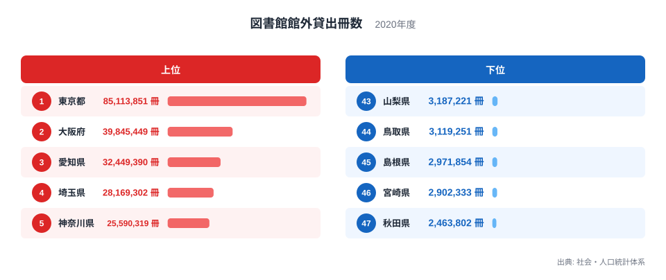
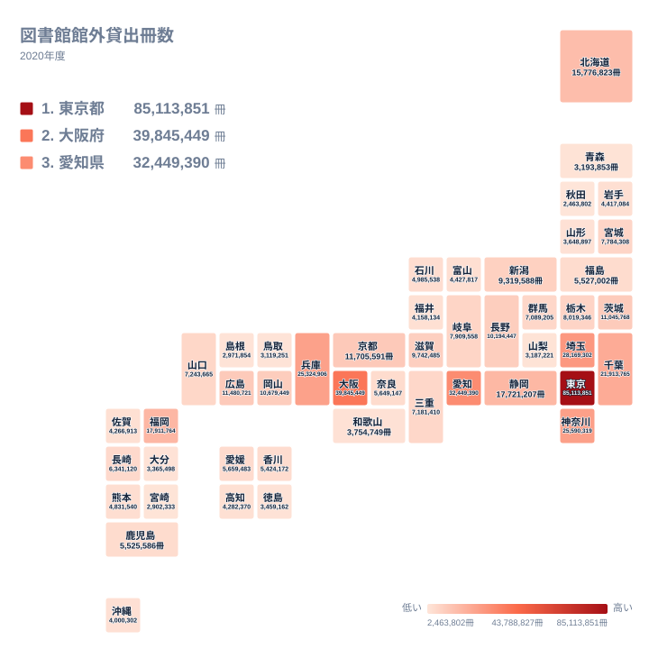

図書館で本を借りて家に持ち帰る。ごく身近な行動ですが、都道府県ごとに集計すると、その冊数には大きな開きが生まれます。2020年の図書館館外貸出冊数で首位に立ったのは、東京都の85,113,851冊でした。最下位の秋田県は2,463,802冊にとどまります。

この記事では、与えられたデータで確かめられる範囲に絞って、首位の突出ぶり、上位と下位の分布、人口規模の並びとの重なりを見ていきます。理由については、データから言えることと仮説にとどまることを分けて書きます。

## 上位と下位の顔ぶれを確認する

まずは47都道府県のうち、上位5と下位5を図で見てみましょう。

<source-link href="/ranking/library-lending-books">図書館館外貸出冊数ランキングをもっと見る</source-link>

図から読み取れる最も大きな特徴は、首位の東京都と2位の大阪府の差です。東京都の85,113,851冊は、大阪府の39,845,449冊の2倍を超えています。2位以下では、大阪府、愛知県、埼玉県、神奈川県と続き、首位だけが別格という形です。

上位5都府県と下位5県の対比も目を引きます。上位5は東京都、大阪府、愛知県、埼玉県、神奈川県で、いずれも大都市圏の中心か周辺にあたります。下位5は秋田県、宮崎県、島根県、鳥取県、山梨県です。東京都1つの冊数は、下位5県を合わせた冊数をはるかに上回ります。最下位の秋田県と比べると、東京都は30倍を超える水準です。

上位と下位の顔ぶれは、おおまかに人口の多い都府県と人口の少ない県の並びと重なって見えます。ただし、この記事には人口のデータを載せていないため、重なりの度合いを数字で確かめることはできません。

> [!NOTE]
> 図書館館外貸出冊数は、図書館の外へ持ち出された資料の延べ冊数です。館内で閲覧しただけの本は含まれません。同じ本が何度も借りられれば、そのたびに数えられます。読まれた本の種類数ではなく、貸出の回数に近い指標です。

## 東京都の突出をどう読むか

データで言えるのは、東京都が首位であり、2位の大阪府の倍を超えているということです。この点は、47都道府県の並びの中でも際立っています。

では、なぜ東京都がここまで多いのか。データだけでは答えが出せませんが、仮説は立てられます。人口が多く利用者の裾野が広いこと、区や市ごとに図書館が置かれていて身近に使えること、通勤や通学で都内に通う人が多いことなどが考えられます。ただし、これらは図書館の数や人口などのデータで裏付けたものではなく、あくまで仮説です。

東京都の位置づけは、貸出冊数の合計という指標の性質とも関わります。県全体の合計なので、利用者の母数が大きい地域ほど冊数が膨らみやすい面があります。1人あたりの利用の深さとは別の話です。詳しい数値は[東京都のデータ](/areas/13000)でも確認できます。

> [!TIP]
> この指標は「県内の全図書館の貸出を足し上げた合計」です。東京都のように1位が突出している場合、2位以下の差よりも首位との倍率に注目すると、分布の偏りが読み取りやすくなります。

## 地理分布で見る大都市圏と地方の差

次に、47都道府県の値を地図の形で見てみましょう。

地図からは、関東、近畿、東海に濃い色が集まる様子が読み取れます。首都圏では東京都、埼玉県、神奈川県、千葉県が上位に入り、千葉県は7位の21,913,765冊です。近畿では2位の大阪府に加えて、兵庫県が6位、京都府が11位です。東海では愛知県が3位、静岡県が9位に入っています。

一方、東北、山陰、四国、九州南部には低い順位の県が目立ちます。青森県は42位の3,193,853冊、島根県は45位、宮崎県は46位、秋田県は47位です。上位に並ぶ地域が三大都市圏とその周辺に偏っているのは、地図からはっきり分かります。

ただし、地方がすべて下位というわけではありません。北海道は10位の15,776,823冊、長野県は15位の10,194,447冊、新潟県は17位の9,319,588冊と、10位台に位置しています。広い面積を持つ県や、市町村ごとに図書館が整備されてきた県が健闘している可能性はありますが、面積や館数のデータを使っていないため、理由は断定できません。

## 中位の県は差が小さい

順位の真ん中あたりを見ると、冊数の差が小さい帯があることが分かります。たとえば30位の石川県は4,985,538冊、31位の熊本県は4,831,540冊、32位の富山県は4,427,817冊です。30位から32位までの差は、合計でも約56万冊にとどまります。

これに対して、上位では1つ順位が動くだけで数百万冊の差があります。1位と2位の差は約4,527万冊、2位と3位の差は約740万冊です。順位の上のほうは差が大きく、中位から下位にかけては差が詰まっていることが、数字から分かります。

このため、中位では順位が1つ違うだけの県どうしを「多い」「少ない」と言い分けるのは慎重にすべきです。新しい図書館の開館や休館といった事情で、順位が入れ替わる余地がある帯だといえます。

詳しい比較は、[同じカテゴリの統計一覧](/category/educationsports)から、ほかの教育・文化の指標とあわせて見ると理解が深まります。

> [!WARNING]
> この数字は2020年の1年分で、新型コロナウイルス感染症の影響を受けた時期にあたります。臨時休館が行われたり、貸出の方法が限られたりした自治体があり、その程度は地域で異なりました。通常の年の貸出量をそのまま映した値とは限りません。

## 大阪府と愛知県の差を測る

2位の大阪府と3位の愛知県を比べると、大阪府が39,845,449冊、愛知県が32,449,390冊で、差は約740万冊です。一方、愛知県と4位の埼玉県の28,169,302冊との差は約430万冊です。

つまり、愛知県と埼玉県の差は、大阪府と愛知県の差よりも小さくなっています。2位から3位、3位から4位、4位から5位と順位を下るにつれて、冊数は緩やかに減っていきます。この数字から「上位3都府県が4位以下を明確に引き離している」とは言えません。上位で突出しているのは、あくまで東京都です。

[大阪府のデータ](/areas/27000)を見ても、大阪府は東京都に次ぐ2位ですが、東京都との間には大きな差があります。大阪府や愛知県の貸出が多い理由は、人口や図書館網、産業構造などが関わると考えられますが、本記事のデータでは確かめられません。

## 読み解くときの注意点

このランキングを使うときは、いくつか気をつけたい点があります。

- 延べ冊数なので、同じ本の再貸出も数えられます。貸出された本の種類の多さを表すものではありません
- 都道府県の合計値なので、県内の市区町村ごとの差や、図書館ごとの違いは見えません
- 2020年は臨時休館や貸出方法の制限があった時期で、休館の長さの違いが冊数に反映されている可能性があります

人口の多い都府県が上位に来やすい、というのは合計値の指標に共通する性質ですが、この記事のデータには人口が含まれていません。そのため、順位が「利用の盛んさ」を反映しているかどうかは、ここからは判断できません。

## データについて

ここで使った図書館館外貸出冊数は、社会・人口統計体系に収録された2020年の値で、単位は冊です。都道府県ごとに、図書館が館外へ貸し出した資料の延べ冊数を集計したものです。順位は冊数の多い順に付けています。

## まとめ

2020年の図書館館外貸出冊数は、東京都が85,113,851冊で首位となり、2位の大阪府の倍を超えました。3位は愛知県、4位は埼玉県、5位は神奈川県です。下位には秋田県、宮崎県、島根県などが並びます。

上位と下位の並びは、人口の多い地域と少ない地域の並びと重なって見えます。人口の規模や図書館網の密度が背景にあるのではないか、というのは仮説であり、本記事のデータだけでは裏付けられません。確かめるには、人口や図書館数、休館日数などのデータとあわせて見る必要があります。
