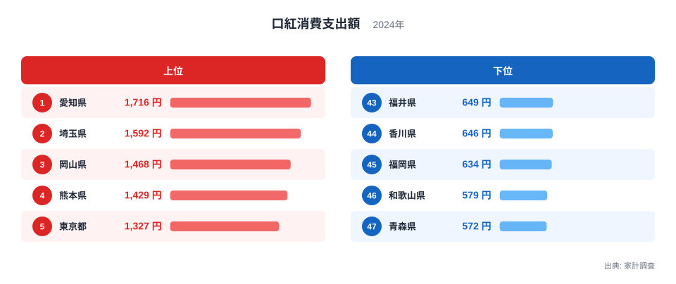
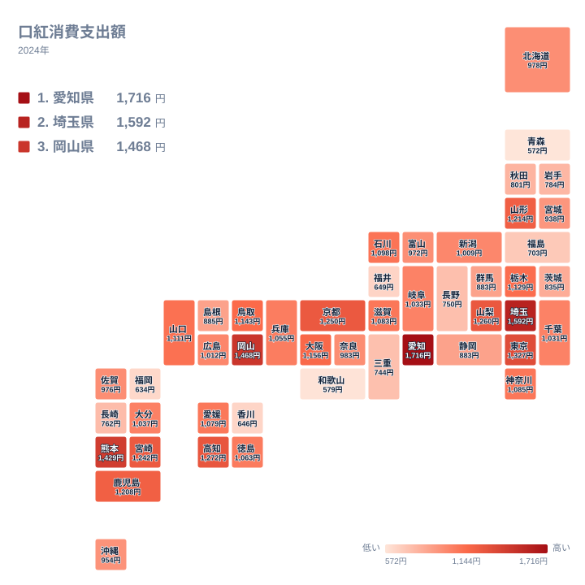

口紅への支出が最も多い県はどこでしょうか。2024年の家計調査では、1位は愛知県の1,716円でした。最下位の青森県は572円です。1位と47位を比べると、約3倍の開きがあります。化粧品の中でも口紅は、流行や気分、職場の身だしなみ規範が表れやすい品目です。この記事では、都道府県ごとの支出額を並べ、地域ごとの暮らしぶりと結びつけて考えます。

## 口紅への支出は愛知県が先頭、埼玉県が続く

まず上位と下位の顔ぶれを見てみます。次の図は、上位5県と下位5県を並べたものです。

<source-link href="/ranking/lipstick-consumption-expenditure">口紅への支出ランキングをもっと見る</source-link>

1位は愛知県で1,716円です。2位は埼玉県の1,592円、3位は岡山県の1,468円、4位は熊本県の1,429円、5位は東京都の1,327円と続きます。東京都は5位で、首位ではありません。大都市の中心だから支出が最も多い、という単純な図式にはなっていないことが分かります。

下位に目を向けると、47位は青森県の572円です。46位は和歌山県の579円、45位は福岡県の634円、44位は香川県の646円、43位は福井県の649円です。下位5県は600円台前半までの狭い範囲に集まっています。上位5県が1,300円台から1,700円台に広がっているのとは対照的です。

上位には中部、関東、中国、九州・沖縄から1県以上が入っています。愛知県は中部、埼玉県と東京都は関東、岡山県は中国、熊本県は九州・沖縄です。特定の地方だけに偏らず、全国に散らばっている点が、この指標の面白いところです。詳しい数値は[愛知県のデータ](/areas/23000)や[埼玉県のデータ](/areas/11000)でも確認できます。

> [!NOTE]
> ここでの支出額は、家計調査で調べられた、1世帯あたりの口紅への年間支出額です。購入した人だけの平均ではなく、買わなかった世帯も含めた値です。このため、買う人が少ない地域は、1人あたりの購入額が高くても全体の数字は小さくなります。

## 地図で見ると、特定の地方に偏らない散らばり方

次に、47都道府県の分布を地図で確認します。

地図を眺めると、濃い色の県が一か所に固まっていません。関東では埼玉県が2位、東京都が5位、栃木県が14位で、神奈川県は17位、千葉県は24位です。同じ関東でも順位には幅があります。茨城県は36位の835円、群馬県は34位の883円で、上位とは差があります。

中部も同じです。愛知県は1位ですが、山梨県は7位の1,260円、石川県は16位の1,098円、岐阜県は23位の1,033円です。一方で、静岡県は35位の883円、長野県は40位の750円、福井県は43位の649円と、順位が下がります。同じ地方でも県ごとに大きく違います。

近畿では、京都府が8位の1,250円、大阪府が12位の1,156円で、滋賀県は18位の1,083円です。一方、三重県は41位の744円、和歌山県は46位の579円です。近畿の中でも差が大きく、地方という単位でひとくくりにはできないことが分かります。

> [!TIP]
> 地図を読むときは、色の濃い県だけでなく、隣り合う県との差にも注目してください。同じ地方の中で順位が大きく離れている場合は、地方の気質というより、その県の都市構造や世帯の年齢構成が効いている可能性があります。

## 愛知県が1位になる背景を考える

愛知県が首位に立つ理由は、データだけでは断定できません。ただ、仮説として考えられる点はあります。

一つは、働く場の多様さです。愛知県には製造業をはじめ、さまざまな業種が集まり、通勤や勤務の場面で身だしなみに気を配る機会が多いと考えられます。もう一つは、買い物の環境です。大きな商業施設や百貨店、専門店が集まる都市圏では、新色や限定品に触れる機会が増えます。化粧品は、実物を見て選ぶ楽しみが購買を後押しする品目でもあります。

もちろん、これは推測にすぎません。実データが示しているのは、愛知県が1,716円で1位だったという事実だけです。埼玉県が1,592円で2位に入ったことも、東京都に隣接した住宅地が広がる地域の暮らしぶりと結びつけて見たくなりますが、因果関係は確認できません。

> [!WARNING]
> 家計調査は標本調査です。都道府県ごとの調査世帯数は限られているため、口紅のように1世帯あたりの年間支出額が小さい品目では、年によって順位が入れ替わりやすくなります。1年分の順位だけで地域の特徴を断定するのは避けてください。

## 中位の県と、関連品目との対比

順位の中ほどを見ると、25位は広島県の1,012円、26位は新潟県の1,009円、27位は奈良県の983円、28位は北海道の978円です。このあたりは差が小さく、わずかな違いで順位が動く層です。

九州・沖縄を見ると、熊本県が4位の1,429円、宮崎県が9位の1,242円、鹿児島県が11位の1,208円と上位に並びます。ところが福岡県は45位の634円で、同じ九州・沖縄でも大きく離れます。佐賀県は29位の976円、沖縄県は31位の954円、長崎県は39位の762円です。

四国では高知県が6位の1,272円です。愛媛県は19位の1,079円、徳島県は20位の1,063円、香川県は44位の646円です。中国では岡山県が3位の1,468円、鳥取県が13位の1,143円と高く、山口県は15位の1,111円です。島根県は33位の885円です。

口紅と対になる品目として、たとえばほかの化粧品やスキンケア用品が挙げられます。こうした品目では、順位の並びが口紅と異なる可能性があります。口紅は、マスクの着用や外出機会の増減といった生活の変化の影響を受けやすい品目です。一方、基礎化粧品は日々の習慣に根ざしており、地域差のでき方が違うかもしれません。ただし、ここに挙げたほかの品目の数値は今回のデータにないため、比較はできません。[同じカテゴリの統計一覧](/category/economy)で、関連する家計の指標を見比べてみてください。

## 東北・北海道の支出は控えめな傾向

北海道・東北を見ると、山形県が10位の1,214円で健闘しています。しかし、そのほかは中位から下位に集まります。北海道は28位の978円、宮城県は32位の938円、秋田県は37位の801円、岩手県は38位の784円、福島県は42位の703円、青森県は47位の572円です。

山形県だけが上位に入り、青森県は最下位です。同じ地方の中でこれだけ開いているのは注目に値します。東北をひとまとめにして「口紅の支出が少ない」と言い切ることはできません。

こうして見ると、口紅への支出は、気候や産地のような固定的な要因よりも、人の暮らし方に左右される部分が大きい品目だと考えられます。食文化のように特定の産地と直結する品目と違い、口紅は全国どこでも買える工業製品です。そのため、地域差は、働き方、外出の頻度、世帯の構成、買い物のしやすさといった要素が重なって生まれるのでしょう。

## データについて

この記事で使ったのは、家計調査の2024年のデータで、統計名は口紅消費支出額です。単位は円で、全47都道府県の値を使っています。記事中の数値と順位は、すべてこのデータに載っているものです。倍率に触れた箇所も、1位の愛知県と47位の青森県の値を比べたものです。

数字を見るときは、1位と47位の差だけでなく、中位の県が接戦であることも意識してください。上位と下位の差は大きく見えても、順位の入れ替わりが起こりやすい層が広く存在します。順位は一つの目安として、ご自身の地域の特徴を考えるきっかけにしていただければと思います。
