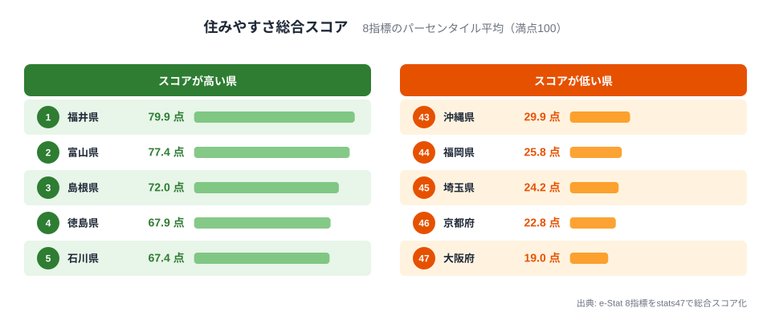
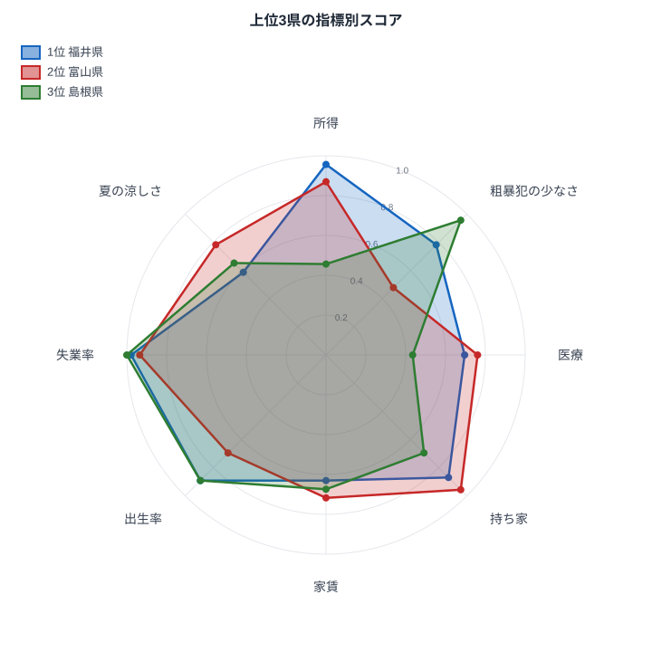

「住みやすい県」を聞かれたとき、あなたは何を思い浮かべるでしょうか。県民所得が高い東京？自然豊かな長野？家賃が安い地方？**「住みやすさ」は主観的な概念ですが、統計データを組み合わせれば、ある程度の客観的な指標を作ることができます。**

本記事では、e-Statの公的統計データから8つの指標を選び、47都道府県を「住みやすさ」の観点で総合スコアリングしました。結論を先に言うと、上位は福井県、富山県、島根県の順で、東京都は40位、最下位は大阪府でした。

> [!NOTE]
> 本ランキングはstats47が独自に設計した総合指標です。「住みやすさ」の定義は人それぞれであり、この順位が絶対的な評価ではありません。あくまで8つの客観指標を等しく重み付けした場合の結果としてご覧ください。
> なお、県民所得は2020年度、完全失業率は2020年の国勢調査のデータを使用しており、COVID-19パンデミック初年度の影響を受けている可能性があります。

## 採点方法──8指標のパーセンタイルスコア

以下の8指標について、各都道府県の順位を点数（1位=100点、47位=0点）に変換し、8指標の平均を総合スコアとしました。点数は順位に比例させ、（47−順位）÷46×100で求めます。同じ値の県は同じ順位として扱っています。

- 1人当たり県民所得：2020年度、高いほど良い。県民経済計算年報
- 粗暴犯認知件数：2023年、**少ないほど良い**。犯罪統計書。人口当たりではなく実数
- 一般病院数（人口10万人当たり）：2023年、多いほど良い。医療施設調査
- 持ち家比率：2023年、高いほど良い。住宅・土地統計調査
- 民営家賃（3.3m2当たり月額）：2024年、**安いほど良い**。小売物価統計調査年報。県庁所在市の家賃
- 合計特殊出生率：2023年、高いほど良い。人口動態統計
- 完全失業率：2020年、**低いほど良い**。国勢調査
- 最高気温（日最高気温の月平均の最高値）：2024年、**低いほど良い**。気象統計。夏の暑さだけを見ており、冬の寒さや雪は含みません

県民所得は2020年度を使っています。公表の最新は2021年度ですが、完全失業率の最新が2020年の国勢調査のため、年をそろえました。2021年度に替えても上位3県は福井県、富山県、島根県のまま変わりません。

> [!NOTE]
> 県民所得は個人の給与ではなく、企業の利益や財産所得を含む県民全体の所得を総人口で割った値です。賃金の高さとは一致しません。

この8指標のうち、家賃・持ち家比率・粗暴犯認知件数は大都市かどうかを強く映し、完全失業率と合計特殊出生率は地域の雇用と家族形成を映します。粗暴犯認知件数は人口で割らない実数のため、人口の多い県ほど不利になります。この影響は総合ランキングの節と「このランキングが捉えきれないもの」の節で整理します。

## 総合ランキング──上位5県・下位5県

<data-source label="e-Stat 県民経済計算ほか8統計" note="8指標のパーセンタイルスコアを平均して算出"></data-source>

**1位は福井県で79.9点です。** 所得は3位、完全失業率は全国で2番目に低く、合計特殊出生率は6位と、経済・雇用・子育て環境の三拍子がそろっています。全8指標のうち7指標で60点以上を記録し、唯一60点に届かない夏の涼しさも58.7点と、弱点らしい弱点がない安定ぶりが特徴です。

**2位の富山県は77.4点です。** 福井と並ぶ北陸の雄で、持ち家比率は3位、所得は7位、完全失業率は4番目に低い水準にあります。粗暴犯認知件数は少ない方から数えて25番目で、実数で見ると平均並みです。人口10万人当たりに直すと富山県は47県中5番目に多い60.4件になり、この軸のスコアは47.8点から8.7点まで下がります。

**3位の島根県は72.0点です。** 所得こそ26位ですが、完全失業率は全国で最も低く、粗暴犯認知件数は少ない方から3番目、合計特殊出生率は6位と、数値に表れにくい「穏やかな暮らしやすさ」が際立ちます。

4位以下は、徳島県が67.9点、石川県が67.4点、長野県が66.3点、山口県が64.4点、佐賀県が62.8点、和歌山県が62.5点と続き、10位は山形県と鳥取県が61.7点で並びました。徳島県は粗暴犯認知件数が2番目に少なく、人口10万人当たりの一般病院数も2位ですが、完全失業率は高い方から6番目と弱点も抱えています。

<data-source label="e-Stat 県民経済計算ほか8統計" note="8指標のパーセンタイルスコアを0〜1に換算して描画"></data-source>

レーダーの目盛り1.0は100点、0.5は50点に当たります。上位3県を重ねると、型の違いがはっきり見えます。福井県は最も低い軸でも58.7点で、8つの軸すべてが中央より外側に張り出す「安定型」です。富山県は持ち家比率の95.7点、完全失業率の93.5点、夏の涼しさの78.3点が突出する一方、粗暴犯の少なさは47.8点と内側にへこみます。島根県は完全失業率の100点、粗暴犯の少なさの95.7点、出生率の89.1点が大きく張り出す反面、所得は45.7点、医療は43.5点と中位にとどまる「凸凹型」です。同じ上位でも、総合力で勝つ県と、特定の強みで勝つ県が混在しています。

### 下位の県

下位5県は、最下位の大阪府が19.0点、次いで京都府が22.8点、埼玉県が24.2点、福岡県が25.8点、沖縄県が29.9点です。

**東京都は40位で31.3点です。** 所得は断トツの1位で100点ですが、粗暴犯認知件数・家賃・出生率の3指標で0点です。持ち家比率も46位で2.2点と、生活コストと子育て環境がスコアを大きく押し下げています。粗暴犯認知件数は実数が全国最多のため0点ですが、人口10万人当たりでは52.3件で多い方から12番目、スコアは23.9点です。

**最下位の大阪府は19.0点です。** 粗暴犯認知件数は多い方から2番目、民営家賃は高い方から3番目、持ち家比率は44位、完全失業率は高い方から4番目と、複数指標で下位に沈みました。所得は20位と中位ですが、生活コストと失業率の課題が重なっています。

上位5県（福井・富山・島根・徳島・石川）と下位5県（大阪・京都・埼玉・福岡・沖縄）で、指標別スコアの平均を比べると、差が最も大きいのは完全失業率で64.8点です。次いで家賃が61.3点、粗暴犯の少なさが59.6点、持ち家比率が58.3点と、雇用・住居・粗暴犯認知件数の4指標が上下を分けています。残る4指標の差は、出生率が40.0点、所得が36.5点、夏の涼しさが35.7点、医療が32.6点と小さめです。この比較は総合スコアで上位と下位を選んだ後の差なので、差の大きい指標が順位を決めたと言い切るものではなく、この設計での傾向として読んでください。ただし粗暴犯認知件数は人口当たりではない実数のため、この差には人口規模の違いも含まれています。

粗暴犯認知件数を、都道府県の総人口（2023年）で割った人口当たりに替えて計算し直すと、上位3県は福井県が75.0点、富山県が72.6点、島根県が71.2点で、順番は変わりません。最下位も大阪府の20.4点で変わりません。結論の骨格は指標の選び方を変えても保たれますが、4位以下と中位の順位は入れ替わります。

## 指標別トップ3

各指標で上位3県を紹介します。

- 1人当たり県民所得は、東京都が5,204千円、愛知県が3,418千円、福井県が3,147千円の順に高い水準です。
- 粗暴犯認知件数は、秋田県が133件、徳島県が138件、島根県が161件の順に少なくなっています。
- 一般病院数（人口10万人当たり）は、高知県が16.1施設、徳島県が12.9施設、鹿児島県が12.3施設の順に多い状況です。
- 持ち家比率は、秋田県が77.1％、山形県が75.0％、富山県が74.9％の順に高くなっています。
- 民営家賃（3.3m2当たり月額）は、和歌山県が3,442円、佐賀県が3,443円、大分県が3,587円の順に安い水準です。
- 合計特殊出生率は、沖縄県が1.60で最も高く、宮崎県と長崎県が1.49で並び、鹿児島県が1.48で続きます。
- 完全失業率は、島根県が2.7％、福井県が2.9％で低く、富山県と三重県が3.1％で並びます。
- 最高気温（日最高気温の月平均の最高値）は、北海道が28.4℃、青森県が29.7℃で低く、岩手県・宮城県・秋田県が31.5℃で並びます。

総合上位5県のうち、福井県は所得と失業率、富山県は持ち家比率と失業率、島根県は粗暴犯認知件数と失業率、徳島県は粗暴犯認知件数と医療で、それぞれ指標別の上位3県に入っています。総合上位の県は、特定の指標で突出した強みを持っていることが多いと言えます。

各指標の47都道府県フルランキングは以下のリンクからご覧いただけます。

あわせて見る: [１人当たり県民所得ランキング](/ranking/per-capita-prefectural-income-h27) / [粗暴犯認知件数ランキング](/ranking/violent-crime-per-100k) / [一般病院数ランキング](/ranking/general-hospital-count-per-100k) / [持ち家比率ランキング](/ranking/owner-occupied-housing-ratio) / [民営賃貸住宅の家賃ランキング](/ranking/private-rental-housing-rent-per-3-3m2) / [合計特殊出生率ランキング](/ranking/total-fertility-rate) / [完全失業率ランキング](/ranking/unemployment-rate) / [最高気温ランキング](/ranking/maximum-temperature)

## 地域別の傾向

### 北陸が「最も住みやすい地域」

総合トップ3のうち2県（福井・富山）が北陸で、石川も5位にランクインしました。**北陸3県の平均スコアは74.9点**で、東北の51.1点、中国の57.6点、四国の56.7点など、地方ブロック別の平均を大きく上回る水準です。所得・雇用・持ち家の安定性に加え、家賃の安さと出生率の高さが好スコアの要因です。

### 東京圏は「所得は高いが暮らしにくい」

東京都は40位、神奈川県は41位、埼玉県は45位、千葉県は35位と、首都圏4都県はいずれも下位に沈みました。4都県の平均は30.6点です。県民所得の高さが、家賃・持ち家・出生率の低スコアを補えていません。粗暴犯認知件数は実数のため人口の多さが不利に働いており、この4都県の低さの一部は人口規模によるものです。「所得の高い場所」と「暮らしやすい場所」は必ずしも一致しないことを示唆しています。

### 九州は「指標次第で明暗」

佐賀県は8位、宮崎県は12位と健闘する一方、福岡県は44位と、粗暴犯認知件数・持ち家・失業率の低スコアが足を引っ張り下位になりました。同じ九州でも都市型と地方型で大きく結果が分かれています。

### 東北は「県ごとの差が大きい地域」

山形県は10位、岩手県は13位、青森県は16位と中位以上に入る一方、秋田県は26位、福島県は28位、宮城県は42位と順位が割れました。東北6県の平均は51.1点で、全国47県の平均49.7点をわずかに上回る程度です。山形県と岩手県と青森県は、所得が中位以下にもかかわらず、持ち家の高さと家賃の安さが総合スコアを押し上げています。

## このランキングが捉えきれないもの

> [!WARNING]
> 本ランキングには以下のような限界があります。結果の解釈にはご注意ください。

- **粗暴犯は実数で測っています**: 粗暴犯認知件数は人口当たりに直していないため、人口の多い東京都・大阪府・兵庫県などが不利になり、人口の少ない県が有利になります。粗暴犯の少なさのスコアを、治安の良し悪しそのものとは読まないでください
- **家賃は県庁所在市の値です**: 民営家賃は県庁所在市の調査結果で、県全体の家賃ではありません
- **気候は夏の暑さだけです**: 最高気温の低さだけを点数にしており、冬の寒さや雪の多さは入っていません
- **交通アクセス・通勤時間**: 都市部の利便性は数値化していません
- **教育環境**: 学校数や進学率は含まれていません
- **自然災害リスク**: 地震・台風・豪雪などの頻度は考慮外です
- **文化・娯楽施設**: 商業施設や文化施設の充実度は反映していません
- **データの年次差**: 指標ごとに2020〜2024年とばらつきがあります。特に県民所得と完全失業率は2020年のデータであり、COVID-19の影響で通常年とは異なるパターンを示している可能性があります
- **指標の重み付け**: 8指標を等しく配分していますが、「所得を重視する人」と「粗暴犯の少なさを重視する人」では最適解が変わります
- **県内格差**: 県庁所在地と郡部では同じ県でも大きな差があります

「住みやすさ」は個人の価値観・ライフステージ・職業によって大きく変わります。本ランキングはあくまで「8つの統計指標を等しく評価した場合のスコア」であり、移住や転居の判断材料の一つとしてご活用ください。

## まとめ

8つの統計指標で47都道府県を総合評価した結果、この設計では**北陸3県（福井・富山・石川）が住みやすさの総合力で突出**していました。一方、東京をはじめとする大都市圏は県民所得の高さだけでは生活コストや子育て環境のハンデを覆せず、下位に沈む結果となりました。

もちろん、統計データだけでは測れない魅力が各県にはあります。本ランキングを入口に、各指標の詳細ページで気になる県を深掘りしてみてください。
