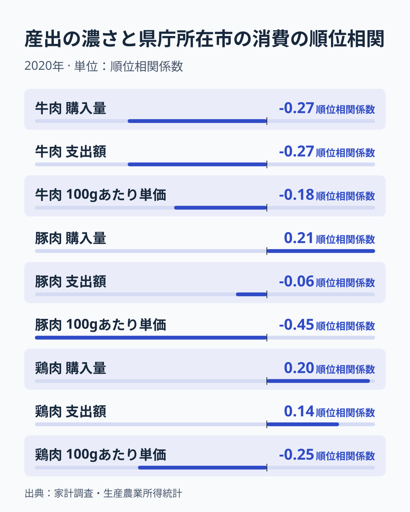
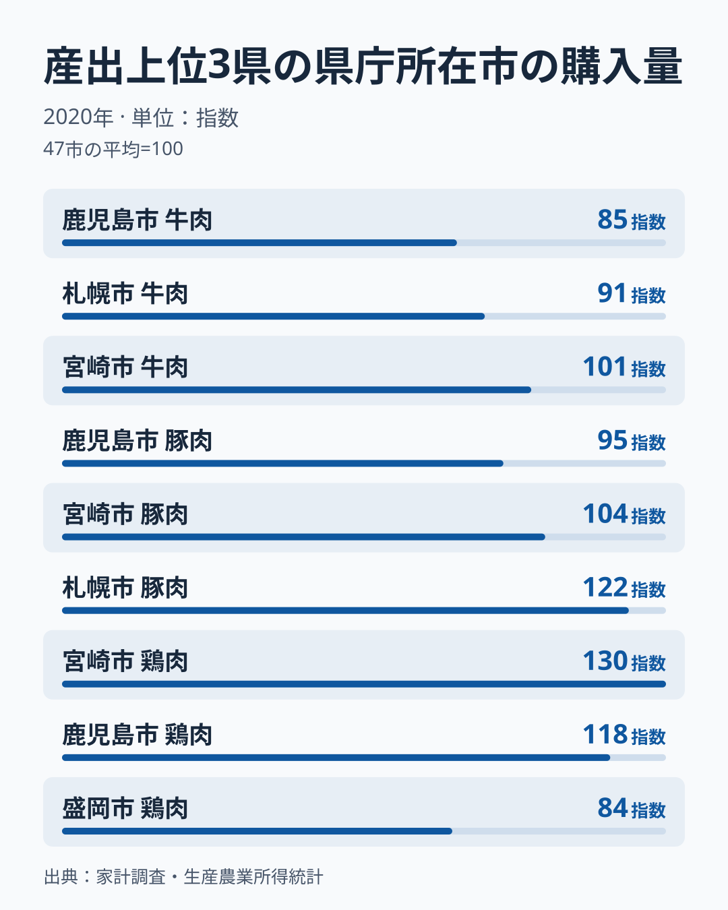
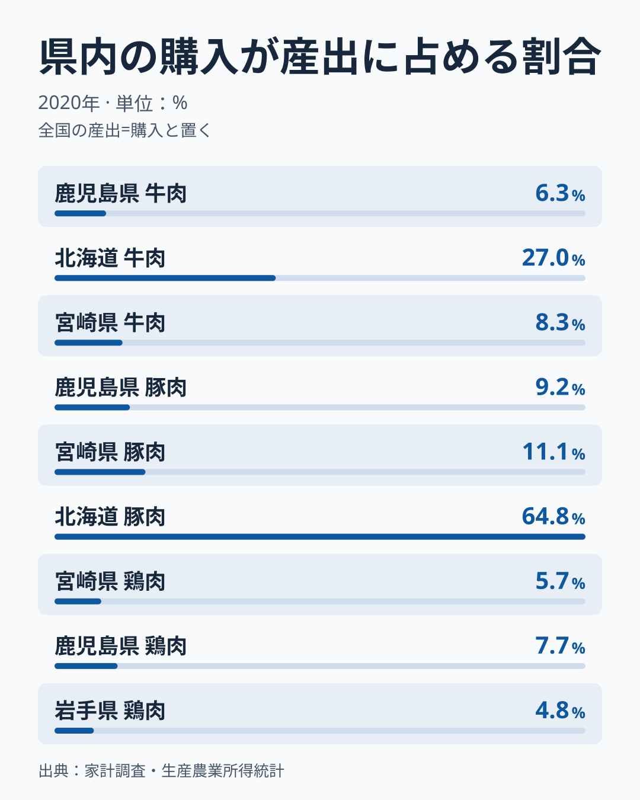
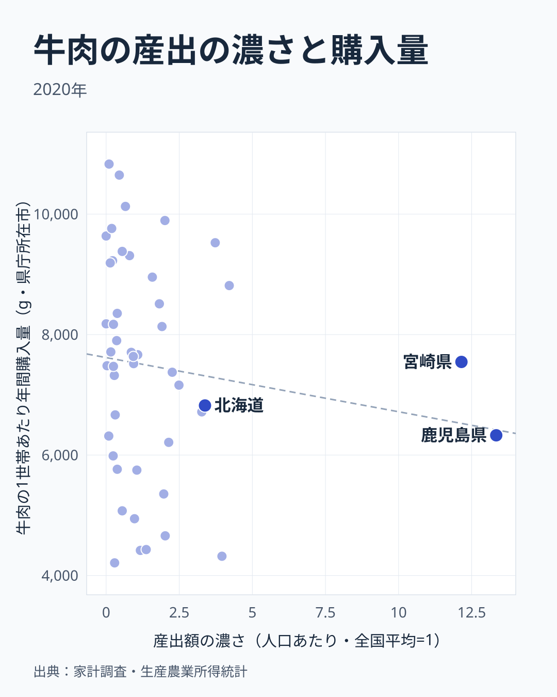
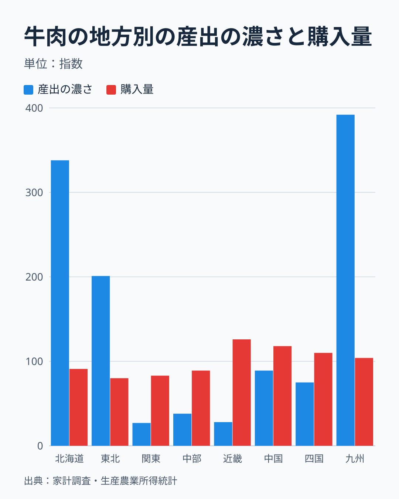
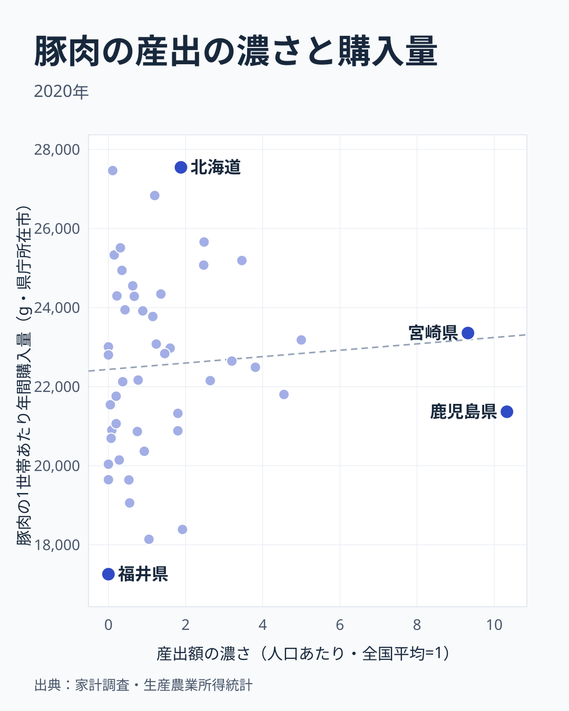
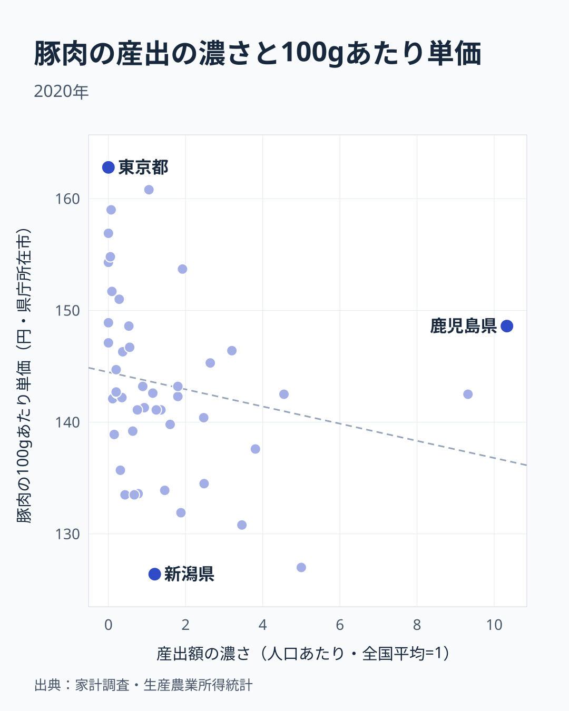
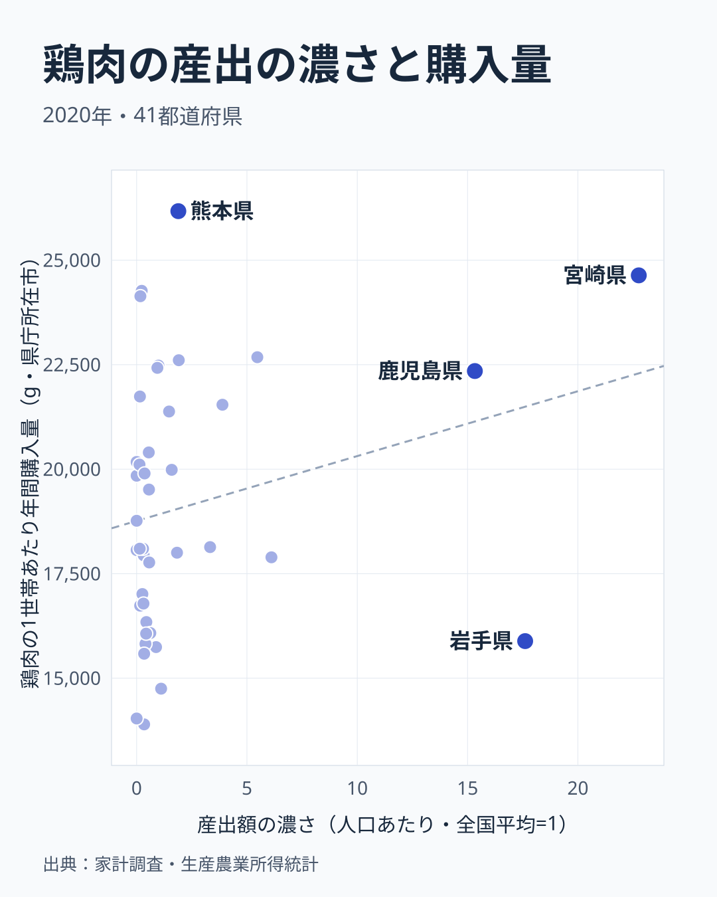
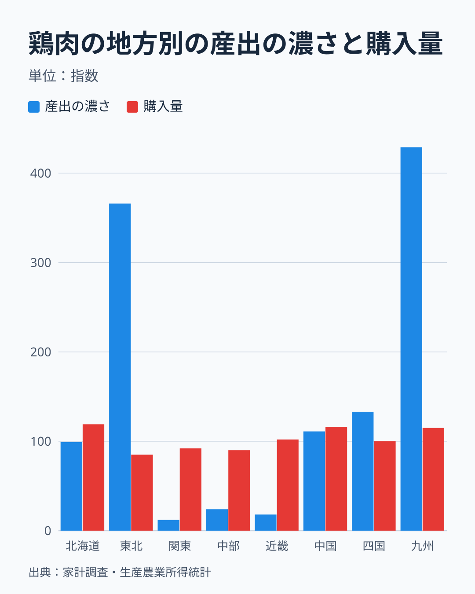
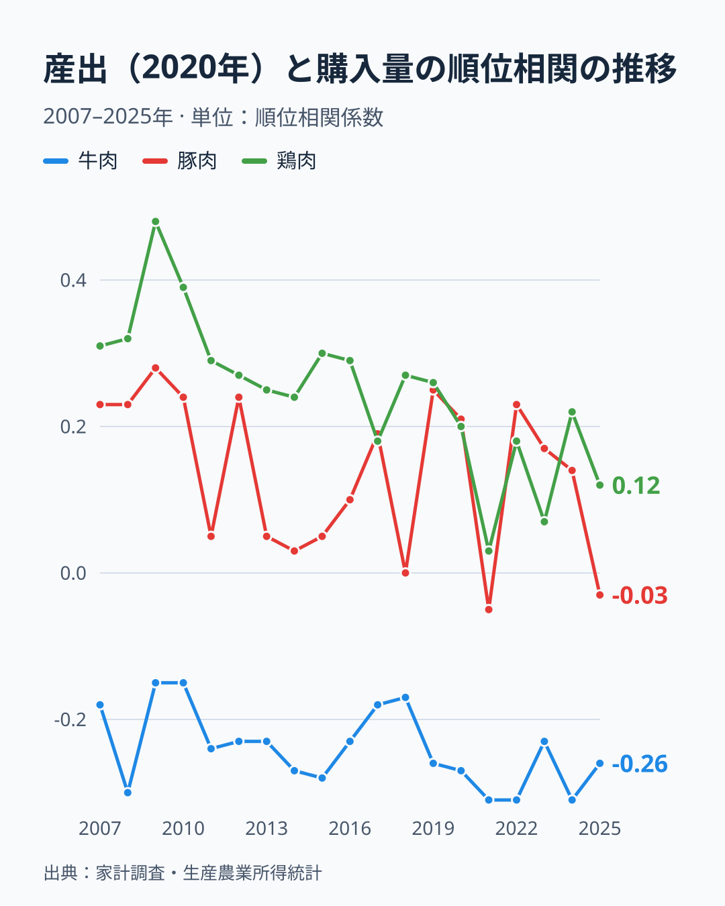

「地産地消」という言葉は、地元で作ったものを地元で食べることを指します。では、肉の産地として知られる県の県庁所在市の世帯は、実際に地元産の肉を多く買っているのでしょうか。2020年の生産農業所得統計と家計調査を突き合わせると、答えは肉の種類で割れ、広くは成り立っていませんでした。

人口あたりで見た産出額の濃さと、県庁所在市の1世帯あたり年間購入量の順位相関は、牛肉が-0.27、豚肉が0.21、鶏肉が0.20です。牛肉の産出額が全国の16.8%を占める鹿児島県の県庁所在市、鹿児島市の牛肉の購入量は47市中34位でした。鶏肉の産出額が全国の16.9%を占める岩手県の県庁所在市、盛岡市は41位です。一方、鶏肉の産出額が全国の19.3%の宮崎県では、宮崎市の購入量が47市中2位でした。産地と購入量が重なる例も重ならない例もあり、全体としては弱い関係です。

ただし、産出は県全体の金額、消費は県庁所在市の世帯が買った量で、単位も対象も違います。産地の肉を地元の人が選んで買っているかという「支持」は、家計調査からは見えません。この記事で言えるのは、産地の県庁所在市が、結果として多く買っているかどうかまでです。

## 比べているもの、見えないもの

この記事が比べる二つのデータは、次のとおりです。

- 産出: 農林水産省の生産農業所得統計の都道府県別農業産出額のうち、肉用牛、豚、ブロイラー(肉用鶏)の2020年の全国に占める割合です。県全体の産出の金額で、生産した肉がどこで食べられるかは分かりません。
- 消費: 家計調査の2020年の、県庁所在市の二人以上の世帯の1世帯あたり年間購入量(g)と支出額(円)です。東京都は区部の値で、県全体の値ではありません。

産出は県の人口が多いほど大きくなりやすいので、全国の産出額に占める割合を全国の人口に占める割合で割った「産出額の濃さ」(全国平均が1)を主に使います。県の大きさをならしたうえで、産出が濃い県の県庁所在市が多く買っているかを見るためです。順位の並びで関係を測るスピアマンの順位相関係数を使い、「偶然でもこのくらいは出る」目安として、順位をランダムに入れ替えた2万回の試行でその値以上の絶対値が出る割合(p値)も添えます。

見えないものもあります。家計調査は世帯が買った量と金額で、飲食店で食べる肉は外食として別に数えられ、もらい物や自家消費は含まれません。産地ではもらい物や自家消費が多い可能性がありますが、その大きさは表からは分かりません。また、2020年は購入量が前の年より増えた年で、47市の単純平均は牛肉が2019年の6,671gから7,471g、豚肉が20,620gから22,561g、鶏肉が17,154gから18,949gへ増えました。2020年だけの結果にしないために、後半で他の年と他の産出の指標でも確かめます。

> [!NOTE]
> 生産農業所得統計の産出額は、生産した量ではなく金額の値です。価格の高い品種を作る県は、同じ頭数でも産出額が大きくなります。鶏肉(ブロイラー)は、個々の経営体が特定されるのを避けるため、秋田県、山形県、栃木県、埼玉県、滋賀県、奈良県の6県が秘匿(x)で、この6県は鶏肉の分析から除いています。産出が皆無の東京都、神奈川県、富山県、石川県、大阪府は0として含めます。

## 三つの肉を並べると、単価だけが産地で安い向きに揃う

まず、産出の濃さと県庁所在市の三つの量(購入量、支出額、100gあたり単価)の順位相関を、肉ごとに並べます。

購入量は牛肉が-0.27、豚肉が0.21、鶏肉が0.20で、どれも絶対値が0.3に届きません。支出額は牛肉が-0.27、豚肉が-0.06、鶏肉が0.14で、豚肉はほぼ無関係です。購入量では正だった豚肉と鶏肉の関係が、金額では弱まるのは、産出が濃い県ほど単価が安く、同じ量でも支出が小さくなる可能性があります。

単価は、牛肉が-0.18、豚肉が-0.45、鶏肉が-0.25と、三つの肉がすべて負です。産出が濃い県の県庁所在市ほど安く買っている向きは揃っていますが、偶然の範囲を出ないのは牛肉と鶏肉で、豚肉だけがp値0.2%と確かです。産地の街は肉を多く買うとは限りませんが、安く買う傾向は、とくに豚肉で見られます。

## 産出の上位3県の県庁所在市は、購入量が多いのか

肉ごとに、産出額が全国の上位3県の県庁所在市の購入量を、47市の平均を100にして並べます。

100を超えるのは、豚肉の札幌市(122)と宮崎市(104)、牛肉の宮崎市(101)、鶏肉の宮崎市(130)と鹿児島市(118)の5つで、9つのうち4つは100を下回ります。牛肉は産出額が上位の3県のうち2県で100に届かず、鹿児島市は85、札幌市は91です。鶏肉の盛岡市も84と低く、産出額が全国の16.9%を占める岩手県の県庁所在市で、47市の平均を下回っています。

産出の上位が、そのまま購入量の上位になっているのは、豚肉の札幌市と鶏肉の宮崎市くらいです。札幌市の豚肉は年間27,546gで47市中1位、宮崎市の鶏肉は24,637gで2位ですが、牛肉の産出額で全国1位の鹿児島県の県庁所在市、鹿児島市は6,328gで34位と、肉の種類によって結果が大きく変わります。

## そもそも、北海道を除く産地の県内では、産出の1割ほどしか食べきれません

産出が濃い県の県庁所在市が肉を多く買っていたとしても、産地の生産の大きさに比べると、地元の需要は小さい可能性があります。産出額が全国の上位3県の合計は、牛肉が41.1%、豚肉が28.7%、鶏肉が55.5%を占める一方、その3県の人口は全国の6.2%、6.2%、3.1%にすぎません。肉の購入量が人口に比例するなら、県内の購入が吸収できるのは、全国の消費のその程度です。

この比を使って、県内で買われる量が産出の何%に当たるのかの目安を計算しました。産出額のシェアを生産量のシェアとみなし、県の購入量は県庁所在市の1世帯あたり購入量に世帯数をかけた値で、世帯数は人口に比例するとみなします。目安は、人口のシェアを産出額のシェアで割り、県庁所在市の購入量を47市の単純平均で割った値をかけたものです。全国の産出が全国の家庭の購入量と同じ量だとみなしたときの、県ごとの相対的な目安で、%の絶対的な大きさに意味があるわけではありません。

目安が最大なのは、北海道の豚肉の64.8%です。北海道は人口が全国の4.14%と大きく、産出額のシェア7.8%に対して、札幌市の購入量が47市の平均の1.22倍と多いためです。北海道の牛肉は27.0%で続きます。それ以外の7つは、宮崎県の豚肉の11.1%から岩手県の鶏肉の4.8%までで、すべて1割前後かそれ以下です。鶏肉は宮崎県の5.7%、鹿児島県の7.7%と、購入量が多い県庁所在市でも、県内で食べきれるのは産出の1割に届きません。

この目安は粗い仮定の上にあります。産出額は金額で、価格が違えば生産量のシェアとは一致しません。県庁所在市の購入量が県全体の平均を代表するとも限りません。それでも、北海道を除く産地では、産出に比べて県内の人口が小さいため、県内の購入だけでは産出を吸収しきれない大きさの差です。[仮説] 産出の大半は県外へ出荷されている可能性が高いですが、出荷先を示す統計は使っていません。そのため、この記事の問いは「産地の街は、産出に見合うだけ地元の肉を食べているか」ではなく、「産地の街が、他の街より多く買っているか」にとどめます。

## 牛肉は、産地の街ほど多く買うという関係が見られません

牛肉は、産地の濃さと購入量が逆向きに並んでいます。

産出額の濃さと購入量の順位相関は-0.27です。順位をランダムに入れ替えて同じ大きさの値が出る割合は7.1%で、偶然では説明できないとまでは言えません。正の関係は見られず、わずかに負の向きだが偶然を排せない、というのが2020年の結果です。購入量の代わりに支出額で見ても-0.27です。人口でならさず、産出額の全国シェアをそのまま使うと-0.35(p値は1.7%)に強まります。

産出額の全国シェアが高い県は、鹿児島県が16.8%、北海道が14.0%、宮崎県が10.3%、熊本県が5.8%、岩手県が3.8%です。この5県の県庁所在市の購入量は、鹿児島市が6,328gで34位、札幌市が6,823gで31位、宮崎市が7,546gで24位、熊本市が8,814gで13位、盛岡市が4,320gで46位です。47市の平均は7,471gなので、平均を上回るのは宮崎市と熊本市だけです。

購入量が多い都市は、おおむね産地と別の顔ぶれです。京都市の10,831g、広島市の10,648g、山口市の10,128gに、山形市の9,894g、奈良市の9,762gが続きます。このうち、京都府と奈良県は産出額のシェアがともに0.2%、広島県は1.0%、山口県は0.7%で、牛肉の産地とは言えない地域です。山形県は1.7%で、産出の濃さは2.01と全国平均の2倍ですが、上位5市のうち4市は産地ではありません。牛肉の購入量は近畿以西で多いことが知られています。地方別に、産出の濃さ(地方の産出額のシェアの合計を人口のシェアの合計で割った値、全国=100)と購入量(地方内の県庁所在市の平均、47市の平均=100)を並べます。

産出の濃さは九州が392、北海道が338、東北が201と高く、関東の27、近畿の28、中部の38は低い一方、購入量は近畿が126、中国が118、四国が110で、九州は104、北海道は91、東北は80です。産出が最も濃い九州と北海道の購入量は、全国の平均に近いか下回り、購入量が最大の近畿は産出が最も薄い地方の一つです。産地側の結果を、東日本(三重県以東)と西日本(滋賀県以西)に分けても向きは変わりません。順位相関は東日本が-0.43、西日本が-0.61で、全国より強い負の値です。東日本と西日本のそれぞれでも負の向きなので、東西の差だけでは説明できません。ただし、西日本の-0.61は産出が濃い九州と購入量の多い近畿・中国・四国の対比で作られている可能性があり、地方の中での確認はしていません。

産地の都市が牛肉を安く買えているとも言えません。100gあたりの単価(支出額÷購入量)は、鹿児島市が398円で47市中3番目に高く、47市の平均320円を大きく上回ります。一方、札幌市は235円で安い方から2番目、盛岡市は262円で7番目と、産地の都市の単価は一様ではありません。[仮説] 肉用牛の産出額が大きい県では、高価な銘柄牛の割合が大きく、それが県外に出荷されて地元の食卓には並びにくい可能性があります。検証には、銘柄牛の割合や出荷先が分かる統計が要ります。

<source-link href="/ranking/beef-consumption-quantity">牛肉の購入量を県庁所在市で比べる</source-link>

## 豚肉は、向きは正でも、強いとは言えません

豚肉は、産出の濃さと購入量の順位相関が0.21で、p値は14.7%と、偶然の範囲を出ません。

産出額のシェアが高い県は、鹿児島県が13.0%、宮崎県が7.9%、北海道が7.8%、群馬県が7.0%、千葉県が6.8%です。この5県の県庁所在市の購入量は、札幌市が27,546gで1位、千葉市が24,343gで11位、宮崎市が23,356gで17位、前橋市が21,802gで29位、鹿児島市が21,365gで32位です。47市の平均22,561gを上回るのは、札幌市と千葉市と宮崎市の3つで、産地の中でも差があります。

産出額のシェアをそのまま使うと、順位相関は0.40まで強くなり、p値は0.6%になります。人口でならした場合の0.21との差は、人口の多い県が、産出額のシェアの大きい県に含まれていることを示します。購入量は1世帯あたりの値で、県の人口の大きさとは本来関係がありません。[仮説] 豚肉の購入量が札幌市や横浜市のような大きな都市で多いという別の地域差が、シェアに混ざり込んでいる可能性があります。検証には、人口規模と購入量の関係を分けた分析が要ります。この記事では、人口でならした0.21を、産地と消費の関係に近い値として扱います。

豚肉は、100gあたりの単価との関係が、肉の中でもっとも明確でした。産出の濃さと単価の順位相関は-0.45で、p値は0.2%です。産出が濃い県の県庁所在市ほど、豚肉を安く買っている傾向があります。単価が安い順では、新潟市が126円、盛岡市が127円、青森市が131円で、47市の平均143円を下回ります。ただし、産地の中でも鹿児島市は149円で、安い方から37番目と平均を上回ります。

図の点を見ると、産出の濃さが極端に大きい鹿児島県が平均より高い側にあり、直線の傾きは緩やかです。順位相関は-0.45と強い一方、点の値そのものの相関係数は-0.20にとどまり、産出が濃い県の単価が一様に安いのではなく、単価が最も高い東京都区部の163円と3番目の神戸市の159円は、産出の濃さが0.07以下とほとんど産地ではない県の都市で、そうした都市が高い側に並んでいることが負の向きを作っています。

東日本と西日本に分けると、豚肉の順位相関は東日本が-0.11、西日本が0.29です。向きが変わるほどの差ですが、どちらも偶然の範囲に収まる大きさで、豚肉の産出と購入量の関係は、地域を限っても確かな結論には届きません。

<source-link href="/ranking/pork-consumption-quantity">豚肉の購入量を県庁所在市で比べる</source-link>

## 鶏肉は、産地と購入量が重なる県と重ならない県が混ざります

鶏肉は、牛肉と違って産出の濃さと購入量が正の向きに並びますが、豚肉と並ぶ程度の弱い重なりで、部分的です。

順位相関は0.20で、秘匿の6県を除いた41県で見ています。p値は20.6%で、強い関係ではありません。産出の濃さは宮崎県が22.76、岩手県が17.61、鹿児島県が15.33、青森県が6.11、鳥取県が5.47の順です。このうち、宮崎市の購入量は24,637gで2位、鹿児島市は22,348gで9位、鳥取市は22,679gで5位と、47市の平均18,949gを大きく上回ります。一方、岩手県の盛岡市は15,887gで41位、青森市は17,892gで29位と平均を下回ります。購入量が1位の熊本市は26,173gで、熊本県の産出額のシェアは2.6%と、産出の濃さの上位ではありません。

宮崎県と岩手県を比べると違いが際立ちます。産出額の全国シェアは宮崎県が19.3%、岩手県が16.9%と近いのに、盛岡市の購入量は宮崎市の6割ほどにとどまります。産出が濃い5県を並べると、購入量が平均を上回るのは5県のうち3県で、重なる例も重ならない例も同じくらいあります。

産出の濃い県を1つ取り除いた順位相関は、宮崎県を除くと0.14、岩手県を除くと0.26、鹿児島県を除くと0.16です。どの1県を除いても0.14から0.26の範囲で、正の向きは保たれますが、強さは0.2前後の弱いままです。結果は特定の県の例外だけで決まっているのではなく、産地の県庁所在市の購入量にばらつきが大きいことを示しています。

地方別に見ると、産出の濃さは九州が429、東北が366で高く、四国が133、中国が111、北海道が99と続きます。購入量は北海道が119、中国が116、九州が115で、東北は85です。産出が最も濃い九州の購入量は高い側ですが、同じ程度に高い北海道と中国は産出が濃くなく、産出が2番目に濃い東北の購入量は低い側です。

東北の産出の濃さは、秘匿の秋田県と山形県を0として足しているので、実際より小さい値です。産出と購入量の順位相関を東日本と西日本に分けると、東日本が-0.36、西日本が0.33と、向きが逆になります。どちらも標本は20県前後で、確かな差とは言えません。

鶏肉の100gあたりの単価は、産出の濃さとの順位相関が-0.25で、p値は11.6%です。産出が濃い県ほど安い向きですが、確かな関係とは言えません。宮崎市の単価は92円で47市の平均92円とほぼ同じ、鹿児島市は98円で、安い方から41番目です。つまり、産地の街は鶏肉を多く買ってはいても、安く買っているとは限りません。

<source-link href="/ranking/chicken-consumption-quantity">鶏肉の購入量を県庁所在市で比べる</source-link>

## 同じ結果になるか、別の年と別の産出の指標で確かめる

ここまでの結果は2020年の1年に頼っています。県庁所在市の標本は世帯数が小さく、単年の順位は動きやすいので、別の年と別の産出の指標でも確かめます。

2020年の産出の濃さと、2007年から2025年までの各年の購入量の順位相関を並べました。牛肉は19年のすべてで負で、-0.31から-0.15の範囲に収まります。産出を2020年に固定していて購入量の年ごとの並びも似るため、独立した19回の確認ではありませんが、符号が年で入れ替わらないことは確かめられます。豚肉は-0.05から0.28、鶏肉は0.03から0.48の範囲で、2007年から2009年は鶏肉が0.3から0.48と高かったものの、2020年代は0.03から0.22に下がりました。牛肉の逆向きは年を変えても動かず、豚肉と鶏肉の正の相関は年によって大きく動く、弱い関係です。

産出が濃い県を1つずつ取り除いても結果は変わりません。分析対象のどの1県を除いても、順位相関は牛肉が-0.31から-0.23、豚肉が0.17から0.26、鶏肉が0.14から0.26の範囲に収まり、産出の濃い上位3県をまとめて除くと、牛肉が-0.30、豚肉が0.23、鶏肉が0.16でした。特定の産地の例外が結果を決めているわけではありません。

2019年から2021年の購入量の3年平均で見ても、結果はほぼ同じです。順位相関は牛肉が-0.30、豚肉が0.16、鶏肉が0.19です。支出額で見ると、牛肉が-0.28、豚肉が-0.12、鶏肉が0.07で、金額に直すと豚肉と鶏肉の正の相関は消えます。

産出の指標を、産出額から飼養頭数に変えると、牛肉は同じ向きで、豚肉は定まりません。肉用牛の頭数が多い北海道、鹿児島県、宮崎県、熊本県、長崎県の県庁所在市の2025年の購入量は、順位がそれぞれ42位、18位、25位、12位、19位で、順位相関は-0.25、支出額で-0.26でした。2024年の豚の頭数では、購入量で0.12、支出額で-0.17と、正負がまちまちです。豚の飼養頭数が多い鹿児島県の県庁所在市の購入量は、2025年は47市中37位、宮崎市は47位で、2020年の32位と17位から大きく動いています。標本の小ささなどによる単年の変動が大きいと考えられます。

> [!WARNING]
> 順位相関が示すのは、都道府県の間での並びの関係であって、ある県の人が地元産を選んで買っているかどうかではありません。産出額は県全体で、購入量は県庁所在市の二人以上の世帯の値です。県庁所在市から離れた地域の産地と、県庁所在市の消費は、そもそも別の集団です。この図の「産地の街」という呼び方は、産出が濃い県の県庁所在市のことで、産地そのものの住民ではありません。

## この結果から言えること、言えないこと

確かに言えるのは、牛肉については、産出が濃い県の県庁所在市ほど購入量が多いという関係が、2020年の1年に限らず、2007年から2025年のどの年でも見られないことです。西日本と東日本のどちらの中でも、同じ向きでした。牛肉の購入量を決めているものが何かは、この統計だけでは分かりません。[仮説] 産地の分布とは別の、地域の食文化や価格の違いが強く効いている可能性があります。検証には、品種や部位ごとの購入量と価格が分かる統計が要ります。

ある程度言えるのは、鶏肉の宮崎市と鹿児島市、鳥取市が、産地であり購入量も多い一致の例だということです。ただし、同じ鶏肉の産地である岩手県の盛岡市や青森市は、購入量が47市の平均を下回ります。産地の鶏肉の購入量が一様に多いわけではないことが、順位相関が0.20にとどまる事実と合っています。

言えないのは、地元産を選んで買っているかどうかです。購入量と産出額が同じ向きに並んでいても、地元産かどうかは家計調査では区別できません。また、産出が濃くて購入量も多い宮崎市が、地元の鶏肉を買っているのか、単に鶏肉を食べる文化が強い地域なのかも区別できません。

言えないことはほかにもあります。県庁所在市の標本は小さく、飲食店で食べる肉やもらい物は含まれません。産地でもらい物や自家消費が多ければ、産地の街の購入量は実際より小さく見える可能性があります。この記事は、その大きさを測っていません。

家計調査で地産地消を確かめるなら、産地の県庁所在市だけでなく、県内の複数の市町村や、もらい物や自家消費を含む調査が要ります。産地の県庁所在市が肉を多く買っているとは、少なくとも牛肉については言えず、鶏肉は宮崎市と鹿児島市と鳥取市で重なる一方で岩手県と青森県では重ならない、というのが2020年の統計から読める範囲です。

## まとめ

- 2020年の産出の濃さと県庁所在市の購入量の順位相関は、牛肉が-0.27、豚肉が0.21、鶏肉が0.20で、地産地消が広く成り立つとは言えませんでした。
- 牛肉は産出額が全国の16.8%の鹿児島県の県庁所在市、鹿児島市の購入量が47市中34位で、2007年から2025年のどの年も順位相関が負で、正の関係は見られません。購入量の多い京都市、広島市、山口市、奈良市の府県は、産地ではありません。
- 豚肉は産出額のシェアをそのまま使うと0.40ですが、人口でならすと0.21に下がり、偶然の範囲です。産出が濃い県の県庁所在市ほど安く買う傾向(順位相関-0.45)は、肉の中でもっとも明確でした。
- 鶏肉は宮崎市が2位、鹿児島市が9位と産地と購入量が重なる一方、産出額が全国の16.9%の岩手県の盛岡市は41位で、重なる産地と重ならない産地が混ざります。
- 家計調査には外食ともらい物が入らず、県庁所在市の標本は小さいです。地元産を選んで買っているかは分かりません。

肉の消費の地域差そのものは[牛肉消費の西高東低の記事](/blog/beef-consumption-prefecture-gap)に、魚で同じ「獲れる県と食べる県」の関係を確かめた結果は[獲れる県と食べる県は違う記事](/blog/fish-catch-vs-consumption-prefecture)にまとめています。産地側の指標は[農業・畜産のテーマ](/themes/agriculture-production)、家計調査の食料の指標は[家計・食費のテーマ](/themes/household-food-spending)で見られます。
