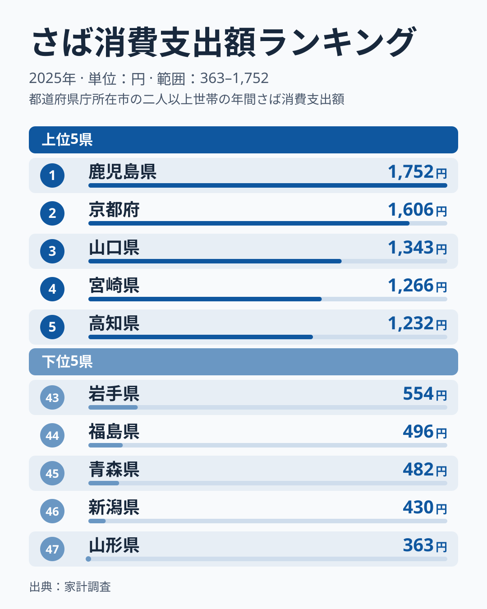
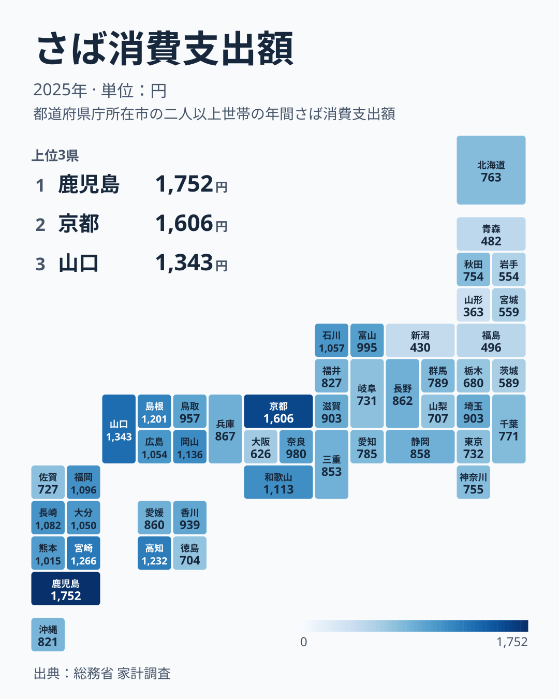

さばは日本の食卓に欠かせない青魚の代表格ですが、都道府県によって消費支出額に大きな差があります。総務省「家計調査」によると、2025年の都道府県庁所在市における二人以上世帯の年間さば消費支出額は、1位鹿児島県が1,752円だったのに対し、最下位の山形県は363円にとどまりました。その差は4.8倍です。

この記事では、47都道府県のさば消費支出額ランキングをもとに、消費が西日本に偏っている様子と、その偏りに当てはまらない県を数字で確かめます。あじ消費支出額との順位の違いも比べます。なお、この記事で「西日本」と書くときは、近畿（三重県を含む）、中国、四国、九州と沖縄を合わせた24県を指します。中部は含めません。

> [!NOTE]
> このデータは総務省「家計調査」における都道府県庁所在市（東京都は都区部）の**二人以上世帯**を対象にした年間支出額です。県全体の消費量ではなく、県庁所在都市の家計簿から見た支出傾向である点に注意してください。

## さば消費支出額 上位5・下位5

<source-link href="/ranking/mackerel-consumption-expenditure">さば消費支出額ランキングをもっと見る</source-link>

2025年の上位5県は、鹿児島県1,752円、京都府1,606円、山口県1,343円、宮崎県1,266円、高知県1,232円という結果でした。九州・沖縄（鹿児島・宮崎）、近畿（京都）、中国（山口）、四国（高知）と、上位5県はすべて西日本にあり、しかも4つの地方にまたがっています。6位以下も島根県が1,201円、岡山県が1,136円、和歌山県が1,113円、福岡県が1,096円、長崎県が1,082円と続き、上位10県は九州・沖縄、中国、近畿、四国の県で占められています。

1位の[鹿児島県](/areas/46000)と2位の[京都府](/areas/26000)の差は146円で、2位以下は1,606円から1,232円までの間に4県が並ぶ接戦です。京都府の値は府庁所在地の京都市の家計で、京都市は海から離れた市街地です。それでも2位に入った背景として、若狭湾で揚がったさばを京都へ運んだ「鯖街道」の歴史とさば寿司の名物があることはよく知られています。ただし家計調査の市別の値は年によるぶれが大きく、1年分の順位だけで京都の食習慣を読み取ることはできません。

## さば消費支出額が少ない地域

下位5県を見ると、[山形県](/areas/06000)363円、[新潟県](/areas/15000)430円、[青森県](/areas/02000)482円、[福島県](/areas/07000)496円、[岩手県](/areas/03000)554円と、北海道・東北の4県と中部の新潟県が並びます。下位10県まで広げると、宮城県が559円、茨城県が589円、大阪府が626円、栃木県が680円、徳島県が704円で、このうち宮城県は北海道・東北、茨城県と栃木県は関東、大阪府は近畿、徳島県は四国です。つまり下位10県は、北海道・東北の5県と新潟県、関東の2県に、西日本の大阪府と徳島県が加わった顔ぶれです。

大都市圏も上位には入りません。東京都は都区部で732円の34位、神奈川県は755円の32位、大阪府は626円の40位で、西日本に含まれる大阪府でも下位に沈んでいます。

> [!WARNING]
> この統計の「さば」は、家計調査の品目分類に沿った支出額です。さば缶などの缶詰が別の品目として集計されているかどうかは、出典の分類表で確認してください。缶詰が別集計の場合、さば缶の消費が多い地域でもこの数値には反映されません。

## 西日本への偏りと、地方だけでは説明できない差

西日本24県のうち、全国24位以内（47県の上位半分）に入っているのは19県です。中国地方の5県（山口・島根・岡山・広島・鳥取）はすべて、四国では高知・香川・愛媛の3県、九州・沖縄では鹿児島・宮崎・福岡・長崎・大分・熊本の6県、近畿では京都・和歌山・奈良・滋賀・兵庫の5県が入りました。これが「さばは西日本の魚」という傾向を裏づける数字です。

例外も5県あります。近畿の三重県は25位、沖縄県は27位、九州の佐賀県は36位、四国の徳島県は38位、近畿の大阪府は40位です。地図で色の濃い（支出額が高い）エリアは、九州から中国・四国、近畿にかけて概ね広がっていますが、佐賀県・徳島県・大阪府は下位に入っており、西日本の中にも色の薄い県が混ざっています。

東日本が一様に低いわけでもありません。関東の埼玉県は903円で19位と中位で、滋賀県も同じ903円です。一方、同じ関東でも茨城県は589円で41位、栃木県は680円で39位と下位に入ります。同じ地方の中でも差があるため、さばの消費は西日本に偏ってはいるものの、地方だけで説明しきれるわけではありません。

上位10県の内訳は、鹿児島・宮崎・福岡・長崎の九州勢が4県、山口・島根・岡山の中国地方が3県、京都・和歌山の近畿勢が2県、高知の四国が1県です。

[福井県](/areas/18000)は827円で26位となっており、同じ中部の石川県は1,057円で11位、富山県は995円で15位と、福井県より上位でした。なお石川県と富山県は中部なので、上で定義した西日本には入りません。福井県には「へしこ」というさばの糠漬けや、「浜焼き鯖」という郷土料理があり、さば食文化が根強い土地として知られています。それでも順位が中位にとどまっている点は、伝統食としての知名度と、家計調査が捉える日常的な購入額とが必ずしも一致しないことを示しています。

## あじと比べると見える、さば固有の偏り

同じ青魚のあじ消費支出額（同じ2025年の家計調査）と順位を並べると、さばの地域差が魚の消費全般の地域差とは違うことが分かります。あじの1位は長崎県の2,449円です。一方、さばで1位だった鹿児島県のあじの順位は10位（1,526円）にとどまります。さばで2位だった京都府のあじの順位は28位（860円）、さばで5位だった高知県のあじの順位は14位（1,241円）です。

反対側を見ると、さばで最下位だった山形県のあじの順位は44位（431円）と低く、さばで46位だった新潟県のあじの順位は36位（586円）で、さばほど下位ではありません。山口県はさばで3位、あじでも3位です。宮崎県もさばで4位、あじで2位と、どちらの魚でも上位に入る県もあります。ただ、鹿児島県と京都府のように、さばだけが突出して高い県があることから、さばの地域差は「魚をよく買う県が上位に並ぶ」という全体傾向だけでは説明できないと分かります。

あわせて見る: [あじ消費支出額ランキング](/ranking/horse-mackerel-consumption-expenditure) / [いわし消費支出額ランキング](/ranking/sardine-consumption-expenditure) / [さんま消費支出額ランキング](/ranking/saury-consumption-expenditure)

## データで言えること、言えないこと

このデータから言えるのは、次の3点です。

- さばの消費支出額は、西日本24県のうち19県で全国の上位半分に入り、西日本に偏っています。
- 例外は三重県、沖縄県、佐賀県、徳島県、大阪府の5県です。
- 同じ青魚でも、さばとあじでは県の順位が大きく入れ替わります。

一方、なぜそうなるのかはこのデータからは確かめられません。次のような説明が考えられますが、いずれも [仮説] であり、検証には別のデータが必要です。

- 鹿児島県や京都府の高さは、近海のさば漁や鯖街道に由来する食文化が日常の購入額に表れた結果かもしれません。検証には、家計調査の複数年の平均や、食生活調査との突き合わせが必要です。
- 水揚げの多い地域で鮮魚が手に入りやすく、購入が増えやすいのかもしれません。検証には、さばの水揚げ量と流通のデータが必要です。
- 東北や新潟では、さばよりサケやハタハタなど他の魚介が食卓の中心にあるのかもしれません。検証には、魚種別の購入額を県ごとに比べる必要があります。
- 都市部では、共働き世帯の増加や中食・外食への支出シフトにより、鮮魚を家庭で調理する機会が減っているのかもしれません。検証には、世帯類型別の支出額が必要です。

## まとめ

- 1位は鹿児島県で1,752円、2位は京都府で1,606円
- 最下位は山形県で363円、1位との差は4.8倍
- 上位10県はすべて西日本で、九州・沖縄4県・中国3県・近畿2県・四国1県
- 西日本24県のうち19県が24位以内で、例外は三重県・沖縄県・佐賀県・徳島県・大阪府
- 下位5県は北海道・東北の4県と中部の新潟県で、下位10県には関東の茨城県・栃木県と、西日本の大阪府・徳島県も入る
- あじとの比較では、さば1位の鹿児島県があじ10位、さば2位の京都府があじ28位と、順位が大きく入れ替わる

## データについて

総務省統計局「家計調査」（都道府県庁所在市及び政令指定都市別、二人以上の世帯）を基に、e-Stat経由で整備したデータを使用しています。集計年は2025年です。あじ消費支出額の順位は、同じ家計調査の2025年の値（ブログ内のあじ消費支出額ランキングの図データ）を使っています。
