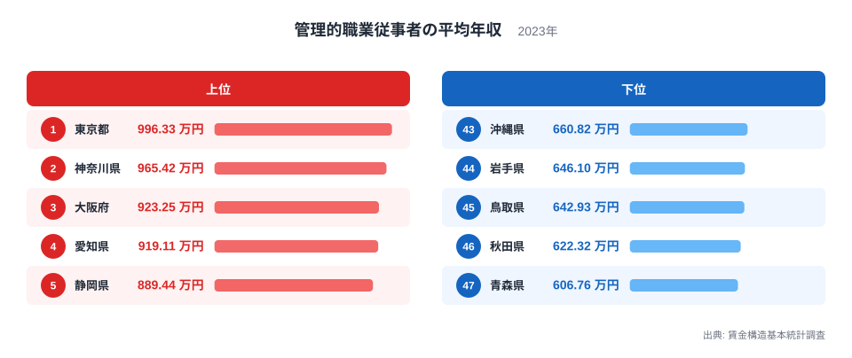
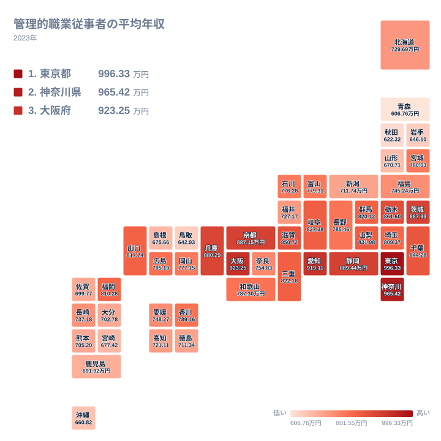

## 管理職の年収は県でここまで違う

管理職といえば、どの県でも組織の中核を担う存在です。ところが平均年収を県別に並べると、顔ぶれははっきり分かれます。2023年の賃金構造基本統計調査によると、1位の東京都は996.33万円です。一方、47位の青森県は606.76万円にとどまります。

題の問いに答えると、996.33万円を606.76万円で割った倍率は約1.64倍です。同じ管理職という区分でも、働く場所によって年収の水準が1.64倍ほど違うことになります。

この記事では、上位と下位の県がなぜその順になるのかを、地理・産業構造・歴史の観点から、データで確かめられる範囲と仮説とを分けながら考えます。賃金に関する他の指標は[同じカテゴリの統計一覧](/category/laborwage)にまとまっています。

> [!NOTE]
> ここでの「管理的職業従事者」は、会社役員や課長相当以上の管理職などを含む職業区分で、役職名ではなく仕事の内容で分類されています。賃金構造基本統計調査は事業所を対象とした調査であり、この記事の値は「その県の事業所で働く管理職」の平均年収です。賞与や役員報酬の扱いの細部は、この記事のデータだけでは確認できません。

## 上位と下位のランキング

まず、上位5県と下位5県を図で確認します。

<source-link href="/ranking/manager-annual-income">管理的職業従事者の平均年収ランキングをもっと見る</source-link>

図から新しく読み取れるのは、上位と下位の間にある大きな段差です。上位の最下位である5位の静岡県は889.44万円、下位の最上位である43位の沖縄県は660.82万円で、その差は228.62万円です。この差は、1位の東京都と5位の静岡県の差である106.89万円の2倍を超えています。

また、下位5県の中では43位の沖縄県の660.82万円から47位の青森県の606.76万円まで、54.06万円の幅に収まっています。上位5県の幅は、東京都の996.33万円から静岡県の889.44万円まで106.89万円です。上位のほうが県ごとのばらつきが大きく、下位は600万円台に固まっています。

下位5県には、東北の岩手県、秋田県、青森県の3県が入っています。ほかの2県は沖縄県と鳥取県です。上位5県と下位5県のあいだにこれだけの開きがあるため、ランキングは「上位と下位の二層」に近い形に見えます。ただし、その中間にある県の数は多く、実際には連続的に分布しています。

## 上位の県はなぜ高いのか

ここからは、実データそのものでは確認できない部分を仮説として述べます。データにあるのは県別の値と順位だけで、事業所の規模や本社の有無は含まれていません。

### 東京都の高さをどう読むか

東京都は996.33万円で1位です。大企業の本社が多く、金融や情報通信など高い賃金を支払う産業が集まっていることが、背景にあるのではないかと考えられます。これは仮説であり、本社の数や産業別の構成は、この記事のデータでは確かめられません。

東京都の詳しい指標は[東京都のデータ](/areas/13000)で確認できます。

### 隣接する大都市圏

2位の神奈川県は965.42万円です。東京都との差は30.91万円で、上位の中でも近い水準です。東京都に隣接していることが、水準の近さと関係しているのかもしれません。詳しくは[神奈川県のデータ](/areas/14000)をご覧ください。

3位の大阪府は923.25万円、4位の愛知県は919.11万円です。2県の差は4.14万円と小さく、ほぼ並んでいます。大阪府は商業・サービス業、愛知県は製造業が盛んな県として知られていますが、その産業構造が管理職の年収にどう効いているかは、この記事の範囲では示せません。

> [!TIP]
> 管理職は一つの県の中でも人数が限られる区分です。順位が隣り合う県の差が数万円程度なら、実力差というより調査の揺らぎの範囲かもしれません。まずは100万円単位の大きな段差に注目すると、全体像がつかみやすくなります。

## 地理分布を地図で見る

続いて、全47都道府県の分布をタイルマップで見ます。

地図で確認できる事実を、順位とあわせて整理します。上位10位までには、関東の東京都、神奈川県、茨城県、栃木県、近畿の大阪府、京都府、兵庫県、滋賀県、中部の愛知県、静岡県が入っています。関東が4県、近畿が4県、中部が2県で、すべて関東から近畿にかけての地域です。

注目したいのは、6位の茨城県が887.33万円、9位の栃木県が861.6万円と、関東の中でも東京都や神奈川県以外の県が上位に入っていることです。一方、同じ関東でも11位の千葉県は844.28万円、18位の埼玉県は809.37万円で、順位は分かれます。

北海道・東北の県を順位の高い順に並べると、23位の宮城県が780.03万円、29位の福島県が745.24万円、31位の北海道が729.69万円です。42位の山形県は670.71万円、44位の岩手県は646.1万円、46位の秋田県は622.32万円、47位の青森県は606.76万円と続きます。宮城県と青森県のあいだには173.27万円の差があり、同じ地方の中でも大きく開いています。

## 下位の県から見えること

下位の青森県は606.76万円、秋田県は622.32万円、岩手県は646.1万円です。中国では45位の鳥取県が642.93万円、41位の島根県が675.66万円です。九州・沖縄では、43位の沖縄県が660.82万円、40位の宮崎県が677.42万円、39位の鹿児島県が691.92万円です。

これらの県に共通する背景として、大企業の本社が少なく、中小規模の事業所が中心であることが仮説として考えられます。事業所が小さければ、管理職が率いる組織も小さくなり、報酬が抑えられやすいという見方です。ただし、事業所の規模別のデータは今回ありません。

歴史的な説明としては、高度成長期以降に製造業や金融の拠点が太平洋側の大都市圏に集まったことが、よく挙げられます。上位10位の県が関東から近畿の範囲に収まっている事実とは整合的です。ただ、これはあくまで一つの見方であり、因果関係をデータで示せるわけではありません。

> [!WARNING]
> この指標は標本調査にもとづく平均値です。管理職は人数が少ない区分のため、人口の少ない県では、回答した事業所の顔ぶれや一部の高額報酬者によって値が動きやすくなります。小さな順位差を、そのまま実態の優劣として受け取らないようにしてください。

## 中位の県が示すもの

中位の県も見てみます。12位の山梨県は831.98万円、16位の山口県は817.74万円、17位の福岡県は810.28万円です。山口県は人口の多い県ではありませんが、福岡県より順位が上です。山口県と福岡県の差は7.46万円で、わずかです。

福岡県は17位ですが、東京都の996.33万円とは186.05万円の差があります。意思決定の中心が東京や大阪にあるいわゆる「支店経済」の構造が、地方の管理職の水準に影響しているという見方もありますが、これも仮説であり、この記事のデータでは確かめられません。

中部の日本海側に位置する県を、北陸という小区分を使わずに順位で並べると、24位の富山県が779.31万円、26位の石川県が776.28万円、32位の福井県が727.17万円、34位の新潟県が711.74万円です。同じ中部でも、9位以内に入る静岡県の889.44万円、4位の愛知県の919.11万円と比べると、100万円以上低い県が多くなっています。

## 数字を読むときのポイント

この指標を読むときは、三つの点に注意してください。

- 値は「県の事業所で働く管理職」の平均であり、役職や企業規模の内訳までは分かりません
- 最大と最小の比は約1.64倍で、東京都の996.33万円と青森県の606.76万円の差は389.57万円です
- 隣り合う順位の差が小さい中位の県は、順位より「どの価格帯に集まっているか」で見るほうが適切です

順位の入れ替わりよりも、上位10位がどの地域に並ぶか、下位がどの地域に並ぶかという大きな構図のほうが、この指標の読みどころです。

## データについて

この記事で使ったのは、賃金構造基本統計調査の2023年の結果にもとづく「管理的職業従事者の平均年収」です。単位は万円で、47都道府県すべての値を対象としています。順位は値の大きい順です。

本文中の数値は、すべてこの統計に掲載された値、またはその値どうしの差と比を示したものです。ほかの賃金指標とあわせて確認したい場合は、[同じカテゴリの統計一覧](/category/laborwage)をご利用ください。
