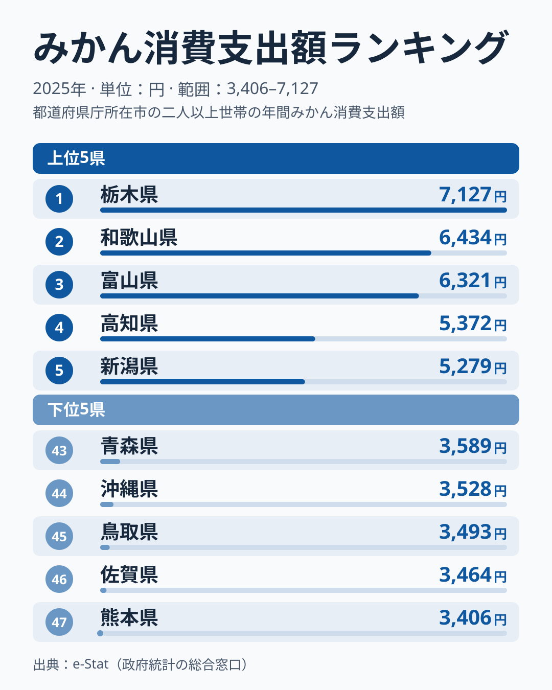
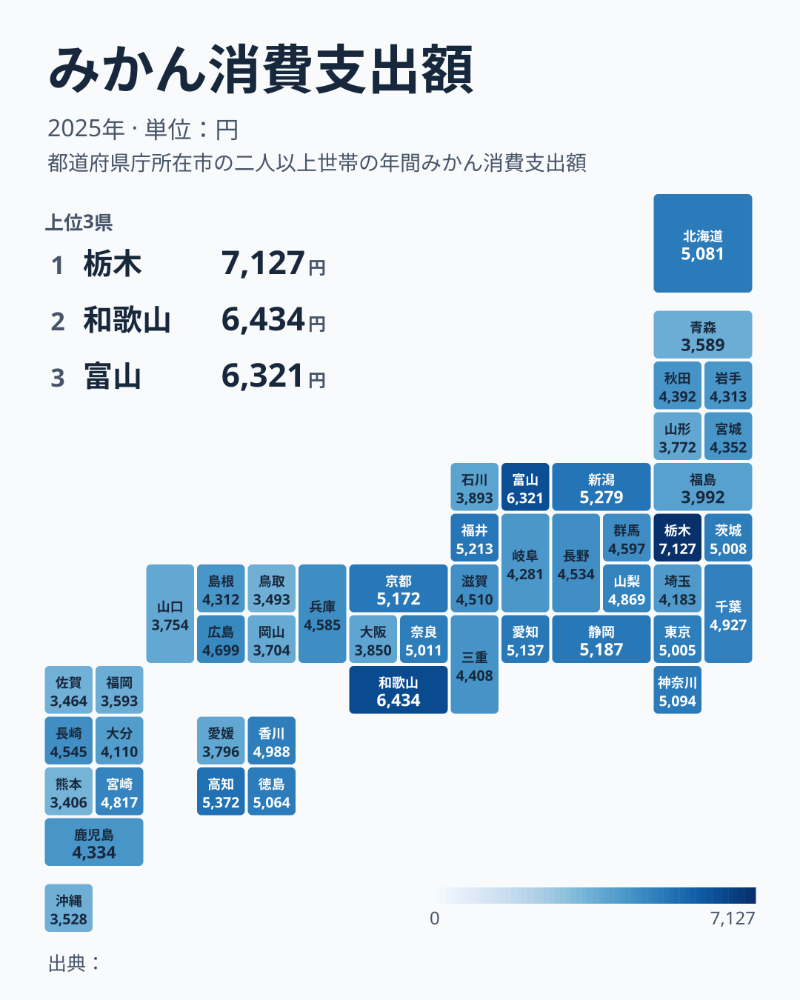
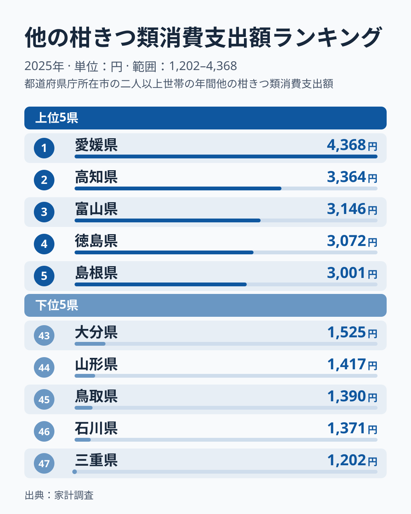

冬になると、こたつの上にみかんが山盛りになっている家庭は少なくありません。総務省の家計調査によると、2025年の1世帯（二人以上）あたり年間みかん消費支出額は、1位の栃木県が7,127円、最下位の熊本県が3,406円で、その差は2.1倍です。

さらに意外なのは、みかんの一大産地として知られる愛媛県が、消費支出額では47都道府県中38位（3,796円）にとどまっている点です。ところが同じ家計調査の「他の柑きつ類」という別の品目では、愛媛県は4,368円で全国1位です。この記事では、みかん消費支出額の地域差を見たうえで、愛媛県の順位が低く見える理由を、2つの品目を並べて確かめます。

> [!NOTE]
> この統計は総務省「家計調査」の品目別支出データで、都道府県庁所在市の二人以上世帯が対象です。実際の「食べる量」ではなく「購入にかけた金額（支出額）」である点に注意してください。単価の高い品種を少量買う家庭と、安価な品種を大量に買う家庭では、同じ支出額でも消費量が異なります。

## みかん消費支出額 上位5県と下位5県

<source-link href="/ranking/mandarin-consumption-expenditure">みかん消費支出額ランキングをもっと見る</source-link>

1位は栃木県で7,127円です。2位は和歌山県6,434円で、有田みかんで知られる日本有数の産地が、1位との差693円まで迫っています。3位は富山県6,321円、4位は高知県5,372円、5位は新潟県5,279円と続きます。産地として名高い和歌山県が上位に入る一方で、栃木県や富山県、新潟県のようにみかんの主産地ではない県も上位に並んでいるのが2025年の特徴です。

上位10県を見ても、6位福井県5,213円、7位静岡県5,187円、8位京都府5,172円、9位愛知県5,137円、10位神奈川県5,094円と、5,000円台前半に多くの県が密集しています。1位から3位までは6,000円を超えていますが、4位以下は差がごく小さく、順位が少しの金額差で入れ替わる状態です。

上位5県と下位5県を同じ尺度で比べると、違いがよくわかります。上位5県は5,279円（5位）から7,127円（1位）まで、幅は1,848円です。下位5県は3,406円（47位）から3,589円（43位）までで、幅は183円にすぎません。また、5位の新潟県5,279円と43位の青森県3,589円の間には、1,690円の開きがあります。上位は1位から3位にかけて金額が大きく離れ、下位はごく狭い範囲に固まっている形です。

「寒い県ほどこたつでみかんを食べる」という説明は、きれいには当てはまりません。栃木県や富山県、新潟県は冬が厳しい県ですが、同じ北国の青森県は43位（3,589円）で、下位5県に入っています。上位に寒冷地が多いことは言えても、気候だけで順位は決まらず、1位の栃木県がなぜ高いのかは、この記事の2025年1年分のデータからは説明できません。

## みかん消費支出額が低い県

下位を見ると、47位熊本県3,406円、46位佐賀県3,464円、45位鳥取県3,493円、44位沖縄県3,528円、43位青森県3,589円と並びます。下位5県のうち3県（熊本県、佐賀県、沖縄県）が九州・沖縄で、さらに42位の福岡県3,593円まで含めると、下位6県のうち4県を九州・沖縄が占めています。

ただし、九州全体が低いわけではありません。同じ九州でも、宮崎県は19位（4,817円）、長崎県は23位（4,545円）、鹿児島県は29位（4,334円）で、中位に入っています。「九州・沖縄が目立つ」ことと「九州の全県が低い」ことは別なので、地域の傾向として読むときも、個々の県の順位を習慣の差としてそのまま受け取るのは避けたほうがよいでしょう。

1位の栃木県と最下位の熊本県を比べると、栃木県は熊本県の2.1倍です。一方、下位5県は3,406円から3,589円までの183円の幅に収まっており、中位から下位にかけては小さな金額差で順位が動きます。最下位の熊本県の事情は、次の節で他の柑きつ類の数字と並べると見えてきます。

## 発見: 産地の愛媛はなぜ38位なのか

最も興味深い発見は、柑橘の産地として全国に知られる愛媛県が、みかん消費支出額では38位（3,796円）と中位以下にとどまっていることです。地図で見ても、愛媛県を含む四国は県ごとに濃淡が分かれ、産地と高消費が重なる単純な分布にはなっていません。四国の4県は、4位高知県5,372円、12位徳島県5,064円、16位香川県4,988円、38位愛媛県3,796円と、上位から中位以下まで散らばっています。

鍵になるのは、家計調査の品目区分です。この統計でいう「みかん」は温州（うんしゅう）みかんを指し、いよかんやぽんかんといった中晩柑（なかばんかん）は「他の柑きつ類」として別の品目で集計されます。愛媛県の家庭がどちらにお金を使っているかは、次の節で他の柑きつ類のランキングを見ればわかります。

## 他の柑きつ類では愛媛が1位

<source-link href="/ranking/other-citrus-consumption-expenditure">他の柑きつ類の消費支出額ランキングをもっと見る</source-link>

2025年の他の柑きつ類の消費支出額は、1位が愛媛県の4,368円です。2位の高知県3,364円に1,004円の差をつけており、3位富山県3,146円、4位徳島県3,072円、5位島根県3,001円と続きます。下位は47位三重県1,202円、46位石川県1,371円、45位鳥取県1,390円、44位山形県1,417円、43位大分県1,525円で、1位と最下位の差は3.6倍と、みかんの2.1倍より大きくなっています。

愛媛県は、みかんでは38位でも、他の柑きつ類では全国1位です。みかん支出額（3,796円）と他の柑きつ類の支出額（4,368円）を単純に足すと8,164円になり、2品目の合計で並べ直すと愛媛県は47都道府県中5位に上がります。この合計は、同じ調査・同じ2025年の2品目を足した筆者の計算で、公式の集計ではありません。合計の上位は、1位栃木県9,483円、2位富山県9,467円、3位高知県8,736円、4位和歌山県8,350円で、愛媛県はその直後に位置します。つまり、愛媛県が「産地なのに食べない」ように見えたのは、支出が温州みかんと他の柑きつ類に分かれ、みかんだけを見ていたためです。

最下位の熊本県も同じ見方で読み直せます。熊本県はみかんでは47位（3,406円）ですが、他の柑きつ類では10位（2,874円）です。2品目の合計は6,280円で、47都道府県中32位まで上がります。みかんの最下位は、柑橘への支出がないことを意味しません。一方で、同じ九州の佐賀県は、みかんが46位（3,464円）、他の柑きつ類が39位（1,698円）と、2つの品目でともに下位に沈んでいます。

産地ごとに結果が分かれる点も見逃せません。和歌山県はみかんが2位（6,434円）ですが、他の柑きつ類は32位（1,916円）で、柑橘を温州みかんに集中して買う県といえます。栃木県もみかんが1位に対して他の柑きつ類は21位（2,356円）です。「産地だから高い」「産地だから低い」と一括りにはできず、県ごとに、どの柑橘に支出が向かうかが違います。

> [!TIP]
> 家計調査の「みかん」は温州みかんにあたり、いよかんやぽんかんなどは「他の柑きつ類」という別の品目です。柑橘の消費を県ごとに比べるときは、1つの品目の順位だけで産地との関係を判断せず、両方を並べて見ると読み違いを防げます。

あわせて見る: [オレンジ消費支出額ランキング](/ranking/orange-consumption-expenditure)

愛媛県の食卓全体は[愛媛の食卓](/blog/ehime-food-culture)、りんごで同じ産地と消費のずれを扱った記事は[りんご消費支出は東北勢が独占](/blog/apple-expenditure-ranking)で読めます。

もうひとつ見落とせないのが、単年の順位のぶれです。家計調査は県庁所在市の二人以上世帯の標本から推計するため、市ごとの年間値は標本の入れ替わりや1年の天候に左右されます。みかんでは4位以下の金額差がごく小さく、1年の順位は小さな変動で入れ替わりやすい状態です。本当の地域差は数年分を平均して初めて見えてくる可能性が高く、2025年1年だけの順位から産地と消費の関係を断定することはできません。

> [!WARNING]
> 家計調査は都道府県庁所在市（政令指定都市含む）のデータをもとにしており、県内の農村部・産地の実態を必ずしも反映しません。また支出額は購入にかけた金額なので、農家の自家消費や、もらいもので賄った分は表に出ません。

## まとめ

- 1位: 栃木県 7,127円（2位の和歌山県は6,434円）
- 最下位: 熊本県 3,406円
- 倍率: 2.1倍（1位と最下位の比）
- 地域パターン: 下位は九州・沖縄が目立つが、宮崎県19位・長崎県23位と九州全体が低いわけではなく、金額差が小さい中下位は単年の順位だけでは読み切れない
- 特筆点: 産地の愛媛県はみかん38位（3,796円）だが、他の柑きつ類は4,368円で全国1位。みかんと他の柑きつ類の合計では5位（8,164円、筆者計算）

みかん以外の家計消費支出データは[経済カテゴリ一覧](/category/economy)、和歌山県の他の統計は[和歌山県の地域プロフィール](/areas/30000)、愛媛県の統計は[愛媛県の地域プロフィール](/areas/38000)から確認できます。

## データについて

総務省統計局「家計調査」（品目別支出金額、二人以上世帯）をもとに、都道府県庁所在市の年間データを2025年時点で集計しています。e-Stat（政府統計の総合窓口）経由で取得したデータを利用しています。みかんと他の柑きつ類の合計は、同じ2025年の2品目の支出額を単純に足した筆者の計算です。
