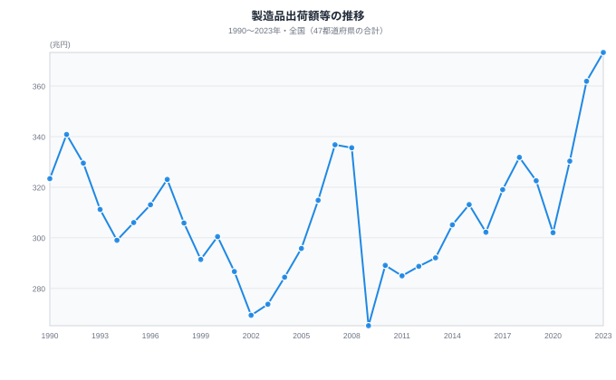
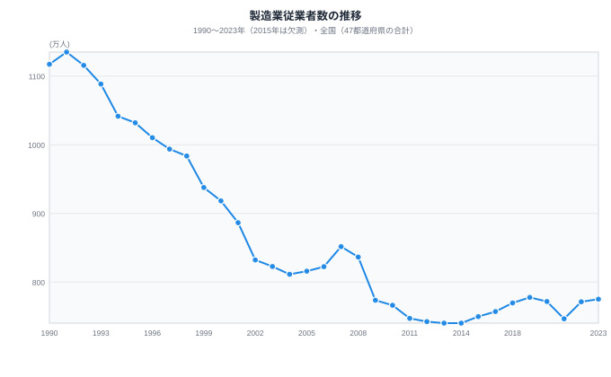
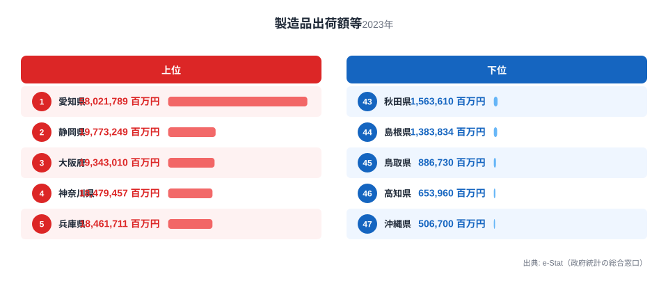
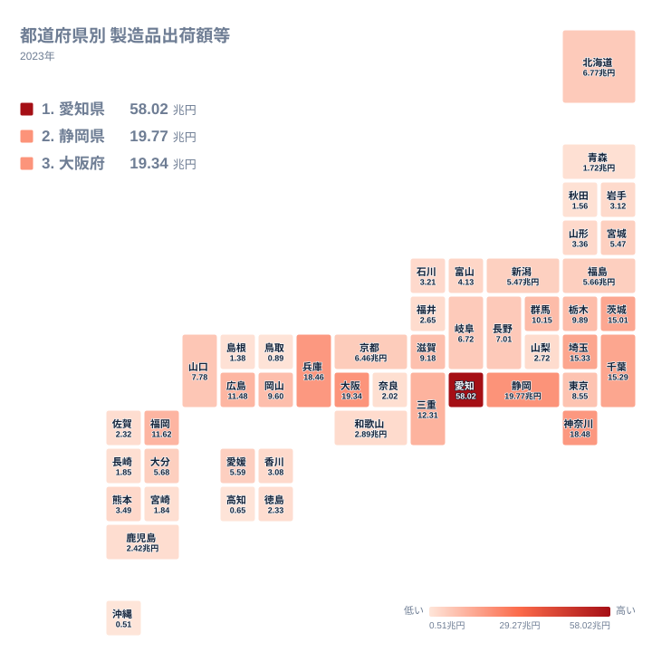
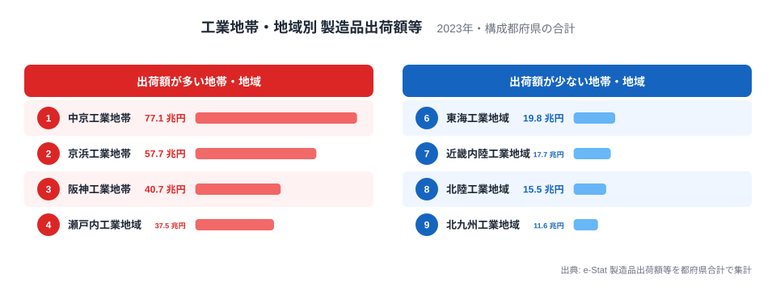
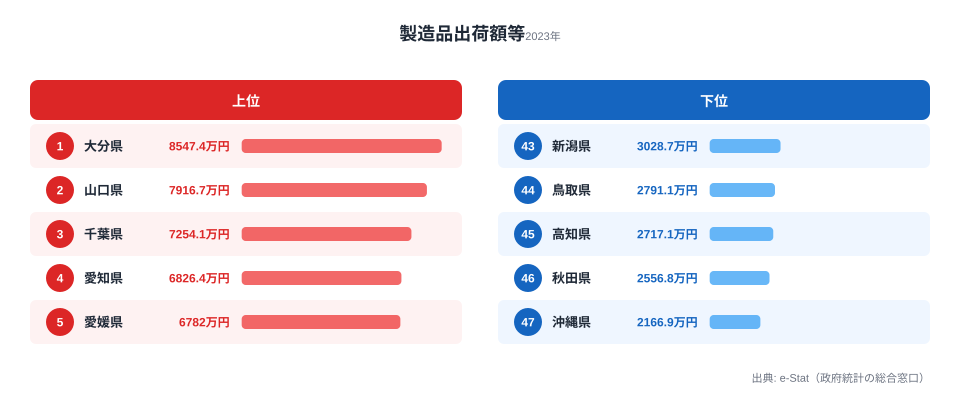
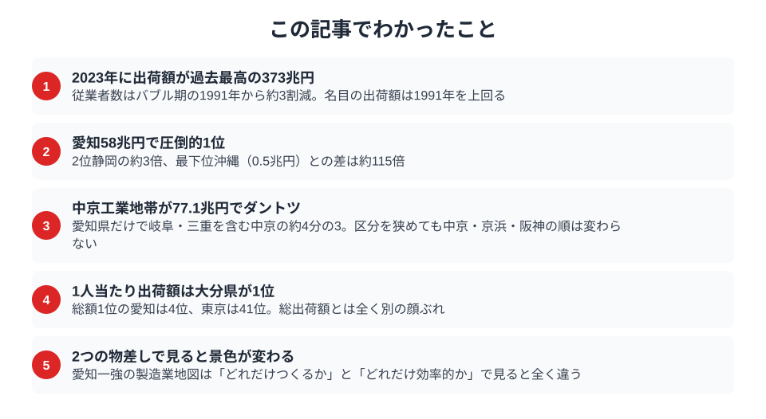

製造品出荷額等の総額1位は、2023年も愛知県の**58.0兆円**。最下位の沖縄県は0.5兆円で、その差は約115倍です。太平洋ベルトへの一極集中は揺るがないように見えます。

ところが、物差しを「従業者1人あたりの出荷額」に変えると地図は一変します。**1人あたりで首位に立つのは愛知ではなく大分県で8,547万円**。総額王者の愛知県は6,826万円で4位に下がり、首都・東京都にいたっては3,231万円で**まさかの41位**です。なぜ「自動車の県」愛知を「コンビナートの県」大分が1人あたりの出荷額で逆転するのか——本記事はこの「2つの王者」のズレを起点に、日本のものづくりの構造を読み解きます。経済全体の地域差は[経済・産業カテゴリの統計一覧](/category/economy)も併せてご覧ください。

> [!NOTE]
> 「製造品出荷額等」とは、製造業の事業所が1年間に出荷した製品の金額に、加工賃収入・くず廃物の出荷額・その他収入などを加えた合計で、消費税などの内国消費税を含みます。工場の生産規模を測る代表的な指標で、地域の「ものづくりの集積度」を表します。

## 製造品出荷額等の推移──バブル・リーマン・コロナを経て過去最高へ

バブル期（1991年：340.8兆円）をピークに一度落ち込んだ日本の製造業。リーマンショック（2009年：265.3兆円）やコロナ禍（2020年：302.0兆円）の谷を越え、2023年には**過去最高の約373兆円**を記録しました。

<data-source url="https://www.e-stat.go.jp/dbview?sid=0000010103" label="e-Stat 社会・人口統計体系（製造品出荷額等・従業者数）"></data-source>

この推移は読み方に注意が必要です。出荷額は2020年の302.0兆円から2021年の330.3兆円へ9.4%増えましたが、2021年の経済センサスは従来より幅広く事業所を把握しており、2020年以降は調査も年により切り替わっています。2020年以前と2021年以降は同じ基準では比べられず、「過去最高」の373兆円も調査範囲の変更を含む値です。また出荷額は当年価格の金額で、物価の変動を調整していません。2022年は前年比9.6%増の361.9兆円ですが、増産と価格の上昇のどちらがどれだけ効いたかは、この図だけでは切り分けられません。

従業者数のほうは、出荷額が高い水準にあるのに**低水準で横ばい**です（2023年：約775万人）。バブル期のピーク（1991年：約1,135万人）から約3割少ない人数で、名目の出荷額は1991年を上回っています。省力化投資・自動化が背景にある可能性はありますが、本記事のデータでは要因までは確認しておらず、物価上昇による名目額の膨らみも含まれます。

<data-source url="https://www.e-stat.go.jp/dbview?sid=0000010103" label="e-Stat 社会・人口統計体系（製造品出荷額等・従業者数）"></data-source>

従業者数は1991年の1,135万人から2009年の774万人まで減り、その後は2023年の775万人まで横ばい圏で推移しています。出荷額が増えた2010年代以降も、人数はほとんど増えていません。

## 都道府県ランキング──愛知一強、沖縄との差は115倍

### 出荷額上位5・下位5

<data-source url="https://www.e-stat.go.jp/dbview?sid=0000010103" label="e-Stat 社会・人口統計体系（製造品出荷額等）"></data-source>

**1位の愛知県は58兆円**で、2位の静岡県の約3倍です。上位5県はいずれも太平洋ベルト上に集中し、4・5位の神奈川・兵庫はほぼ同水準で横並びです。なお2018年は愛知県に次ぐ2位が神奈川県、4位が静岡県でしたが、今回は静岡県が2位に上がり、神奈川県は4位に下がっています。

一方、最下位の**沖縄県はわずか0.5兆円**。下位では高知県が46位、鳥取県が45位と続きます。農林水産業・観光・サービス業が産業の中心の県が多いとみられますが、産業別の出荷額は本記事では確認していません（[沖縄県の統計プロフィール](/areas/47000)）。

> [!WARNING]
> 総出荷額は「産業集積の規模」を示す指標であり、地域の効率や豊かさを直接表すものではありません。人口や事業所規模が大きい県ほど総額も大きくなります。実際の1人あたりの規模は後述の「従業者1人当たり出荷額」と併せて読むのが適切です。

### 全国の分布マップ

<data-source url="https://www.e-stat.go.jp/dbview?sid=0000010103" label="e-Stat 社会・人口統計体系（製造品出荷額等）"></data-source>

地図にすると一目瞭然です。**太平洋ベルト地帯**（愛知・静岡・大阪・神奈川・兵庫）が濃く染まり、日本海側・四国・九州南部・沖縄は薄い。出荷額が特定の地域に偏る構図は、地図で見ると一目で分かります。

<source-link href="/ranking/manufacturing-shipment-amount">製造品出荷額等ランキングをもっと見る</source-link>

## 工業地帯・工業地域別ランキング──中京が「日本最大」を堅持

都道府県を超えた工業地帯・地域単位で集計すると、産業集積の全体像がよりはっきり見えます。

<data-source url="https://www.e-stat.go.jp/dbview?sid=0000010103" label="e-Stat 社会・人口統計体系（製造品出荷額等）"></data-source>

**中京工業地帯（岐阜・愛知・三重）が77.1兆円でダントツ1位**。京浜工業地帯は57.7兆円で2位です。中京の77.1兆円のうち愛知県だけで58.0兆円と、約4分の3を占めています。トヨタを頂点とする自動車産業の集積が背景にあるとされますが、産業別の出荷額は本記事のデータに含まれないため、ここで確認できるのは県別の内訳までです。

阪神は40.7兆円、瀬戸内は37.5兆円、北関東は35.0兆円と、近い水準で続きます。図には上位4つと下位4つを載せており、5位は北関東工業地域です。この図で扱う9つの区分は27都府県で、全国の出荷額373.2兆円の約84%にあたります。大分県など、どの区分にも入らない20道県は図に含まれません。

工業地帯・地域の範囲には公式の統一基準がなく、教材によって異なります。この図は中京に岐阜県、京浜に埼玉県と千葉県、阪神に和歌山県を含む広めの区分で集計しました。京浜を東京・神奈川・埼玉の3都県とする新しい教材の区分では42.4兆円になり、中京を愛知・三重の2県、阪神を大阪・兵庫の2府県に絞ると、中京は70.3兆円、阪神は37.8兆円です。区分を変えても、上位3つは中京、京浜、阪神の順で変わりません。構成する都府県と範囲の根拠は「データについて」にまとめています。

## 従業者1人当たり出荷額──総額の王者と1人当たりの王者は別人

ここが本記事の核心です。製造業の強さは総出荷額だけでは測れません。従業者1人当たりの出荷額で見ると、「少ない人数で大きな出荷額を上げる」産業構造の違いが浮かび上がり、**総額ランキングとは全く別の県が上位に並びます**。

> [!NOTE]
> 総額は「従業者数 × 1人あたりの出荷額」で決まります。愛知県の従業者は約85.0万人で、大分県の約6.65万人の12.8倍ですが、出荷額は58.0兆円と5.68兆円で10.2倍にとどまります。そのぶん大分県の1人あたりが高くなります。愛知県の6,826万円も全国平均の4,815万円の約1.4倍あり、愛知県が低いのではなく、大分県などがそれをさらに上回る構図です。

<data-source url="https://www.e-stat.go.jp/dbview?sid=0000010203" label="e-Stat 社会・人口統計体系（製造品出荷額等・従業者数）"></data-source>

> [!TIP]
> 1人当たり出荷額は、賃金や付加価値額ではありません。出荷額には原材料費の転嫁分や、揮発油税などの内国消費税が含まれるため、出荷額の大きさがそのまま稼ぐ力の大きさを意味するとは限りません。

**1位は大分県で8,547万円**、2位は山口県で7,917万円、3位は千葉県で7,254万円です。総出荷額ランキングとは全く異なる顔ぶれです。上位には石油・化学コンビナートを抱える県が並ぶことが多いと言われますが、これは県の産業構成からの見立てです。産業別の出荷額は本記事では確認しておらず、産業中分類別の出荷額と突き合わせる検証が必要です。

総出荷額1位の**愛知県は4位で6,826万円**。大規模な雇用を抱えながらも、全国平均を大きく上回っています。一方、**東京都は41位で3,231万円**です。首都でも製造業従業者1人当たりの出荷額は低く、本社機能やサービス業が中心の産業構造が背景にあるとみられます（[東京都の統計プロフィール](/areas/13000)）。**沖縄県は総出荷額・1人当たりともに最下位**で2,167万円、1位の大分県との差は約4倍に達します。

総額の地図と1人当たりの地図、どちらか一方だけでは「ものづくりの実像」を見誤るというのが、本記事の最大の発見です（[大分県の統計プロフィール](/areas/44000)）。

<source-link href="/ranking/manufacturing-shipment-amount-per-employee">従業者1人当たり製造品出荷額等ランキングをもっと見る</source-link>

## 地方の製造業は今──産業構造の変化

各地の製造業の得意分野は、産業別の出荷額で確かめられます。ただし本記事は産業別のデータを使っていないため、ここでは県ごとの産業の中身には踏み込まず、地方の製造業が直面する課題として指摘される点を整理します。

- **人口減少**による労働力不足
- **脱炭素化**の波（自動車のEV化が中京工業地帯に与える影響）
- **サプライチェーン再構築**（コロナ禍以降の国内回帰の動き）

従業者数が1991年から約3割減った全国の姿は、この人手不足の先行きと無関係ではありません。輸送用機器の比重が大きいとされる愛知・三重・静岡では、EV化への対応が論点になります。一方、半導体工場の熊本誘致（TSMC）に象徴されるように、電子部品・先端素材分野での地方への新たな投資も始まっています。

## まとめ

総額で見れば愛知県の58.0兆円は群を抜き、岐阜・三重を含む中京工業地帯は77.1兆円に達します。しかし1人あたりの出荷額に直すと、首位は大分県の8,547万円で、愛知県は4位、東京都は41位です。総額が示す集積の規模と、1人あたりの出荷額は別の物差しとして、両方を並べて読むのが本記事の結論です。

## データについて

- **製造品出荷額等**: 従業者4人以上の製造業事業所について、1年間の製造品出荷額、加工賃収入額、くず廃物の出荷額、その他収入額を合計した金額です。消費税などの内国消費税を含みます。2020年以降は調査が年により切り替わり、2021年の経済センサスは従来より幅広く事業所を把握しているため、時系列の比較には注意が必要です。金額は当年価格で、物価変動は調整していません。
- **製造業従業者数**: 製造業事業所の所属従業者から、個人業主・無給家族従業者、1か月未満または日々雇用の臨時雇用者、他事業所への出向・派遣者を除き、他事業所からの出向・派遣受入者を加えた人数です。公開値に2015年がないため、推移の図では2015年を欠測のままにしています。
- **全国の値**: 推移の図の全国値は、47都道府県の公開値を合計して求めています。
- **従業者1人当たり出荷額**: 製造品出荷額等を製造業従業者数で割った値です。賃金や付加価値額を示す指標ではありません。
- **工業地帯・地域の範囲**: 工業地帯・地域別の図は、次の都府県の2023年の製造品出荷額等を合計しています。範囲に統一基準はなく、旧来の教材は京浜に千葉県を含め、令和3年度版以降の教材は千葉県を京葉工業地域として分けています（帝国書院の解説による）。
  - 中京工業地帯: 岐阜県、愛知県、三重県
  - 京浜工業地帯: 埼玉県、千葉県、東京都、神奈川県
  - 阪神工業地帯: 大阪府、兵庫県、和歌山県
  - 瀬戸内工業地域: 岡山県、広島県、山口県、香川県、愛媛県
  - 北関東工業地域: 茨城県、栃木県、群馬県
  - 東海工業地域: 静岡県
  - 近畿内陸工業地域: 滋賀県、京都府、奈良県
  - 北陸工業地域: 新潟県、富山県、石川県、福井県
  - 北九州工業地域: 福岡県
- **範囲の近似**: 中京の岐阜県と阪神の和歌山県は、一般には岐阜県南部や和歌山県北部だけを含むと説明されることがあり（Wikipedia の説明による）、ここでは県全域の値を合計しています。近畿内陸工業地域の範囲は出典を確認できておらず、本記事の区分です。
