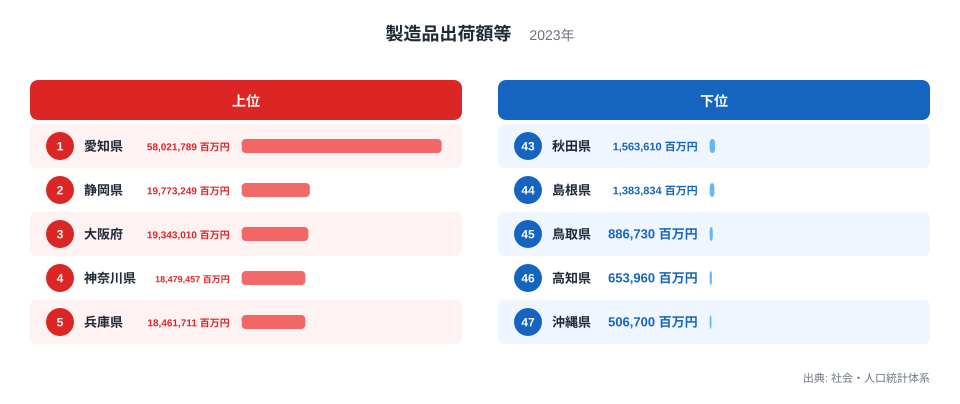
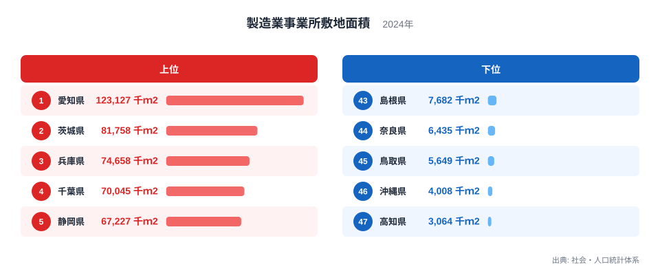
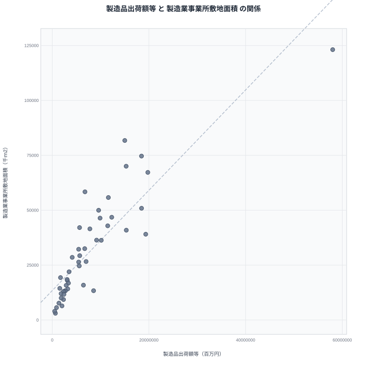

製造業が盛んな県には、大きな工場がいくつも立ち並んでいるイメージがあります。出荷額が大きければ工場の敷地も広いはずだ、と考えるのは自然です。では実際のデータでは、その直感はどこまで当てはまるのでしょうか。

この記事では、製造品出荷額等と製造業事業所敷地面積という2つの指標を47都道府県で並べ、関係の強さを確かめます。そのうえで、相関があることと因果があることは別の話であることを整理し、数字の裏にある真因を考えます。

## 出荷額のランキングを見る

まず製造品出荷額等から確認します。2023年の数値です。

<source-link href="/ranking/manufacturing-shipment-amount">製造品出荷額等ランキングをもっと見る</source-link>

1位は愛知県で58,021,789百万円です。2位の静岡県は19,773,249百万円で、愛知県はその約3倍に迫る規模ですが、ここでは実データの値だけを示すにとどめます。3位は大阪府の19,343,010百万円、4位は神奈川県の18,479,457百万円、5位は兵庫県の18,461,711百万円と続きます。

下位に目を向けると、47位は沖縄県で506,700百万円です。46位は高知県の653,960百万円、45位は鳥取県の886,730百万円です。1位と47位の差は非常に大きく、出荷額が特定の県に集中していることが分かります。

東京都は人口が最も多い都道府県ですが、製造品出荷額等では16位で、8,552,651百万円です。人口や経済規模の大きさと、製造業の出荷額は必ずしも並びません。この点は後で敷地面積と比べるときにも重要になります。

## 敷地面積のランキングを見る

次に製造業事業所敷地面積です。こちらは2024年の数値で、出荷額とは年が1年ずれています。

1位は愛知県で123,127千ｍ2です。出荷額でも1位でしたので、愛知県は両方の指標で首位に立っています。2位は茨城県の81,758千ｍ2、3位は兵庫県の74,658千ｍ2、4位は千葉県の70,045千ｍ2、5位は静岡県の67,227千ｍ2です。

出荷額で2位だった静岡県は、敷地面積では5位です。大阪府は出荷額で3位でしたが、敷地面積では16位の39,064千ｍ2にとどまります。一方、茨城県は出荷額で8位でしたが、敷地面積では2位です。順位がきれいに対応しているわけではありません。

下位は、47位が高知県で3,064千ｍ2、46位が沖縄県で4,008千ｍ2、45位が鳥取県で5,649千ｍ2です。出荷額の下位にも高知県、沖縄県、鳥取県が並んでいました。順序は入れ替わっていますが、顔ぶれはほぼ重なります。

> [!NOTE]
> 製造品出荷額等は、製造業の事業所が1年間に出荷した製品の価額などを合計したもので、単位は百万円です。製造業事業所敷地面積は事業所が使う敷地の広さを示し、単位は千ｍ2です。前者は金額、後者は面積という別の量であり、調査年も2023年と2024年で異なります。

## 2つの指標の関係を散布図で確かめる

ここで2つの指標を同時に眺めます。横軸と縦軸にそれぞれの値を取った散布図です。

ピアソンの相関係数は0.87で、計算に使った都道府県の数は47です。0.87は強い正の相関を示す値です。出荷額が多い県は、敷地面積も広い傾向がはっきり読み取れます。

ただし、この数値は「敷地が広いから出荷額が増える」とも「出荷額が多いから敷地が広がる」とも言っていません。相関係数は2つの数字が一緒に動く度合いを表すだけで、因果の大きさや、一方で他方を説明できる割合を示すものではありません。

また、散布図の右上には愛知県が大きく離れて位置します。愛知県は出荷額も敷地面積も1位で、1県だけで全体の傾きに強く影響している可能性があります。相関係数を読むときは、こうした突出した県の存在を頭に置く必要があります。

> [!TIP]
> 散布図を読むときは、傾向線から大きく外れた県に注目すると発見があります。大阪府は出荷額が3位なのに敷地面積は16位で、茨城県は敷地面積が2位なのに出荷額は8位です。外れ方の違いが、産業構造の違いを映しています。

## 見かけの相関と、その裏にある真因

相関が強いからといって、敷地を広げれば出荷額が増えるとは限りません。両方の指標を同時に押し上げる第三の要因があるかもしれません。たとえば、製造業の集積そのものです。工場の数が多い県は、出荷額も敷地面積も自然に大きくなります。この場合、2つの数字は互いの原因ではなく、共通の原因から生じた結果です。

また、業種の違いも見逃せません。装置を多く使い、広い敷地を必要とする業種もあれば、小さな敷地で高い付加価値を生む業種もあります。大阪府や東京都のように、敷地の制約が厳しい都市部では、狭い土地で出荷額を確保する構造になりやすいと考えられます。茨城県や北海道のように土地に余裕のある県では、広い敷地を使う工場が立地しやすい面があります。ただし、これは業種別の実データを確認したものではなく、解釈の候補です。

愛知県の姿は示唆的です。愛知県は出荷額で58,021,789百万円、敷地面積で123,127千ｍ2といずれも1位です。こうした集積の厚い県では、規模の大きさが両方の指標に現れます。静岡県は出荷額が2位、敷地面積が5位で、上位に位置する点は共通しています。

> [!WARNING]
> 2つの指標は調査年が異なり、出荷額は金額ベース、敷地面積は面積ベースです。金額は物価や製品の単価の影響を受け、敷地面積は土地の取得しやすさに左右されます。1つの散布図だけで、効率や生産性の優劣を判断することはできません。

## 数字を読むときの注意点

今回の分析から言えるのは、出荷額が多い県は敷地も広い傾向にある、という事実までです。そこから先、敷地を増やせば出荷額が伸びる、といった因果の主張を導くことはできません。

地域の産業構造を詳しく見たい場合は、個別の県のデータが役に立ちます。[愛知県のデータ](/areas/23000)や[静岡県のデータ](/areas/22000)では、製造業に関わる他の指標も確認できます。敷地面積の順位をじっくり見たい場合は、[製造業事業所敷地面積ランキング](/ranking/manufacturing-establishment-site-area)が便利です。同じ分野の指標を広く見たい場合は、[同じカテゴリの統計一覧](/category/miningindustry)をご覧ください。

次の一歩として、敷地面積あたりの出荷額という比率を考える方法があります。広さの割に出荷額が大きい県と小さい県を分けられれば、相関だけでは見えない違いが浮かびます。ただし、その比率はここでは実データに載っていないため、数値の算出は行いません。

## データについて

製造品出荷額等は2023年、製造業事業所敷地面積は2024年の値で、いずれも社会・人口統計体系を出典としています。相関係数は47都道府県の値から計算したピアソンの相関係数で、0.87です。年が異なる2つの指標を比べているため、厳密な同時点の比較ではない点に注意してください。
