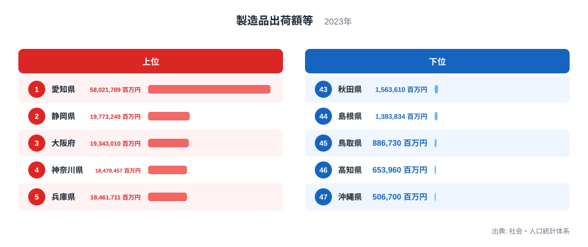
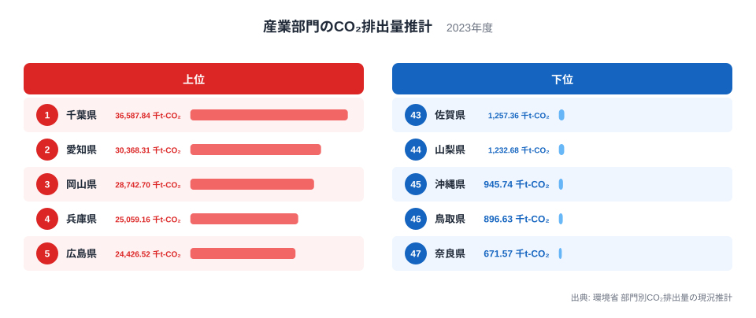
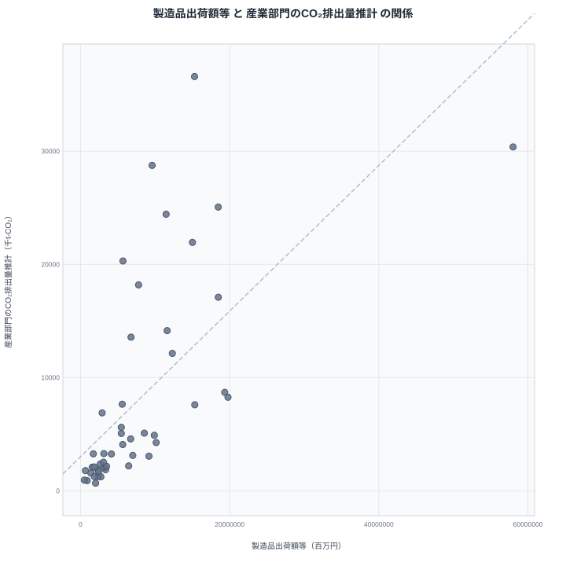

「たくさん作る県ほど、たくさんCO₂を出している」。直感的にはそう思えますが、実際の都道府県データでは、この見立てはきれいには当てはまりません。出荷額が全国2位の静岡県は、CO₂排出量では14位にとどまります。反対に、出荷額で7位の千葉県は、排出量では1位です。

この記事では、工場の数ではなく、2023年の製造品出荷額等という金額の指標と、産業部門のCO₂排出量推計を47都道府県で並べ、両者の関係を確かめます。そのうえで、見かけの相関と、食い違いの背後にあるかもしれない要因を分けて整理します。

## まず出荷額のランキングを確認する

最初に、製造業でつくられたモノの金額がどう分布しているかを見ます。

<source-link href="/ranking/manufacturing-shipment-amount">製造品出荷額等ランキングをもっと見る</source-link>

この図で目を引くのは、1位の愛知県が58,021,789百万円と、2位以下から切り離されている点です。2位の静岡県は19,773,249百万円、3位の大阪府は19,343,010百万円で、2位から5位までは接戦です。つまり「上位」といっても、愛知県だけが別格で、残りは団子状態という構図です。

もう一つの含意は、下位との開きです。47位の沖縄県は506,700百万円で、愛知県との間には、同じ「製造業」という言葉では括りにくいほどの規模差があります。この差は、のちに散布図を読むときにも効いてきます。出荷額の軸では、愛知県が右端に1点だけ離れて置かれるからです。

各県の詳しい数字は[愛知県のデータ](/areas/23000)や[静岡県のデータ](/areas/22000)で確認できます。

> [!NOTE]
> 製造品出荷額等は、製造業の事業所が1年間に出荷した製品の金額に、加工賃収入などを加えたものです。工場や事業所の数ではなく、あくまで金額の指標です。付加価値ではなく出荷の総額なので、原材料費や部品代も含まれます。部品を仕入れて組み立てる産業ほど、金額が膨らみやすい点に注意してください。単位は百万円です。

## 産業部門のCO₂排出量のランキング

次に、産業部門から出るCO₂の推計値を見ます。

出荷額と並べると、顔ぶれの重なりは限られています。排出量の上位5位のうち、出荷額でも上位5位に入るのは、排出量2位で出荷額1位の愛知県と、排出量4位で出荷額5位の兵庫県の2県です。1位の千葉県は出荷額で7位、3位の岡山県は14位、5位の広島県は11位と、排出量の順位のほうがはっきり高くなっています。

逆に、出荷額で2位から4位だった静岡県、大阪府、神奈川県は、排出量の上位5位に入っていません。出荷額の上位と排出量の上位が、きれいに重なっていないことがわかります。一方で、下位には鳥取県や奈良県など、出荷額も小さい県が目立ちます。奈良県は排出量が47位の671.568千t-CO₂です。「少なく作る県は排出も少ない」という関係は比較的保たれ、食い違いが大きいのは中位から上位の県だと読めます。

排出量ランキングの全体は[産業部門のCO₂排出量推計ランキング](/ranking/regional-industry-co2-emissions-estimate)で確認できます。

> [!WARNING]
> この排出量は、実測値ではなく統計から配分して求めた推計値です。大規模な設備が1か所にあるだけでも、人口や事業所の少ない県の数字は大きく動きえます。順位の近い県どうしの小さな差は、実態の差とは言い切れません。また、出荷額は事業所の所在地ベース、排出量は推計上の配分ベースで、集計の考え方が揃っていない点にも注意が必要です。

## 散布図で見る相関

2つの指標を1枚の図に重ねると、全体の傾向が見えます。

47都道府県で計算したピアソンの相関係数は0.65です。出荷額が大きい県ほど排出量も大きい傾向は確かにあり、正の相関といえます。ただし、点が一本の線上に並ぶほど強い関係ではなく、線から大きく外れる県が複数あります。

外れ方は2種類に分けられます。1つは、出荷額のわりに排出量が少ない県です。静岡県は出荷額2位に対して排出量14位、大阪府は出荷額3位に対して排出量13位です。埼玉県も、出荷額6位に対して排出量は16位です。もう1つは、出荷額のわりに排出量が多い県です。千葉県は出荷額7位で排出量1位、大分県は出荷額22位で排出量7位、山口県は出荷額17位で排出量8位です。

ここで注意したいのは、愛知県の位置です。愛知県は出荷額で突出し、排出量でも2位なので、右上に離れた1点として図に現れます。突出した点が1つあると、全体の相関の印象はその点に引っ張られやすくなります。0.65という値が「全県に共通する関係」なのか、「愛知県のような大きな県と、小さな県との差」を主に反映しているのかは、この数字だけでは区別できません。

> [!TIP]
> 横軸の出荷額は実際に集計された金額で、縦軸の排出量は統計から配分して求めた推計値です。単位も百万円と千t-CO₂で異なり、性質の違う2つの数字を並べていることを忘れないでください。そのため「出荷額1円あたりの排出」のような換算は、この図からは読み取れません。0.65も因果の大きさや説明できる割合を示す数字ではなく、出荷額が排出量を決めているとは読めません。

## 見かけの相関と考えられる要因を分ける

相関は因果ではありません。0.65という値は、2つの指標が同じ方向に動きやすいことを示すだけです。出荷額が増えるから排出量が増える、あるいはその逆だ、とは、この値だけでは言えません。

では、なぜ食い違いが生まれるのでしょうか。与えられた2つの指標だけでは、原因までは断定できません。一つの可能性として考えられるのは、各県にどんな産業が立地しているかという産業構成の違いです。出荷額は「つくったモノの金額」で、排出量は「つくる過程で出た排出」に近い指標です。金額が大きくても排出の少ない産業が中心の県もあれば、金額のわりに排出が多くなる産業が集まる県もあるのかもしれません。千葉県や岡山県、大分県のように出荷額の順位より排出量の順位が高い県は、後者の候補として注目できます。ただし、これを確かめるには業種別の統計が必要で、本記事のデータでは裏付けられません。

もう一つの可能性は、集計の仕方そのものです。排出量が推計であることを踏まえると、大規模な設備の所在やエネルギーの使い方の違いが数字に影響している場合もあり得ます。これも仮説にとどまります。

地方ごとの顔ぶれも、図の上位10県の範囲で見ておきます。排出量の上位10県のうち、関東の7都県からは千葉県が1位、茨城県が6位、神奈川県が9位の3県が入ります。中国の5県からは岡山県が3位、広島県が5位、山口県が8位の3県が入ります。九州・沖縄の8県からは大分県が7位、福岡県が10位の2県が入り、同じ九州・沖縄でも沖縄県は45位です。上位10県は複数の地方にまたがっており、特定の地方に固まっているとは言えません。

## 数字を読み違えないために

この比較から言えることと、言えないことを整理します。

言えることは次のとおりです。

- 出荷額と排出量には、47都道府県で見て0.65の正の相関がある
- 出荷額が下位の鳥取県や沖縄県は、排出量も下位に並ぶ
- 出荷額の順位と排出量の順位が大きく食い違う県が、複数ある

言えないことは次のとおりです。

- 出荷額が増えれば排出量が必ず増えるという因果
- 排出量の多さがそのまま環境対応の遅れを示すという評価
- 産業構成の違いが食い違いの原因だという断定

特に、排出量の多い県を単純に責める読み方は適切ではありません。県の数字は、産業の構造や設備の立地、推計方法が重なった結果であり、順位だけで良し悪しを判断することはできません。

他の産業関連の統計と併せて見たい場合は、[同じカテゴリの統計一覧](/category/miningindustry)が役立ちます。事業所数や従業者数などと組み合わせると、産業構成の違いをより具体的に検討できます。

## データについて

製造品出荷額等は、社会・人口統計体系に掲載された2023年の値で、単位は百万円です。産業部門のCO₂排出量推計は、環境省の部門別CO₂排出量の現況推計による2023年の値で、単位は千t-CO₂です。相関係数は、この2つの指標を47都道府県で組み合わせて計算したピアソンの相関係数で、値は0.65です。

## まとめ

製造品出荷額等と産業部門のCO₂排出量の間には、0.65という正の相関があります。ただし、静岡県や大阪府のように出荷額が上位でも排出量が中位にとどまる県もあれば、千葉県や大分県のように出荷額のわりに排出量が多い県もあります。

見かけの相関の裏には、産業構成のような別の要因が隠れているかもしれません。ただし、それは一つの可能性にとどまり、この2指標だけでは確かめられません。出荷額の大きさだけで排出量を語らず、どんな産業が集まっているかまで目を向けることが、数字を正しく読むための出発点です。
