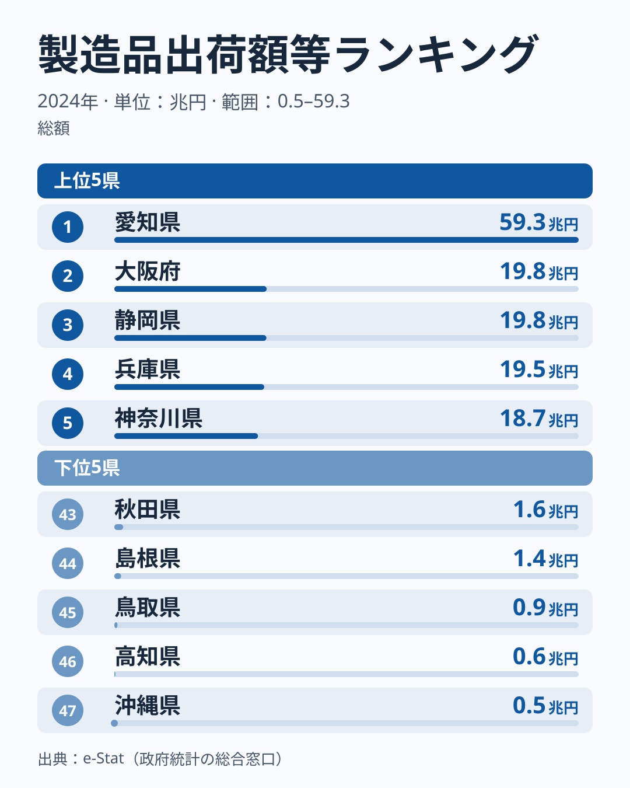

「製造品出荷額の首位はどこか?」と聞けば、多くの人が愛知と即答するでしょう。実際、2024年の[愛知県](/areas/23000)の製造品出荷額等は約**59.3兆円**で、2位の大阪府の約19.8兆円のおよそ3倍です。最下位の[沖縄県](/areas/47000)の約115倍にも達します。

ただ、本当に注目すべきは愛知の大きさそのものではありません。**上位が「太平洋ベルト」と「三大都市圏」に並ぶ**という偏りです。なぜ日本の製造業はこれほど一部の地域に集中するのか──この記事では、総出荷額のランキングから日本のものづくりの地理構造を読み解きます。

> [!NOTE] 「製造品出荷額等」とは
> 「製造品出荷額等」とは、製造品の出荷額に加え、加工賃収入額・修理料収入額等を含む指標です（経済構造実態調査（旧・工業統計調査）の定義）。本記事では e-Stat「社会・人口統計体系」を通じて取得した2024年データを使用しています。

<data-source url="https://www.e-stat.go.jp/dbview?sid=0000010103" label="e-Stat 社会・人口統計体系"></data-source>

## 総額ランキング──愛知59兆円という別格

総出荷額の上位は、愛知を筆頭に「太平洋ベルト＋三大都市圏」がずらりと並びます。**1位の愛知県**は約59.3兆円で、2位の大阪府の約19.8兆円のおよそ3倍という別格ぶりです。注目すべきは2位以下の「団子状態」です。2位の大阪府から5位の神奈川県までの4府県（大阪・静岡・兵庫・神奈川）は、いずれも約18.7兆円から約19.8兆円の間にひしめいています。2位の大阪府と3位の静岡県の差は約330億円しかなく、2023年は2府県の順序が逆で、静岡県のほうが上でした。6位の千葉県は約16.0兆円、7位の埼玉県は約15.3兆円、8位の茨城県は約15.2兆円で、15兆円台が連なります。トップ1だけが突出し、それ以下が横並びになるのが日本の製造業地図の特徴と言えます。

なぜ愛知だけが突き抜けるのでしょうか。よく挙げられる説明は自動車産業の集積です。愛知県には完成車メーカーと大手部品メーカーが集まっており、輸送用機器は1台あたりの出荷額が大きいうえ、部品の取引が県内で何重にも積み上がると考えられます。ただし、この記事のデータは産業別の内訳を持たないため、約59兆円のうちどれだけが自動車関連かは確かめられません。「自動車の集積が首位を支えている」というのは、通説に基づく読み方として受け取ってください。

<source-link href="/ranking/manufacturing-shipment-amount">製造品出荷額ランキングをもっと見る</source-link>

## 上位を貫く「太平洋ベルト」という背骨

2024年の上位10県（愛知・大阪・静岡・兵庫・神奈川・千葉・埼玉・茨城・三重・福岡）を地図に置くと、東は茨城・千葉から、神奈川・静岡・愛知・三重・大阪・兵庫を経て、西は福岡へと一本の帯が浮かび上がります。これが戦後の重化学工業化で形成された「太平洋ベルト」です。

なぜこの帯に集中するのでしょうか。通説では3つの条件が挙げられます。第一に**臨海立地**です。鉄鋼・石油化学などは原材料の輸入と製品の輸出を港湾に頼るため、港を持つ平野部が選ばれやすいとされます。第二に**大消費地への近さ**です。三大都市圏に近いほど輸送費が抑えられ、部品メーカーと完成品メーカーが近くで取引できます。第三に**集積の自己強化**で、大工場の周りに部品・物流・人材が集まり、後発の工場も引き寄せられるという説明です。

ただし、この3条件だけでは順位を説明しきれません。海に面していない埼玉県が7位、群馬県が12位、栃木県が14位、滋賀県が15位に入る一方、海に面した山口県は18位、北海道は19位です。首都圏や中京圏・関西圏の大消費地に近い内陸県も上位に入っており、港の有無より大都市圏との距離のほうが効いている可能性があります。

> [!TIP] 「港」より「大都市圏との距離」を補助線に
> 上位県の多くは太平洋ベルト沿いにありますが、内陸の埼玉県が7位に入るように、海に面しているかどうかだけでは順位は決まりません。順位を見るときは、三大都市圏への近さと工場用地の広さを補助線にすると読みやすくなります。

## 下位に並ぶのは大都市圏から遠い県

総額ランキングの図（上記）で下位を見ると、島根・鳥取・高知・沖縄が並びます。最下位の沖縄県は約0.5兆円で、首位の愛知県の約115分の1にとどまります。46位の**高知県**は約0.65兆円、45位の**鳥取県**は約0.92兆円、44位の**島根県**は約1.4兆円で、山陰・四国南部・離島の県が下位を占めます。

これらの4県はいずれも海に面しており、港の有無では上位県と区別できません。共通するのは、三大都市圏から遠く、県の人口も少ないことです。[仮説] 大消費地から離れていることや、平野が狭く大規模な工場用地を確保しにくいことが、大規模な組立・装置工場の集積が進まなかった理由かもしれません。沖縄県は本土から離れた島で、原材料や製品の輸送に費用がかかりやすい立地です。ただし産業別の内訳や工場用地のデータはこの記事に無いため、理由は確かめられていません。

> [!WARNING] 「出荷額が小さい＝産業が弱い」ではない
> 総出荷額は工場の規模と数に強く左右される指標です。下位県でも、地場の食品加工や伝統工芸が地域経済を支えているケースは多く、出荷額の小ささがそのまま「ものづくりが弱い」を意味するわけではありません。総額は「大規模製造業の集積度」を測るものさしだと捉えてください。

## 東京は16位──大都市なのに上位でない

三大都市圏のうち、東京だけは様子が異なります。**東京都の製造品出荷額は約9.4兆円で16位**にとどまり、上位の常連である愛知・大阪・神奈川とは一線を画します。日本最大の都市が、製造業の総額ではなぜ中位なのでしょうか。

よく挙げられる説明は、地価の高い都心では大規模工場を維持しにくく、本社機能・研究開発・サービス業が中心になったというものです。首都圏では神奈川県が5位、千葉県が6位、埼玉県が7位に入っており、生産の現場は周辺の県が多く担っている、という分業の見方と食い違いません。ただし東京都の出荷額は2023年の約8.6兆円から2024年の約9.4兆円へ約1割増えており、この2年だけを見ると工場が東京から出ていく動きは読み取れません。東京が16位にとどまるのは、周辺の県に比べて工場の規模が小さいためと考えられますが、その理由まではこのデータでは確かめられません。

> [!NOTE] 出荷額は「どこで作ったか」で計上される
> 製造品出荷額は本社所在地ではなく、実際に製造した事業所の所在地で計上されます。そのため、本社が東京にあっても工場が神奈川にあれば、その分は神奈川の出荷額になります。大都市の順位を読むときは「本社の数」ではなく「工場の数と規模」を見ている点に注意してください。<source-link href="/areas/13000">東京都の統計プロフィールを見る</source-link>

## 総額と効率は別もの──「1人当たり」では順位が入れ替わる

ここまで見てきた総出荷額は「規模」のランキングです。ものさしを「従業者1人当たり」に変えると順位は大きく入れ替わります。この指標の最新年は2023年で、その年の首位は大分県でした。大分県の同じ年の総額は22位で、愛知県は1人当たりでは4位です。[仮説] 少ない従業者で大きな出荷額を生む石油化学や鉄鋼などの装置型の工場が多い県ほど、1人当たりでは上位に来やすいのかもしれません。ただし産業の内訳はこの記事のデータでは確かめられないため、総額（規模）と1人当たり（効率）の「ねじれ」は、ランキングページで県ごとの値を見比べてください。

あわせて見る: [製造品出荷額等（従業者1人当たり）ランキング](/ranking/manufacturing-shipment-amount-per-employee)

## まとめ──製造業の総額は「太平洋ベルト」に集中する

- **2024年の1位は愛知県**で約59.3兆円。2位の大阪府の約3倍、最下位の沖縄県の約115倍という別格の首位です
- **上位10県は太平洋ベルトと三大都市圏**に並びます。茨城・千葉から愛知・大阪・兵庫を経て福岡まで、臨海・平野・大消費地の帯が背骨になっています
- **集中の背景としてよく挙げられるのは「港＋大都市圏への近さ＋集積」**。ただし内陸の埼玉県が7位に入るように、港の有無だけでは順位は決まりません
- **下位は島根・鳥取・高知・沖縄**。いずれも海に面していますが、三大都市圏から遠い県です
- **東京は約9.4兆円で16位**。2023年からは約1割増えており、この2年では工場が東京から出ていく動きは読み取れません

半導体の地方誘致（熊本のTSMC等）やEV化が、太平洋ベルトに偏ったこの製造業地図をどこまで書き換えるかが今後の注目点です。
