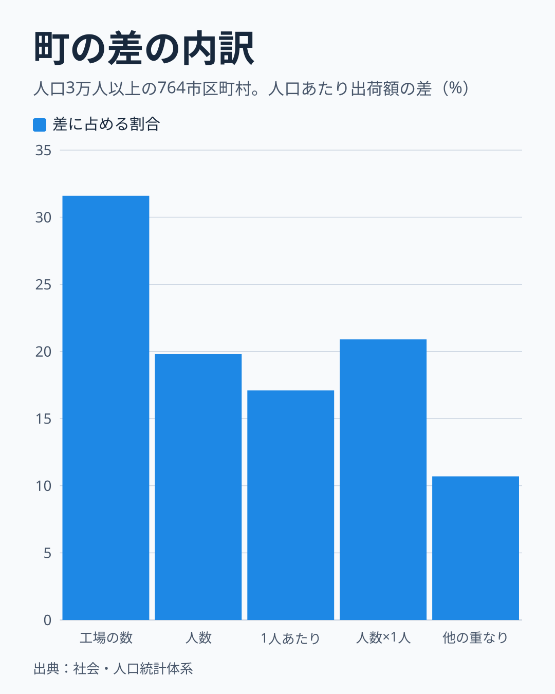
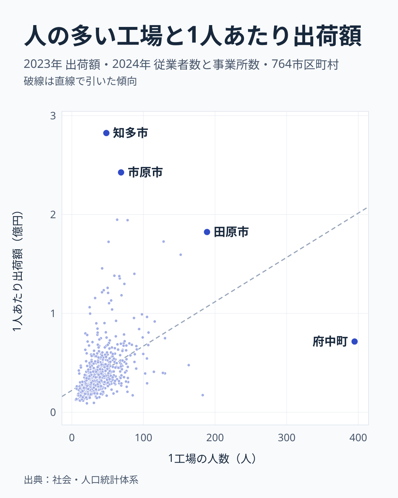
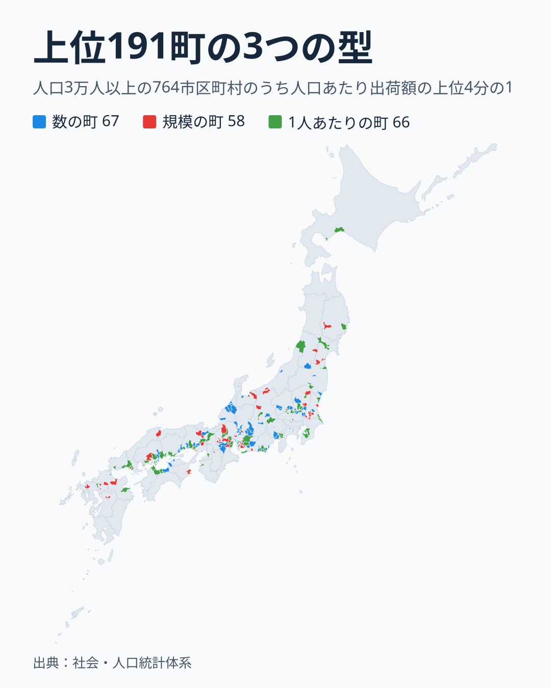

「ものづくりの町」と聞くと、小さな工場がたくさん並ぶ風景を思い浮かべる人もいれば、広い敷地の大きな工場を思い浮かべる人もいるでしょう。製造業が強い町の強さは、工場の数でしょうか。それとも工場の規模や、働く人1人あたりの生産性でしょうか。

この記事では、人口1人あたりの製造品出荷額が大きい町を「製造業が強い町」と呼びます。人口あたり出荷額は、次の3つを掛けた値です。

- 工場の数: 人口1万人あたりの製造業の事業所数
- 規模: 1工場あたりの従業者数 (1工場の人数)
- 1人あたり出荷額: 従業者1人あたりの製造品出荷額

生産性そのものの統計は市区町村の表に無いので、代わりの目安として1人あたり出荷額を使います。

答えはこうです。町の差の約3割は工場の数の違いに当たります。規模と1人あたり出荷額は、単独ではどちらも2割弱とほぼ同じ大きさで、さらに約2割は2つが重なって切り分けられません。「規模か生産性か」のどちらかとは言えず、2つは一緒に動いています。人口3万人以上の764市区町村で確かめました。

## 町の差の3割は工場の数、規模と1人あたりは重なる

764市区町村の人口あたり出荷額の差を分けると、工場の数が単独で31.6%、規模が19.8%、1人あたり出荷額が17.1%でした。残りは要素どうしの重なりで、規模と1人あたり出荷額の重なりが20.9%、工場の数と他の2つの重なりが10.7%です。町ごとの差は桁が大きく開くので、対数をとって全体のばらつきを分けました。掛け算の式から決まる計算上の割合で、原因を示すものではありません。

図の「人数×1人」が、規模と1人あたり出荷額の重なりです。この21%をどちらのものと決める方法はありません。人口の線引きを変えても形はほぼ同じで、人口1万人以上の1,209町では28.5%、21.6%、17.9%、重なり21.3%、人口10万人以上の283町では31.7%、19.8%、14.6%、重なり18.9%でした。

## 上位の町の差は、どれか1つに偏らない

町を人口あたり出荷額で4つに分けて、3つの要素を比べます。

人口あたり出荷額で並べているので、上位の町の要素が高いのは当然です。読むところは、どの要素がどれだけ高いかです。下位4分の1の町を1とすると、上位4分の1の町は工場の数が2.74倍、規模が2.42倍、1人あたり出荷額が2.22倍でした。差はどれも2倍台で、1つの要素に偏っていません。

中央値で見ると、下位の町は人口1万人あたり9.7所、1工場21.5人、1人あたり0.23億円です。上位の町は26.6所、52人、0.51億円でした。

## 規模の大きい町は、1人あたり出荷額も高い傾向がある

3つの要素の関係を対数の相関で見ると、工場の数は他の2つとほとんど関係がありませんでした。規模との相関は0.10、1人あたり出荷額との相関は0.12です。一方、規模と1人あたり出荷額の相関は0.57でした。先ほどの重なりは、この関係から来ています。

図は値をそのまま描いていて、破線は直線で引いた傾向です。値のままの相関は0.43で、対数の0.57より低く出ます。多くの町は左下に集まり、規模の小さい町ほど1人あたり出荷額も低い位置にあります。

傾向から離れた町もあります。広島県府中町は1工場395人と764町で最も多く、1人あたり出荷額は0.71億円です。愛知県知多市は1工場48人で、1人あたり出荷額は2.82億円と764町で最も高い値でした。千葉県市原市 (69人、2.43億円) と愛知県田原市 (189人、1.82億円) は、規模のわりに1人あたり出荷額が高い町です。傾向はありますが、規模だけで1人あたり出荷額は決まりません。

## 強い町には3つの型があり、地域で比率が違う

3つの要素を、全764町の中央値 (人口1万人あたり19.2所、1工場34.4人、1人あたり0.33億円) の何倍かで比べました。倍率が最も高い要素を、その町の型と呼びます。上位4分の1の191町では、数の町が67、規模の町が58、1人あたりの町が66でした。

この比率は上位の町だけの特徴ではありません。全764町でも数の町が301、規模の町が221、1人あたりの町が242で、全体の比率と大きく変わりません。どの型からも強い町が出ています。

地図の色には地域の差があります。中部の58町は数の町が29で半分を占めます。中国・四国の25町は1人あたりの町が13で、九州・沖縄の11町には数の町がありません。町数が少ない地方もあるので、傾向として見てください。

倍率の差がはっきりした町の例は次のとおりです。

- 数の町: 東京都瑞穂町は人口1万人あたり85.6所、1工場25人、1人あたり1.06億円
- 数の町: 愛知県碧南市は46.8所、48人、0.56億円
- 規模の町: 広島県府中町は6.6所、395人、0.71億円
- 規模の町: 栃木県上三川町は21.4所、130人、0.75億円
- 1人あたりの町: 千葉県袖ケ浦市は16.9所、63人、1.95億円
- 1人あたりの町: 茨城県神栖市は22.1所、67人、1.35億円

型は3つの中で最も高い要素に名前を付けただけで、他の2つが低いという意味ではありません。

## この分解で言えないこと

この分解は、掛け算の式を分けただけです。なぜその町の工場が多いのか、大きいのかまでは言えません。規模が大きいから1人あたり出荷額が高いのか、1人あたり出荷額が高い業種が大きな工場を持つのかも、この表では分かりません。

1人あたり出荷額は、生産性そのものではありません。出荷額は原料費を含むので、原料を多く使う業種の町は大きく出ます。効率を比べるなら付加価値を見る必要がありますが、この表には付加価値も業種の内訳もありません。

強い町どうしの差を同じ方法で分けることはしていません。結果の大きい町だけを選ぶと、3つの要素が互いに打ち消し合う形になり、割合として読めないためです。

人口3万人未満の905町はこの比較に入れていません。香川県直島町や山口県和木町のように人口あたり出荷額が非常に大きい町もありますが、少数の工場で値が決まるので、同じ物差しでは比べにくいためです。

町の人にとっての働き口の多さも、この表からは分かりません。出荷額や従業者数は工場のある町で数えるので、働く人が別の町に住んでいることもあります。

## データについて

出典は総務省統計局の社会・人口統計体系です。出荷額は2023年の製造品出荷額等、従業者数と事業所数は2024年の値です。人口は2020年の昼間人口を昼夜間人口比率で割って求めた常住人口です。年が異なるので、細かい差は読みすぎないでください。

指標の説明では、出荷額は従業者4人以上の事業所の値です。事業所数と従業者数が同じ範囲かは、公式の定義では確認できていません。値がそろう全国の町には1工場の平均が4人未満の小さな村が11あるので、より小さい事業所も含むとみられます。その場合、小さな工場が多い町ほど、規模と1人あたり出荷額は低めに出ます。

値がそろう1,669市区町村のうち、人口3万人以上の764を対象にしました。

## まとめ

製造業が強い町の差は、約3割が工場の数の違いに当たります。規模と1人あたり出荷額は単独ではどちらも2割弱で、約2割は重なって切り分けられません。工場の数は他の2つとほぼ無関係で、規模と1人あたり出荷額は一緒に動きます。「規模か生産性か」のどちらかではなく、規模と1人あたり出荷額は組になって、工場の数とは別に動いています。

自分の町の値は、[出荷額](/municipalities/ranking/manufacturing-shipment-amount)、[事業所数](/municipalities/ranking/manufacturing-establishments)、[従業者数](/municipalities/ranking/manufacturing-employees)の市区町村ランキングで確かめられます。出荷額を従業者数で割り、従業者数を事業所数で割ると、自分の町がどの要素で強いかが見えてきます。

資料づくりなどで長い期間の推移を使う場合は、最新の市区町村の境域にそろえた1980〜2023年の[CSVとGeoJSONのデータ](https://note.com/stats47/n/n5d86476e9c73)も用意しています。
