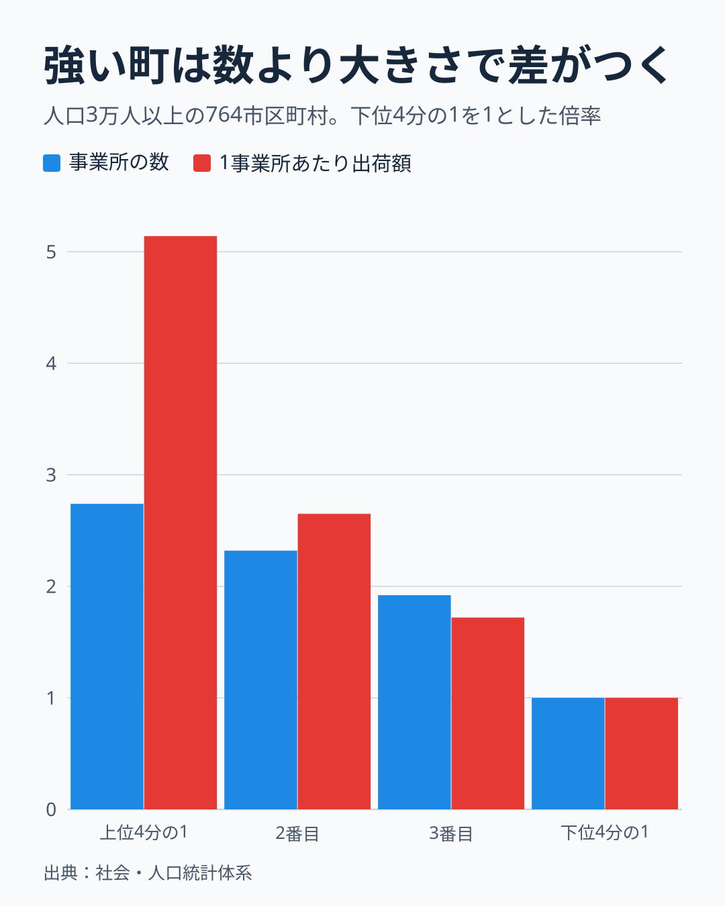
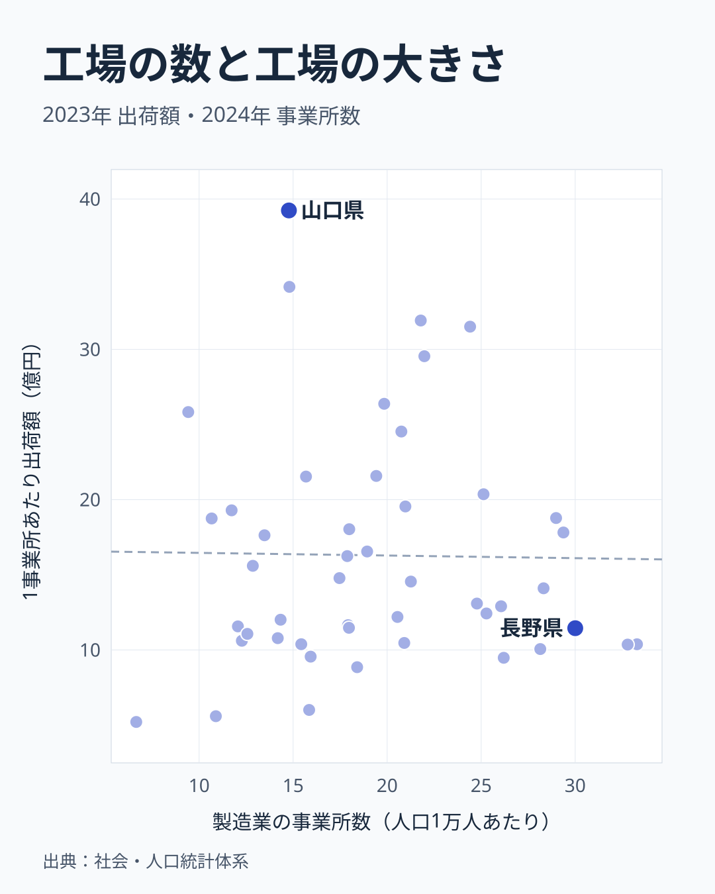

「ものづくりの町」と聞くと、小さな工場がたくさん並ぶ風景を思い浮かべる人もいれば、広い敷地の大きな工場を思い浮かべる人もいるでしょう。製造業が強い町の強さは、工場の数と工場の大きさのどちらから来ているのでしょうか。

この記事では、人口1人あたりの製造品出荷額が大きい町を「製造業が強い町」と呼びます。人口あたり出荷額は、人口あたりの事業所数と1事業所あたり出荷額を掛けた値です。人口3万人以上の764市区町村について、町の間の差がどちらの要素に沿っているかを確かめました。「工場の大きさ」は1事業所あたり出荷額で測ります。敷地の広さではありませんが、対数で見ると1事業所あたり出荷額と1事業所あたり従業者数の相関は0.89で、同じ向きに動きます。

答えは「主に工場の大きさだが、数で強い町もはっきりある」です。全体の傾向、県で見た関係、町の例の順に見ていきます。

## 差の6割は1つの工場の大きさで説明できる

764市区町村の人口あたり出荷額の差を分けると、63.1%は1事業所あたり出荷額、36.9%は事業所の数で説明できました。町ごとの差は桁が大きく開くので、対数をとり、全体のばらつきを2つの要素へ割り振っています。これは掛け算の式から決まる計算上の割合で、原因を示すものではありません。

町を人口あたり出荷額で4つに分けて並べると、違いが目で見えます。

下位4分の1の町を1とすると、上位4分の1の町の事業所の数は2.74倍、1事業所あたり出荷額は5.14倍です。中央値で見ると、下位の町は人口1万人あたり9.7所で1事業所あたり5.2億円、上位の町は26.6所で26.5億円でした。

もし強い町が工場の多い町なら、青い棒のほうが高くなるはずです。上位の区分では逆で、赤い棒が2倍近く高くなりました。ただし青い棒も2.74倍まで伸びているので、数が関係ないわけではありません。3番目の区分では、事業所の数の倍率が1.92、1事業所あたり出荷額の倍率が1.72で、青い棒のほうが高くなっています。

## 県で見ると、工場の数と大きさはほぼ無関係

市区町村の表を県へ足し上げて、2つの要素の関係を見ました。

横軸が人口1万人あたりの事業所数、縦軸が1事業所あたり出荷額です。この図は値のそろう1,684市区町村を県ごとに足し上げたもので、人口3万人以上の764市区町村の表とは範囲が違います。2つの相関は-0.01で、ほぼ無関係でした。工場が多い県ほど1つの工場が小さい、あるいは大きいという関係は見えません。

人口1万人あたりの事業所が多いのは福井県の33.3所、岐阜県の32.8所、長野県の30.0所です。1事業所あたり出荷額が大きいのは山口県の39.2億円、大分県の34.2億円、三重県の31.9億円です。上位の顔ぶれは重なりません。数で強い県と、大きさで強い県は別々にあります。

<source-link href="/municipalities/ranking/manufacturing-shipment-amount">製造品出荷額の市区町村ランキングをもっと見る</source-link>

## 町で見ると、2つの型がはっきり分かれる

市区町村まで降りると、違いはさらに大きくなります。人口あたり出荷額が高い町の中でも、1事業所あたり出荷額が大きい町と、事業所の数が多い町があります。

- 福岡県 苅田町: 人口1人あたり出荷額は6,552万円、人口1万人あたり事業所は27.1所、1事業所あたり出荷額は242.1億円
- 愛知県 豊田市: 人口1人あたり出荷額は4,862万円、人口1万人あたり事業所は22.0所、1事業所あたり出荷額は221.2億円
- 愛知県 田原市: 人口1人あたり出荷額は4,348万円、人口1万人あたり事業所は12.6所、1事業所あたり出荷額は344.1億円
- 新潟県 燕市: 人口1人あたり出荷額は656万円、人口1万人あたり事業所は104.0所、1事業所あたり出荷額は6.3億円
- 岐阜県 関市: 人口1人あたり出荷額は530万円、人口1万人あたり事業所は71.3所、1事業所あたり出荷額は7.4億円
- 長野県 岡谷市: 人口1人あたり出荷額は380万円、人口1万人あたり事業所は77.2所、1事業所あたり出荷額は4.9億円

田原市は事業所が人口1万人あたり12.6所と少なくても、1事業所あたり344.1億円で、人口1人あたり出荷額は4,348万円です。燕市は事業所が104.0所と田原市の8倍以上ありますが、1事業所あたりは6.3億円で、人口1人あたり出荷額は656万円です。

上の3つは、1事業所あたり出荷額が200億円を超える町です。下の3つは、事業所が多く、1事業所あたりの出荷額が小さい町です。1事業所あたりの従業者数も、田原市は189人、燕市は20人で大きく違います。同じ「製造業の町」でも、中身は別物だと分かります。

## この分解で言えないこと

この分解は、掛け算の式を2つに分けただけです。なぜその町の工場が大きいのかまでは言えません。立地の条件や企業の判断は、この表には入っていません。対数で見ると町の間の2つの要素の相関は0.12で、完全に独立ではないので、割合は目安として読んでください。

出荷額が大きいことは、儲かっていることと同じではありません。出荷額は原料費を含むので、効率を比べるなら付加価値を見る必要があります。原料を多く使う業種の町は、出荷額が大きく出ます。

町の人にとっての働き口の多さも、この表からは分かりません。事業所の数や出荷額は工場のある町で数えるので、働く人が別の町に住んでいることもあります。

## データについて

出典は総務省統計局の社会・人口統計体系です。出荷額は2023年の製造品出荷額等、事業所数は2024年の製造業の事業所数です。人口は2020年の昼間人口を昼夜間人口比率で割って求めた常住人口です。年が異なるので、細かい差は読みすぎないでください。事業所の集計範囲が出荷額と同じかは確かめていません。

人口3万人以上の市区町村を比べています。値がそろう1,684市区町村のうち、人口3万人以上の764を対象にしました。値の無い57自治体は表に含まれません。町の分解は県の足し上げとは別に、市区町村の値で計算しています。

## まとめ

製造業が強い町の差は、主に1つの工場の大きさで説明できました。人口あたり出荷額の差の63.1%は1事業所あたり出荷額、36.9%は事業所の数です。県で見ると2つの要素はほぼ無関係で、数で強い県と大きさで強い県は別々にあります。

自分の町の値は、[出荷額の市区町村ランキング](/municipalities/ranking/manufacturing-shipment-amount)と[事業所数の市区町村ランキング](/municipalities/ranking/manufacturing-establishments)で確かめられます。この記事の6つの例では、1事業所あたり出荷額が200億円を超える町は大きさの型、10億円に届かない町は数の型でした。あわせて[製造業の1人あたり出荷額の県別の比較](/blog/manufacturing-productivity)も読むと、県の産業の違いが見えてきます。

資料づくりなどで長い期間の推移を使う場合は、最新の市区町村の境域にそろえた1980〜2023年の[CSVとGeoJSONのデータ](https://note.com/stats47/n/n5d86476e9c73)も用意しています。
