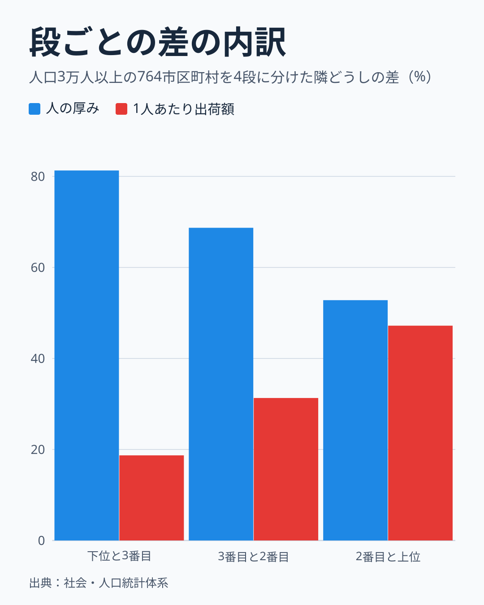
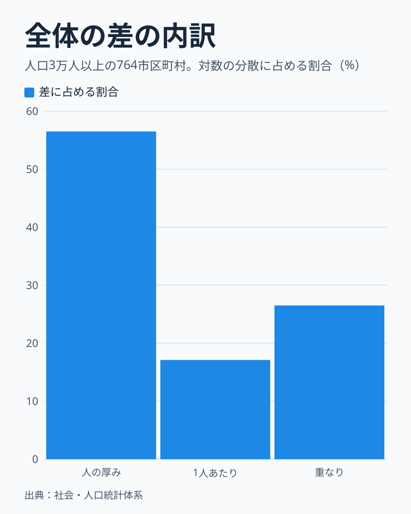
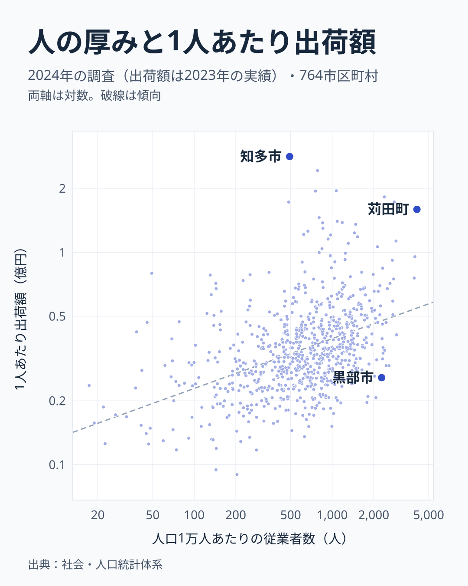

「ものづくりの町」と聞くと、工場で働く人が大勢いる町を思い浮かべる人もいれば、高い技術で大きな金額を生む工場を思い浮かべる人もいるでしょう。製造業が強い町の強さは、規模でしょうか。それとも生産性でしょうか。

この記事では、人口1人あたりの製造品出荷額が大きい町を「製造業が強い町」と呼びます。人口あたり出荷額は、次の2つでできています。

- 人の厚み: 人口1万人あたりの製造業の従業者数。町の人口に対する製造業の規模です
- 1人あたり出荷額: 従業者1人あたりの製造品出荷額。生産性そのものの統計は市区町村の表に無いので、代わりの目安として使います

答えはこうです。どの差を見るかで変わります。人口3万人以上の764市区町村を人口あたり出荷額で4段に分けると、一番下の段と次の段の差は約8割が規模にあたる人の厚みでした。一番上の段と次の段の差は、人の厚みと1人あたり出荷額がほぼ半々です。

## 下の段では8割が人の厚み、上の段ではほぼ半々

764町を人口あたり出荷額の順に4等分し、隣の段との差を2つの要素に分けました。差は対数の平均で測っているので、2つの割合を足すと段の差全体に一致します。

下位4分の1と3番目の段の差は3.6倍で、人の厚みが81.3%、1人あたり出荷額が18.7%です。2番目と上位の段の差は2.5倍で、人の厚みが52.8%、1人あたり出荷額が47.2%でした。

段ごとの中央値は次のとおりです。

- 上位4分の1: 人口1万人あたり1,376人、1人あたり0.51億円
- 2番目: 862人、0.35億円
- 3番目: 551人、0.29億円
- 下位4分の1: 217人、0.23億円

人の厚みは下位と上位で6倍以上違いますが、1人あたり出荷額の違いは2倍あまりです。

人口の下限や東京23区の扱いを変えても、両端の形は変わりません。上位の段の差に占める人の厚みは、人口1万人以上の1,209町で56%、人口10万人以上の283町で51%、東京23区を除いた741町で53%でした。町を選び直して計算し直した95%の幅は、下位の段が76〜86%、上位の段が46〜61%です。上位の段の幅は50%をまたぐので、どちらが大きいとは言えません。3番目と2番目の差は同じ比較で66%から80%まで動くので、中の段の数字は細かく読まないでください。

## 上の段の割合は端の町で動く

上位の段の半々という形は、端にある町の影響も受けています。上位191町から1人あたり出荷額の高い順に1割を除くと、この段の差に占める1人あたり出荷額は47%から39%に、2割を除くと32%に下がります。

同じことを人の厚みでも試しました。人の厚みの高い順に1割を除くと53%から49%に、2割を除くと45%に下がります。上位の段の「ほぼ半々」は、端の町をどう扱うかで動く値です。

段を細かくして上の端だけを見ると、順番が入れ替わって見えます。5段に分けた最上段の差では、1人あたり出荷額が55%でした。この値の誤差の幅は計算していません。

## 全体でも人の厚みが最も大きい

764町全体の差を対数の分散で分けても、同じ向きです。

人の厚みが単独で56.5%、1人あたり出荷額が17.1%で、残りの26.5%は2つの重なりです。重なりは、人の厚みも1人あたり出荷額も高い町が多いために生じる分で、どちらのものとも決められません。掛け算の式から決まる計算上の割合で、原因を示すものではありません。

## 2つとも高い町と、片方だけ高い町

2つの要素の関係を点で見ます。

図は両方の軸を対数で描いています。人の厚みが大きい町ほど1人あたり出荷額も高い傾向があり、対数の相関は0.43でした。ただ、点は大きく散らばっていて、人の厚みだけで1人あたり出荷額は決まりません。

人口あたり出荷額の上位20町のうち18町は、2つの要素がどちらも764町の上位4分の1に入ります。最も大きい福岡県苅田町は人口1万人あたり4,113人、1人あたり1.59億円で、それに次ぐ愛知県豊田市は2,816人、1.73億円でした。

片方だけが高い町もあります。図の右下にある富山県黒部市は2,281人と人の厚みが大きく、1人あたりは0.26億円で全764町の中央値の0.33億円を下回ります。図の上端にある愛知県知多市は1人あたり2.82億円と764町で最も高い一方、人の厚みは491人で、中央値の690人を下回ります。

## 工場の数か、1工場の人数か

人の厚みは、[事業所数](/municipalities/ranking/manufacturing-establishments)から求める工場の数と、1工場の人数に分けられます。下位と3番目の差では工場の数が49%、1工場の人数が33%で、2番目と上位の差では17%、35%でした。下の段では工場の数の割合が高く、上の段では低いという形です。

ただ、この配分は目安にとどめてください。元の調査は売上高の総額の9割に達する範囲の事業所を対象にしているので、小さな工場の一部が数えられていない可能性があります。その場合、工場の数は少なめに、1工場の人数は多めに出ます。従業者数も同じ範囲で数えられていれば人の厚みも少なめに出ますが、範囲が同じかは確認できていません。

## この分解で言えないこと

この分解は、掛け算の式を分けただけです。なぜその町に工場で働く人が多いのかまでは言えません。規模が大きいから1人あたり出荷額が高いのか、1人あたり出荷額が高い業種が多くの人を雇うのかも、この表では分かりません。

町は出荷額の順に並べているので、段の間で2つの要素が上がるのは当然です。読むところは、どちらの割合が大きいかです。また、1人あたり出荷額の割合が上の段ほど大きくなるのは、値の分布の偏りでも生じます。上位の町で強さの質が変わるとまでは言えません。

1人あたり出荷額は、生産性そのものではありません。出荷額は原料費を含み、消費税や揮発油税などの税も含みます。原料や税の大きい業種の町は大きく出ます。効率を比べるなら付加価値を見る必要がありますが、この表には付加価値も利益も業種の内訳もありません。

人口3万人未満の905町はこの比較に入れていません。香川県直島町や山口県和木町のように人口あたり出荷額が非常に大きい町もありますが、少数の工場で値が決まるので、同じ物差しでは比べにくいためです。結論を、正値を持つ全1,669市区町村へそのまま広げることはできません。

町の人にとっての働き口の多さも、この表からは分かりません。出荷額や従業者数は工場のある町で数えるので、働く人が別の町に住んでいることもあります。分母を昼間人口に替えると (対象は昼間人口3万人以上の737町)、上位の段の差は人の厚みが52%、1人あたり出荷額が48%で、形は変わりませんでした。

## データについて

出典は総務省統計局の社会・人口統計体系です。元の調査は2024年の経済構造実態調査とみられます。全町を足した事業所数と従業者数が、同調査の全国の値とほぼ一致するためです (222,080所に対して222,200所、773.2万人に対して773.4万人)。この調査では、事業所数と従業者数は2024年6月1日時点、出荷額は2023年の1年間の実績です。この間に工場が新設や閉鎖された町では、1人あたり出荷額が動きます。人口は2020年の昼間人口を昼夜間人口比率で割って求めた常住人口です。

指標の説明では、出荷額は従業者4人以上の事業所の値です。事業所数と従業者数が同じ範囲かは確認できていません。

値がそろう1,669市区町村のうち、人口3万人以上の764を対象にしました。95%の幅は、町を復元抽出して2,000回計算した範囲です。

## まとめ

製造業が強い町の強さは、「規模か生産性か」のどちらか一方では説明できません。人口3万人以上の764市区町村を4段に分けると、一番下の段と次の段の差は約8割が規模にあたる人の厚みで、一番上の段と次の段の差はほぼ半々でした。最上位に並ぶ町の多くは、2つとも高い町です。

自分の町の値は、[出荷額](/municipalities/ranking/manufacturing-shipment-amount)と[従業者数](/municipalities/ranking/manufacturing-employees)の市区町村ランキングで確かめられます。出荷額を従業者数で割り、従業者数を人口で割ると、自分の町がどちらの要素で強いかが見えてきます。764町の中央値は、人の厚みが690人、1人あたり出荷額が0.33億円です。県単位の比較は[製造業の1人あたり出荷額の県別の比較](/blog/manufacturing-productivity)にまとめています。

資料づくりなどで長い期間の推移を使う場合は、最新の市区町村の境域にそろえた1980〜2023年の[CSVとGeoJSONのデータ](https://note.com/stats47/n/n5d86476e9c73)も用意しています。
