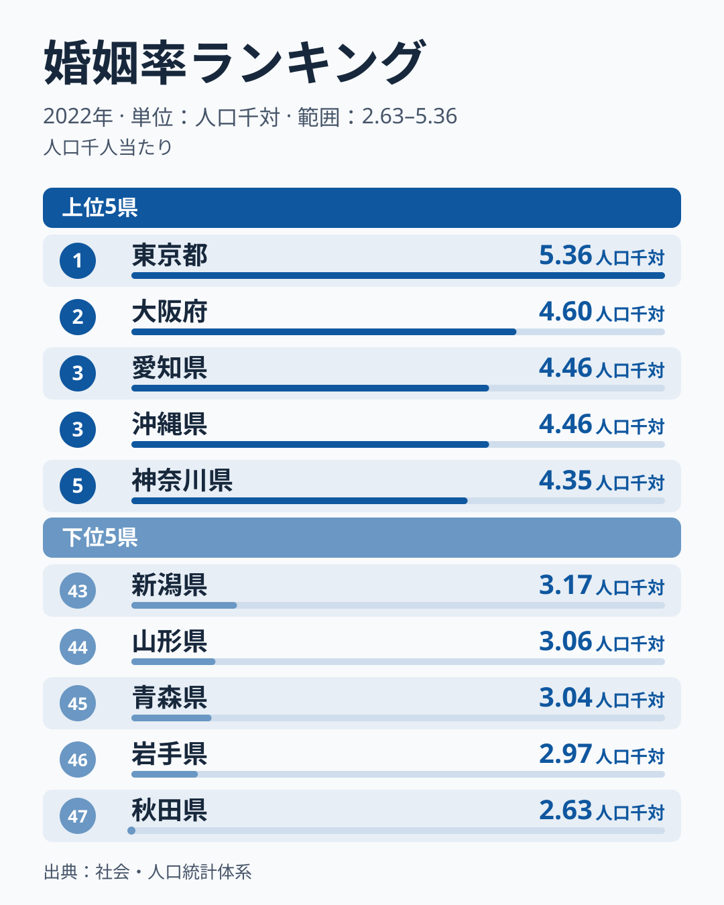
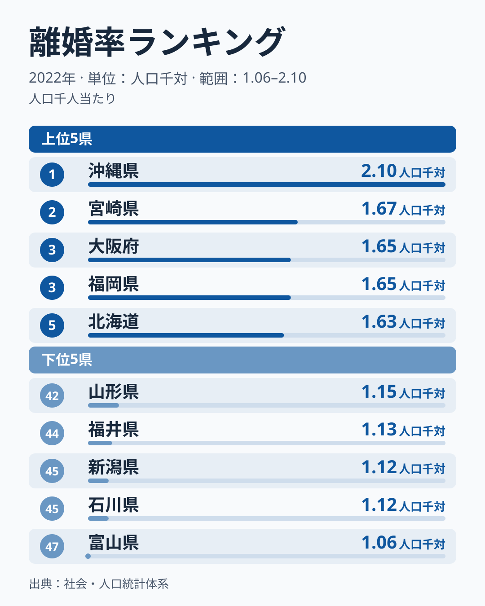
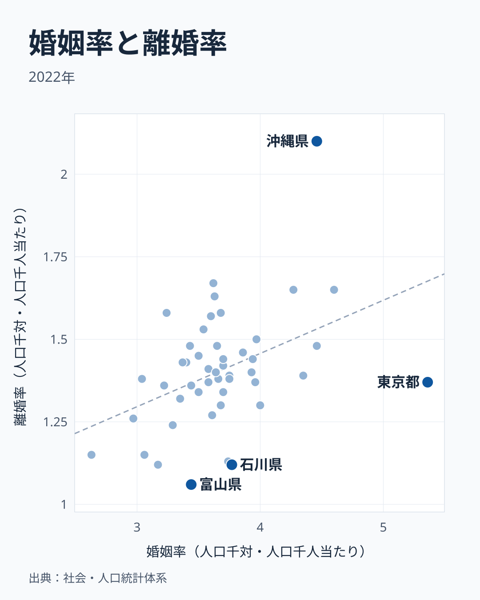
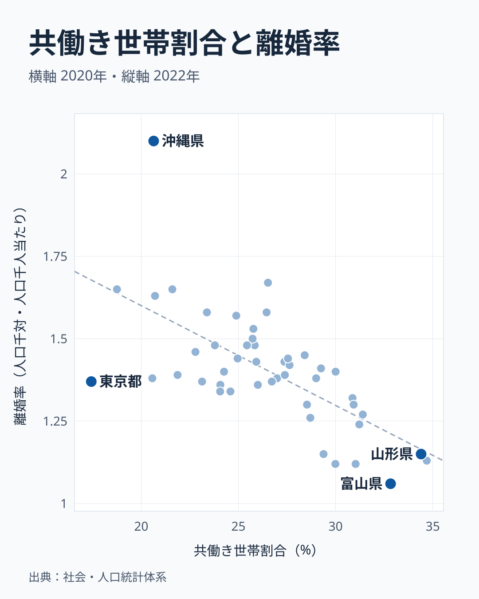

「結婚が多い県は、離婚も多いのか」。47都道府県の[婚姻率](/ranking/marriages-per-total-population)と[離婚率](/ranking/divorces-per-total-population)を2022年の数字で並べると、答えは「緩やかにそうなる」でした。相関係数は0.42で、結婚が多い県ほど離婚も多い傾向があります。

ただし、その線から大きく外れる県があります。東京都は婚姻率が5.36で全国1位なのに、離婚率は1.37で29位です。沖縄県は婚姻率が4.46で3位、離婚率は2.10で1位と、婚姻率から見込まれる水準を大きく上回ります。

この記事では全体の傾向と例外を分けて読みます。さらに、離婚率と0.42より強く連動した指標として、共働き世帯割合を取り上げます。

> [!NOTE]
> 婚姻率・離婚率は人口千人当たりの件数で、数字は2022年です。分母は人口全体なので、結婚する世代の人口が多い県ほど高く出やすい指標です。年齢構成をそろえた比較ではない点に注意してください。

## 婚姻率ランキング──上位に大都市圏が並ぶ

婚姻率が最も高いのは東京都の5.36です。2位は大阪府の4.60で、愛知県と沖縄県が4.46で同率3位、神奈川県は4.35で5位と続きます。6位の福岡県は4.27、7位の滋賀県は4.00です。上位には大都市圏の都府県が多く、そこに沖縄県が加わる形です。

最も低いのは秋田県の2.63で、東京都のおよそ半分です。岩手県は2.97で46位、青森県は3.04で45位、山形県は3.06で44位と、東北の県が下位に並びます。47都道府県の単純平均は3.68です。

この順位を「結婚への意欲」の差として読むことはできません。婚姻率は人口全体に対する件数なので、高齢者の割合が高い県では、結婚する人の割合が同じでも低く出ます。順位が示すのは、その県で1年間に届け出られた婚姻の多さです。

<source-link href="/ranking/marriages-per-total-population">47都道府県の婚姻率ランキングをもっと見る</source-link>

## 離婚率ランキング──沖縄が突出し、北陸が低い

離婚率が最も高いのは沖縄県の2.10で、2位の宮崎県の1.67を0.43上回ります。大阪府と福岡県が1.65で同率3位、北海道が1.63で5位です。上位5道府県のうち4つが関西以西の府県です。

最も低いのは富山県の1.06です。石川県と新潟県が1.12で同率45位、福井県が1.13で44位と、新潟県と北陸3県が下位を占めます。秋田県と山形県も1.15で同率42位です。47都道府県の単純平均は1.40で、東京都の1.37はこの平均に近い値です。

新潟県と北陸3県は離婚率がそろって低い一方で、婚姻率はそろっていません。石川県は3.77で13位、福井県は3.74で16位と平均を上回り、富山県は3.44で34位、新潟県は3.17で43位です。「北陸は結婚も離婚も少ない」と一括りにはできません。

<source-link href="/ranking/divorces-per-total-population">47都道府県の離婚率ランキングをもっと見る</source-link>

## 婚姻率と離婚率を重ねる──全体は連動、東京と沖縄が外れる

47都道府県で婚姻率と離婚率の相関を計算すると、相関係数は0.42です。右上がりの緩やかな傾向があり、順位どうしで計算しても0.34と同じ向きになります。

この線から最も大きく外れるのが沖縄県です。婚姻率から見込まれる値より離婚率が約0.57高くなっています。反対に東京都と富山県は、見込みより約0.31低い位置にあります。石川県と福井県も同じ側で、約0.3低く出ています。

外れ値が全体の数字をどれだけ動かすかも確かめました。東京都を除くと相関係数は0.52に上がり、沖縄県を除くと0.35に下がります。つまり東京都は傾向を弱め、沖縄県は傾向を強める側にあります。どちらを除いても正の関係は残るので、連動そのものは2つの都県だけが作ったものではありません。

婚姻が多い県で離婚も多いことには、数字の作りからくる説明もあります。どちらも人口全体が分母なので、若い世代の人口が厚い県では両方が高く出ている可能性があります。この記事のデータではこの影響を取り除いていないため、相関の0.42を「結婚が多いと離婚が増える」という因果として読むことはできません。

> [!WARNING]
> 2022年に離婚した夫婦の多くは、それより前に結婚した人たちです。同じ年の婚姻と離婚を県ごとに比べているだけで、同じ夫婦を追跡した数字ではありません。

## 離婚率と強く連動したのは共働き世帯割合

離婚率と連動する指標を探すと、2020年の[共働き世帯割合](/ranking/dual-income-household-ratio)との相関係数はマイナス0.66でした。婚姻率との0.42より強く、共働き世帯の割合が高い県ほど離婚率が低い傾向です。

福井県は34.69%で1位、山形県は34.4%で2位、富山県は32.83%で3位です。この3県は離婚率でも44位、42位、47位と下位にあります。新潟県も6位、石川県も10位で、離婚率の低い新潟県と北陸3県はいずれも共働き世帯割合が上位に入ります。

一方で、この関係にも東京都は当てはまりません。共働き世帯割合は17.43%で47位なのに、離婚率は29位の中位です。大阪府は18.75%で46位、離婚率は3位で、沖縄県は20.64%で44位、離婚率は1位なので、この2府県は傾向どおりです。東京都は婚姻率との関係でも、共働きとの関係でも、離婚率が見込みより低い位置に来ます。

これも因果を示す数字ではありません。共働きが離婚を減らしているとも、産業や世帯の構成など別の事情が両方を動かしているとも考えられます。本記事ではそこまで検証していません。

## 初婚年齢との関係は弱いが、出生率とは強い

平均初婚年齢も確かめました。2023年の夫の平均初婚年齢が最も高いのは東京都の32.3歳で、神奈川県の31.8歳、埼玉県の31.7歳が続きます。最も低いのは島根県と宮崎県の30.0歳で、沖縄県は30.2歳です。全都道府県で夫の平均初婚年齢は30歳以上です。

「遅く結婚する県ほど離婚が少ない」と言えるかというと、数字は弱いものでした。夫の初婚年齢と離婚率の相関係数はマイナス0.20で、妻の初婚年齢では0.08とほぼ関係が見えません。同じ30.0歳でも、宮崎県の離婚率は2位、島根県は下位と分かれます。

あわせて見る: [平均初婚年齢（夫）ランキング](/ranking/average-age-of-first-marriage-husband) / [平均初婚年齢（妻）ランキング](/ranking/average-age-of-first-marriage-wife)

初婚年齢が強く連動したのは離婚率ではなく出生率です。夫の初婚年齢と2023年の[合計特殊出生率](/ranking/total-fertility-rate)の相関係数はマイナス0.74でした。東京都の出生率は0.99で47位、神奈川県は1.13で42位です。沖縄県は1.60で1位、宮崎県は1.49で2位です。初婚年齢が高い県は大都市圏に偏るので、都市の暮らしなど別の事情が両方に関わっている可能性があり、これも因果を示す数字ではありません。

婚姻率と出生率の相関係数はマイナス0.09で、ほとんど関係がありません。婚姻率が上位の東京都の出生率は47位、沖縄県は1位と、正反対の位置にあります。

## まとめ

- 婚姻率と離婚率の相関係数は0.42です。結婚が多い県は離婚も多い傾向があります
- 東京都は婚姻率1位で離婚率29位と線より下に外れ、沖縄県は婚姻率3位で離婚率1位と線より上に外れます
- 離婚率と強く連動したのは共働き世帯割合で、相関係数はマイナス0.66です。新潟県と北陸3県はこの傾向に沿います
- 初婚年齢と離婚率の関係は弱く、初婚年齢が強く連動するのは出生率です

どの数字も県ごとの相関で、個々の夫婦の事情を示すものではありません。結婚をめぐる背景は[婚姻率の低下が止まらない](/blog/marriage-unmarried-crisis)や[出生率0.99──東京「1割れ」の衝撃](/blog/fertility-fiscal-nexus)もあわせてお読みください。
