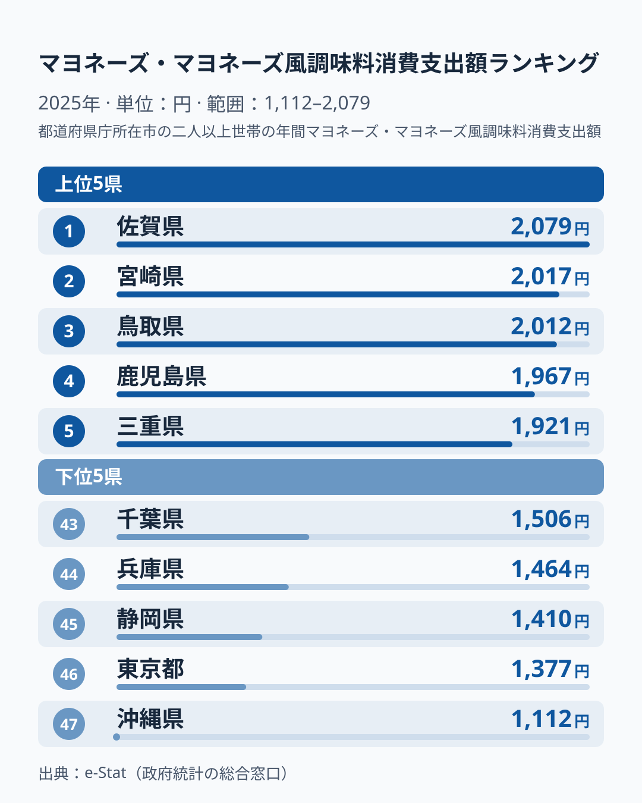

「マヨラー」という言葉があります。マヨネーズを何にでもかけずにはいられない人を指す俗語です。では「マヨラー県」となると、どこを思い浮かべるでしょうか。脂っこい料理のイメージから大阪を連想する人もいれば、外食の多そうな東京を挙げる人もいるかもしれません。

実際のデータは、直感の半分だけと合います。2025年の家計調査でマヨネーズ・マヨネーズ風調味料への支出が最も多かったのは佐賀県で、宮崎県、鳥取県、鹿児島県と続きました。東京都は46位と、外食の多そうなイメージどおり低い側です。ところが大阪府は16位で、「マヨラーの本場」の印象ほど上位ではありません。関東の7都県は、最も高い茨城県でも28位にとどまりました。

身近な調味料ひとつの支出額が、なぜこれほど地域でばらつくのでしょうか。本記事では総務省「家計調査」の数字をもとに、支出額の地域差を、同じ調査の消費量や納豆の支出と突き合わせて読み解きます。

## 全体像：九州の県が上位、関東が下半分に固まる

マヨネーズ・マヨネーズ風調味料の消費支出額がもっとも多いのは佐賀県の2,079円です。もっとも少ないのは沖縄県の1,112円で、両者の差はおよそ1.9倍にのぼります。

上位10県は、佐賀県、宮崎県、鳥取県、鹿児島県、三重県、石川県、熊本県、京都府、島根県、福井県です。地方別に見ると、九州が佐賀・宮崎・鹿児島・熊本の4県、中国が鳥取・島根の2県、中部が石川・福井の2県、近畿が三重・京都の2県という内訳になります。これに対して関東の1都6県は、茨城県が28位、神奈川県が29位、栃木県が33位、埼玉県が37位、群馬県が41位、千葉県が43位、東京都が46位と、すべて下半分に入っています。「人口が多く、食にお金をかけていそうな都市部ほどマヨネーズ支出も多い」という素朴な予想は成り立ちません。

> [!NOTE]
> 本データは総務省統計局「家計調査」（2025年）です。調査対象は各都道府県庁所在市の二人以上世帯で、年間のマヨネーズ・マヨネーズ風調味料への支出額（円）を世帯あたりで見ています。一人あたりの消費量ではなく、県全体の傾向でもない点に注意してください。

<source-link href="/ranking/mayonnaise-consumption-expenditure">マヨネーズ消費支出額ランキングの全47都道府県データを見る</source-link>

## 上位グループ：10県が狭い幅に収まる

上位の特徴は、金額の高さよりも「近さ」にあります。10位の福井県は1,844円、1位の佐賀県は2,079円で、上位10県は235円の幅に収まっています。1位と3位の鳥取県の差も67円で、上位は僅差の団子状態です。

地域で見ると、7位までに九州の4県が入っている点が目を引きます。ただし九州全体が高いわけではありません。長崎県は25位で1,745円、大分県は26位で1,736円、福岡県は35位で1,639円と、同じ九州でも順位は大きく散らばっています。東北も同様で、秋田県と山形県は同額の1,822円で並び、ランキング上は12位と13位です。宮城県は24位、福島県は31位で1,689円、青森県は36位、岩手県は38位です。「東北は高い」「九州は高い」と地方単位でまとめるより、県ごとに見るほうが実態に近いと言えます。

> [!WARNING]
> 家計調査の県別の値は、県庁所在市の限られた世帯が対象なので、単年の順位がぶれやすい指標です。同じ福島県が、2024年の同調査では首位でしたが、2025年は31位に下がりました。1位の県を「マヨラー県」と決めつけず、複数年で見る必要があります。

佐賀県の暮らしの全体像は[佐賀県のエリアページ](/areas/41000)で確認できます。

## 下位グループ：沖縄県が突出して低い

下位は上位と対照的です。43位の千葉県は1,506円、最下位の沖縄県は1,112円で、下位5県は1,112〜1,506円と、上位10県の235円幅より広く散らばっています。幅を広げているのは主に沖縄県で、46位の東京都は1,377円、45位の静岡県は1,410円、44位の兵庫県は1,464円と、43位から45位までは比較的詰まっています。沖縄県と46位の東京都との差は265円あり、下位の中でも突出して低い値です。

大都市で見ると、下位5県に入るのは東京都、兵庫県、千葉県で、愛知県も40位と下側にあります。ところが同じ大都市圏でも、大阪府は16位で1,805円、京都府は8位で1,875円と、中位から上位に位置します。都市部は一様に低いわけではなく、大阪府の16位や京都府の8位をどう説明するかが、この記事の問いになります。

単年のぶれではないかも確かめておきます。同じランキングの過去年を見ると、沖縄県は2023年、2024年、2025年とも47位です。東京都は2023年が40位、2024年が44位、2025年が46位と、毎年下位に入っています。この2県の低さは、少なくとも直近3年は続いた傾向です。

## 金額の差は、買う量の差か単価の差か

支出額の差が「買う量」によるのか「単価」によるのかは、同じ家計調査にある消費量のランキング（[マヨネーズ消費量](/ranking/mayonnaise-consumption-quantity)）と見比べると分かります。2025年の消費量は、佐賀県が3,049gで1位、宮崎県が3,029gで2位、沖縄県が1,307gで47位、東京都が1,812gで46位です。支出額の順位とほぼ重なります。消費量の差は1位と47位で約2.3倍あり、支出額の約1.9倍より大きい点に注目できます。

これは単価が差を少し縮めているためです。支出額を消費量で割った100gあたりの目安は、沖縄県が約85円、千葉県が約80円、東京都と神奈川県が約76円と高めです。一方で佐賀県は約68円、宮崎県は約67円と低めです。つまり下位の県は、少なめにしか買わない上に、少量・小容量のぶん単価が高くなっている可能性があります。

この見方は、大阪府の位置づけも説明します。大阪府の消費量は2,708gで6位と上位ですが、100gあたりでは約67円と全国でも安い部類です。量は多いのに単価が低いため、支出額では16位に下がっています。「支出額が多い県が、たくさん使っている県」とは限らないという点を、この対比がよく示しています。

## 納豆と並べると、高い県は重ならない

食品ごとに高い県が違うことは、納豆の支出と並べると具体的に分かります。納豆の支出額は、福島県が1位、茨城県が2位、岩手県が3位と、東北・北関東が上位に並びます。この福島県はマヨネーズでは31位、茨城県は28位です。反対に、マヨネーズで3位の鳥取県は納豆ランキングでは下位側にあり、マヨネーズ16位の大阪府は納豆では下から3番目です。

納豆とマヨネーズで上位の顔ぶれがほとんど重ならないことは、食卓に何を欠かさず置くかが地域ごとに違うことを示します。仮説として、納豆を朝食の定番に置く地域では、マヨネーズが使われる場面が相対的に少ないのかもしれません。ただしこれは本データだけでは確かめられず、世帯の調理頻度や食べ方を調べた別のデータが必要です。[納豆消費支出ランキング](/ranking/natto-consumption-expenditure)で、納豆側の地域差を詳しく読めます。

## まとめ

- マヨネーズ消費支出の1位は2,079円の佐賀県、最下位は1,112円の沖縄県で、その差はおよそ1.9倍です
- 上位10県は九州の4県・中国の2県・中部の2県・近畿の2県で、10県が235円の幅に収まる団子状態です
- 関東の7都県はすべて28位以下で、東京都は46位です。ただし大阪府は16位、京都府は8位で、大都市が一様に低いわけではありません
- 下位は買う量が少ないことが主因で、単価の高さが差を一部縮めています。沖縄県は2023年から3年連続で47位です
- 納豆とは高い県が重ならないため、食品ごとに地域の食卓が違うと読めます。理由までは、本データだけでは断定できません
