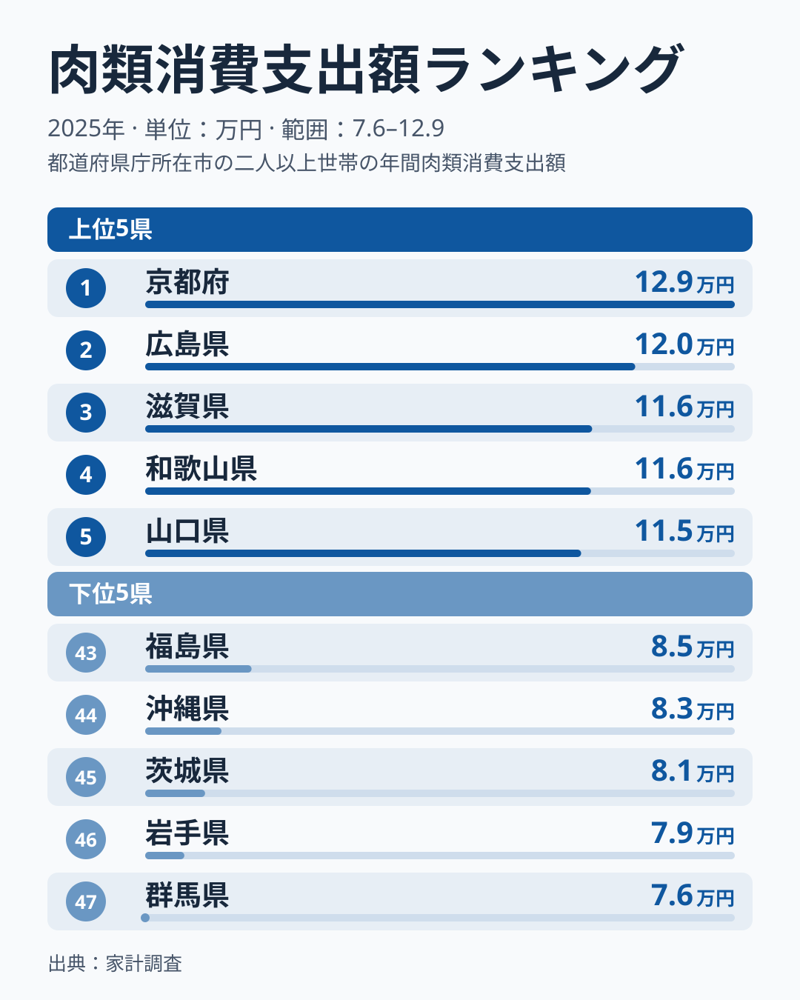
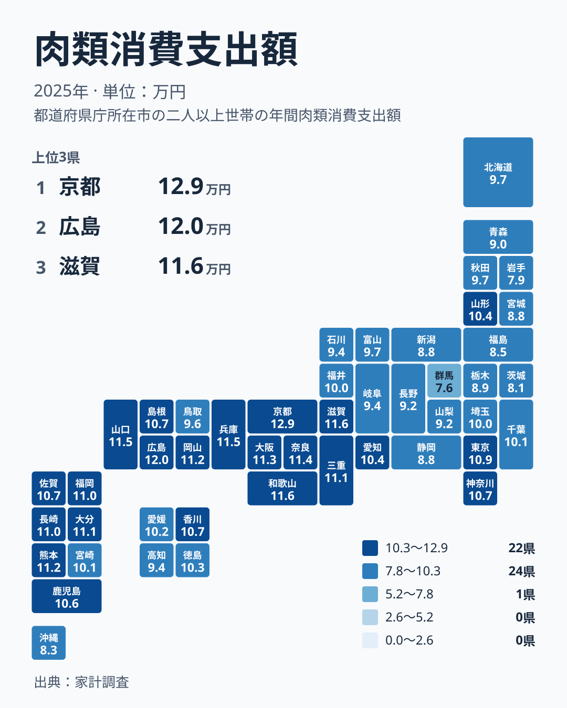

家庭の食卓に並ぶ肉は、地域によってどれほど違うのでしょうか。2025年の家計調査で、1世帯あたりの肉類への年間支出が最も多かったのは京都府でした。金額は129,246円です。一方、最も少なかったのは群馬県の75,560円でした。同じ日本の家庭でも、肉にかける金額には大きな開きがあります。

この記事では、肉類への支出の都道府県差を、食文化・産地・都市の性格という3つの視点から整理します。

## 肉類への支出は京都府が1位、群馬県が最下位

まず、上位5県と下位5県を図で確認します。

<source-link href="/ranking/meat-group-consumption-expenditure">肉類への支出ランキングをもっと見る</source-link>

上位には、1位の京都府、2位の広島県、3位の滋賀県、4位の和歌山県、5位の山口県が並びました。金額は京都府が129,246円、広島県が120,179円、滋賀県が116,258円、和歌山県が116,147円、山口県が115,255円です。3位から5位は1,000円ほどの幅に収まっており、中位グループの手前で団子状に並んでいます。いっぽう京都府と広島県の間には、それより大きな開きがあります。京都府が頭ひとつ抜けているのが特徴です。

下位には、43位の福島県、44位の沖縄県、45位の茨城県、46位の岩手県、47位の群馬県が並びました。金額は福島県が85,246円、沖縄県が82,507円、茨城県が81,014円、岩手県が79,126円、群馬県が75,560円です。上位5県が115,000円台以上であるのに対し、下位5県はすべて86,000円を下回っています。上位と下位は、金額の水準そのものが別の層にあります。

> [!NOTE]
> ここでの「肉類への支出」は、家計調査が集計する、1世帯あたりの年間の購入金額です。家庭で調理する生の肉や加工肉の購入が中心で、外食の焼肉やステーキの代金は含まれません。また、金額で見る指標なので、購入量が同じでも肉の種類や価格帯が違えば数字は変わります。

## 近畿と西日本に高い県が集まる

次に、地理的な分布を見ます。

地図で目を引くのは、近畿から中国・九州にかけての西日本に支出の多い県が連なる点です。近畿では、滋賀県が3位、和歌山県が4位、兵庫県が6位、奈良県が7位、大阪府が8位、三重県が12位に入りました。京都府を含めて、近畿の府県はすべて12位以内に収まっています。近畿は、地方単位でこれほど揃って上位に入る数少ない地域です。

中国地方も上位に厚く、広島県が2位、山口県が5位、岡山県が9位です。島根県は18位、鳥取県は32位で、同じ地方でも差があります。九州では熊本県が10位、大分県が11位、福岡県が13位、長崎県が14位と、1位から14位の範囲に4県が入りました。これに対して、鹿児島県は20位、宮崎県は26位、沖縄県は44位と、九州・沖縄の中でも幅が見られます。

この西高の構図は、肉の消費が西日本の食文化に根づいていることと整合的です。西日本では牛肉を日常的に好む傾向があるとよく語られ、すき焼きや焼肉、肉じゃがといった牛肉の料理が家庭の定番になっている地域が少なくありません。ただし、この調査は肉の種類別ではなく肉類全体の金額なので、牛肉の影響だけを取り出して断定することはできません。

> [!TIP]
> 地図は、色の濃さではなく「どの地方に固まっているか」に注目すると読みやすくなります。1県だけの突出は、調査対象の世帯の偏りも疑えます。複数の隣接県が同じ方向に並んでいれば、地域の食習慣や流通の影響である可能性が高まります。

## 京都府と広島県はなぜ高いのか

1位の京都府は、一般に「和食の街」「精進料理の街」というイメージを持たれがちです。しかし、肉類の支出では全国で最も高い値を示しました。京都市は古くから牛肉の消費が盛んな地域として知られ、すき焼きや牛肉を使った家庭料理が根づいているといわれます。観光客向けの料亭の姿と、日々の家庭の食卓は別物だと考えると納得がいきます。詳しい数値は[京都府のデータ](/areas/26000)で確認できます。

2位の広島県は、お好み焼きやカキで知られますが、肉類の支出も全国屈指です。中国地方には和牛の産地が点在し、肉を身近に買える環境があります。広島県の暮らしの数字は[広島県のデータ](/areas/34000)にまとめています。

東京都は15位で109,185円、神奈川県は16位で107,178円でした。大都市圏だから肉が多いとは限らず、いずれも上位5県には届いていません。大阪府の8位、113,068円と並べると、同じ大都市でも関西の方が肉類への支出が多いことがわかります。都市の規模よりも、地域ごとの食習慣の方が支出の差を左右しているようです。

> [!WARNING]
> 家計調査は、都道府県庁所在地と政令指定都市などの世帯を対象にした標本調査です。県全体の姿とは必ずしも一致せず、県内の郡部や島しょ部の家庭は反映されにくくなります。調査世帯の数も限られるため、順位が近い県同士の差は、年ごとの偶然のぶれの範囲にあることがあります。

## 下位に並ぶ関東・東北の県をどう読むか

下位を見ると、関東と東北の県が目立ちます。関東では、栃木県が39位の89,452円、茨城県が45位の81,014円、群馬県が47位の75,560円でした。東北では、青森県が38位、宮城県が40位、福島県が43位、岩手県が46位です。一方で、山形県は21位の104,406円、秋田県は31位の96,533円と中位以上に入っており、東北でも一様ではありません。

ここで大事なのは、支出が少ないことを、肉をあまり食べていないと直結させない点です。群馬県や茨城県、岩手県は畜産が盛んな県でもあります。産地では地元の直売所や精肉店、あるいは家庭内での入手の経路が多様で、家計調査の購入金額に表れにくい取引があるのかもしれません。支出額が低いことと、消費量が少ないことは別の話です。

また、肉の代わりに魚介類や別の食材をどれだけ買うかも関係します。日本海や太平洋に面した県では、魚を日常的に買う家庭が多く、その分だけ肉類への支出が抑えられる可能性があります。ただし、この記事で使っているデータは肉類だけです。魚介類など他の品目との対比は、品目ごとの支出ランキングを並べて見ることで確かめられます。同じ分野の指標は[同じカテゴリの統計一覧](/category/economy)から探せます。

## 地域の差を、どう生活に結びつけて見るか

肉類への支出は、価格や産地、世帯構成、食習慣が重なって決まります。東日本よりも西日本で高い傾向があること、近畿が特に集中していることは、食文化の違いが家計の数字にまで表れている例といえます。2025年のデータでは、近畿の府県はすべて12位以内に入りました。この集中度は、他の地方にはあまり見られない特徴です。

一方で、中位の県の間では、順位の差がわずかな金額の違いにすぎないこともあります。たとえば、20位の鹿児島県は106,415円、21位の山形県は104,406円です。この程度の差なら、順位が1つ違うだけで物語を作るのは慎重にすべきです。順位よりも、近畿が上位に集まり、関東北部と東北の一部が下位に沈むという大きな構図に注目する方が実り多い読み方です。

## データについて

この記事で扱った指標は、家計調査の「肉類消費支出額」です。年は2025年、単位は円で、1世帯あたりの年間の支出額を示します。順位は全47都道府県を金額の高い順に並べたものです。本文の地方のくくりは、北海道・東北、関東、中部、近畿、中国、四国、九州・沖縄の7区分に従っています。

数値は実際の支出額であり、物価や世帯人数の違いは調整されていません。価格の高い地域では、同じ量を買っても金額が大きくなります。今後は、肉の種類別の支出や、時間をさかのぼった推移もあわせて確認すると、地域差の理由がさらにはっきりします。
