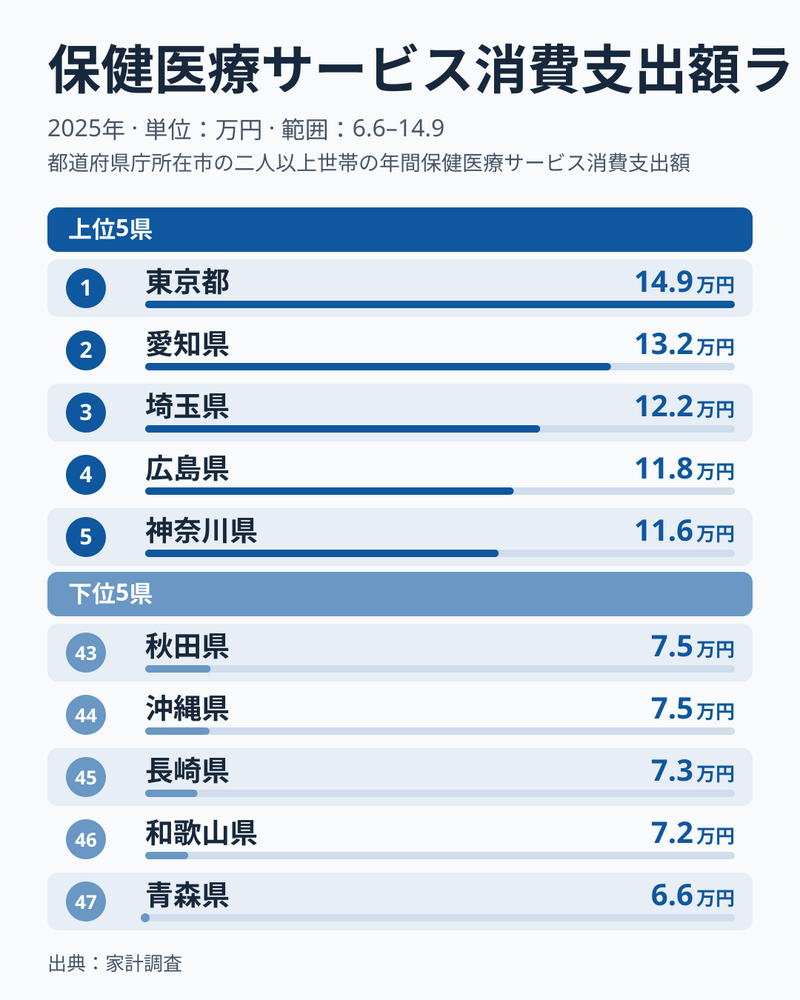
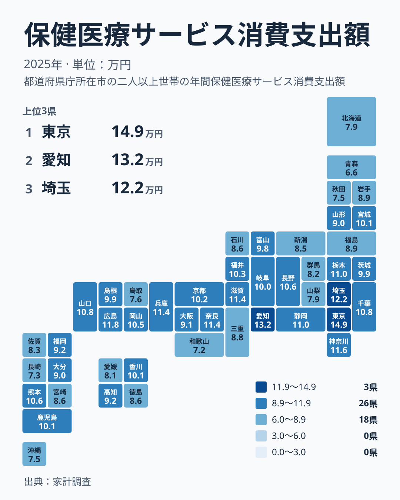

診察や歯の治療、入院にかかるお金は、誰にとっても避けにくい出費です。ところが、その金額は住んでいる場所によって大きく変わります。2025年の家計調査で、保健医療サービスへの支出を都道府県別に見ると、1位の東京都は149,138円、47位の青森県は65,972円でした。149,138円を65,972円で割ると約2.3倍です。題の問いへの答えは、東京都は青森県の約2.3倍、ということになります。

この記事では、その開きがどの県と県の間に、どんな形で現れているのかを、暮らしの側から順に確かめます。

> [!NOTE]
> ここでの保健医療サービスへの支出とは、家計調査でいう「保健医療サービス消費支出額」です。診察代、入院費、歯科の治療費など、医療機関などに支払うサービスの代金を指します。薬や健康食品、医療用品といった物品の購入費は別の区分です。つまり、風邪薬や湿布の購入額が多い県と、医療機関で支払う額が多い県は、必ずしも一致しません。

## 上位と下位の顔ぶれ

まず、上位5県と下位5県を図で確認します。

<source-link href="/ranking/medical-services-group-consumption-expenditure">保健医療サービスへの支出ランキングをもっと見る</source-link>

上位5県を順に挙げると、1位が東京都の149,138円、2位が愛知県の131,661円、3位が埼玉県の121,686円、4位が広島県の117,950円、5位が神奈川県の115,834円です。この中で目を引くのは、東京都が2位の愛知県を大きく上回っている点です。2位から5位までは緩やかに連なっており、1位だけが離れた形をしています。

顔ぶれの地方を見ると、東京都、埼玉県、神奈川県が関東、愛知県が中部、広島県が中国です。大都市圏が中心ですが、広島県のように三大都市圏の外にある県も入っています。5県のうち3県が関東に集まっている点は、上位の特徴といえます。

下位5県は、43位の秋田県が75,198円、44位の沖縄県が75,038円、45位の長崎県が73,354円、46位の和歌山県が72,047円、47位の青森県が65,972円です。上位の幅に比べて、下位は狭い範囲に固まっています。ただし、最下位の青森県だけは46位の和歌山県からさらに約6,000円下に離れています。地方で見ると、青森県と秋田県が東北、和歌山県が近畿、長崎県と沖縄県が九州・沖縄です。特定の一地方だけが低いわけではなく、離れた地域に低い県が散らばっています。

> [!TIP]
> この指標は、家計が自分で支払った分の合計を映したものです。公的医療保険から支払われる分は含まれていません。順位を見るときは、まず「自腹で払った額の順位」だと意識してください。支出が少ない県は、医療を使っていない県とは限らず、自己負担の小ささが映っている場合もあります。

## 地理分布で見ると何が見えるか

次に、47都道府県を地図状に配置したタイルマップで、分布の全体像を確認します。

地図で眺めると、色の濃い県は関東、中部、近畿、中国に点在しています。反対に、色の薄い県は東北の北部、近畿の南端、九州の西側、沖縄に見られます。大きな傾向としては、大都市圏とその周辺に支出の多い県が多く、遠い地方に少ない県が目立ちます。ただし、濃い県がひと続きの帯になっているわけではなく、間に薄い県をはさみながら散らばっています。

近畿は、その混在がもっとも分かりやすい地方です。兵庫県は114,306円で6位、滋賀県は114,120円で7位、奈良県は113,749円で8位と上位に並ぶ一方、京都府は101,839円で17位、大阪府は91,109円で27位、三重県は87,652円で32位、和歌山県は72,047円で46位です。同じ地方の中に、上位から下位までがそろっています。

都市の大きさだけでも並びは説明できません。大阪府は人口の多い都市ですが27位にとどまり、滋賀県や奈良県のほうが上です。広島県が4位なのも同じ例です。

関東も一律ではありません。栃木県は109,807円で10位、千葉県は108,019円で12位ですが、茨城県は98,801円で23位、群馬県は82,210円で38位です。地方名でひとくくりにして語るのは避けたほうがよさそうです。

## 同じ地方の中でも差が大きい

地方ごとの差は、地方間の違いよりも、地方の内部で大きく出る場合があります。東北を例にすると、宮城県は101,030円で19位、山形県は90,010円で28位、岩手県は89,170円で30位、福島県は88,986円で31位、秋田県は75,198円で43位、青森県は65,972円で47位です。上位の宮城県と最下位の青森県の間には、28位分の幅があります。

九州・沖縄でも、熊本県は105,569円で14位、鹿児島県は101,152円で18位、福岡県は92,288円で25位、大分県は89,722円で29位、長崎県は73,354円で45位と、順位が大きく散らばります。

中部も同じです。愛知県は2位、静岡県は109,973円で9位、長野県は105,983円で13位ですが、石川県は85,610円で35位、新潟県は85,385円で36位です。

四国は、香川県が100,597円で20位、高知県が92,115円で26位、徳島県が85,862円で34位、愛媛県が80,594円で39位です。順位は段階的に下がっていきますが、20位から39位まで19位分の幅があり、同じ四国でも一様ではありません。

こうして見ると、「東北は少ない」「近畿は多い」といった言い方は、実態を捉えきれません。県ごとの事情を個別に見る必要があります。

## 支出の多さは「豊かさ」か「負担」か

支出が多いことを、そのまま医療が充実している証拠と読むのは早計です。この数字は、家計が実際に支払った金額だからです。背景として次のような可能性が考えられますが、いずれも今回のデータでは確かめられません。

- 医療機関が身近にあり、受診しやすいために支出が増えている可能性
- 自己負担が生じる治療や歯科などの利用が多い可能性
- 世帯の収入に余裕があり、医療に回せるお金が大きい可能性
- 通院や治療が多く、やむを得ず支出が増えている可能性

支出が少ない県についても、理由は複数ありえます。健康で医療を使う機会が少ない場合も、自己負担の発生する場面が少ない場合も考えられます。青森県や和歌山県の少なさを、受診の状況と結びつけて語る根拠は、この指標にはありません。

> [!WARNING]
> 家計調査は、全国の限られた世帯を対象にした標本調査です。都道府県別の値は、調査された世帯の構成や年齢層の偏りで揺れやすく、2025年の1つの数字だけで県の医療事情を断定することはできません。また、公的医療保険で賄われた分は含まれないため、この金額は地域の医療費全体を示すものではありません。

## 暮らしへの含意を考える

この結果を暮らしの目線で読むと、使い方は2つあります。

1つ目は、住み替えや転勤を考えるときの見方です。たとえば東京都の149,138円と愛知県の131,661円は、青森県の65,972円と並べると大きな開きがあります。ただし、これは調査された世帯の平均です。自分の家計にそのまま当てはまる額ではなく、年齢や通院の頻度で家庭ごとの支出は大きく変わります。転居先の数字は、予算を決める基準ではなく、地域の傾向をつかむ参考にとどめるのが妥当です。[東京都のデータ](/areas/13000)や[愛知県のデータ](/areas/23000)で、収入や物価などほかの指標と並べると、数字の意味がより具体的になります。

2つ目は、同じ地方の中の差に注目することです。近畿の中でも、滋賀県と和歌山県では金額が大きく違います。「近畿だから」「東北だから」という見方ではなく、県ごとの数字を確かめるほうが、暮らしの実態に近づけます。

## 中位の県をどう見るか

最後に、上位でも下位でもない中位の県に目を向けます。山口県は108,299円で11位、岡山県は104,611円で15位、福井県は102,917円で16位、京都府は101,839円で17位です。これらは100,000円を超えており、上位に近い水準です。

一方、29位の大分県は89,722円、30位の岩手県は89,170円、31位の福島県は88,986円、32位の三重県は87,652円と続きます。このあたりは数百円から千円台の間隔で並んでいて、順位が1つ違っても金額の差はごくわずかです。中位は、少しの条件の違いで順位が入れ替わりやすい可能性のある層です。

順位の上下に一喜一憂するより、自分の県が全体のどの辺りにいるのかを知るほうが有益です。経済に関する他の指標も確認したい場合は、[同じカテゴリの統計一覧](/category/economy)から探せます。

## データについて

この記事で使った数値は、家計調査の2025年の結果で、正式な統計名は「保健医療サービス消費支出額」です。単位は円です。順位は、支出額が多い順に47都道府県へ付けています。

この指標では、東京都の149,138円と青森県の65,972円の比が、実データにある最大と最小の比です。県ごとの値は標本調査に基づくため、順位の近い県どうしの差は、ごくわずかなものとして読むのが適切です。
