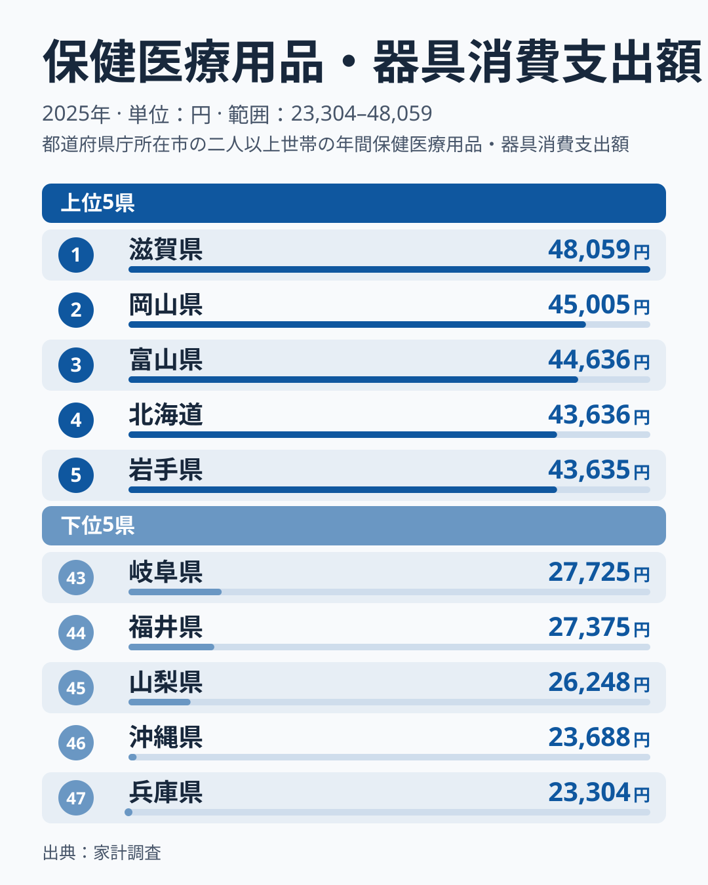
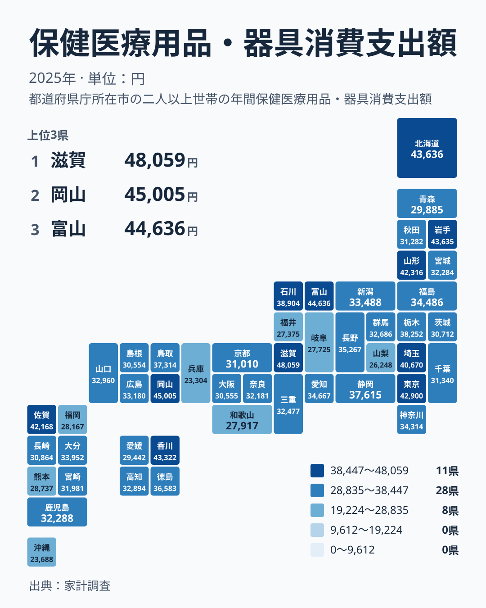

ドラッグストアで買うマスクや絆創膏、体温計、コンタクトレンズや眼鏡など、「保健医療用品・器具」への支出は、住む場所によってどれだけ違うのでしょうか。2025年の家計調査をもとに、47都道府県の姿を見ていきます。

1位の滋賀県は48,059円、47位の兵庫県は23,304円です。最大と最小の比は約2倍に達します。この開きが何を意味するのか、地理の並びと生活の側面から考えます。

## 上位は僅差、下位は2県が突出して低い

まず、上位5県と下位5県を並べた図を見てください。

<source-link href="/ranking/medical-supplies-group-consumption-expenditure">保健医療用品・器具への支出ランキングをもっと見る</source-link>

図から読み取れる第一の特徴は、上位5県の金額が近いことです。2位から5位までは43,000円台から45,000円台に収まっており、4位の北海道は43,636円、5位の岩手県は43,635円と1円差しかありません。この層では、順位の違いはほとんど実質的な差を意味しません。

第二の特徴は、1位の滋賀県が48,059円で、2位の岡山県の45,005円から一段高い位置にあることです。上位の中でも滋賀県だけが抜けています。

下位では事情が違います。兵庫県は23,304円、沖縄県は23,688円で、この2県が他から離れて低くなっています。45位の山梨県は26,248円ですから、最下位の2県と、その上の層との間に段差があります。上位は団子状に詰まり、下位は底が深いという非対称な形です。

> [!NOTE]
> ここでの「保健医療用品・器具」は、家計調査の「保健医療用品・器具消費支出額」にあたります。診療代や薬代そのものではなく、家庭で購入する用品や器具への1世帯あたり年間支出で、単位は円です。眼鏡やコンタクトレンズのような視力矯正用品、体温計や血圧計のような器具、衛生用品が含まれる区分です。

## 地理で見ても、東高西低にはならない

次に、都道府県を地図の形に並べたタイルマップを見ます。

色の濃淡を追っても、特定の地方にまとまっているわけではありません。上位10県を地方で整理すると、北海道・東北には北海道、岩手県、山形県の3道県が入っています。関東には東京都と埼玉県の2都県、中部には富山県、近畿には滋賀県、中国には岡山県、四国には香川県、九州・沖縄には佐賀県がそれぞれ入っています。7つの地方すべてが上位10位に顔を出しています。

下位にも同じ散らばりがあります。近畿では、1位の滋賀県と47位の兵庫県の両方が同じ地方に含まれます。九州・沖縄でも、上位10位に入る佐賀県は42,168円で9位ですが、福岡県は28,167円で41位、沖縄県は23,688円で46位です。同じ地方の中で、これだけ位置が分かれています。

関東も同様です。東京都は7位の42,900円、埼玉県は10位の40,670円ですが、神奈川県は19位の34,314円、千葉県は31位の31,340円です。首都圏という括りでも一様ではありません。「寒い地域」「都市部」といった単純な切り口では説明しにくい指標だといえます。

> [!TIP]
> 順位を読むときは、隣り合う順位の金額差に注目してください。4位と5位は1円差ですが、10位の埼玉県40,670円から11位の石川県38,904円までは段差があります。僅差の順位は実質的な優劣ではなく、誤差の範囲と考えるのが安全です。

## 考えられる背景(仮説)

実データは支出額だけなので、滋賀県と兵庫県の差の原因を断定することはできません。ここでは、検証されていない仮説として、生活との接点を整理します。

ひとつは、高単価の買い物が合計を動かす可能性です。この区分には、眼鏡やコンタクトレンズのように1回で数万円になりうるものも、絆創膏やマスクのような安価な消耗品も含まれます。高額品を買うかどうかで年間合計が変わるなら、順位は年ごとに入れ替わりやすいことになります。

もうひとつは、買い物の習慣の違いです。身近な店でまとめ買いをするのか、少量ずつ買うのかによって、年間の支出の出方は変わるかもしれません。気候や世帯の構成によって必要な用品が違う可能性もあります。

ただし、これらを滋賀県と兵庫県の差に結びつける材料は、手元のデータにはありません。気候で説明しようとしても、同じ首都圏の中で順位が分かれている事実や、同じ近畿の中で両極が出ている事実と整合しません。単一の要因では説明しにくい、という点までが、データから言える範囲です。

> [!WARNING]
> この区分には、眼鏡やコンタクトレンズのような単価の高い買い物が含まれます。こうした買い物が年によって集中したり、ほとんど無かったりすると、1年分の合計は大きく動きます。2025年の1年だけの順位は、その年の高額な買い物の有無に左右された可能性があり、県の恒常的な傾向とは言い切れません。

## 滋賀県と岡山県から見えるもの、そして暮らしへの含意

上位2県の詳しい数字は、[滋賀県のデータ](/areas/25000)と[岡山県のデータ](/areas/33000)で確認できます。2県の差は1位と2位の間ではっきり開いていますが、2位の岡山県から3位の富山県44,636円までは、ほぼ横並びです。滋賀県は上位の中でも頭ひとつ抜けた存在です。

中位に目を向けると、16位の長野県は35,267円、17位の愛知県は34,667円、18位の福島県は34,486円と、似た金額が続きます。この層は順位が入れ替わりやすく、順位よりも金額の水準そのものを見るほうが実感に近いでしょう。

暮らしの視点では、順位の高低を良し悪しで判断しないことが大切です。支出が多いことは、必要な用品が多い事情や高額品の購入があったことを示すかもしれませんし、少ないことも、健康だから、あるいは買い控えているから、のどちらとも読めます。数字は、背景を考える出発点にすぎません。

自分の家庭の支出を見直すときは、全国の幅である23,304円から48,059円の中で、どのあたりにいるかを知るだけでも、買い物の見方が変わります。他の費目とあわせて見るために、[同じカテゴリの統計一覧](/category/economy)もご覧ください。

## データについて

この記事は、家計調査の2025年の結果をもとにしています。指標の正式名称は「保健医療用品・器具消費支出額」で、単位は円です。都道府県別の1世帯あたり年間支出額を並べたものです。値は調査の結果であり、すべての世帯の実態を表すものではない点にご注意ください。
