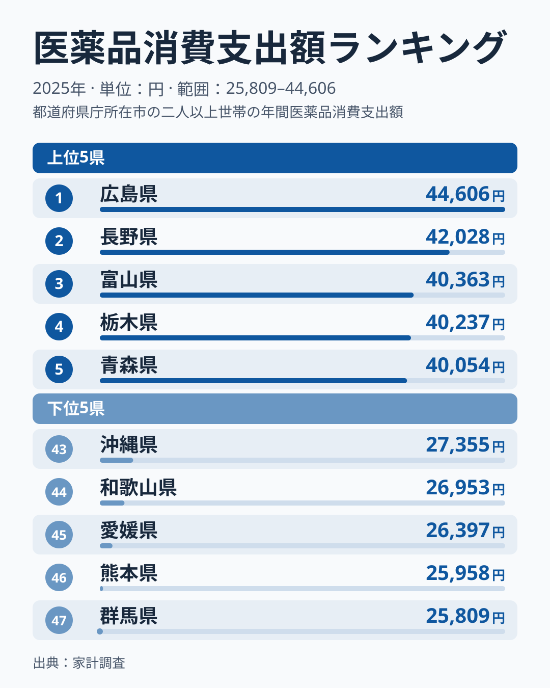
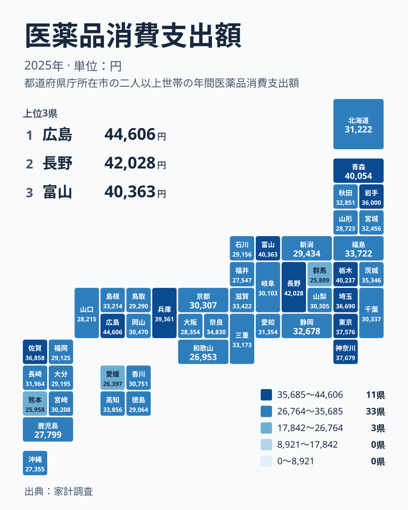

## 医薬品への支出は県によってどれほど違うのか

ドラッグストアで風邪薬や胃腸薬、湿布を買うとき、私たちはその金額を気にとめることはあまりありません。しかし 1 年分を積み上げると、住んでいる県によって医薬品にかける金額は大きく変わります。

2025年の家計調査によると、医薬品への支出が最も多いのは広島県で 44,606 円です。いちばん少ないのは群馬県の 25,809 円で、47 位に位置します。最大と最小の比はおよそ 1.7 倍ですが、実データから確かに言えるのは、1 位と 47 位の間に大きな開きがあるという事実です。

この記事では、まず上位と下位の顔ぶれを確認し、次に地方というくくりでこの差を説明できるかを地図で確かめます。そのうえで、高齢化や医療機関の分布といった背景を仮説として整理し、暮らしにとって何を意味するのかを考えます。同じカテゴリの数字を広く見たい方は、[同じカテゴリの統計一覧](/category/economy)もあわせてご覧ください。

なお、この記事で「北海道・東北」と呼ぶのは、北海道、青森県、岩手県、宮城県、秋田県、山形県、福島県の 7 道県をまとめた区分です。以降もこの区分で地方を数えます。

> [!NOTE]
> ここでの「医薬品への支出」は、家計調査の医薬品消費支出額を指します。家計が購入した医薬品への支払いが対象で、病院や薬局で処方される薬の保険給付を含む医療費の全体を示すものではありません。単位は 1 世帯あたりの年間支出額(円)です。

## 上位と下位の顔ぶれ

<source-link href="/ranking/medicines-group-consumption-expenditure">医薬品への支出ランキングをもっと見る</source-link>

上位 5 県は、広島県の 44,606 円、長野県の 42,028 円、富山県の 40,363 円、栃木県の 40,237 円、青森県の 40,054 円です。1 位の広島県と 2 位の長野県の間には 2,578 円の差があり、上位の中でも広島県は頭ひとつ抜けています。一方で、3 位から 5 位までは 40,000 円台前半に並び、差はごくわずかです。

下位 5 県は、群馬県の 25,809 円が 47 位、熊本県の 25,958 円が 46 位、愛媛県の 26,397 円が 45 位、和歌山県の 26,953 円が 44 位、沖縄県の 27,355 円が 43 位です。下位は 25,000 円台から 27,000 円台に固まり、僅差の中に 5 県が並んでいます。

上位 5 県の所属は、青森県が北海道・東北、栃木県が関東、長野県と富山県が中部、広島県が中国で、4 つの地方にまたがります。下位 5 県も、群馬県が関東、和歌山県が近畿、愛媛県が四国、熊本県と沖縄県が九州・沖縄で、やはり 4 つの地方に分かれます。特定の地方がまとめて多い、あるいは少ないという単純な構図ではなさそうです。地図で確かめてみましょう。

> [!TIP]
> 順位の隣り合う県は、数千円ではなく数百円しか違わないことがよくあります。たとえば 4 位の栃木県は 40,237 円、5 位の青森県は 40,054 円です。順位の上下に一喜一憂するより、上位・中位・下位という大きなまとまりで捉えるほうが、数字を読み誤りません。

## 地図で見ると地方のくくりでは説明できない

地図を見ると、濃い色の県は特定の地方に集中せず、あちこちに散らばっています。関東では、栃木県が 4 位で 40,237 円、神奈川県が 7 位で 37,679 円、東京都が 8 位で 37,576 円、埼玉県が 10 位で 36,690 円と上位に並びます。ところが同じ関東の群馬県は 47 位で 25,809 円、千葉県は 27 位で 30,337 円です。

中部も同じです。長野県が 2 位で 42,028 円、富山県が 3 位で 40,363 円と高い一方、福井県は 42 位で 27,547 円です。近畿でも、兵庫県が 6 位で 39,361 円なのに対し、和歌山県は 44 位で 26,953 円です。北海道・東北でも、青森県が 5 位で 40,054 円、山形県が 38 位で 28,723 円と開いています。

データで確かめられるのは、地方ごとのまとまりが弱く、同じ地方の中でも順位が大きく分かれるという点までです。その理由は、この数字だけでは分かりません。人口構成や医療機関の分布、買い物の習慣といった、県ごとのより細かい違いが関わっている可能性はありますが、あくまで仮説です。

> [!WARNING]
> 家計調査は標本調査です。都道府県別に見ると、調査対象となる世帯の数が限られるため、数百円から千円程度の差は誤差の範囲に収まる可能性があります。1 年分の数字だけで県の優劣を断定するのは避けてください。

## 考えられる背景(仮説)

ここからは、今回の実データには含まれない要因についての仮説です。高齢化率や医療機関数などの数値は扱っていないため、因果関係を示すものではありません。

需要側の候補は高齢化です。家計調査の分析では、健康保持用の摂取品や歯科診療代といった自己負担のヘルスケア支出は、高齢者世帯や所得の高い世帯で高くなる傾向があると言われます。高齢の世帯が多い県ほど、医薬品への支出が膨らみやすい可能性があります。

供給側の候補は、医療機関の分布や受診のしやすさです。近くに病院や診療所が多ければ、体調を崩したときにまず受診し、薬は処方で受け取る人が増えるかもしれません。その場合、家計が直接購入する医薬品の支出は小さくなります。逆に医療機関が遠い地域では、手元の市販薬で対処する場面が増える可能性があります。

さらに、地域の経済状況や受診の頻度が支出に影響している可能性もあります。ただし、これも今回のデータから確かめたものではありません。これらの要因が県ごとに異なる形で組み合わさり、散らばった地図になっているのかもしれませんが、検証には別のデータが必要です。

> [!NOTE]
> 医薬品への支出が多いことは、必ずしも「病気が多い」ことを意味しません。日頃から市販薬やケア用品を買って備える習慣が強い県でも、数字は高く出ます。逆に支出が少なくても、健康であるとは限りません。

## 広島県と長野県が示すもの

1 位の広島県は 44,606 円、2 位の長野県は 42,028 円です。この 2 県を取り上げたのは、1 位と 2 位でありながら、広島県が中国、長野県が中部と、別々の地方に属しているからです。詳しい数字は[広島県のデータ](/areas/34000)と[長野県のデータ](/areas/20000)で確認できます。

読み取れるのは、上位 2 県が同じ地方ではなく、先ほどの「地方のくくりでは説明できない」という見方と合うことまでです。2 県だけの比較から、都市か農村かといった性格を論じることはできません。

## 自分の暮らしにどう活かすか

この数字を、自分の家計や健康管理に引き寄せて読むには、いくつかのコツがあります。

- 自分の県の順位を知り、全国の中でどのあたりにいるかを確認します
- 近隣の県と比べて、同じ地方の中でも差があることを意識します
- 市販薬の購入額だけでなく、受診や処方にかかった費用もあわせて家計を見直します
- 薬の使い方に迷ったら、薬局や薬剤師に相談し、重複や不要な購入を避けます

支出が少ない県の世帯を「健康意識が低い」と読むのは早計です。医療へのアクセスや保険制度の使い方の違いが表れている可能性もあります。反対に、支出が多い県の世帯が、軽い不調を市販薬で乗り切る習慣を持っているなら、それは通院の手間や時間を節約する選択とも言えます。

平均値はあくまで目安です。世帯の人数、年齢、持病の有無で、必要な薬の量は大きく変わります。全国や県の数字は、自分の家計を点検するきっかけとして使うのが現実的です。

## データについて

この記事で使った指標は、家計調査の医薬品消費支出額で、2025年の 1 世帯あたり年間支出額を円で示したものです。順位は 47 都道府県の高い順です。記事中の数値はすべてこの実データに基づいており、高齢化率や医療機関数などの数値は含んでいません。背景の説明は、一般的に指摘されている要因を仮説として整理したもので、今回のデータから因果を証明したものではありません。

医薬品への支出は、広島県の 44,606 円から群馬県の 25,809 円まで、県によって大きく異なります。その差は、地方のくくりでは説明しにくいことが分かりました。自分の県の位置を知ることは、健康と家計の両面から暮らしを見直す、小さな第一歩になります。
