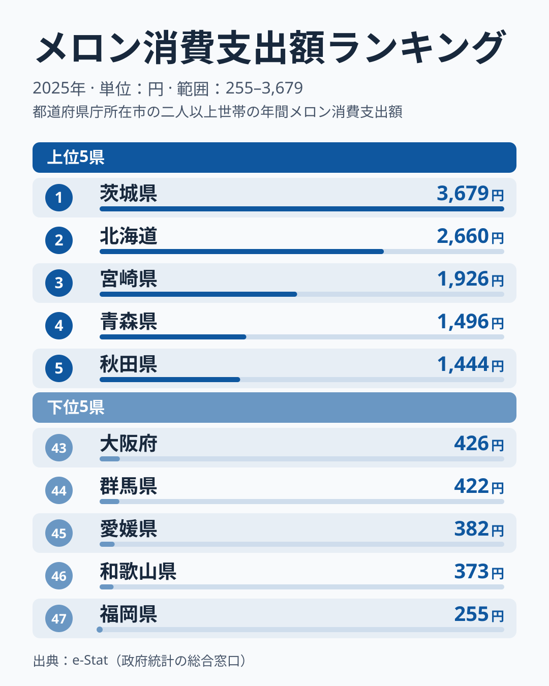
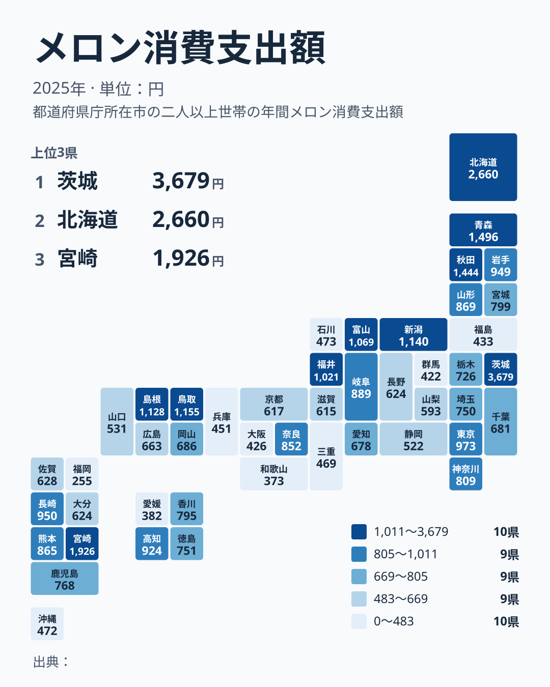

「メロンを一番食べているのはどこの県か」と聞かれたら、産地の県を思い浮かべる人も、贈答の多い都市部を思い浮かべる人もいるでしょう。総務省の家計調査（2025年、二人以上世帯・都道府県庁所在市）を見ると、1位は茨城県で年間3,679円、最下位は福岡県で255円。その差は14.4倍にのぼります。

メロンは高級果実の代名詞として贈答用のイメージが強い一方、産地では日常的に食べられている果物でもあります。この記事では、メロンの産地として広く知られる茨城県、北海道、熊本県の3道県に絞り、産地が食卓でも上位に来るのかを確認します。収穫量などの産地統計はこの記事のデータに含まれないため、産地の範囲は一般的な知名度に基づく整理です。2位に北海道、3位に宮崎県が入った一方、熊本県は17位でした。この結果は、単年の順位をどう読むかという注意点にもつながります。

> [!NOTE]
> この統計は総務省「家計調査」の品目別支出金額（二人以上の世帯、都道府県庁所在市が対象）です。県全体ではなく県庁所在市の家計を代表値として扱う調査のため、県内の産地・消費実態と数値が完全に一致するとは限りません。

## メロン消費額トップ5とワースト5

<source-link href="/ranking/melon-consumption-expenditure">メロン消費支出額ランキングをもっと見る</source-link>

1位の[茨城県](/areas/08000)は3,679円で、2位の[北海道](/areas/01000)の2,660円を大きく上回ります。茨城県はメロンの産地として知られ、鉾田市などが中心です。ただし家計調査の対象は県庁所在地の水戸市で、産地の中心とは別の市です。産地の多さが水戸市の家計の消費額に直接結びついたかは、この統計からは確かめられません。[仮説]として、県内で流通するメロンが水戸市の家計にも届きやすい可能性はありますが、検証には購入先や購入頻度の統計が必要です。

3位は[宮崎県](/areas/45000)で1,926円です。宮崎県は主産地のイメージが強い県ではないため、順位の理由は断定できませんが、[仮説]として、地元産の流通量や直売所での購入しやすさが家計の支出に反映された可能性があります。検証には、品目別の購入頻度や購入数量とあわせて複数年の推移を見る必要があります。

4位は[青森県](/areas/02000)で1,496円、5位は[秋田県](/areas/05000)で1,444円です。上位5位を地方別に見ると、北海道、青森県、秋田県の3道県が北海道・東北、茨城県が関東、宮崎県が九州・沖縄で、北海道・東北が過半を占めるものの、上位が一つの地方に集まっているとまでは言えません。冷涼な気候や地元流通の違いが背景にあるのかも、この統計だけでは確かめられません。

下位を見ると、最下位の福岡県は255円で、和歌山県373円、愛媛県382円、群馬県422円、大阪府426円が続きます。大阪府と福岡県のように大都市を含む県が下位に入っていることから、贈答の多い都市部ほどメロンの消費額が高いとは、この結果からは言えません。和歌山県と愛媛県はみかんをはじめとする柑橘の産地で、[仮説]として、家計の果物支出が柑橘類に向きやすく、メロンの比重が小さくなっている可能性があります。ただしこれも家計調査の1品目だけでは確かめられず、果物全体の支出構成を見る必要があります。

## 地図で見る全国分布

地図で上位10県を見ると、茨城県、北海道、宮崎県、青森県、秋田県、鳥取県、新潟県、島根県、富山県、福井県が並びます。地方別では北海道・東北が北海道、青森県、秋田県の3県、中部が新潟県、富山県、福井県の3県、中国が鳥取県と島根県の2県、関東が茨城県の1県、九州・沖縄が宮崎県の1県です。合計は3+3+2+1+1で10県となり、東日本だけ、西日本だけという偏り方ではありません。一方で、下位には福岡県、和歌山県、愛媛県、群馬県、大阪府が並び、地域をまたいで散らばっています。

上位に中部や中国の県が目立つ理由は、この統計だけでは説明できません。[仮説]として、贈答や直売といった地元消費の習慣が関わっている可能性がありますが、検証にはメロンの購入先別の統計や複数年の推移が必要です。

## 産地と消費地はどこまで一致するか

ここで産地として扱うのは、メロンの産地として広く名前が挙がる茨城県（鉾田市など）、北海道（夕張市）、熊本県（肥後グリーン）の3道県です。この3つを選んだ根拠は一般的な知名度で、収穫量の順位などはこの記事のデータには含まれていません。

2025年の結果では、茨城県が1位、北海道が2位と、産地と消費額の高い県が重なりました。一方で熊本県は17位で865円にとどまり、24位の埼玉県の750円との差は小さくありません。が、上位に入ったとは言えない位置です。産地として知られていても、消費額が上位に入るとは限りません。題の問いに答えるなら、産地3道県のうち食卓でも上位に来たのは2道県で、「産地は食卓でも一番」とは単年では言い切れません。

> [!WARNING]
> メロンは購入が夏場などの特定の時期や、贈答の機会に偏りやすい品目です。年間の購入世帯が限られ、標本が小さい県庁所在市では、たまたま高額の購入があった世帯の有無で平均額が動きやすくなります。単年の順位から「この県は産地だから消費が多い」「少ない」と構造を断定せず、複数年にわたって上位や下位に居続ける県かどうかを見てください。

茨城県は1位、福岡県は最下位と、2025年は両端がはっきり分かれました。ただしこれは1年分の結果に過ぎず、確かな構造とは言えません。[仮説]として、産地の厚みと地元の購入しやすさが両端の位置に関わっている可能性があり、過去の推移を長く見ることで検証できます。

## 九州と中部の一部は一括りにできない

産地が多い九州を一つの地域として見ると、結果はばらばらです。宮崎県が3位、長崎県が12位、熊本県が17位、鹿児島県が22位、佐賀県が30位、大分県が32位、福岡県が最下位となっています。九州のなかで上位から最下位までが並ぶ形で、「九州は下位に沈む」とも「上位に固まる」とも言えません。

中部の新潟県、富山県、石川県、福井県も同様です。新潟県が7位、富山県が9位、福井県が10位と上位に入る一方、石川県は38位で473円と、同じ中部でも順位が大きく違います。地方のくくりで消費の傾向をまとめるより、県ごと・年ごとの値のぶれを前提に、複数年の推移で見ていくのが妥当です。

## まとめ

- 1位は茨城県3,679円、最下位は福岡県255円で14.4倍の開き
- 2位は北海道2,660円、3位は宮崎県1,926円で、青森県1,496円が4位、秋田県1,444円が5位
- 産地として知られる茨城・北海道・熊本の3道県のうち、茨城と北海道は1位・2位、熊本は17位で、「産地=消費地」は単年では一部でしか成り立たない
- 家計調査の対象は茨城では水戸市で、産地の中心とは別の市のため、産地の多さが消費額に直結したかは確かめられない
- 上位10県は北海道・東北、中部、中国、関東、九州・沖縄にまたがり、理由はこの統計では断定できない（[仮説]として地元消費の習慣）
- 大阪府426円、福岡県255円と大都市を含む県が下位に入り、都市部ほど消費額が高いとは言えない
- メロンは購入が季節や贈答に偏り、市別の値は年ごとのぶれが大きいため、単年の順位から構造は断定せず、複数年で確認する必要がある
