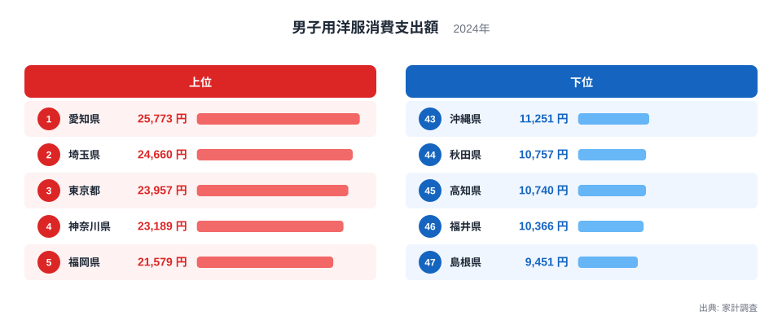
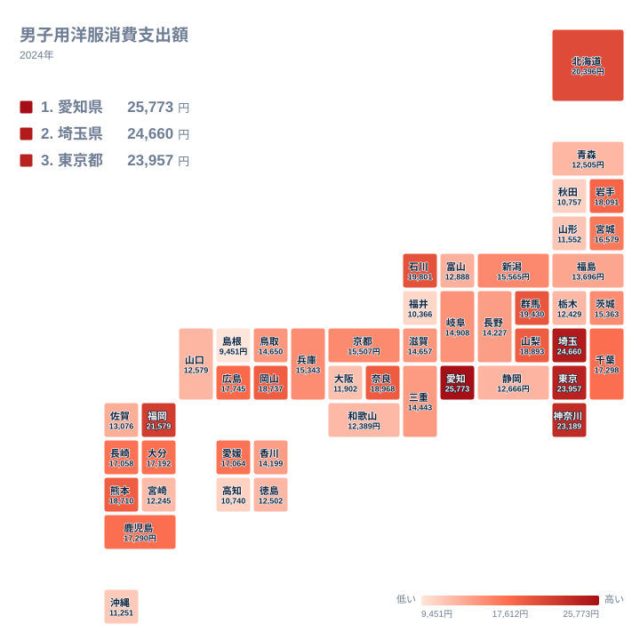

男子用洋服への支出は、住む県によってどれほど違うのでしょうか。2024年の家計調査では、1位の愛知県が25,773円、47位の島根県が9,451円でした。1位は47位の約2.7倍にあたります。同じ日本で暮らしていても、男性の服にかけるお金には大きな開きがあります。この記事では、上位と下位の顔ぶれを確かめながら、仕事や暮らし方、気候といった観点から、その差の背景を仮説として考えます。

## 上位は大都市圏、下位は地方に広がる

まず、上位5県と下位5県を図で確認します。

<source-link href="/ranking/mens-clothing-consumption-expenditure">男子用洋服への支出ランキングをもっと見る</source-link>

1位は愛知県で25,773円です。2位は埼玉県で24,660円、3位は東京都で23,957円、4位は神奈川県で23,189円、5位は福岡県で21,579円と続きます。上位5県のうち3県は関東の埼玉県、東京都、神奈川県で、残る2県は中部の愛知県と九州・沖縄の福岡県です。大都市を抱える地域が上位に並んでいます。

一方、下位は島根県が9,451円で47位、福井県が10,366円で46位、高知県が10,740円で45位、秋田県が10,757円で44位、沖縄県が11,251円で43位です。東北、中部、中国、四国、九州・沖縄から1県ずつ入っており、下位は特定の地方に固まっているわけではありません。

冒頭の問いに答えると、1位の愛知県は47位の島根県の約2.7倍です。25,773円と9,451円という二つの数字が、地域差の大きさを端的に示しています。上位4県は23,000円台以上に集まっており、下位5県は9,000円台から11,000円台に収まっています。上と下で、それぞれ別のまとまりができているのが特徴です。

> [!NOTE]
> この指標は、家計調査における男子用洋服への年間の消費支出額で、単位は円です。集計の対象は二人以上の世帯です。男性個人が買った服だけの金額ではなく、世帯として男子用洋服に使った額を表しています。単身世帯の買い物は含まれません。

## 仕事の服が支出を左右するのか

男子用洋服には、スーツやワイシャツ、ジャケットといった仕事用の服が含まれます。そのため、勤め人が多く、オフィスで働く人の割合が高い地域ほど、支出が増えやすいという見方ができます。

上位の愛知県、埼玉県、東京都、神奈川県は、いずれも大都市やその周辺です。東京都に近い埼玉県や神奈川県では、都心で働く人が身なりに気を配る習慣が支出に表れている、という説明も考えられます。ただし、これはデータから証明できる話ではありません。職業の構成や世帯の年齢の構成など、確かめたい要因は他にも多くあります。

> [!TIP]
> 順位だけでなく、金額の並び方も見てください。1位から4位までは23,000円台以上で密集していますが、5位の福岡県は21,579円、6位の北海道は20,396円と、少しずつ下がります。大きな段差がどこにあるかを探すと、上位の「核」になる県が見えやすくなります。

## 地理分布で見る地域の濃淡

続いて、全国の分布を地図で見てみましょう。

関東では、埼玉県の24,660円、東京都の23,957円、神奈川県の23,189円が上位に入っています。ところが同じ関東でも、群馬県は19,430円で8位、千葉県は17,298円で15位、茨城県は15,363円で23位、栃木県は12,429円で38位と、県ごとにばらつきがあります。関東という同じ地方の中でも、順位は大きく分かれています。

中部では、愛知県が1位、石川県が19,801円で7位、山梨県が18,893円で10位に入る一方、福井県は46位、富山県は12,888円で33位、静岡県は12,666円で34位です。中部の9県だけを見ても、上位から下位まで幅広く散らばっています。

近畿では、奈良県が18,968円で9位に入り、京都府は15,507円で22位、兵庫県は15,343円で24位です。大阪府は11,902円で41位と低く、大都市を抱える府でも支出が多いとは限りません。隣り合う奈良県と大阪府で順位がこれほど違うのは、都市の大きさだけでは説明できない差があることを示しています。

> [!WARNING]
> 家計調査は、各県の県庁所在市を中心とした限られた世帯から得た結果です。対象は二人以上の世帯なので、単身の会社員や学生が多い県では、実態とずれる可能性があります。また、県庁所在市の暮らしぶりが、県内の町村部や他の都市と同じとは限りません。県全体の傾向としてではなく、調査された世帯の傾向として読むのが安全です。

## 気候・地域性と順位の関係

気候も服の支出に関わりそうです。北海道は20,396円で6位、岩手県は18,091円で13位と、寒冷な地域が上位に入っています。冬用のコートや防寒着は単価が高いため、寒さが支出を押し上げているという見方もできます。

しかし、同じ東北でも宮城県は16,579円で20位、福島県は13,696円で31位、青森県は12,505円で36位、山形県は11,552円で42位、秋田県は10,757円で44位です。寒冷であることだけでは、順位を説明できません。東北の県の中でも、岩手県の18,091円と秋田県の10,757円では大きな開きがあります。

沖縄県は11,251円で43位でした。温暖な地域で下位に入っている点は、気候が支出に影響するという仮説と合います。ただし、これも1年分の結果から推測した一つの見方にすぎません。気候、仕事、暮らし方が重なり合っているため、一つの理由に絞ることはできません。

## 中位の県が示す手がかり

中位の県にも目を向けましょう。広島県は17,745円で14位、千葉県は17,298円で15位、鹿児島県は17,290円で16位、大分県は17,192円で17位、愛媛県は17,064円で18位、長崎県は17,058円で19位と、17,000円台に6県が並びます。14位から19位までの6県は、金額の差が小さく、順位が入れ替わりやすい層です。

岡山県は18,737円で11位、熊本県は18,710円で12位と、地方の県が上位に食い込んでいます。九州や中国の県でも、順位には大きな幅があることがわかります。地方だから低い、という単純な見方は当てはまりません。

一方で、この層の県同士は数百円の差で順位が動きます。中位の県では、順位の違いを暮らしの違いとして読みすぎず、おおよその水準が近いと捉えるほうが実態に合っています。

## データについて

この記事の数値は、家計調査の2024年の結果にある男子用洋服消費支出額を使っています。単位は円で、全47都道府県の値が公表されています。地域のくくりは、北海道・東北、関東、中部、近畿、中国、四国、九州・沖縄の7区分を使いました。倍率は、1位の愛知県の値を47位の島根県の値で割ったものです。

## まとめ

男子用洋服への支出は、1位の愛知県が25,773円、47位の島根県が9,451円で、約2.7倍の開きがありました。上位には愛知県と関東の3都県が並び、福岡県も5位に入っています。一方で、同じ地方の中でも順位は大きく分かれ、気候や大都市の有無だけでは説明できません。

各県の詳しい数字は、[愛知県のデータ](/areas/23000)や[埼玉県のデータ](/areas/11000)で確認できます。ほかの家計の指標との比較には、[同じカテゴリの統計一覧](/category/economy)も役立ちます。自分の住む県の順位を確かめて、暮らしの特徴を読み解いてみてください。
