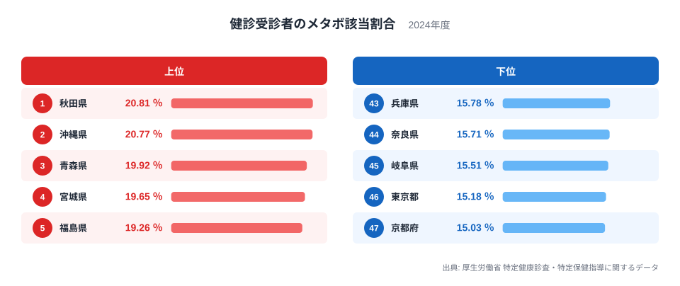
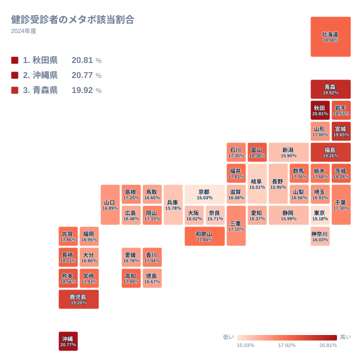

健診を受けた人のうち、メタボリックシンドロームに該当する人はどれくらいいるのでしょうか。2024年のデータでは、最も高い秋田県が20.813％、最も低い京都府が15.034％でした。同じ制度で健診を受けた人たちの間でも、県によってこれだけの開きがあります。この記事では、上位と下位がなぜその順になるのかを、地理や暮らし方の面から読み解きます。

## 上位と下位のランキングを見る

まずは上位5県と下位5県を並べた図です。

<source-link href="/ranking/metabolic-syndrome-prevalence-among-checkup-recipients">健診受診者のメタボ該当割合ランキングをもっと見る</source-link>

1位は秋田県で20.813％、2位は沖縄県で20.768％です。この2県の差はごくわずかで、ほぼ並んでいると言えます。3位は青森県で19.924％、4位は宮城県で19.653％、5位は福島県で19.263％と続きます。上位5県のうち4県が北海道・東北の県です。

下位側を見ると、47位が京都府で15.034％、46位が東京都で15.18％、45位が岐阜県で15.51％、44位が奈良県で15.712％、43位が兵庫県で15.776％です。大都市圏を含む近畿や関東の県が目立ちます。最大の秋田県と最小の京都府を比べると、20.813％と15.034％で、その開きは小さくありません。

上位に東北が並ぶ背景としてまず考えられるのは、車での移動が中心になる生活です。公共交通が限られる地域では、日常の歩行量が少なくなりがちです。冬の積雪や寒さで屋外での運動が減る季節があることも、体重管理には不利に働きます。さらに、米を中心とした食文化や塩分を多めに使う保存食の習慣が、食生活に影響している可能性もあります。ただし、これらは地域の傾向を説明する仮説であり、このデータ自体が原因を示すわけではありません。

下位の京都府や東京都、兵庫県、奈良県は、鉄道網が発達し、通勤や買い物で歩く機会が多い地域です。都市部では駅までの徒歩や階段の利用が日課になりやすく、これが該当割合を低く抑える一因と考えられます。

> [!NOTE]
> ここでの「メタボ該当割合」は、特定健康診査を受けた人のうち、メタボリックシンドロームの基準に該当した人の割合です。県民全体ではなく、健診を受けた人だけが分母になっています。

## 地理分布で見る東北と南の島

次に、47都道府県の分布をタイルマップで確認します。

地図にすると、色の濃い県が北海道・東北にまとまっていることがわかります。秋田県の20.813％、青森県の19.924％、宮城県の19.653％、福島県の19.263％、岩手県の18.575％と、東北の多くが上位10位以内に入っています。山形県は26位で16.995％と、同じ東北でも中位にとどまります。北海道は12位で18.077％です。東北の中でも県によって差があるため、「東北はすべて高い」とは言えません。

もう一つの特徴は九州・沖縄です。沖縄県が2位で20.768％、鹿児島県が6位で19.196％、熊本県が8位で18.556％、長崎県が11位で18.206％です。一方で福岡県は27位で16.954％、大分県は30位で16.797％と、順位に幅があります。沖縄県は長寿の県というイメージが強いものの、近年は肥満の割合が高いことが指摘されてきました。車社会であることや、食生活の変化が背景にあると考えられます。このデータでも、その姿が数字として表れています。

中部や近畿、関東の大都市圏に近い県は、おおむね下位に集まっています。長野県は41位で15.955％、新潟県は42位で15.895％、静岡県は40位で15.992％です。中部の県が下位側に多いのも特徴です。長野県は高齢者の就労や健康づくりの取り組みが知られており、それが数字に反映している可能性があります。

> [!TIP]
> 順位の差が小さい中位の県どうしは、実質的に横並びです。たとえば20位の香川県は17.444％、21位の岡山県は17.327％で、順位は違っても差は僅かです。順位よりも、値そのものと全体の位置関係で読むのがコツです。

## 秋田県と沖縄県、頂点を争う二つの県

1位の秋田県と2位の沖縄県は、気候も産業も大きく異なる県です。それでも数字はほぼ同じ水準になっています。[秋田県のデータ](/areas/05000)と[沖縄県のデータ](/areas/47000)をあわせて見ると、背景の違いが見えてきます。

秋田県は、冬の長い雪国です。積雪期間は屋外での活動が減り、移動も車に頼る割合が高くなります。人口の高齢化が進んでいることも、代謝の低下を通じて数字に影響している可能性があります。農業が盛んで、米や漬物などを中心とした食文化が根づいている点も、よく指摘される特徴です。

沖縄県は温暖で、屋外の運動ができる環境にあります。それでも該当割合が高いのは、公共交通が限られ、日常の移動が自動車に偏りやすいためと考えられます。戦後の食文化の変化により、肉類や揚げ物を取り入れた食事が広まったことも、よく語られる背景です。こうして、寒冷な北国と温暖な南の島という正反対の環境で、同じ結果が生まれています。

ここから言えるのは、メタボの該当割合が気候だけでは決まらないということです。移動手段、食習慣、歴史的な生活様式が重なって、県ごとの傾向をつくっていると考えられます。

> [!WARNING]
> この数値は健診受診者の集計であり、受診率が県ごとに異なります。健康意識の高い人ほど受診しやすい場合など、受診者の偏りが数字に影響します。また年齢構成の違いは調整されていない可能性があるため、県の優劣をそのまま判断することは避けてください。

## 下位の県に見る都市の暮らし

下位に目を向けると、京都府が15.034％、東京都が15.18％と、大都市を抱える県が最も低い水準です。大阪府は39位で16.019％、神奈川県は38位で16.03％でした。都市部では、徒歩や電車での移動が多く、日常の活動量が確保されやすいと考えられます。

岐阜県が45位で15.51％、奈良県が44位で15.712％、兵庫県が43位で15.776％という並びも興味深い点です。奈良県や兵庫県は大阪府や京都府に近く、大都市圏の通勤文化の影響を受けています。岐阜県は都市圏とは性格が異なるものの、低い水準にあります。単純な都市と地方の二分では説明できない面もあり、県ごとの事情を丁寧に見る必要があります。

また、都市部では健診の機会が整っていることも考えられます。勤務先の健診が充実していれば、早い段階で生活習慣の見直しにつながる可能性があります。ただし、これも仮説の域を出ません。

関東の中でも、茨城県は10位で18.285％、群馬県は18位で17.757％、栃木県は19位で17.683％と、東京都とは大きく異なる値です。同じ関東でも、都市部と郊外では暮らし方が違うことを示しています。千葉県は22位で17.3％、埼玉県は28位で16.93％と中位に入ります。

## 読み解きのまとめ

2024年の結果をまとめると、上位には秋田県、沖縄県、青森県、宮城県、福島県が並び、下位には京都府、東京都、岐阜県、奈良県、兵庫県が並びました。最大と最小の開きは、20.813％と15.034％です。車中心の生活、寒冷な気候、食習慣、そして都市の歩ける環境といった要素が、順位の背景にあると考えられます。

大切なのは、この数字が県民の優劣を示すものではないという点です。むしろ、地域ごとの暮らし方が健康にどう結びついているかを考えるきっかけになります。ほかの健康指標や、[同じカテゴリの統計一覧](/category/socialsecurity)もあわせて見ると、地域の姿がより立体的に見えてきます。

## データについて

この統計は、厚生労働省の特定健康診査・特定保健指導に関するデータをもとにした、2024年の「健診受診者のメタボ該当割合」です。単位は％で、全47都道府県が対象です。

メタボ該当とは、腹囲に加えて血圧、血糖、脂質のうち複数の項目で基準を超えた状態を指します。基準値に近い予備群は、該当には含まれない点に注意してください。
