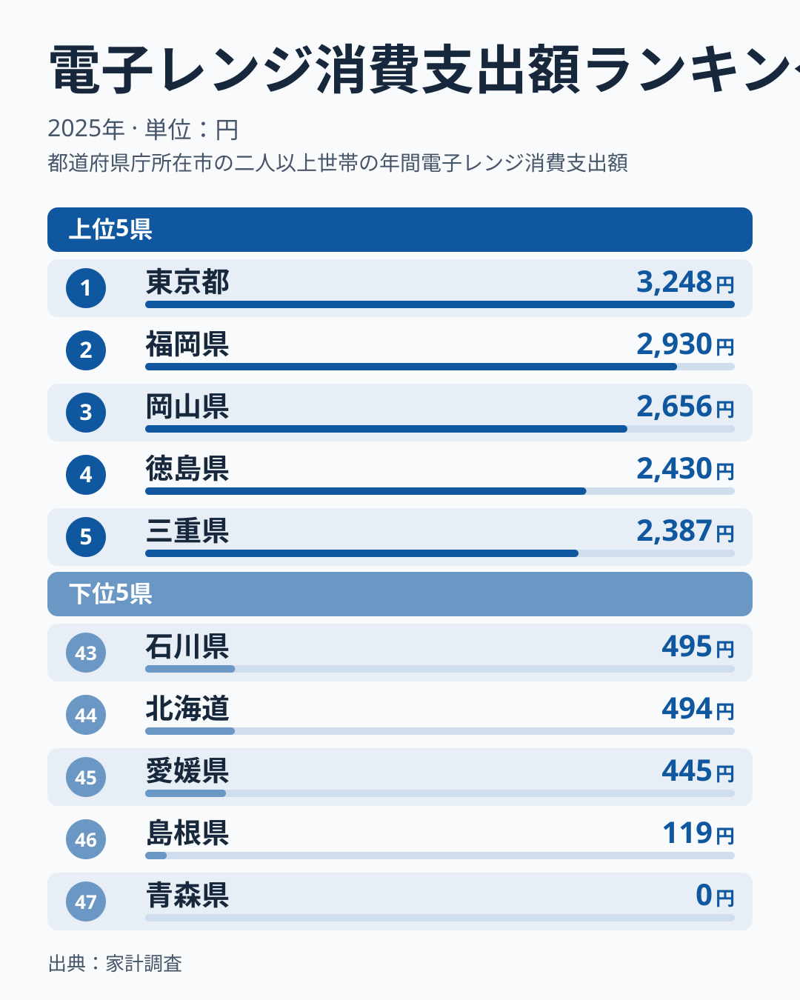
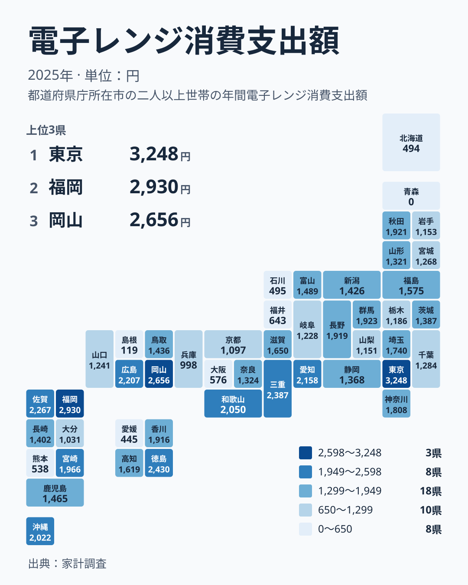

電子レンジは、ほとんどの家庭に置かれている身近な家電です。それなのに、家計調査で見た2025年の電子レンジへの支出は、都道府県によって驚くほど違います。最も多い東京都は3,248円、最も少ない青森県は0円でした。同じ日本で、同じ家電について、ここまで差が出るのはなぜでしょうか。

この記事では、家計調査の結果をもとに、電子レンジへの支出が多い県と少ない県を見比べます。あわせて、食品の消費量とは違って、家電の支出ならではの読み方もお伝えします。

## まず上位と下位の顔ぶれを見る

最初に、上位5県と下位5県を並べた図を見てください。

<source-link href="/ranking/microwave-consumption-expenditure">電子レンジへの支出ランキングをもっと見る</source-link>

1位は東京都で3,248円です。2位は福岡県で2,930円、3位は岡山県で2,656円、4位は徳島県で2,430円、5位は三重県で2,387円と続きます。関東、九州、中国、四国、近畿と、地方がばらばらに並んでいる点が目を引きます。

一方、下位は逆の意味で個性的です。47位の青森県は0円、46位の島根県は119円、45位の愛媛県は445円、44位の北海道は494円、43位の石川県は495円でした。東北、中国、四国、北海道、北陸と、こちらもまとまった地域に偏っていません。

食品の消費量であれば、うどんなら香川県、納豆なら東北のように、食文化がはっきり地図に出ます。電子レンジの支出では、そうした単純な地域の色分けが見えにくいのです。ここが、この指標を読むうえでいちばん大事な出発点になります。

> [!NOTE]
> この指標の正式な統計名は電子レンジ消費支出額で、出典は家計調査の2025年です。調べているのは世帯が一年の間に電子レンジの購入に使った金額で、電子レンジを使った量や、使っている台数ではありません。

## 地図で見ると地域の色分けは強くない

次に、全国の分布を地図で確認します。

地図を見ると、濃い色の県と薄い色の県が隣り合っている場所が多いことに気づきます。たとえば、東京都は3,248円で1位ですが、隣の埼玉県は1,740円で17位、千葉県は1,284円で30位、神奈川県は1,808円で16位です。同じ首都圏でも、順位は大きく違います。

九州でも似たことが言えます。福岡県は2,930円で2位ですが、熊本県は538円で42位、大分県は1,031円で38位です。同じ九州の中で、上位と下位が混ざっています。

つまり、気候や食文化のように地域全体を覆う要因だけでは、この分布は説明しにくいのです。電子レンジは毎日使うものでも、買い替えるのは数年から十年に一度という家電です。そのため、調査した年に買い替えた世帯がたまたま多かったかどうかが、そのまま金額に出てしまいます。

## 食品の消費量との決定的な違い

家計調査で、麺類や調味料のような食品の消費量を見る場合、毎年ほぼ同じ量を買うので、県ごとの違いは暮らしの習慣を反映しやすくなります。うどん県と言われる香川県のように、食文化と結びついた安定した差が出ます。

家電の支出はこの性質がまったく違います。ほとんどの世帯が一年のうちに一度も電子レンジを買わず、買った世帯だけが数万円を支出します。その結果、平均すると県の金額は少数の購入世帯に大きく左右されます。調べる世帯の数が県ごとにそれほど多くない家計調査では、この影響が特に目立ちます。

青森県が0円という結果も、青森県の人が電子レンジを使っていないという意味ではありません。調査した世帯の中に、その年に購入した世帯がいなかったということです。これは食文化の違いではなく、買い替えの時期が重ならなかっただけの可能性が高いと言えます。

> [!WARNING]
> 家計調査は県庁所在市の世帯を中心とした標本調査で、県全体の姿をそのまま表すわけではありません。また、電子レンジは購入頻度が低いため、一年分の結果は偶然に大きく左右されます。順位の差をそのまま県民性や所得の差と読むのは危険です。

## 上位に東京都と福岡県が並ぶ理由を考える

それでも、上位に目立つ県の顔ぶれには、いくつか読み取れることがあります。1位の東京都と2位の福岡県は、いずれも人口の多い大都市を抱え、単身世帯や共働き世帯が多い地域です。調理の時間を節約したい世帯が多いほど、電子レンジを買い替えたり、高機能な機種を選んだりする傾向は強まると考えられます。

ただし、これは仮説にとどまります。実際、同じ大都市圏を抱える大阪府は576円で41位、兵庫県は998円で39位と、金額は大きく下回りました。大都市だから高い、という説明は成り立ちません。

東京都は東京都のデータ、福岡県は福岡県のデータで、家計の他の項目も見られます。気になる方は、東京都の様子を[東京都のデータ](/areas/13000)で、福岡県の様子を[福岡県のデータ](/areas/40000)でご覧ください。電子レンジ以外の家電や、食費と並べて見ると、この指標がどんな暮らしの中にあるのかが少し分かります。

## 関連する支出と並べて読む

電子レンジの支出が、ほかの家計の項目とどう関係するかも気になるところです。同じカテゴリの支出を一覧で見るには、[同じカテゴリの統計一覧](/category/economy)が便利です。

家電の支出を読むときは、次のような見方が役に立ちます。

- 同じ県でも、別の年に順位が大きく入れ替わっていないかを見る
- 調理家電や冷蔵庫など、買い替え周期の近い品目とあわせて見る
- 一つの年の順位ではなく、複数年の動きで傾向を捉える

食品と違って、家電の支出は単年の数字だけで県の特徴を語るのが難しい品目です。逆に言えば、複数年を並べたときに初めて、本当に支出の多い県が見えてきます。

> [!TIP]
> 食品の消費量は習慣を映し、家電の支出は買い替えのタイミングを映します。順位が高い県を見たら、その県の人がよく使っているのか、その年にたまたま買い替えが集まったのかを分けて考えると、数字の読み違いを防げます。

## データについて

この記事で使った数値は、家計調査の2025年の結果から得た電子レンジ消費支出額です。単位は円で、都道府県ごとの金額を高い順に並べています。

最後に、この記事の要点を整理します。2025年の電子レンジへの支出は、東京都が3,248円で最も多く、青森県は0円で最も少ない結果でした。ただし、この差は食文化のような安定した違いではなく、購入頻度の低い家電に特有の、偶然の影響を強く受けた数字です。順位を見るときは、金額の大小よりも、なぜその金額になりうるのかを一歩引いて考えてみてください。
