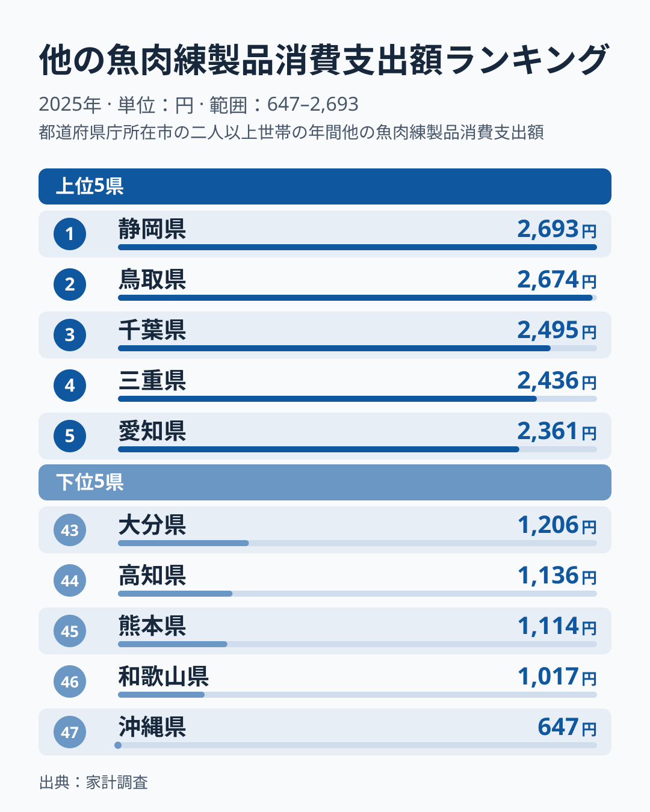
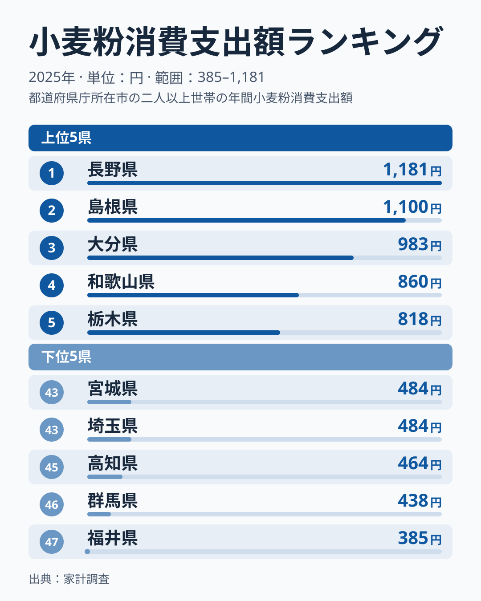
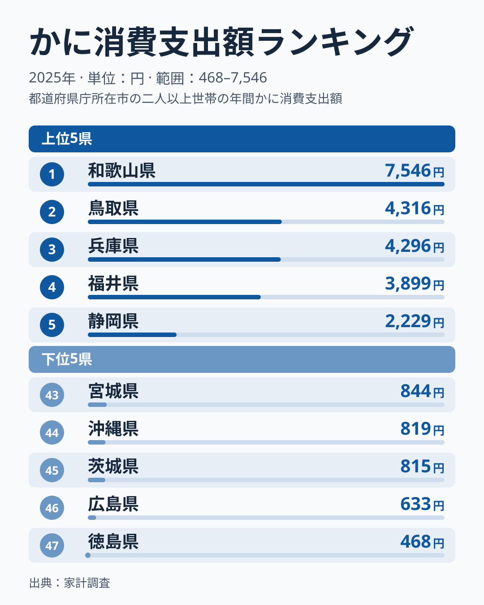
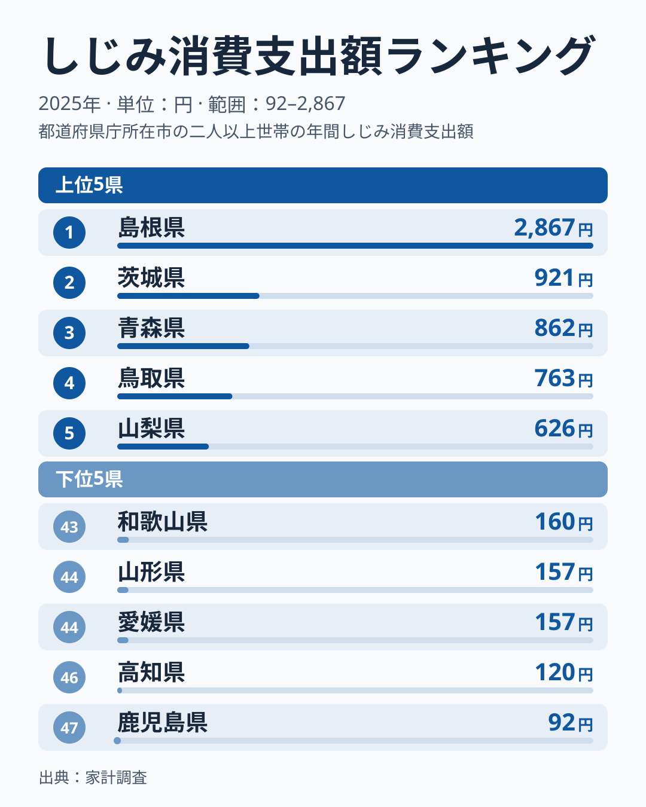
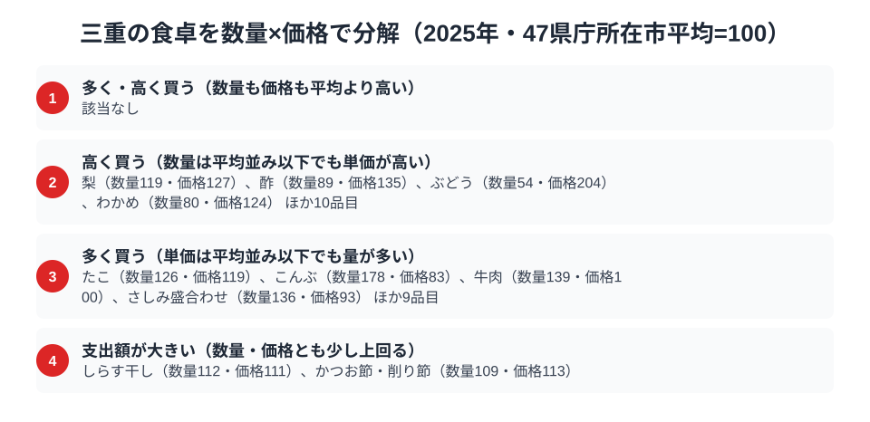

[三重県の地域プロフィール](/areas/24000)を数字で覗くと、海の幸を練り込んだ加工品と、うどん文化を支える粉ものが目立ちます。総務省「家計調査」の2025年の品目別支出データでは、三重県庁所在市（津市）の二人以上世帯は他の魚肉練製品（ちくわ・はんぺんなど）に2,436円を支出し、全国4位でした（1位は静岡県の2,693円です）。小麦粉は791円で6位に入っています。一方、かには1,402円で24位、しじみは190円で37位にとどまります。家計消費のデータは[経済カテゴリ一覧](/category/economy)からも横断的に確認できます。

題の問いへの答えは、上位は練り物と小麦粉の2品目、かにとしじみは中位から下位です。ただし家計調査の市別の値は1年ごとのぶれが大きく、単年の順位だけでは三重の食卓の構造は断定できません。この記事では2025年の4品目の位置を確かめたうえで、数量×価格の分解を使い、津市の食卓のもう一つの顔も紹介します。

> [!NOTE]
> 本記事のデータは総務省「家計調査（品目別支出額）」2025年、都道府県庁所在市（三重県は津市）における二人以上世帯の1世帯あたり年間支出額です。全国順位は47都道府県庁所在市の比較によるものであり、県内他地域の消費実態とは異なる場合があります。

## 他の魚肉練製品 — 全国4位2,436円、上位が狭い範囲に固まる

<source-link href="/ranking/other-fish-paste-consumption-expenditure">他の魚肉練製品消費支出額ランキングをもっと見る</source-link>

三重県は他の魚肉練製品（ちくわ・はんぺん・さつま揚げなど、かまぼこ以外の練り製品を指す品目）の消費支出額が2,436円で、全国4位でした。1位は静岡県の2,693円、2位は鳥取県の2,674円、3位は千葉県の2,495円です。5位の愛知県は2,361円、10位の福島県でも2,150円と、上位10県が狭い範囲に固まっています。最下位の沖縄県は647円で、1位の静岡県との開きは約4.2倍でした。

この記事で使えるのは2025年のデータだけで、他の年の順位は確認していません。そのため、三重が毎年上位にいるのかどうかは、ここでは判断できません。[仮説] 伊勢志摩沿岸でエソやグチなどの白身魚をすり身にした練り製品が日常的に出回り、おでんや煮物の具材として通年で買われることが、上位を支えている可能性があります。県内の販売量や購入頻度の資料がないと確かめられないため、この記事では仮説にとどめます。

## 小麦粉 — 全国6位791円、上位は小差で並ぶ

<source-link href="/ranking/wheat-flour-consumption-expenditure">小麦粉消費支出額ランキングをもっと見る</source-link>

小麦粉の消費支出額は三重県が791円で全国6位でした。1位は長野県の1,181円、2位は島根県の1,100円、3位は大分県の983円、4位は和歌山県の860円、5位は栃木県の818円で、三重は5位の栃木県と27円差です。隣県の岐阜県は622円で26位にとどまり、隣接県がそろって上位という並びにはなっていません。最下位の福井県は385円で、1位の長野県との開きは約3.1倍でした。練り製品の約4倍に比べると、品目としての地域差は小さめです。

[仮説] 郷土料理の伊勢うどんや、家庭で粉ものの惣菜を作る習慣が上位に寄与している可能性はありますが、単年の順位だけで「粉文化の県」と言い切れる段階ではありません。検証するには、小麦粉の購入量と使い道を世帯ごとに見られる資料が要ります。

## かに — 全国24位1,402円、1位は和歌山の7,546円

<source-link href="/ranking/crab-consumption-expenditure">かに消費支出額ランキングをもっと見る</source-link>

かにの消費支出額は、三重県が1,402円で全国24位でした。1位は和歌山県の7,546円、2位は鳥取県の4,316円、3位は兵庫県の4,296円、4位は福井県の3,899円、5位は静岡県の2,229円です。上位4県は3,899円以上で、5位以下とは大きな段差があります。三重の前後は、23位の岩手県が1,405円、25位の奈良県が1,398円と、小さな差で順位が入れ替わる混戦です。最下位の徳島県は468円で、1位の和歌山県との開きは約16.1倍でした。

[仮説] 市別の家計調査は調査世帯が限られるため、かにのように価格の高い品目では、数世帯の大きな購入が平均を押し上げたり、逆に購入が途切れたりして順位がぶれやすいのかもしれません。2025年の結果も、単年のぶれを含む可能性があります。支出額の順位だけでは三重のかに消費の実態は読み切れません。

## しじみ — 全国37位190円、突出した島根と大きな差

<source-link href="/ranking/freshwater-clam-consumption-expenditure">しじみ消費支出額ランキングをもっと見る</source-link>

しじみの消費支出額は、三重県が190円で全国37位でした。1位は宍道湖のしじみ漁で知られる島根県で2,867円です。2位の茨城県は921円、3位の青森県は862円、4位の鳥取県は763円、5位の山梨県は626円で、1県だけが突出する構図です。最下位は鹿児島県の92円で、1位の島根県との開きは約31.2倍にのぼります。

三重の37位は順位としては下位に入ります。[仮説] しじみは宍道湖（島根）、涸沼（茨城）、十三湖（青森）のように特定の汽水湖・河口域に漁場が集中する食材なので、伊勢湾や英虞湾といった内湾はあっても大規模な産地を持たない三重では、家庭の購入が少ないのかもしれません。ただし産地と消費の関係をこの記事では直接確かめておらず、あくまで仮説です。

> [!WARNING]
> 本記事の数値は津市の二人以上世帯のみの値で、三重県全体を代表するものではありません。調査対象の世帯数が限られるため、1年ごとの順位は大きくぶれることがあります。また伊勢うどんや松阪牛のように、個別の品目として集計されない食べ物は、ここで扱う家計調査の品目に含まれていません。

## 三重の食卓を貫くもの

4品目を並べると、2025年だけを見れば「海の加工品」と「粉もの」が上位、「かに」と「汽水域の貝」が中位以下という構図です。ただし、これは単年の順位であり、構造として断定できるものではありません。

比べる材料として、[鳥取の食卓](/blog/tottori-food-culture)は梨とかれいが全国1位、かにも2位という産地の強さが前面に出る食卓で、品目ごとに濃淡がある三重とは対照的です。小麦粉については、[小麦粉の消費量の地図](/blog/wheat-flour-consumption-food-culture-gap)が、購入量では長野が1位でうどん県の香川は3位であり、上位の顔ぶれは年ごとの入れ替わりも大きいと報告しています。三重の小麦粉の6位も、単年の位置として読むのが安全です。

## 津市の食卓のもう一つの顔 — 数量×価格で分解すると

支出額の順位だけでは、その県が「たくさん買っている」のか「一つひとつを高く買っている」のかを区別できません。家計調査には品目ごとの数量もあり、支出額を数量で割ると単価にあたる価格指数が出ます。そこで、47県庁所在市の平均を100とした指数で津市の品目を分けました。数量指数と価格指数のどちらも、120以上を「多い・高い」とみなし、100から119までは平均並みとして扱います。題の4品目は今回の分解データに入っていないため、ここで取り上げるのは別の品目です。

- 数量も価格も120以上: 該当する品目はありませんでした。
- 高く買う型（価格が120以上、数量は120未満）: 酢は数量89・価格135、わかめは数量80・価格124、ぶどうは数量54・価格204です。梨は数量119・価格127で、数量が120にわずかに届かず、この型に入ります。
- 多く買う型（数量が120以上、価格は120未満）: こんぶは数量178・価格83、牛肉は数量139・価格100、さしみ盛合わせは数量136・価格93です。たこは数量126・価格119で、価格が120にわずかに届かず、この型に入ります。
- 支出額が大きい型（数量・価格とも120未満）: 2つを掛け合わせた支出額の指数が120以上になる品目で、しらす干しは数量112・価格111、かつお節・削り節は数量109・価格113です。

この分け方から言えるのは、同じ「支出が多い品目」でも中身が違うことです。こんぶのように数量指数が高い品目は食べる量の差を、ぶどうのように価格指数が高い品目は何を選んで買うかの差を映しています。他県と食卓を比べるときは、支出額の順位だけで「よく食べる県」と読まず、数量と価格のどちらが押し上げているかを見分けると、取り違えを避けられます。[仮説] しらす干しやかつお節が当てはまるのは、だしや日常のおかずに少しずつ多めに使う食卓が背景にあるからかもしれませんが、使い方まではこのデータで確かめられません。

あわせて見る: [牛肉消費量ランキング](/ranking/beef-consumption-quantity) / [こんぶ消費量ランキング](/ranking/konbu-consumption-quantity) / [ぶどう消費支出額ランキング](/ranking/grape-consumption-expenditure)

> [!NOTE]
> ここでの指数は家計調査の全国値ではなく、47都道府県庁所在市の単純平均を100とした相対値です。また価格指数は「支出額÷数量」から算出した実勢の購入単価の比較であり、同じ品目でも買っている品種やブランドの違いが反映されるため、純粋な物価水準の差とは限りません。数値は二人以上世帯・津市（三重県庁所在市）の2025年の年間値に基づきます。

## まとめ

- 他の魚肉練製品は全国4位2,436円。1位の静岡県は2,693円で、上位10県が狭い範囲に固まる
- 小麦粉は全国6位791円。1位の長野県は1,181円で、三重は5位の栃木県と27円差
- かには全国24位1,402円。1位の和歌山県は7,546円で、三重の前後は小さな差で並ぶ混戦
- しじみは37位190円。1位の島根県は2,867円で、最下位の鹿児島県の92円とは約31.2倍の差

## データについて

総務省統計局「家計調査（品目別）」2025年、都道府県庁所在市（三重県：津市）二人以上世帯の1世帯あたり年間支出額。e-Stat（政府統計の総合窓口）経由で取得したデータをもとに集計しています。数量×価格の分解は、47県庁所在市の平均を100とした指数によります。
