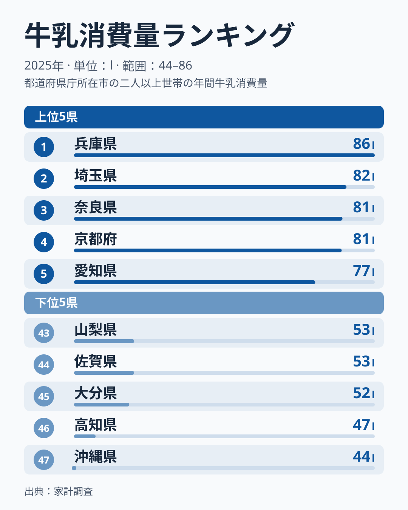
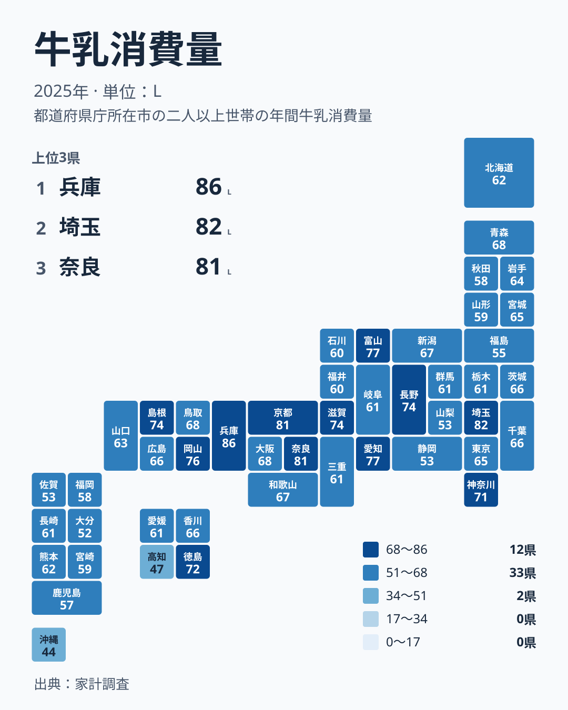

牛乳は、どの家庭の冷蔵庫にもありそうな身近な食品です。ところが家計調査の2025年の結果を見ると、都道府県によって購入量には大きな開きがあります。1位は兵庫県の85.52l、最下位の沖縄県は44.25lです。最大と最小を比べると、2倍近い差があります。

この記事では、牛乳消費量が多い地域と少ない地域の並びを確認し、食文化・気候・産地といった視点から、その差をどう考えられるかを整理します。データから言えることと、仮説にとどまることを分けて読んでいきます。

## 上位と下位を並べると見えるもの

まず、上位5県と下位5県を図で確認します。

<source-link href="/ranking/milk-consumption-quantity">牛乳消費量ランキングをもっと見る</source-link>

上位は、1位が兵庫県で85.52l、2位が埼玉県で81.64l、3位が奈良県で81.09l、4位が京都府で80.98l、5位が愛知県で77.35lです。5県の中には近畿の3府県が入っており、兵庫県、奈良県、京都府がそろって上位に並んでいます。一方で埼玉県は関東、愛知県は中部に属し、地方をまたいで高い値が現れています。

下位は、43位が山梨県で52.51l、44位が佐賀県で52.5l、45位が大分県で51.83l、46位が高知県で47.21l、47位が沖縄県で44.25lです。ここには中部、九州・沖縄、四国の県が混在しています。下位5県のうち、九州・沖縄は佐賀県、大分県、沖縄県の3県です。

上位の愛知県が77.35lなのに対し、下位の山梨県は52.51lです。上位5県と下位5県の間には、はっきりした断層があります。ただし、順位が一つ違うだけの差は小さいことも多く、中位は値が密集しています。例えば28位の三重県は61.44l、29位の群馬県は61.43l、30位の愛媛県は61.42l、31位の栃木県は61.41lと、ほぼ横並びです。順位の細かな上下よりも、上位と下位の大きな位置関係に注目するのが適切です。

> [!NOTE]
> ここでの値は、家計調査で把握された世帯あたりの牛乳の年間購入量(単位はリットル)です。正式な統計名は「牛乳消費量」で、家庭で購入した分が対象になります。外食や学校給食で飲む牛乳は含まれません。

## 近畿に多く、九州・沖縄に少ない地理分布

次に、47都道府県の分布を地図状に示した図を見ます。

近畿は、兵庫県が85.52lで1位、奈良県が81.09lで3位、京都府が80.98lで4位、滋賀県が73.77lで10位、大阪府が67.92lで14位、和歌山県が67.35lで16位、三重県が61.44lで28位です。7府県のうち上位10位以内に入るのは4府県で、地方としてのまとまりが強く表れています。

関東では、埼玉県が81.64lで2位と突出していますが、神奈川県は70.65lで12位、茨城県は66.18lで18位、千葉県は65.94lで19位、東京都は65.48lで22位です。群馬県は61.43lで29位、栃木県は61.41lで31位と、同じ関東でも幅があります。

九州・沖縄は全体に低めです。熊本県が61.72lで27位、長崎県が61.22lで33位、宮崎県が59.45lで36位、福岡県が58.13lで38位、鹿児島県が57.15lで40位、佐賀県が52.5lで44位、大分県が51.83lで45位、沖縄県が44.25lで47位です。8県のうち最も高い熊本県でも27位にとどまります。

四国も一様ではありません。徳島県は72.2lで11位と上位に入る一方、香川県は65.79lで21位、愛媛県は61.42lで30位、高知県は47.21lで46位です。同じ地方の中で、徳島県と高知県の間に大きな開きがあります。

> [!TIP]
> 地図を読むときは、色の濃い県だけでなく隣の県との差に注目してください。四国の徳島県と高知県のように、隣り合っていても値が大きく違う例があり、地方単位の傾向と県ごとの事情は分けて考える必要があります。

## 食文化・気候・産地から考える

酪農の盛んな県が上位に並ぶわけではない、というのがまず目に付く点です。酪農の代名詞である北海道は61.93lで26位、岩手県は64.46lで24位、栃木県は61.41lで31位と、いずれも中位にとどまります。ここで言えるのは「酪農県が上位にいない」という観察までです。生産量のデータは使っていないため、その理由までは今回の数字からは断定できません。

上位には、近畿の府県や大都市圏の周辺が目立ちます。兵庫県、京都府、奈良県、愛知県、埼玉県が並びます。スーパーなどで牛乳を日常的に買いやすい環境や、朝食でパンやシリアルと合わせる習慣、子どものいる世帯での飲用が購入量を押し上げている可能性はありますが、これはあくまで仮説で、今回のデータだけでは確かめられません。

下位の沖縄県は44.25lで最下位です。気候や主食の組み合わせの違いが背景にあるかもしれませんが、これも推測の域を出ません。高知県の47.21lや大分県の51.83lも低い水準で、これらの県で牛乳の代わりに何が飲まれているのかは、飲料全体の購入量を見なければ判断できません。

富山県が77.12lで6位、長野県が73.98lで8位、島根県が73.95lで9位に入っている点も見逃せません。近畿や大都市圏とは別の地域にも、高い値を示す県があることが分かります。

## 関連品目との対比

牛乳は乳製品の一部にすぎません。ヨーグルトやチーズなど他の品目の購入量は、今回の実データに含まれていないため、ここで牛乳との関係を述べることはできません。牛乳の位置づけを立体的に見るには、他の品目のランキングと並べて確認するのが近道です。

同じカテゴリの他の指標も合わせて見ると、地域の暮らしの違いがより見えてきます。[同じカテゴリの統計一覧](/category/economy)から、関連する家計の指標を探せます。

## 上位2県の暮らしを深掘りする

1位の兵庫県と2位の埼玉県は、地方も都市の性格も異なります。兵庫県は近畿に属し、埼玉県は関東に属します。それでも両県の値は85.52lと81.64lで、近い水準にあります。[兵庫県のデータ](/areas/28000)と[埼玉県のデータ](/areas/11000)を見比べると、牛乳の購入量を別の指標と結びつける手がかりが得られます。

埼玉県は、関東の中で突出しているのが特徴です。同じ関東の東京都は65.48lで22位、千葉県は65.94lで19位です。首都圏という括りだけでは、この並びは説明しにくいと言えます。理由として世帯の構成などが考えられますが、検証には世帯属性のデータが必要です。

> [!WARNING]
> 家計調査は標本調査で、県全体の実態を完全に表すものではありません。順位が近い県同士の差は誤差の範囲に収まることもあります。また、1世帯あたりの購入量は世帯人数の違いの影響を受けるため、一人あたりの飲用量とは異なります。

## 読み解きのまとめ

2025年の牛乳消費量は、兵庫県の85.52lから沖縄県の44.25lまで、大きな幅があります。上位には兵庫県、埼玉県、奈良県、京都府、愛知県が並び、近畿の存在感が際立ちます。下位には高知県、沖縄県をはじめ、九州・沖縄の県が多く並びます。

また、北海道は26位、岩手県は24位と、酪農県が上位に入っていないことも読み取れます。理由は今回のデータからは言えませんが、生産地だから家庭の購入量が多いとは限らない、という点は押さえておきたいところです。

数字を読むときは、順位だけでなく値の差も見ることが大切です。中位は値が密集していて、順位が一つ違うだけでは大きな意味を持たないことが多いからです。上位と下位という大きな枠組みで傾向をつかみ、気になる県は個別のデータで確かめてください。

## データについて

この記事で扱う値は、家計調査の2025年の結果にもとづく牛乳消費量で、単位はリットルです。家庭で購入された牛乳の量を示し、外食や給食などでの飲用は含みません。順位の小さな差は慎重に読む必要があります。
