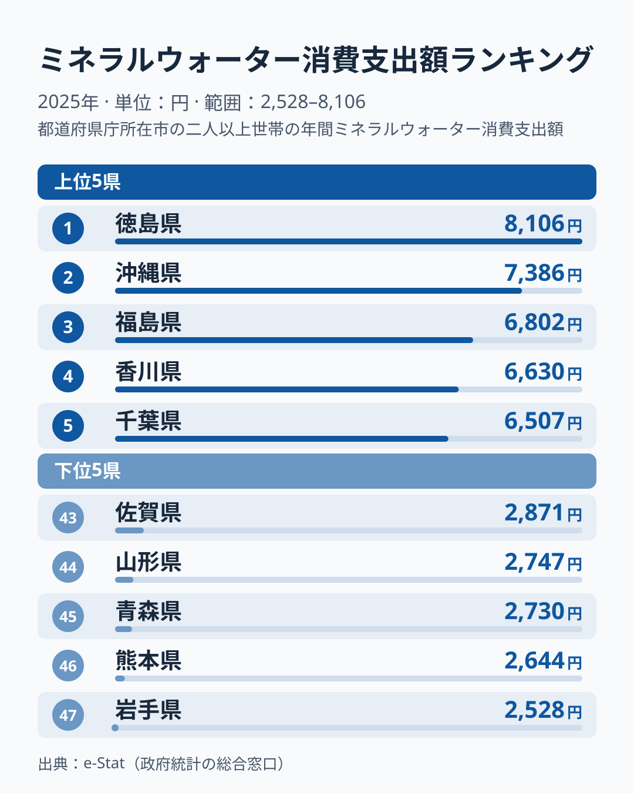

「水道水をそのまま飲むか、ペットボトルの水を買うか」——この日常の小さな選択は、住んでいる県によって大きく違います。2025年の家計調査によると、二人以上世帯が1年間に使うミネラルウォーター消費支出額は、トップの徳島県で**8,106円**、最下位の岩手県で**2,528円**でした。その差は**約3.2倍（正確には3.21倍）**にのぼります。

「西日本が多いのでは?」と問われそうなテーマですが、データを開けてみると話はそう単純ではありません。確かに徳島・沖縄・香川・長崎といった西日本の県が上位に並びます。ですが、それに加えて**千葉・埼玉・群馬・東京・神奈川という関東の5県が上位10県のうち半数を占めている**のです。逆に下位は東北（岩手・青森・山形）と九州の熊本・佐賀に固まっています。つまり「東西」ではなく、「水へのお金の使い方」を分ける別の構造が隠れています。

この記事では、47都道府県のミネラルウォーター支出を上位・下位の両面から並べ、どんな地域パターンが見えるのかを読み解いていきます。家計のなかでは小さな費目ですが、気候・水質・都市化という地域の性格が凝縮されており、自分の県の「水との付き合い方」を映す鏡になります。

> [!NOTE]
> このランキングは総務省「家計調査」をもとにした、都道府県庁所在市の二人以上世帯における1年間（2025年）のミネラルウォーター消費支出額（円）です。世帯あたりの金額であり、1人あたりの額や飲用量そのものではありません。世帯人数や単価の差も金額に含まれるため、「飲んでいる量の順位」と読み替えないよう注意してください。

## ミネラルウォーター支出が多い県と少ない県（上位5・下位5）

まず上位5県と下位5県を1枚の図で見比べてみましょう。左のカードが支出の多い上位5県、右のカードが少ない下位5県です。

1位は徳島県の8,106円、2位は沖縄県の7,386円で、約720円の差です。沖縄県は2023年・2024年も1位で、順位が安定して高い県です。亜熱帯の気候で水分補給の需要が大きいこと、そして硬度の高い地下水が多いとされ「飲み水は買うもの」という習慣が根づいていることが背景にあると考えられます。一方、徳島県は2024年に7位、2023年に32位、3位の福島県は2024年に32位で、2年前後で順位が大きく動いています。この2県が今年の上位に入った理由は、このデータだけでは特定できません。

目を引くのが、上位の顔ぶれに千葉・埼玉・群馬・東京・神奈川という関東勢が並んでいる点です。[仮説] **大都市圏では、宅配水やペットボトルの常備が広がりやすい**のかもしれません。ただし大阪は20位、愛知は15位、福岡は22位と他の大都市圏は中位で、群馬は大都市圏ではなく、都市化や所得だけでは説明できません。1位の徳島・4位の香川といった四国勢や、7位の長崎が混じることも含め、上位は「暑い・水を買う地域」と「都市圏で買い置きする地域」という、性質の異なるグループが同居していると見られます。

対する下位5県は、最下位の岩手県が2,528円、46位の熊本県が2,644円で、45位の青森県が2,730円、44位の山形県が2,747円、43位の佐賀県が2,871円と続きます。東北が3県を占めるいっぽう、九州の熊本・佐賀も最下位ゾーンに混じっている点が目を引きます。左右のカードに並ぶバーの長さの差が、そのまま「水にお金を使う県」と「使わない県」の落差を表しています。地域ごとの偏りについては、次の章で構造的に掘り下げます。

<source-link href="/ranking/mineral-water-consumption-expenditure">ミネラルウォーター消費支出額ランキングをもっと見る</source-link>

## 下位グループに東北が多い理由

下位ゾーンをもう少し広げて見ると、偏りが見えてきます。47位の岩手・45位の青森・44位の山形に加えて、宮城県が40位（3,129円）、秋田県が33位（3,629円）と、**東北では福島県が3位（6,802円）と大きな例外で、残る5県はいずれも33位以下に並んでいます**。山陰では鳥取県が42位（2,996円）で下位に入ります。寒冷地で夏の暑さによる需要が小さいうえ、良質な地下水や伏流水など、蛇口やくみ置きの水で十分にまかなえる環境が広がる地域だと考えられます。

ここで効いてくるのが「水に困っていない」という逆説です。支出が少ないことは「水が手に入りにくい」のではなく、むしろ「買わなくても良質な水がある」裏返しと読めます。東北が下位に多いのは、この見立てと整合します。支出の少なさをそのまま「水を飲まない」「節約志向」とだけ受け取ると、地域の実態を読み違えてしまいます。

> [!TIP]
> ランキングを「多い＝豊か / 少ない＝貧しい」と読むと外します。ミネラルウォーター支出が少ない県の多くは、地下水・湧水に恵まれ蛇口の水で足りる地域です。支出額は所得の多寡よりも、気候（暑さ）・水質・買い置き習慣の組み合わせを映していると考えて読むのが実態に近いといえます。

「西日本が多い」という見立てに対して、九州内の割れ方も示唆的です。長崎県は7位、沖縄は2位と上位に並ぶ一方、同じ九州の熊本は46位、佐賀は43位と最下位ゾーンにいます。**九州・西日本の内部ですら大きく割れている**ことから、東西や地方ブロックだけでは説明しきれないことがわかります。地方を一括りにせず、県ごとの気候と水環境を見る必要があります。

## 支出を押し上げる「暑さ」と「都市」の二重構造

上位・下位を並べて浮かび上がるのは、ミネラルウォーター支出を押し上げる要因が1つではないという構造です。ただし順位の動きが大きい県も多く、福島県は2023年に39位、2024年に32位、2025年に3位、長崎県は2023年に36位、2024年に44位、2025年に7位、熊本県は2023年に15位、2024年に24位、2025年に46位です。安定して上位にいる沖縄県と、2023年と2024年に2位で2025年に6位の埼玉県を手がかりに、それ以外は単年の振れを含むと見るのが安全です。整理すると、次の3点が見えてきます。

**沖縄は安定して高い県です。** 2025年は2位（7,386円）ですが、1位の徳島の8,106円との差は約1.1倍にとどまり、3位の福島の6,802円まで含めて上位3県が6,800円から8,100円の範囲に並んでいます。沖縄は2023年（8,079円）と2024年（7,668円）にいずれも1位で、気候・水質などが重なって3年連続で上位2位以内にいます。沖縄を1つの説明軸で語ることはできず、複数の要因が同時に働いている県だと考えられます。

**上位は「南国・四国」と「関東ベルト」の混成です。** 2位の沖縄・4位の香川・7位の長崎といった温暖な西日本勢と、5位の千葉・6位の埼玉・8位の群馬・9位の東京・10位の神奈川の関東勢が並びます。温暖な西日本勢には「暑さによる水分補給の需要」、関東勢には「都市圏の購買習慣と所得」という、異なる説明軸が同居していると考えられます。1位の徳島と3位の福島は、どちらの説明軸でも理由を特定できません。同じ高支出でも、その理由は地域によって違うのです。

**下位は東北に多く、福島は3位の例外で残る5県が33位以下です。** 下位5県のうち3県（47位の岩手・45位の青森・44位の山形）を東北が占め、40位の宮城も続きます。山陰では42位の鳥取が下位に入りますが、島根は29位です。寒冷で水分補給の需要が比較的小さく、かつ水源に恵まれた地域が「買わない」選択に向かいやすい、という見方と整合します。

> [!WARNING]
> ここで挙げた「気候」「水質」「所得」「習慣」はあくまで **[仮説]** です。家計調査の支出額だけでは因果は特定できません。たとえば購入単価の差や、調査年ごとの変動（徳島県が2023年32位・2024年7位・2025年1位と動いたほか、過去には2011年に埼玉県が7,920円まで跳ねた年もあります）も金額に影響します。確定的な原因とせず、傾向の読み解きとして受け取ってください。検証には飲用量や購入単価の別データとの突き合わせが必要です。

「なぜ西日本が多いのか?」という最初の問いに戻ると、より正確には**「温暖な地域と関東の都市圏で多く、寒冷で水源豊かな地域で少ない」**といえます（大阪・愛知など関東以外の大都市圏は中位です）。東西の軸ではなく、気候と都市化の二重構造で見るのが実態に近いのです。あなたの県が上位・下位どちらにあっても、その背景には「暑さ」「水質」「買い置き習慣」のいずれかが効いていると読み解けます。

## まとめ

- **トップは徳島県の8,106円** で、2位の沖縄県の7,386円とは約720円の僅差です。
- **最下位は岩手県の2,528円** で、トップとの差は**約3.2倍（3.21倍）**でした。
- 上位は徳島・沖縄・香川・長崎などの西日本に、千葉・埼玉・群馬・東京・神奈川の関東勢が混在しています。
- 下位は岩手・青森・山形の東北に多く、46位の熊本・43位の佐賀のように九州内でも大きく割れています。
- 支出を左右するのは「東西」ではなく、**暑さ（需要）・都市化（習慣と所得）・水源環境**の組み合わせと読めます。
- 食まわりの地域差をさらに見たい方は、[食料費支出のランキング](/ranking/food-expenditure-total)や[経済カテゴリ](/category/economy)も合わせてご覧ください。

## データについて

総務省統計局「家計調査」（2025年）。都道府県庁所在市の二人以上世帯における1年間のミネラルウォーター消費支出額を、政府統計ポータル e-Stat 経由で整備・集計しています。2023〜2024年の順位への言及は、同じ指標の過去年の値によります。
