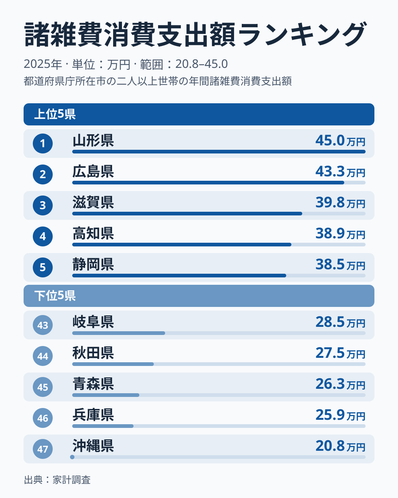
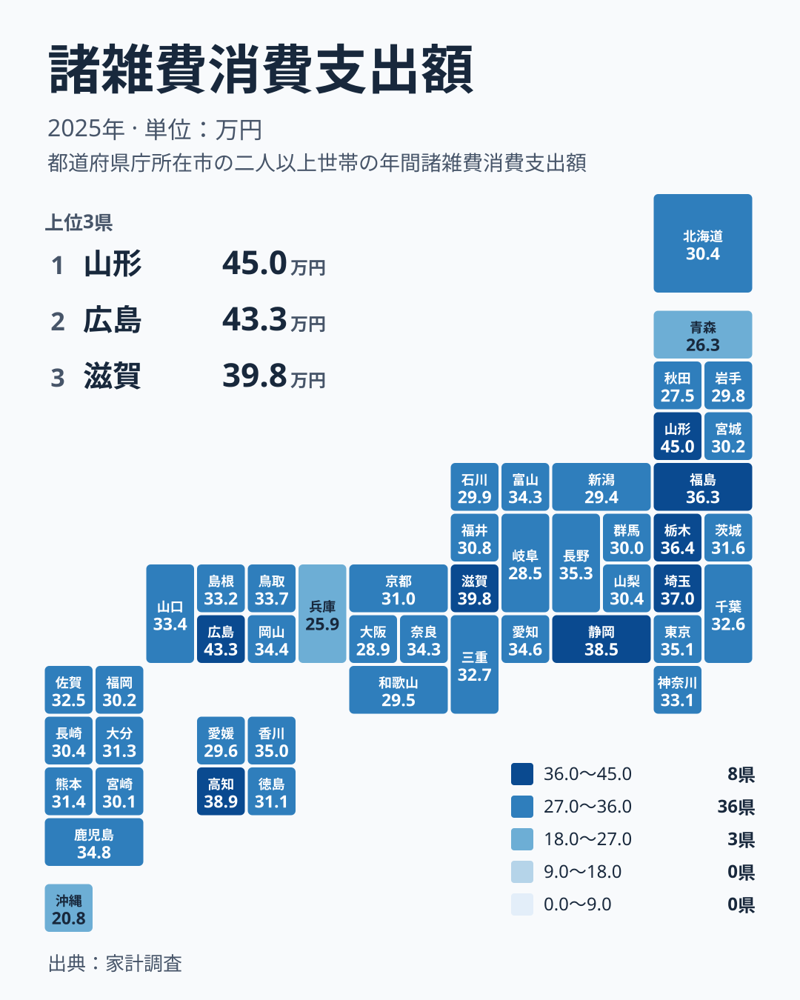

「諸雑費」と聞いても、何に使うお金なのかピンとこない方は多いのではないでしょうか。食費や住居費のように目立つ項目ではありませんが、家計の中では見逃せない存在です。2025年の家計調査では、この諸雑費への支出に都道府県で大きな開きが出ました。

1位の山形県は450,409円、47位の沖縄県は208,057円です。山形県は沖縄県の2倍を超えています。この記事では、この開きが47都道府県でどのように分かれているかを確かめます。あわせて、この数字から言えることと言えないことを整理します。

## 諸雑費とは何か、まず定義を確認します

> [!NOTE]
> 家計調査でいう諸雑費は、食料・住居・光熱・衣類・交通通信・教養娯楽などの分類に入らない支出をまとめた区分です。こづかい、交際費、仕送り金などが含まれます。1世帯あたりの年間支出額（円）であり、個人の支出額ではありません。

この区分は「その他」の受け皿です。そのため、1つの原因で増減するのではなく、複数の暮らしの要素が混ざった結果として数字が出ます。食費や光熱費の地域差と違い、数字の中身が見えにくい点がこの指標の特徴です。

背景として、仕送り金や交際費の地域差には、大学の立地と若い世代の県外進学、世帯の所得水準、親族や地域との付き合いの濃さ、世帯の人数構成などが関わると指摘されています。ただし、今回使うのは内訳のない合計額です。どの要因がどれだけ効いているかは、この数字からは断定できません。

## 上位と下位の顔ぶれを見ます

まず、上位5県と下位5県を図で確認します。

<source-link href="/ranking/miscellaneous-group-consumption-expenditure">諸雑費への支出ランキングをもっと見る</source-link>

上位は、1位が山形県の450,409円、2位が広島県の432,781円、3位が滋賀県の398,081円、4位が高知県の389,127円、5位が静岡県の384,856円です。1位の山形県と2位の広島県の差より、2位の広島県と3位の滋賀県の差の方が大きくなっています。山形県と広島県が上位の頭を形成し、3位との間に上位5県の中で最も大きな段差があります。

下位は、43位が岐阜県の284,816円、44位が秋田県の275,469円、45位が青森県の263,489円、46位が兵庫県の258,713円、47位が沖縄県の208,057円です。47位の沖縄県は46位の兵庫県からも離れており、最下位は際立って低い水準です。

上位にも下位にも北海道・東北の県が入っている点が目を引きます。山形県が1位である一方、秋田県は44位、青森県は45位です。同じ北海道・東北でも、諸雑費への支出は一様ではありません。

詳しいデータは [山形県のデータ](/areas/06000) や [広島県のデータ](/areas/34000) でも確認できます。

## 地理的に見ると、規則性は見えるでしょうか

次に、地理的な分布を図で見ます。

地図を見ても、「東日本が高い」「西日本が低い」といった単純な線は引けません。上位5県は、北海道・東北の山形県、中国の広島県、近畿の滋賀県、四国の高知県、中部の静岡県と、5つの異なる地方にまたがっています。

関東では、埼玉県が6位で370,048円、栃木県が7位で364,499円、東京都が10位で350,910円と上位に並びます。一方で神奈川県は20位の331,024円、千葉県は22位の325,818円です。同じ関東でも順位に幅があります。

近畿はさらに差が大きくなっています。滋賀県は3位ですが、京都府は28位の309,537円、大阪府は42位の289,421円、兵庫県は46位の258,713円です。同じ地方の中に、上位から下位までが入っています。

> [!TIP]
> 地図で色が濃い県を見つけたら、隣の県も必ず確認してください。この指標は隣り合う県でも大きく違います。「地域の気質」と一言でまとめず、県ごとに見るのが読み解きのコツです。

## 都市部が高いとは限りません

大都市の家計は何でも高い、というイメージがあるかもしれません。しかし、この指標では必ずしもそうなっていません。東京都は10位の350,910円で上位ですが、1位ではありません。愛知県は13位の345,964円です。大阪府は42位の289,421円、兵庫県は46位の258,713円で、下位に近い位置です。

一方で、広島県は2位の432,781円、高知県は4位の389,127円です。いわゆる大都市圏に限らない県が、上位に入っています。「都会だから高い」という単純な図式では、この並びを説明できません。

> [!WARNING]
> この統計は標本調査の結果で、調査世帯数が限られるため年ごとの変動が出やすい指標です。14位から16位、30位から35位のように値が近い県の順位差には、ほとんど意味がありません。注目すべきは上位グループと下位グループの違いです。また、諸雑費は内訳が混在しているため、高い県で「交際費が多い」のか「こづかいが多い」のかは、この数字だけでは判断できません。

## 生活への含意:この平均値をどう読むか

山形県の450,409円と沖縄県の208,057円の開きは、「その他」の支出が県によってこれだけ違うことを示しています。ただし、これが豊かさの差なのか、暮らし方の違いなのかは、この数字だけでは判断できません。所得や内訳のデータが、ここにはないためです。

この指標で特に注意したいのは、中身が混ざっている点です。こづかい、交際費、仕送り金は、世帯の事情によって大きく増減します。たとえば子どもが県外の大学に進学すれば仕送り金が増えますし、冠婚葬祭が続く年は交際費が膨らみます。こうした項目が合算されるため、県の平均値は自分の家計の目安になりにくい数字です。「自分の世帯は全国のどの位置か」を知るために使うには、向いていません。

また、県平均の差から、個々の世帯の支出は予測できません。山形県に住めば諸雑費が増える、沖縄県に住めば減る、といった読み方はできません。平均値の差は、県全体の世帯の傾向を比べる材料にとどまります。

[同じカテゴリの統計一覧](/category/economy)では、他の家計関連の統計も見られます。食料や住居、教育といった個別の支出と並べると、各県の家計の特徴がより立体的に見えてきます。

## 山形と沖縄の開きから見えること

山形県は450,409円、沖縄県は208,057円です。実データで比べられるのは、この最大と最小の比、つまり山形県が沖縄県の2倍を超えているという点です。この比は、47位の沖縄県が際立って低いことでも大きくなっています。46位の兵庫県は258,713円で、沖縄県との間にも差があります。

では、なぜ山形県が高く沖縄県が低いのでしょうか。調査材料では、大学の地域偏在、世帯所得、親族や地域との付き合い、世帯構成といった要因が挙げられています。ただし、これらは一般的な説明であり、今回の数字から山形県と沖縄県それぞれに当てはまると確かめたものではありません。理由を特定するには、仕送り金や交際費などの内訳を示した統計が必要です。

## データについて

この記事で使ったのは、家計調査の諸雑費消費支出額です。2025年の1世帯あたりの年間支出額（円）で、全国47都道府県の値が公表されています。記事中の金額と順位は、すべてこの統計の値をそのまま使っています。

最大の山形県は450,409円、最小の沖縄県は208,057円で、山形県は沖縄県の2倍を超えています。この比較は、実データにある最大値と最小値の関係を述べたものです。

諸雑費の内訳には、こづかい、交際費、仕送り金などが含まれますが、この統計は内訳ごとの値を示していません。そのため、順位の背景として挙げた要因は、あくまで一般的に指摘されている見方です。

## まとめ:開きの大きさと、読み方の限界

諸雑費への支出は、山形県が450,409円で1位、広島県が432,781円で2位、滋賀県が398,081円で3位でした。下位は兵庫県が258,713円で46位、沖縄県が208,057円で47位です。同じ国内でも、「その他」の家計にこれだけの開きがあります。

この開きが豊かさの差かどうかは、この数字だけでは判断できません。大学の立地、世帯の構成、地域の付き合いなど、複数の要素が混ざった合計額だからです。順位の小さな違いに一喜一憂せず、上位と下位の大きな開きがあることを確かめる材料として使ってください。

気になる県があれば、各県のページで他の統計もあわせて確認してみてください。
