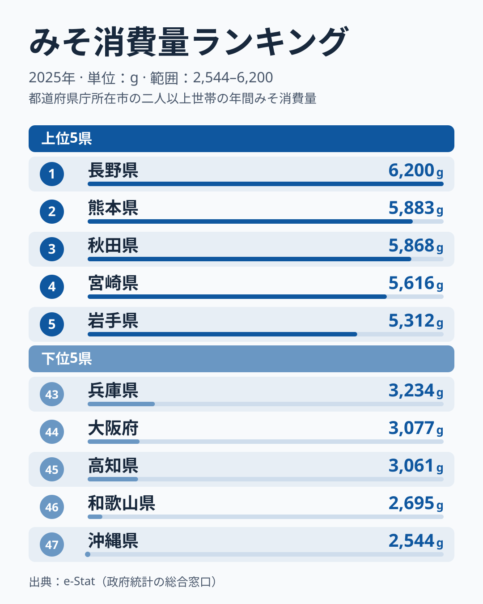
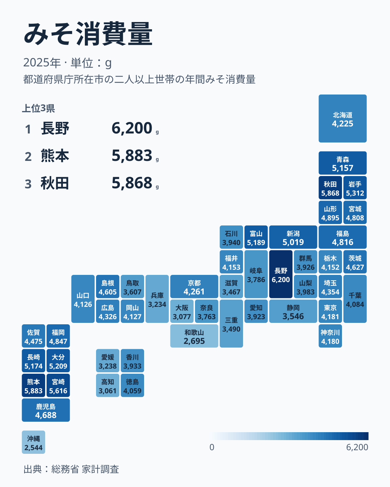

「みそ汁は日本の国民食」とよく言われますが、都道府県別の年間みそ消費量を見ると、その実態は一様ではありません。2025年の家計調査データでは、1位の長野県の6,200gと最下位の沖縄県の2,544gの差は2.4倍にのぼります。しかも上位10県のうち3県を東北、4県を九州が占める一方、下位10県のうち6県を近畿と四国が占めるという、はっきりした地域の偏りが見えてきます。

この記事では、みそ消費量の都道府県ランキングを2025年の最新データで確認しながら、なぜ長野が1位なのか、なぜ近畿・四国で消費が少ないのかを、気候・産地・食文化の違いから読み解きます。

## 2025年ランキング——上位5県と下位5県

**上位5県**は1位の長野が6,200g、2位の熊本が5,883g、3位の秋田が5,868g、4位の宮崎が5,616g、5位の岩手が5,312gの順です。長野は2位の熊本と比べて300g以上多いものの、2位から10位までは5,019gから5,883gの範囲に9県が並び、上位は接戦です。

**下位5県**は43位の兵庫が3,234g、44位の大阪が3,077g、45位の高知が3,061g、46位の和歌山が2,695g、47位の沖縄が2,544gと、近畿・四国・沖縄が並びます。最下位の沖縄は1位の長野の4割程度の消費量しかなく、同じ国内でここまで差が開くこと自体が驚きです。

> [!NOTE]
> データは総務省「家計調査」（2025年）による、**都道府県庁所在市の二人以上世帯**の年間みそ消費量（g）です。県内でも農村部と都市部で食生活が異なるため、県庁所在市（例: 那覇市・長野市）の傾向であり、県全体を代表する値ではない点に注意してください。値は1世帯あたりの購入数量で、世帯人員の違いは調整していません。家計調査は標本調査のため年ごとの揺れがあり、2位の熊本の5,883gと3位の秋田の5,868gは15g差、東京と神奈川は1g差のように、近接する順位の差は標本の揺れの範囲に収まると考えられます。

<source-link href="/ranking/miso-consumption-quantity">みそ消費量ランキングの全47都道府県を見る</source-link>

上位を見ると、1位の長野と10位の新潟という中部山岳・日本海側の県に加え、3位の秋田・5位の岩手・9位の青森の東北、2位の熊本・4位の宮崎・6位の大分・8位の長崎の九州が並びます。単純に「寒い地域が多い」わけではなく、産地であることと食文化が両方効いていると考えられます。

## 地図で見る地域分布——東北・信越が濃く、近畿・四国が薄い

地図にすると、東北6県がすべて14位以内（秋田3位・岩手5位・青森9位・山形11位・福島13位・宮城14位）に入り、東北が濃い色でまとまっているのがわかります。対照的に、近畿（京都21位を除き奈良37位・滋賀41位・兵庫43位・大阪44位・和歌山46位）、東海（三重40位・静岡39位）、四国（愛媛42位・高知45位）は薄い色が連続し、近畿から東海・四国にかけて「みそ消費が少ない」県が連なっています（三重は東海として数えています）。九州の7県がすべて18位以内に入る一方、沖縄だけが最下位の47位で対照的です。

この地域差の背景には、後述する信州みそ・東北の発酵食文化と、近畿のだし文化という、根の異なる食のアイデンティティの違いがあると考えられます。ただし単年の値なので、細かな順位差には標本の揺れが含まれます。

## なぜ長野が1位なのか——信州みそという「地場産業×食習慣」

長野県が1位である大きな要因は、**信州みそを擁する全国有数のみその産地**であることです。味噌の醸造業者数・生産量ともに全国トップクラスとされ、地元では味噌が日常の調味料として深く根付いています。長野県内では「みそ蔵見学」や味噌を使った郷土料理（おやきの具など）も多く、味噌が食卓の中心にある食文化が形成されてきました。[長野県の地域特性](/areas/20000)では、地域の産業構造を確認できます。

もう一つの要因が気候です。長野は内陸性の盆地気候で寒暖差が大きく、冬は厳しい寒さになります。かつてみそは保存食・発酵食品として、寒冷地の長い冬を越すための貴重なたんぱく源・塩分補給源でした。現代でも味噌汁を毎日の食卓に欠かさない習慣が、他県より濃く残っていると考えられます。

> [!TIP]
> 味噌には米みそ（信州みそ・仙台みそ）、豆みそ（愛知の八丁みそ）、麦みそ（九州・四国の一部）など地域ごとに種類が異なります。消費「量」だけを見ると気づきにくいですが、原料や色・塩分濃度の違いで一食あたりの使用量にも差が出るため、量の格差がそのまま「みそ汁を食べる頻度の格差」と一致するとは限りません。

## 東北勢と九州勢が上位に並ぶ背景

上位10県のうち3位の秋田・5位の岩手・9位の青森の3県を東北が占めています（山形11位・福島13位・宮城14位も上位15県以内です）。東北は日本でも有数の豪雪・寒冷地帯であり、長野と同様に**冬の保存食・発酵食品文化**が根強く残ってきた地域です。

東北の伝統的な食卓では、みそ汁に加えて「なめこ汁」のようにみそを使う郷土の味が多く、朝食にみそ汁が欠かせない家庭が多いとされています。また、東北は稲作地帯であると同時に大豆の産地でもあり、地元産の大豆を使った自家製みそ（手前みそ）の文化が農村部を中心に残っていることも、消費量を押し上げる一因と考えられます。

一方で同じ東北でも、5位の岩手の5,312gと14位の宮城の4,808gでは500g以上の差があり、東北全体が一様に高いわけではない点には注意が必要です。都市化の進み方の違いが影響している可能性があります。

今回の上位でもう一つ目立つのが九州です。2位の熊本・4位の宮崎・6位の大分・8位の長崎の4県が上位10県に入り、12位の福岡・15位の鹿児島も上位15県以内に収まっています。九州各県が高い理由は、このデータだけでは特定できません。九州には麦みそなど米みそとは異なるみその文化があるとされますが、同じ麦みそ地域とされる愛媛は42位で、麦みそだけでは説明できません。

## なぜ近畿・四国が下位に多いのか——だし文化との関係

下位10県を見ると、近畿（和歌山46位・大阪44位・兵庫43位・滋賀41位）・四国（高知45位・愛媛42位）で6県を占めます。この地域は**昆布だし・かつおだしを基本とする「だし文化」**が強く、うどん・そば・煮物などの味付けの主役がみそではなく醤油とだしになっている食習慣が背景にあると考えられます。ただし[しょうゆ消費量ランキング](/ranking/soy-sauce-consumption-quantity)で確かめると、和歌山は1位の6,165mlと突出する一方、兵庫は45位、大阪は46位、高知は21位で、みそが少ない県で醤油が多いとは限りません。

うどん県として知られる香川は33位で、下位10県には入らないものの中位より下です。だしと醤油の味付けが食文化の中心にあるとされます。45位の高知はかつおのたたきなど魚食文化が濃く、みそ以外の味付けが食卓に多い可能性があります。[高知県の地域特性](/areas/39000)を見ると、カツオ漁業が地域産業の象徴であることがよくわかります。46位の和歌山は醤油（湯浅は醤油発祥の地とされます）の産地であり、醤油の消費量が1位であることが、みそ消費の少なさにつながっている可能性があります。

> [!WARNING]
> この記事の「なぜ」の説明は、気候・産地・食文化からの合理的な推測であり、家計調査データそのものが原因を証明しているわけではありません。個別県の因果関係を厳密に特定するには、より詳細な食生活調査との突き合わせが必要です。

43位の兵庫・44位の大阪といった近畿の都市部が下位に沈んでいるのも特徴的です。外食・中食比率が高い都市部では、家庭でみそ汁を作る頻度自体が下がりやすく、地方の食文化に加えて都市化の影響も重なっている可能性があります。ただし23位の東京や24位の神奈川は中位にとどまり、都市化だけでは説明しきれません。

最下位の沖縄が2,544gと低い理由は、このデータだけでは特定できません。みそ汁を日常的に飲む習慣の強さが本土と異なる可能性はありますが、これは仮説であり、食生活調査との突き合わせが必要です。

## まとめ

- **1位は長野県の6,200g**：信州みそを擁する全国有数の産地であり、寒冷な内陸気候と発酵食文化が消費量を押し上げていると考えられます。ただし2位以下との差は小さく、上位は接戦です。
- **最下位は沖縄県の2,544g**：1位の長野との差は2.4倍。理由はこのデータだけでは特定できません。
- **東北（秋田・岩手・青森）と九州（熊本・宮崎・大分・長崎）が上位10県に入る**：東北は寒冷地の保存食文化と大豆産地としての伝統が共通の背景と考えられます。
- **近畿・四国は下位に多い**：下位10県のうち近畿4県・四国2県を占めます。昆布・かつおの「だし文化」との関係が考えられますが、醤油の消費量が多いとは限りません。
- **同じ地方の中でも県によって差がある**（近畿の京都は21位、東北の宮城は14位）ため、地方全体で一括りにできない食文化の細かな違いも読み取れます。

みそ消費量の地域差は、単なる好みではなく、産地・気候・郷土料理・都市化度合いが折り重なった結果と考えられます。[経済カテゴリの指標一覧](/category/economy)では、他の食品消費に関する地域差も確認できます。

## データについて

総務省「家計調査」（2025年）をもとに、都道府県庁所在市の二人以上世帯における年間みそ消費量（g）を集計。e-Stat 経由で整備。調査対象は各都道府県庁所在市の世帯であり、県全体の消費傾向を保証するものではありません。
